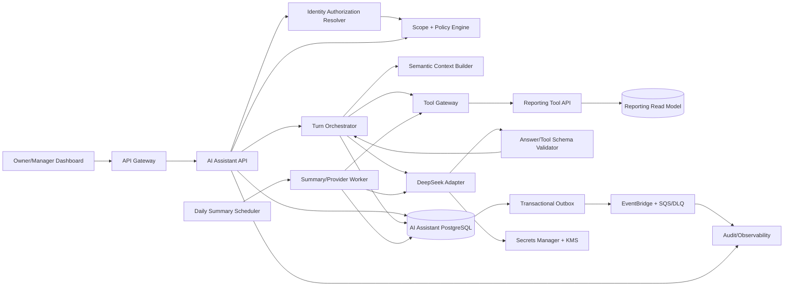
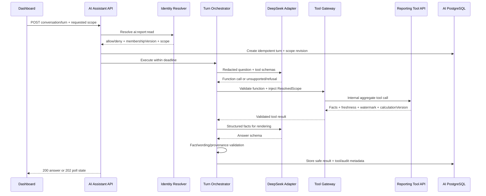
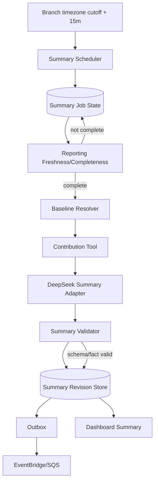
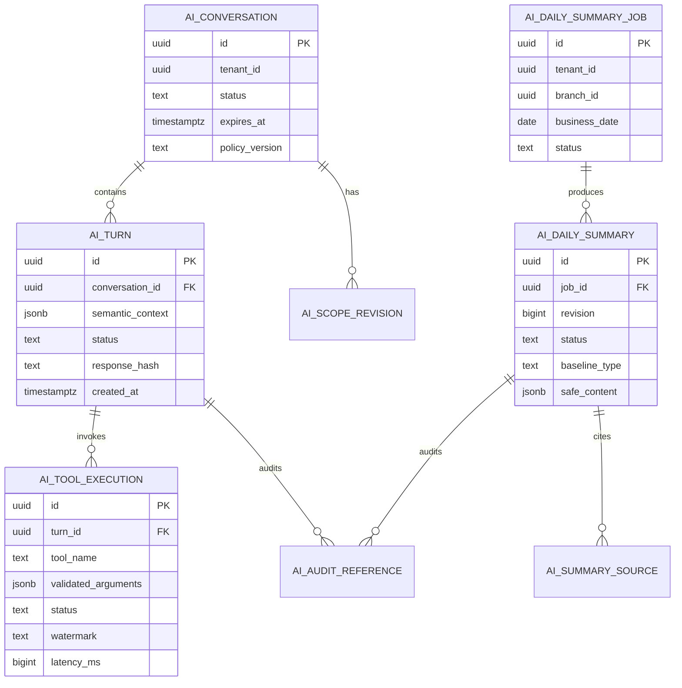

Started at: 2026/10/13 00:00:00
Finished at: 2026/10/13 00:00:00
Total time: 0 minutes
---

# Module 9 — Trợ lý AI cho chủ quán: Kiến trúc hệ thống (Architecture)

**Ngày:** 2026-10-13  
**Trạng thái:** Approved  
**Yêu cầu nghiệp vụ:** [AI Assistant Requirements](./2026-10-13-requirements.md)  
**Đánh giá yêu cầu:** [AI Assistant Requirements Review](./2026-10-13-requirements-review.md)  
**Biểu đồ tuần tự:** [AI Assistant Sequences](./2026-10-13-sequence-diagrams.adoc)  
**Kiến trúc tổng thể nền tảng:** [POS Platform Architecture](../pos-platform/2026-10-12-architecture.md)

## 1. Tóm tắt kiến trúc (Architecture Summary)

AI Assistant là một dịch vụ có ranh giới rõ ràng (bounded service) chỉ phục vụ thao tác đọc (read-only), đóng vai trò trung gian giữa giao diện bảng điều khiển của Chủ quán / Quản lý (Owner/Manager Dashboard) và mô hình đọc (read model) của Reporting. Kiến trúc tận dụng cơ chế DeepSeek Function Calling nhưng phân định rạch ròi ba thẩm quyền:

1. **Identity quyết định phạm vi người gọi (Caller Scope)** — AI Assistant bắt buộc phải gọi quyết định phân quyền trực tuyến (authorization decision) từ Identity tại mỗi phiên hội thoại hoặc lượt hỏi được bảo vệ.
2. **Reporting quyết định dữ kiện và chỉ số số liệu (Facts/Metrics)** — Cổng công cụ (Tool Gateway) chỉ được phép gọi các công cụ Reporting nằm trong danh mục trắng (allowlist); tuyệt đối không cho phép sinh hoặc thực thi câu lệnh SQL tùy ý.
3. **AI Assistant quyết định cách hiển thị và trạng thái (Presentation/State)** — Quản lý phiên hội thoại, vòng lặp công cụ (tool-loop), bộ xác thực (validator), nhật ký kiểm toán đã che giấu thông tin nhạy cảm (redacted audit) và các phiên bản hiệu chỉnh của tóm tắt ngày (daily-summary revision) hoàn toàn thuộc sở hữu của dịch vụ này.

Luồng chat P1 thực thi đồng bộ trong thời hạn tối đa 10 giây nếu điều kiện cho phép; các lượt hỏi vượt quá hạn chót sẽ tự động chuyển sang mã phản hồi `202 + polling`. Luồng tóm tắt ngày P2 chạy bất đồng bộ theo giờ chốt ca/ngày kinh doanh của từng chi nhánh, kiên nhẫn chờ mốc kiểm chứng tính đầy đủ (completeness watermark) của Reporting, sau đó mới gọi DeepSeek để diễn đạt các yếu tố đóng góp doanh thu (contribution facts).

## 2. Kiến trúc thành phần (Component Architecture)



### Trách nhiệm của các thành phần (Component Responsibilities)

| Thành phần | Trách nhiệm | Điều cấm kỵ (Must not do) |
|---|---|---|
| Dashboard | Gửi câu hỏi/phạm vi phân quyền, hiển thị trạng thái câu trả lời/nguồn gốc/độ tươi mới, poll lượt hỏi trong hàng đợi | Tự quyết định phân quyền hoặc hiển thị dữ liệu thô từ công cụ như một sự thật hiển nhiên đáng tin |
| AI Assistant API | Ranh giới xác thực, tính lũy quyền, endpoint quản lý phiên/lượt hỏi, đóng gói phong bì phản hồi | Đọc trực tiếp cơ sở dữ liệu của Order/Payment/Catalog hoặc thay đổi trạng thái domain |
| Identity Resolver | Cung cấp vai trò/tenant/quyền chi nhánh hiện tại và phiên bản tư cách thành viên | Trả dữ liệu thành viên thô nằm ngoài giao ước quyết định |
| Scope + Policy Engine | Tạo `ResolvedScope` bất biến, kiểm tra khoảng thời gian/khoảng cách/vai trò, thực thi chính sách ngân sách/công cụ | Tin tưởng ID chi nhánh do client/LLM truyền vào làm thẩm quyền |
| Turn Orchestrator | Điều phối vòng lặp gọi mô hình/công cụ có ranh giới, kiểm soát timeout, thử lại, tổng hợp câu trả lời cấu trúc | Thực thi các hàm tùy ý hoặc chấp nhận văn bản mô tả của mô hình như sự thật hiển nhiên |
| Semantic Context Builder | Chuyển đổi các lượt hỏi trước thành ngữ cảnh ngữ nghĩa có cấu trúc (ý định/thời gian/số liệu) không kèm transcript thô | Mặc định lưu trữ hoặc chuyển tiếp transcript thô ra ngoài |
| Tool Gateway | Quản lý danh mục trắng, schema đối số, tiêm phạm vi quyền (scope injection), kiểm tra che dữ liệu nhạy cảm, timeout/ngắt mạch | Tiếp nhận câu lệnh SQL, tên bảng hoặc biểu thức lọc từ LLM |
| Reporting Tool API | Thực thi các truy vấn tổng hợp/báo cáo chuẩn và trả về mốc kiểm chứng watermark/phiên bản tính toán | Tiếp nhận câu truy vấn tùy ý hoặc suy diễn thẩm quyền phân quyền từ câu từ của người gọi |
| DeepSeek Adapter | Ánh xạ yêu cầu/phản hồi của nhà cung cấp LLM, kiểm soát token/ngân sách/timeout, sử dụng khóa bí mật an toàn | Gửi dữ liệu PII/ID thô hoặc tự ý chuyển sang nhà cung cấp LLM khác mà không báo trước |
| Validator | Xác thực định dạng JSON hàm và schema câu trả lời cuối cùng/tính nhất quán với số liệu cấu trúc | Cố gắng sửa lỗi vô hạn hoặc tự bịa ra các giá trị bị thiếu |
| Summary Worker | Xử lý các tác vụ chốt ca/tính đầy đủ, mốc so sánh/đóng góp/hiển thị/phiên bản tóm tắt | Phát hành dữ liệu chưa đầy đủ như một bản tóm tắt chính thức |
| AI PostgreSQL | Lưu trữ trạng thái an toàn, phả hệ phiên bản, tham chiếu chính sách, trạng thái lũy quyền/outbox | Biến thành một kho lưu trữ số liệu Reporting thứ hai |
| Outbox / Event Bus | Đảm bảo chuyển phát các sự kiện kiểm toán/tóm tắt/lượt hỏi theo cơ chế ít nhất một lần (at-least-once) | Mang theo nội dung prompt, thông tin PII hoặc khóa bí mật |
| Audit / Observability | Lưu trữ bằng chứng kiểm toán đã che giấu, chỉ số đo lường, dấu vết phân tán, tín hiệu an ninh | Ghi nhật ký prompt thô hoặc payload thô gửi nhà cung cấp |

## 3. Phân quyền và ranh giới tin cậy (Authorization & Trust Boundaries)

### 3.1 Đường đi của yêu cầu (Request Path)

```text
JWT từ Dashboard
  → API Gateway kiểm tra sơ bộ
  → AI Assistant API xác thực tính hợp lệ của JWT + correlation ID
  → Identity /internal/v1/authorization-decisions (thẩm quyền trực tuyến)
  → Scope + Policy Engine tạo ra ResolvedScope
  → Mọi lệnh gọi từ Tool Gateway đều mang theo scope tin cậy + membershipVersion
  → Reporting áp dụng điều kiện lọc tenant/chi nhánh tại tầng repository
```

Việc gọi quyết định trực tuyến từ Identity là bắt buộc vì thao tác thu hồi quyền thành viên hoặc thay đổi vai trò phải có hiệu lực ngay ở request tiếp theo. Sự kiện `AuthorizationContextChanged.v1` có thể vô hiệu hóa bộ nhớ cache tối ưu nhưng không thể kéo dài quyền truy cập sau khi đã bị thu hồi.

`ResolvedScope` là bất biến cho một lượt hỏi (turn):

```json
{
  "scopeType": "BRANCH",
  "tenantId": "tenant-uuid",
  "branchIds": ["branch-uuid"],
  "subjectId": "opaque-user-id",
  "role": "MANAGER",
  "permission": "ai:report:read",
  "membershipVersion": 12,
  "authorizationVersion": 7,
  "resolvedAt": "2026-10-13T08:00:00Z"
}
```

Phạm vi toàn chuỗi của Chủ quán được khai báo tường minh là `scopeType=TENANT`; không chấp nhận ký tự đại diện (wildcard) cho chi nhánh. Dịch vụ Reporting chỉ tin tưởng ngữ cảnh đã được ký số hoặc xác thực qua định danh tải công việc (workload identity) và vẫn bắt buộc kiểm tra điều kiện lọc tenant/chi nhánh tại ranh giới ứng dụng/repository của mình.

### 3.2 Ranh giới tin cậy với mô hình LLM (LLM Trust Boundary)

Tin nhắn người dùng, phản hồi từ mô hình và các dữ kiện lấy về từ công cụ đều bị coi là dữ liệu không đáng tin cậy. Mô hình LLM chỉ nhận:

- chính sách hệ thống cố định cùng phiên bản chính sách mô hình/prompt;
- tóm tắt vai trò/phạm vi quyền an toàn, không chứa chi tiết thành viên thừa thãi;
- ngữ cảnh ngữ nghĩa có cấu trúc kế thừa từ các lượt hỏi trước;
- câu hỏi hiện tại của người dùng sau khi đã qua khâu che giấu dữ liệu PII và kiểm tra kích thước;
- schema của các công cụ cho phép mà không làm lộ chi tiết câu lệnh SQL hoặc cấu trúc bảng nội bộ;
- kết quả tổng hợp từ công cụ sau khi đã qua kiểm tra schema và rà soát PII.

Mô hình LLM tuyệt đối không bao giờ nhận chuỗi JWT, số điện thoại, tên khách hàng, ID đơn hàng/thanh toán thô, khóa bí mật, câu lệnh SQL, cấu trúc cơ sở dữ liệu, prompt ẩn hoặc danh sách chi nhánh không bị hạn chế quyền.

## 4. Kiến trúc luồng chat P1 (P1 Chat Architecture)

### 4.1 Luồng trạng thái lượt hỏi (Turn State Flow)



### 4.2 Vòng lặp công cụ có ranh giới (Bounded Tool Loop)

1. Tạo prompt ban đầu và gọi DeepSeek kèm theo danh mục công cụ cho phép.
2. Nếu mô hình không gọi công cụ, xác thực trường hợp `UNSUPPORTED`/yêu cầu làm rõ hoặc schema câu trả lời an toàn.
3. Nếu có lệnh gọi hàm, kiểm tra tính hợp lệ của tên hàm/đối số đối chiếu với registry; phạm vi quyền và chính sách sẽ do máy chủ tự tiêm vào.
4. Thực thi tối đa 3 lần gọi công cụ trong một lượt hỏi, mặc định chạy tuần tự; chỉ cho phép gọi song song khi các công cụ độc lập hoàn toàn và chia sẻ chính xác cùng phạm vi/khoảng thời gian.
5. Chỉ gửi ngược lại các dữ kiện tổng hợp đã được kiểm tra hợp lệ về DeepSeek để sinh câu văn trả lời.
6. Xác thực câu trả lời cuối cùng đối chiếu với schema và các dữ kiện cấu trúc; cho phép tối đa 1 lần sửa/sinh lại có giới hạn.
7. Khi có sự mâu thuẫn số liệu hoặc mô hình không khả dụng, trả về số liệu cấu trúc kèm thông báo lỗi; tuyệt đối không tự bịa ra con số.

### 4.3 Thực thi đồng bộ / bất đồng bộ (Sync/Async Execution)

- API ưu tiên thực thi đồng bộ trong giới hạn thời hạn chót 10 giây cho mỗi lượt hỏi.
- Nếu worker xử lý công cụ hoặc nhà cung cấp LLM không thể hoàn thành an toàn trước hạn chót, transaction sẽ ghi nhận trạng thái turn là `QUEUED` hoặc `RUNNING` và trả về mã `202` kèm đường dẫn polling kết quả.
- Phản hồi polling chỉ thể hiện trạng thái, nguồn gốc và lỗi; không bao giờ đánh dấu câu văn chưa hoàn chỉnh là kết quả cuối cùng.
- Phiên bản MVP không áp dụng cơ chế SSE/WebSocket cho phản hồi của trợ lý.
- Bộ đôi `Idempotency-Key` và `clientTurnId` đảm bảo việc client gửi lại yêu cầu sẽ luôn nhận được cùng một lượt hỏi/kết quả duy nhất.

## 5. Kiến trúc Tool Gateway và Reporting (Tool Gateway & Reporting Architecture)

### 5.1 Danh mục công cụ (Tool Registry)

Danh mục công cụ là cấu hình có phiên bản do hệ thống quản trị, không phải danh sách do LLM tự kiểm soát:

| Công cụ | Đơn vị sở hữu trong Reporting | Khoảng thời gian tối đa | Dữ liệu đầu ra |
|---|---|---:|---|
| `getSalesSummary` | Bản chiếu doanh số ngày / chi nhánh | 31 ngày kinh doanh | Số đơn, doanh thu gross/net/VAT, chênh lệch, độ tươi mới |
| `getOrderCount` | Bản chiếu đơn hàng đã thanh toán | 31 ngày kinh doanh | Số lượng đơn / chênh lệch / độ tươi mới |
| `getAverageOrderValue` | Bản chiếu/công thức AOV chuẩn | 31 ngày kinh doanh | AOV / mẫu số / chênh lệch / phiên bản làm tròn |
| `getTopItems` | Bản chiếu món bán chạy | 31 ngày kinh doanh | Nhãn an toàn món, số lượng, doanh thu, thứ hạng |
| `compareBranches` | Bản chiếu doanh số chi nhánh | 31 ngày kinh doanh | Số liệu tổng hợp các chi nhánh được phân quyền |
| `getHourlySales` | Bản chiếu theo khung giờ | 7 ngày kinh doanh | Khung giờ và số liệu tổng hợp |
| `getContributionDrivers` | Bản chiếu phân tích đóng góp | Một ngày kinh doanh + mốc so sánh | Các yếu tố đóng góp có dấu / ngưỡng trọng yếu / phiên bản |

Bộ mô tả công cụ chứa JSON Schema, quyền hạn yêu cầu, khoảng thời gian/kích thước tối đa, thời gian chờ timeout, chính sách độ tươi mới, phân loại PII, phiên bản tính toán và đơn vị sở hữu. Tool Gateway sẽ từ chối ngay lập tức các phiên bản không rõ nguồn gốc hoặc đã bị vô hiệu hóa trước khi gọi sang Reporting.

### 5.2 Nguồn chân lý của Reporting (Reporting Source of Truth)

Dịch vụ Reporting sở hữu:

- `sales_daily` và `sales_by_branch` xây dựng từ các sự kiện chuẩn `OrderPaid.v1` kết hợp với các sự kiện điều chỉnh/hoàn tiền đã được duyệt;
- `sales_by_hour` phân khóa theo ngày kinh doanh của chi nhánh / giờ / múi giờ;
- `top_items` trích xuất từ các bản chụp dòng hóa đơn đã thanh toán;
- `aov` tính theo công thức `netMinor / paidOrderCount` kèm quy tắc làm tròn tất định;
- `contribution_drivers` kèm chênh lệch có dấu, tỷ lệ đóng góp, ngưỡng trọng yếu và phiên bản tính toán.

Các lệnh gọi công cụ tương tác sẽ đọc đồng bộ các bản chiếu này. Sự kiện `ReportProjectionWatermarkUpdated.v1` và `BusinessDayReady.v1` đóng vai trò là gợi ý bất đồng bộ cho bộ lập lịch hoặc bộ nhớ đệm; chúng không thay thế truy vấn kiểm tra độ tươi mới tại thời điểm thực tế.

AI Assistant tuyệt đối không tự tính toán doanh thu trực tiếp từ `OrderPaid`. Điều này ngăn ngừa triệt để hiện tượng sai lệch chỉ số và các câu truy vấn phân tích liên dịch vụ phức tạp.

### 5.3 Độ tươi mới và tính đầy đủ (Freshness & Completeness)

Reporting trả về cấu trúc phong bì chất lượng dữ liệu `DataQualityEnvelope`:

```json
{
  "freshnessStatus": "FRESH",
  "completenessStatus": "COMPLETE",
  "projectionVersion": 901,
  "watermark": "reporting:branch:42:v901",
  "lastUpdatedAt": "2026-10-13T08:00:00Z",
  "missingSources": [],
  "calculationVersion": "sales-metric-v2"
}
```

Trạng thái `STALE` có thể được hiển thị kèm theo cảnh báo cho các truy vấn tương tác nếu chính sách cho phép. Trạng thái `INCOMPLETE` sẽ chặn việc phát hành bản tóm tắt ngày và chuyển tác vụ sang trạng thái chờ hoặc dữ liệu đến muộn tường minh.

## 6. Kiến trúc tóm tắt ngày P2 (P2 Daily-Summary Architecture)



### 6.1 Chính sách chốt ca và tính đầy đủ (Cutoff & Completeness Policy)

- Bộ lập lịch tạo một tác vụ cho mỗi bộ `(tenant, branch, businessDate, summaryPolicyVersion)` tại thời điểm giờ chốt ca + 15 phút.
- Worker chờ tối đa 30 phút để mốc kiểm chứng tính đầy đủ của Reporting hoàn tất.
- Nếu dữ liệu đã đủ, xác định mốc so sánh cùng thứ của tuần trước; nếu không có, chuyển sang phương án phụ tính trung bình 7 ngày kinh doanh tương đương; nếu vẫn thiếu, chuyển sang `NO_BASELINE`.
- Nếu có dữ kiện phát sinh muộn làm thay đổi mốc kiểm chứng nguồn sau khi đã phát hành, Reporting sẽ phát ra cập nhật độ tươi mới hoặc bộ lập lịch tiến hành thăm dò; worker sẽ tạo ra một phiên bản tóm tắt hiệu chỉnh bất biến mới.
- Phiên bản cũ chuyển sang trạng thái `SUPERSEDED`; tuyệt đối không bị ghi đè vật lý, và sự kiện phát ra sẽ mang theo thông tin phả hệ phiên bản cũ/mới.

### 6.2 Phân tích đóng góp và chuẩn mực ngôn từ (Contribution & Wording)

Reporting chịu trách nhiệm tính toán các yếu tố đóng góp có dấu. AI Assistant chuyển giao các dữ kiện cấu trúc này sang DeepSeek. Một bộ xác thực tất định sẽ kiểm tra:

- mọi con số xuất hiện trong văn bản đều phải khớp với dữ kiện cấu trúc hoặc quy tắc làm tròn cho phép;
- các nhãn mốc so sánh / khoảng thời gian / phạm vi chi nhánh phải hiện diện đầy đủ;
- các từ ngữ khẳng định nguyên nhân tuyệt đối bị từ chối trừ khi chính sách quy định rõ cờ bằng chứng nhân quả `causalEvidence=false` chỉ cho phép dùng các cụm từ “liên quan” hoặc “đóng góp”; mẫu văn bản mặc định luôn là phi nhân quả;
- các dữ kiện bị thiếu hoặc còn mơ hồ bắt buộc phải được đưa vào phần lưu ý và giới hạn (caveats).

## 7. Kiến trúc dữ liệu (Data Architecture)

### 7.1 Quyền sở hữu dữ liệu trong AI Assistant PostgreSQL



Tin nhắn thô của người dùng, prompt thô hay văn bản thô từ LLM không phải là các cột bắt buộc. Các trường `semantic_context` và `safe_content` chỉ chứa các giá trị có cấu trúc đã qua che giấu dữ liệu nhạy cảm. Mọi cột trong cơ sở dữ liệu đều bắt buộc phải có câu lệnh `COMMENT ON COLUMN` trong tài liệu Contracts.

### 7.2 Chính sách đánh chỉ mục và thời hạn lưu trữ (Index & Retention Policy)

- `ai_conversations`: `(tenant_id, created_at DESC)`, chỉ mục dọn dẹp theo trạng thái và thời hạn hết hạn.
- `ai_turns`: `(tenant_id, conversation_id, created_at DESC)`, chỉ mục duy nhất `(tenant_id, conversation_id, client_turn_id)`.
- `ai_tool_executions`: `(tenant_id, turn_id, created_at)`, chỉ mục đo lường công cụ / trạng thái / độ trễ.
- `ai_daily_summary_jobs`: chỉ mục duy nhất `(tenant_id, branch_id, business_date, policy_version)` và chỉ mục phân bổ tác vụ worker `(status, next_attempt_at)`.
- `ai_daily_summaries`: chỉ mục duy nhất cho phiên bản đang hoạt động theo `(tenant_id, branch_id, business_date, policy_version)`; chỉ mục phả hệ theo mốc kiểm chứng nguồn watermark.
- Đối với các bảng lưu trữ khối lượng lớn như lượt hỏi, thực thi công cụ và kiểm toán, có thể áp dụng cơ chế phân vùng theo khoảng thời gian tháng (RANGE partitions) sau khi đo đạc thực tế; mặc định trong MVP chưa cần phân vùng.
- Thời hạn lưu trữ mặc định (TTL) cho ngữ cảnh ngữ nghĩa là 90 ngày; thời gian lưu trữ prompt thô bằng 0; các tham chiếu kiểm toán đã che giấu tuân theo chính sách kiểm toán/pháp lý của hệ thống cha. Cơ chế xóa/tombstone phải đảm bảo ngăn chặn việc tái sử dụng cho các mô hình trong tương lai.

## 8. Độ tin cậy và phục hồi sự cố (Reliability & Recovery)

### 8.1 Tính lũy quyền (Idempotency)

- Khóa lệnh hỏi đáp công khai: `(tenant, conversation, clientTurnId)`.
- Khóa tác vụ tóm tắt ngày: `(tenant, branch, businessDate, policyVersion)`.
- Khóa chạy lại tóm tắt bao gồm mốc kiểm chứng nguồn và số hiệu phiên bản.
- Việc thử lại cuộc gọi sang nhà cung cấp LLM không tạo ra lượt hỏi hay bản tóm tắt mới; máy trạng thái cục bộ tự quản lý định danh lần thử.
- Bảng Outbox phát ra duy nhất một sự kiện cho mỗi lần chuyển trạng thái đã commit thành công; sự kiện gửi lặp phía nhận sẽ được bỏ qua an toàn dựa vào ID sự kiện.

### 8.2 Hành vi ứng phó sự cố (Failure Behavior)

| Sự cố | Hành vi ứng phó |
|---|---|
| Identity không khả dụng | Đóng ngắt an toàn (fail-closed); không gọi công cụ; trả về lỗi an toàn `authorization_unavailable`. |
| Reporting không khả dụng | Chỉ trả về `PARTIAL` nếu dữ kiện có sẵn đã đủ và chính sách cho phép; nếu không trả về `SERVICE_UNAVAILABLE`; tuyệt đối không bịa câu trả lời. |
| Dữ liệu Reporting bị chậm/chưa đủ | Cảnh báo rõ ràng; tác vụ tóm tắt ngày chuyển sang chờ; truy vấn tương tác tuân theo chính sách độ tươi mới của công cụ. |
| DeepSeek quá thời gian chờ (timeout) | Thử lại có giới hạn 1 lần nếu còn ngân sách, sau đó trả về dữ liệu cấu trúc hoặc thông báo lỗi. |
| Lệnh gọi công cụ không hợp lệ | Từ chối ngay trước khi gọi Reporting; ghi nhật ký kiểm toán vi phạm chính sách; không lặp lại mô hình quá số lần cho phép. |
| Văn bản mô tả cuối cùng không hợp lệ | Cho phép sửa 1 lần; nếu vẫn lỗi thì trả về dữ liệu cấu trúc hoặc lỗi nhà cung cấp. |
| Cơ sở dữ liệu AI lỗi trước khi commit | Trả về lỗi an toàn; không gọi nhà cung cấp ra ngoài khi chưa xác lập định danh turn bền vững. |
| Outbox / Message Broker bị gián đoạn | Trạng thái cục bộ vẫn được commit an toàn; worker phát sự kiện sẽ thử lại hoặc đưa vào DLQ; Dashboard vẫn đọc được trạng thái từ DB. |
| Dữ kiện Reporting bổ sung muộn | Tạo phiên bản tóm tắt hiệu chỉnh bất biến mới và phát sự kiện superseded. |

### 8.3 Bộ ngắt mạch và quản lý ngân sách (Circuit Breakers & Budgets)

- Adapter kết nối nhà cung cấp LLM có timeout, giới hạn 1 lần thử lại, bộ ngắt mạch tự động và ngân sách chi phí theo từng ngày của mỗi tenant.
- Tool Gateway áp dụng timeout riêng cho từng công cụ và giới hạn số lượng cuộc gọi đồng thời.
- Scheduler và Worker quản lý tác vụ thông qua cơ chế khóa thuê (lease) có heartbeat và số lần thử lại giới hạn; các tác vụ lỗi độc hại (poison jobs) sẽ bị đưa vào hàng đợi thư chết (DLQ) kèm mã lỗi an toàn.
- Đội ngũ vận hành chỉ có thể kích hoạt phát lại tác vụ tóm tắt hoặc sự kiện công cụ khi có phạm vi phân quyền rõ ràng và khóa lũy quyền hợp lệ.

## 9. An ninh, quyền riêng tư và khả năng quan sát (Security, Privacy & Observability)

### An ninh và quyền riêng tư (Security & Privacy)

- Xác thực Cognito/JWT tại tầng biên; quyết định phân quyền trực tuyến từ Identity cho mọi lượt hỏi được bảo vệ.
- Các cuộc gọi nội bộ sang Reporting hoặc nhà cung cấp sử dụng định danh tải công việc (workload identity) hoặc mTLS.
- Phạm vi phân quyền là ngữ cảnh đáng tin cậy đã ký số kết hợp với điều kiện lọc tại repository; client và LLM không có khả năng mở rộng phạm vi này.
- Thao tác che giấu dữ liệu nhạy cảm gửi sang nhà cung cấp được thực thi tại Tool Gateway và Prompt Builder; tuyệt đối không ghi prompt thô ra log.
- AWS Secrets Manager và KMS quản lý khóa API của nhà cung cấp và các tham chiếu khóa mã hóa; không lưu khóa bí mật trong DB, prompt hay sự kiện.
- Bằng chứng kiểm toán ghi nhận tác nhân, phạm vi, công cụ, chính sách và trạng thái nhưng không lưu câu hỏi thô, phản hồi thô hay PII.
- Các endpoint thay đổi dữ liệu (mutation) hoàn toàn không hiện diện trong danh mục công cụ và chính sách mạng.

### Chỉ số, nhật ký và dấu vết phân tán (Metrics, Logs & Traces)

- Chỉ số đo lường (Metrics): lượt hỏi/ý định/trạng thái, cuộc gọi công cụ/trạng thái/độ trễ, độ trễ nhà cung cấp/token/chi phí, từ chối phạm vi, từ chối tấn công prompt injection, độ tươi mới, độ trễ tóm tắt/trạng thái, độ sâu outbox/DLQ.
- Nhật ký (Logs): chỉ chứa các ID an toàn, loại/số lượng phạm vi, ý định, công cụ/trạng thái, mốc kiểm chứng watermark, phiên bản chính sách/mô hình và thời gian thực thi.
- Dấu vết phân tán (Traces): Dashboard → API → Identity → Tool Gateway → Reporting/DeepSeek → DB/Outbox; các thuộc tính span đều được che giấu dữ liệu nhạy cảm.
- Cảnh báo (Alerts): ngắt mạch nhà cung cấp mở / ngân sách cạn kiệt, tỷ lệ từ chối phân quyền tăng đột biến, hành vi cố tình truy cập chéo phạm vi, công cụ bị timeout, báo cáo bị chậm/chưa đủ, tóm tắt bị trễ hạn, hàng đợi DLQ tăng và sự cố che giấu dữ liệu.

## 10. Triển khai và mở rộng quy mô (Deployment & Scaling)

| Khối lượng công việc | Phương án triển khai và mở rộng quy mô |
|---|---|
| AI Assistant API | Dịch vụ ECS Fargate hoàn toàn phi trạng thái (stateless); tự động mở rộng theo độ trễ yêu cầu và số kết nối đồng thời; không lưu trạng thái phân quyền trong bộ nhớ. |
| Tool Gateway / Orchestrator | Ban đầu triển khai chung trong cùng ranh giới dịch vụ; cách ly luồng xử lý và kết nối đồng thời của worker với luồng tiếp nhận request API. |
| Summary Worker | Tác vụ/worker ECS tách biệt riêng; mở rộng quy mô dựa trên số lượng tác vụ trong hàng đợi và độ trễ phản hồi của nhà cung cấp LLM. |
| Scheduler | Bộ kích hoạt lập lịch bền vững; đảm bảo tính lũy quyền khi tạo tác vụ, áp dụng ngữ nghĩa lãnh đạo duy nhất (single-leader/claim). |
| PostgreSQL | Cơ sở dữ liệu và schema chuyên biệt cho AI Assistant, mã hóa khi lưu trữ (at-rest), quản lý migration bằng Flyway, sao lưu và phục hồi định kỳ. |
| Reporting | Dịch vụ và cơ sở dữ liệu read-model tách biệt sẵn có; không dùng chung thông tin đăng nhập database. |
| EventBridge / SQS | Kênh định tuyến, hàng đợi và DLQ chuyên biệt cho sự kiện của trợ lý; đảm bảo cơ chế ít nhất một lần kèm khử trùng lặp tại inbox. |
| DeepSeek | Kết nối ra ngoài thông qua ranh giới mạng và quản lý khóa bí mật có kiểm soát; tuyệt đối không cho phép Dashboard gọi thẳng sang nhà cung cấp. |

## 11. Các quyết định kiến trúc cốt lõi (Architecture Decisions / ADRs)

| Mã ADR | Quyết định | Các phương án thay thế bị từ chối | Lý do lựa chọn |
|---|---|---|---|
| ADR-AI-01 | Sử dụng LLM kết hợp gọi hàm trong danh mục trắng (Allowlisted Function Calling) trên các công cụ Reporting | Tự động sinh câu lệnh SQL trực tiếp; sử dụng agent tự do tổng quát | Đảm bảo tuyệt đối an toàn thông tin, giữ vững quyền sở hữu số liệu và kiểm toán tất định. |
| ADR-AI-02 | Reporting tiếp tục giữ vai trò là chủ sở hữu số liệu và nguồn chân lý duy nhất | Tự tính toán lại các chỉ số trong AI Assistant | Ngăn chặn sai lệch dữ liệu giữa Dashboard và Trợ lý ảo, tránh các câu lệnh join phân tích liên dịch vụ. |
| ADR-AI-03 | Thực hiện quyết định phân quyền Identity trực tuyến cho mỗi lượt hỏi được bảo vệ | Tin tưởng vào claim vai trò/chi nhánh tĩnh trong token hoặc cache lâu dài | Việc thu hồi quyền phải có tác dụng ngay lập tức ở request kế tiếp. |
| ADR-AI-04 | Lưu trữ ngữ cảnh ngữ nghĩa có cấu trúc, mặc định không lưu transcript thô | Lưu trữ toàn bộ lịch sử trò chuyện và prompt thô | Giảm thiểu tối đa việc lưu trữ dữ liệu PII và duy trì phạm vi phân quyền ổn định cho câu hỏi tiếp nối. |
| ADR-AI-05 | Ưu tiên chat đồng bộ kèm phương án dự phòng chuyển sang `202 + polling` có ranh giới | Áp dụng SSE/WebSocket ngay từ đầu | Đơn giản hóa kiến trúc cho giai đoạn MVP và xác lập trạng thái kết thúc rõ ràng. |
| ADR-AI-06 | Xây dựng pipeline xử lý tóm tắt ngày bất đồng bộ theo giờ chốt ca / tính đầy đủ / phiên bản hiệu chỉnh | Sinh báo cáo cố định lúc nửa đêm một cách ngầm định | Dữ liệu phát sinh muộn và độ tươi mới của báo cáo đòi hỏi phải có phả hệ và cơ chế hiệu chỉnh rõ ràng. |
| ADR-AI-07 | Không áp dụng phương án chuyển đổi nhà cung cấp dự phòng trong MVP | Tự động chuyển đổi ngầm giữa nhiều nhà cung cấp LLM | Đảm bảo tính minh bạch về luồng dữ liệu ra ngoài, kiểm soát chi phí và ranh giới đánh giá chất lượng ổn định. |

## 12. Cổng xác nhận biểu đồ tuần tự (Sequence Diagram Confirmation Gate)

Repository hiện chưa có mã nguồn triển khai thực tế của AI Assistant và Reporting, do đó các biểu đồ tuần tự sẽ đóng vai trò là **biểu đồ thiết kế dựa trên giao ước (contract-driven design diagrams)** chứ không phải là bản vết thực thi lúc runtime. Đề xuất kết xuất L1/L2 cho các luồng nghiệp vụ sau:

1. Chat P1 — Chủ quán / Quản lý hợp lệ gửi câu hỏi doanh số và nhận được câu trả lời kèm dữ liệu từ công cụ.
2. Từ chối phạm vi / Tấn công Prompt Injection P1 — Quản lý yêu cầu số liệu chi nhánh chưa được phân quyền hoặc yêu cầu tiết lộ mã SQL/prompt hệ thống.
3. Xử lý sự cố công cụ / Nhà cung cấp P1 — Reporting bị chậm/không khả dụng hoặc DeepSeek bị timeout sẽ trả về trạng thái cấu trúc an toàn.
4. Tóm tắt ngày P2 — Chốt ca → kiểm tra tính đầy đủ → xác định mốc so sánh / đóng góp → DeepSeek → phát hành tóm tắt.
5. Xử lý dữ kiện muộn / Chạy lại P2 — Mốc kiểm chứng nguồn thay đổi, phiên bản hiệu chỉnh mới thay thế phiên bản cũ.
6. Thu hồi phân quyền — Tư cách thành viên bị thay đổi giữa các lượt hỏi và request kế tiếp bị chặn đóng an toàn.

### Danh sách thành phần L1 đề xuất (Proposed L1 Participants)

| Thành phần | Phân loại | Vai trò |
|---|---|---|
| Owner/Manager Dashboard | Client | Gửi câu hỏi chat/phạm vi phân quyền và hiển thị trạng thái |
| AI Assistant Service | Service | Xử lý API / điều phối / chính sách / xác thực kết quả |
| Identity Access | Service | Đưa ra quyết định phân quyền trực tuyến |
| Reporting Service | Service | Cung cấp công cụ tổng hợp chuẩn / mô hình đọc |
| DeepSeek Provider | External Provider | Lập kế hoạch gọi hàm / sinh văn bản tự nhiên |
| AI Assistant PostgreSQL | Database | Lưu trữ trạng thái hội thoại / công cụ / tóm tắt |
| EventBridge / SQS / DLQ | Message Broker | Đảm bảo chuyển phát các sự kiện kiểm toán / tóm tắt |
| Audit / Observability | Consumer | Tiếp nhận bằng chứng kiểm toán đã che giấu / metrics / traces |
| Scheduler / Worker | Worker | Lập lịch chốt ca P2 / thực thi tác vụ tóm tắt |

### Danh sách thành phần L2 đề xuất (Proposed L2 Participants)

Bao gồm: `AI Assistant Controller`, `ScopePolicyEngine`, `TurnOrchestrator`, `ToolGateway`, `DeepSeekAdapter`, `SummaryWorker`, `AI Assistant PostgreSQL`, cùng các ranh giới adapter kết nối ra ngoài đại diện cho Reporting, Identity và Outbox.

**Yêu cầu trước khi sinh biểu đồ:** Người dùng xác nhận danh sách các luồng và thành phần nêu trên. Sau khi được xác nhận, sử dụng kỹ năng `sequence-diagram` để tạo tệp PlantUML `.adoc` cho L1/L2.

## 13. Cổng phê duyệt kiến trúc (Architecture Approval Gate)

- **Trạng thái hiện tại:** Approved.
- **Yêu cầu trước khi vào Contracts:** Phê duyệt toàn bộ các quyết định về thành phần, dữ liệu, độ tin cậy và xác nhận danh sách luồng/thành phần của biểu đồ tuần tự.
- **Quy tắc triển khai:** Không viết mã nguồn ứng dụng trực tiếp; tài liệu Giao ước (Contracts) bắt buộc phải cụ thể hóa toàn bộ OpenAPI công khai/nội bộ, schema công cụ Reporting, chính sách nhà cung cấp, schema sự kiện và các file migration PostgreSQL.
