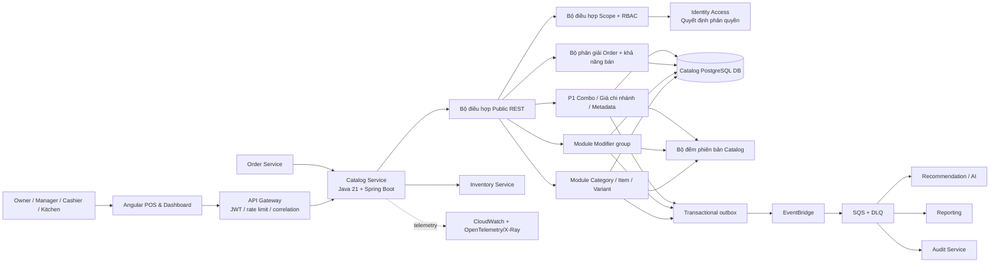
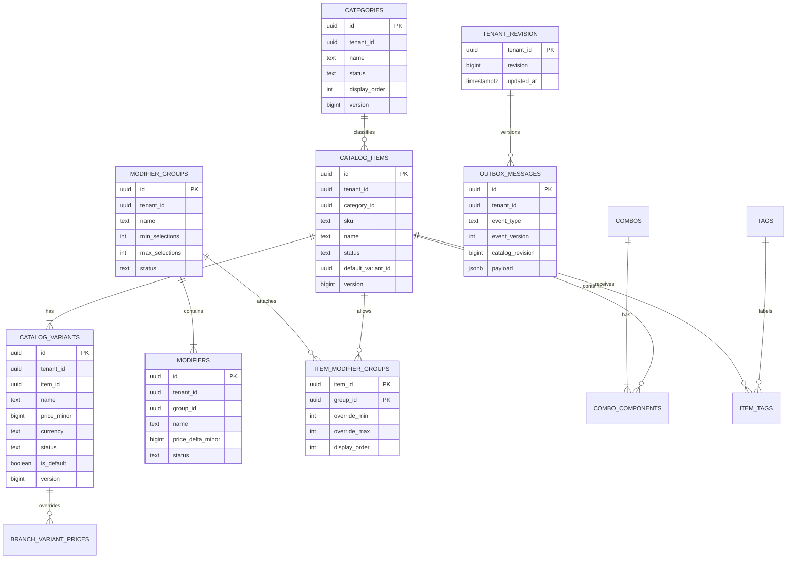

Started at: 2026/10/12 16:28:00
Finished at: 2026/10/12 16:28:00
Total time: 0 minutes
---

# Kiến trúc Hệ thống: Catalog Service (Dịch vụ Danh mục Món ăn)

## Nguồn tài liệu

- [Tầm nhìn (Vision)](./2026-10-12-vision.md)
- [Đánh giá Tầm nhìn (Vision review)](./2026-10-12-vision-review.md)
- [Yêu cầu Kỹ thuật (Requirements)](./2026-10-12-requirements.md)
- [Kiến trúc Nền tảng POS](../pos-platform/2026-10-12-architecture.md)
- [Hợp đồng Nền tảng POS](../pos-platform/2026-10-12-contracts.md)
- [Hợp đồng Identity & Access](../identity-access/2026-10-12-contracts.md)

## Mục tiêu Kiến trúc

1. Duy trì Catalog là nguồn chân lý duy nhất (single source of truth) cho cấu trúc thực đơn, giá bán và trạng thái sẵn sàng của thực đơn theo tenant.
2. Đảm bảo mọi thao tác đọc/ghi đều theo phạm vi tenant và mọi thao tác đọc theo chi nhánh đều nhận biết phân quyền xác thực.
3. Phân giải một bộ lựa chọn món/biến thể/modifier nhất quán cho Order Service mà không cần truy vấn trực tiếp cơ sở dữ liệu chéo service.
4. Bảo toàn các tham chiếu lịch sử của Order và Inventory thông qua cơ chế lưu trữ mềm (soft archive) và các ID bất biến.
5. Xuất bản các sự kiện có phiên bản bền vững (durable versioned events) cho Recommendation, Reporting, Audit và vô hiệu hóa bộ nhớ đệm (cache invalidation).
6. Giữ cho P0 đơn giản và ổn định trong khi vẫn thiết lập các điểm mở rộng rõ ràng cho combo, giá theo chi nhánh và metadata AI.

## Kiến trúc Thành phần

### Tổng quan Hệ thống



### Các Thành phần và Ranh giới

| Thành phần | Trách nhiệm | Công nghệ | Giao tiếp |
|---|---|---|---|
| Angular POS/Dashboard | Form quản trị danh mục, đọc menu POS, chọn category/modifier và các màn hình P1 | Angular | HTTPS REST/OpenAPI |
| API Gateway | TLS, định tuyến, xác thực JWT thô, giới hạn tốc độ (rate limiting) và lan truyền correlation ID | AWS API Gateway hoặc gateway cha | HTTPS |
| Bộ điều hợp Public REST | Xác thực DTO, ngữ cảnh auth của endpoint, phân trang, ETag và ánh xạ lỗi | Ranh giới Spring Boot MVC | `/api/v1/catalog` |
| Bộ điều hợp Scope/RBAC | Gọi Identity Access với user subject đã xác thực và tenant/branch/permission được yêu cầu | Spring Security + client nội bộ | Private `/internal/v1/authorization-decisions` |
| Module Category | Vòng đời danh mục phẳng, gán danh mục cho món và thứ tự hiển thị | Spring domain/application module | PostgreSQL + outbox |
| Module Item/Variant | Vòng đời món ăn, SKU, biến thể mặc định, giá và khả năng bán toàn cầu | Spring domain/application module | PostgreSQL + revision + outbox |
| Module Modifier | Các nhóm tái sử dụng, tùy chọn, liên kết món và quy tắc lựa chọn hiệu lực | Spring domain/application module | PostgreSQL + revision + outbox |
| Bộ phân giải Order | Xác thực hàng loạt nhất quán các lựa chọn món/biến thể/modifier và giá hiện tại | Spring application module | Private REST tới Order; giao dịch đọc PostgreSQL |
| Chính sách bán hàng | Kết hợp trạng thái Catalog; cung cấp mã lý do/phiên bản cho Order và consumers | Domain policy module | Được sử dụng bởi public read và resolver |
| Module mở rộng P1 | Combo, ghi đè giá biến thể theo chi nhánh, mô tả/tag và sự kiện metadata | Các module Spring bật/tắt bằng feature flag | REST + PostgreSQL + outbox |
| Bộ đếm phiên bản Catalog | Phiên bản tăng đơn điệu theo tenant phục vụ ETag, vết snapshot và vô hiệu hóa sự kiện | Hàng/giao dịch PostgreSQL | Phụ thuộc domain nội bộ |
| Transactional outbox | Ghi sự kiện trong cùng giao dịch với trạng thái catalog | Worker PostgreSQL | EventBridge/SQS |
| Catalog PostgreSQL DB | Sở hữu toàn bộ bảng Catalog; không service nào khác được đọc trực tiếp | PostgreSQL/Aurora; local PostgreSQL | Mạng nội bộ / thông tin xác thực riêng |
| Order Service | Sở hữu trạng thái đơn hàng và các ảnh chụp (snapshots) dòng đơn hàng bất biến | Service cha hiện có | Private REST/events |
| Inventory Service | Sở hữu công thức pha chế và tình trạng tồn kho sẵn có | Service cha hiện có | Private REST/events |
| Recommendation/Reporting/Audit | Tiêu thụ các sự kiện Catalog và tự xây dựng bảng chiếu (projection) riêng | Các service cha hiện có | EventBridge/SQS |
| Khả năng quan sát | Log có cấu trúc, metrics và traces kèm các trường tenant/correlation | OpenTelemetry + CloudWatch/X-Ray | SDK/agent |

### Ranh giới Trách nhiệm của Service

Catalog sở hữu:

- Danh mục, món ăn, biến thể, giá cơ sở của biến thể và trạng thái thực đơn toàn cầu thuộc sở hữu của tenant.
- Các nhóm/tùy chọn modifier tái sử dụng và quy tắc lựa chọn giữa món - nhóm.
- Định nghĩa combo P1, ghi đè giá biến thể theo chi nhánh và metadata chuẩn hóa.
- Phiên bản sửa đổi catalog hiện tại (revision) và các sự kiện thực đơn có phiên bản.
- Khả năng bán được trên thực đơn hiện tại của Catalog, không bao gồm trạng thái tồn kho của Inventory.

Catalog không sở hữu:

- Danh tính người dùng, tư cách thành viên chi nhánh hoặc chính sách vai trò; Identity Access sở hữu các quyết định này.
- Đơn hàng, ảnh chụp giá lịch sử hoặc trạng thái thanh toán; Order sở hữu các bản ghi đó.
- Công thức, nguyên vật liệu, tồn kho và trạng thái giữ chỗ; Inventory sở hữu các bản ghi đó.
- Tính điểm/xếp hạng gợi ý hoặc huấn luyện khởi động nguội AI.
- Lưu trữ truy vấn audit dài hạn; Audit Service sở hữu bảng chiếu đó.

## Kiến trúc Giao tiếp

### Luồng Đọc Thực đơn POS Công khai

```text
Angular → Gateway → Catalog API
  → xác thực JWT và phân giải quyền tenant/branch/catalog:read thông qua Identity
  → truy vấn đồ thị category/item/variant/modifier đang hoạt động cho tenant
  → áp dụng ngữ cảnh chi nhánh và phiên bản Catalog revision hiện tại
  → trả về DTO thực đơn + ETag/catalogVersion
```

- Thực đơn P0 được dùng chung trong tenant, nhưng quyết định phân quyền theo phạm vi chi nhánh vẫn bắt buộc đối với các lượt đọc của Manager/Cashier/Kitchen.
- Header ETag có thể được trả về cho các lượt đọc POS. Mã `304 Not Modified` chỉ được phép trả về sau khi đã xác thực và kiểm tra phạm vi hợp lệ hiện tại.
- Khóa bộ nhớ đệm (cache key) bao gồm tenant, chi nhánh, đối tượng (`POS` hoặc `ADMIN`) và phiên bản catalog revision. Tuyệt đối không chia sẻ bộ nhớ đệm phản hồi giữa các tenant.
- Cấu hình không hoạt động hoặc đã lưu trữ sẽ bị loại khỏi các lượt đọc POS; các lượt đọc quản trị (admin) được ủy quyền có thể yêu cầu xem các mục không hoạt động.

### Luồng Biến đổi Quản trị (Admin Mutation)

```text
Lệnh từ Owner/Manager
  → JWT + quyết định phân quyền từ Identity
  → xác thực toàn bộ ID category/item/variant/group được tham chiếu đều thuộc cùng một tenant
  → giao dịch kiểm tra trạng thái/phiên bản và biến đổi các bản ghi Catalog
  → tăng phiên bản sửa đổi catalog revision của tenant
  → chèn bản ghi sự kiện outbox đã làm sạch thông tin nhạy cảm
  → commit giao dịch
  → trả về phiên bản tài nguyên mới và catalogVersion
```

Các thao tác ghi của Quản lý (Manager) được ủy quyền từ một tư cách thành viên chi nhánh đang hoạt động nhưng có hiệu lực trên toàn tenant. Dữ liệu audit payload phải thể hiện rõ ràng hiệu lực này.

### Luồng Phân giải Đơn hàng và Ảnh chụp Snapshot

```text
Lệnh tạo nháp Đơn hàng
  → Order gửi tenantId, branchId, các lựa chọn món/biến thể/modifier tới Catalog resolver
  → Catalog xác thực workload và kiểm tra ngữ cảnh tenant/chi nhánh
  → giao dịch repeatable-read nạp toàn bộ bản ghi được yêu cầu và quy tắc/giá hiệu lực
  → Catalog từ chối các lựa chọn không hoạt động, thuộc tenant khác, đã lưu trữ hoặc vi phạm quy tắc
  → Catalog trả về tên đã phân giải, giá, phụ thu modifier, catalogVersion và mã lý do
  → Order ghi các ảnh chụp bất biến (immutable snapshots) vào Order DB
```

- Catalog không ghi dữ liệu vào Order.
- Catalog không gọi sang Inventory để kiểm tra tồn kho trong resolver; Order/Saga sẽ dùng Inventory để xác thực công thức và tồn kho.
- Resolver trả về một `catalogVersion` nhất quán cho giao dịch đọc. Thao tác biến đổi thực đơn sau đó không được ghi đè lên ảnh chụp Order đã tạo trước đó.
- Trường hợp thiếu `variantId` chỉ phân giải được khi món đó có duy nhất một biến thể đang hoạt động; ngược lại resolver sẽ từ chối yêu cầu.

### Luồng Sự kiện (Event Flow)

```text
Giao dịch trạng thái Catalog
  ├─ cập nhật trạng thái category/item/variant/modifier
  ├─ tăng phiên bản sửa đổi catalog revision của tenant
  └─ thêm sự kiện outbox với eventVersion/correlationId
        ↓
Outbox publisher → EventBridge → Các hàng đợi SQS + DLQ
        ├─ Bảng chiếu Recommendation/AI
        ├─ Bảng chiếu Reporting
        └─ Audit và vô hiệu hóa bộ nhớ đệm
```

- Chuyển phát theo cơ chế ít nhất một lần (at-least-once); consumers khử trùng lặp theo `eventId`.
- Payload sự kiện chứa ID, tenant, chi nhánh khi liên quan, revision, trạng thái thay đổi và tóm tắt an toàn. Không chứa token, bí mật hoặc PII không cần thiết.
- Consumer xử lý thất bại không làm rollback giao dịch biến đổi trong Catalog. Cơ chế retry/DLQ và các chỉ số đo độ tươi mới giúp nhận diện độ trễ dữ liệu.

### Độ tin cậy Nội bộ (Internal Trust)

- Các yêu cầu công khai sử dụng Cognito JWT và phân quyền hiện tại từ Identity.
- Các lệnh gọi từ Order và worker sử dụng workload identity/mTLS. Bên gọi gửi tenant/branch và các ID, nhưng Catalog luôn tự xác thực quyền sở hữu tại chỗ.
- Không có service nào nhận được thông tin kết nối Catalog DB ngoại trừ chính Catalog Service.
- Các API nội bộ là riêng tư và không nằm trong bảng định tuyến của Angular.

## Kiến trúc Dữ liệu

### Mô hình Thực thể Quan hệ (Entity Relationship Model)



### Các Quyết định Cơ sở Dữ liệu

| Quyết định | Lựa chọn | Cơ sở lý luận |
|---|---|---|
| Cơ sở dữ liệu | PostgreSQL/Aurora PostgreSQL | Các ràng buộc quan hệ phù hợp hoàn hảo với quyền sở hữu tenant, một danh mục chính, một biến thể mặc định, các nhóm tái sử dụng và kiểm soát ghi lạc quan. |
| Mô hình | Các bảng chuẩn hóa kết hợp bảng liên kết tường minh | Ngăn chặn việc nhân bản định nghĩa modifier và giúp việc xác thực quy tắc hiệu lực có tính tiền định. |
| ID | UUID v7 sinh bởi ứng dụng | Quy ước của toàn nền tảng, tạo phân tán và các chỉ mục có thể sắp xếp theo thời gian. |
| Tiền tệ | `BIGINT price_minor` + `currency` | Số học VND chính xác tuyệt đối; không dùng số thực dấu phẩy động (float). |
| Phiên bản sửa đổi | Một bộ đếm revision tăng đơn điệu cho mỗi tenant | Cung cấp ETag ổn định, phản hồi phân giải Order nhất quán và vô hiệu hóa bảng chiếu chính xác. |
| Tính nhất quán | Giao dịch DB chính cho biến đổi/phân giải; nhất quán sau cho consumers | Order đòi hỏi catalog hiện tại phải hoàn toàn nhất quán; Recommendation/Reporting có thể chấp nhận độ trễ sự kiện. |
| Lưu trữ (Archive) | Lưu trữ mềm (soft archive) | Bảo toàn các tham chiếu từ Order lịch sử, công thức Inventory và các sự kiện. |
| Phân vùng (Partitioning) | Không áp dụng cho các bảng cốt lõi ở MVP | Khối lượng thực đơn dự kiến nằm dưới ngưỡng yêu cầu phân vùng; các chỉ mục là đủ đáp ứng. |

### Các Bảng Cốt lõi và Ràng buộc Bất biến

| Bảng | Vai trò | Bất biến bắt buộc |
|---|---|---|
| `categories` | Danh mục phẳng của tenant | Tên/mã chuẩn hóa duy nhất theo tenant; chặn archive khi vẫn còn món chưa lưu trữ. |
| `catalog_items` | Tập hợp món ăn thực đơn | SKU duy nhất trong tenant; chính xác một danh mục; món active đòi hỏi biến thể mặc định active. |
| `catalog_variants` | Size/giá mặc định | Thuộc cùng tenant/món; giá không âm; tối đa một biến thể mặc định mỗi món; món active không thể mất hết biến thể active. |
| `modifier_groups` | Nhóm lựa chọn tái sử dụng | Các tùy chọn thuộc cùng tenant; `0 ≤ min ≤ max`. |
| `modifiers` | Tùy chọn trong nhóm và phụ thu | Nhóm cùng tenant; phụ thu không âm trong P0; tùy chọn active chỉ được chọn qua nhóm/liên kết active. |
| `item_modifier_groups` | Quy tắc giữa món và nhóm | Khóa phức hợp duy nhất `(item_id, group_id)`; các giá trị ghi đè nằm trong số lượng tùy chọn; toàn bộ ID cùng tenant. |
| `tenant_catalog_revisions` | Đánh dấu thay đổi đơn điệu | Chính xác một hàng cho mỗi tenant; được tăng trong cùng giao dịch với biến đổi catalog. |
| `outbox_messages` | Xuất bản sự kiện bền bỉ | Được chèn trong cùng giao dịch với biến đổi/tăng revision; ID sự kiện là bất biến. |
| `idempotency_records` | Biến đổi an toàn khi thử lại | Khóa duy nhất operation/tenant/actor/key và hash chuẩn hóa của request. |
| P1 `combos`/`combo_components` | Cấu thành combo giá cố định | Không thành phần nào được trỏ tới một combo khác; cùng tenant; thành phần bắt buộc phải phân giải được. |
| P1 `branch_variant_prices` | Ghi đè giá hiện tại theo chi nhánh | Khóa duy nhất `(tenant_id, branch_id, variant_id)`; chi nhánh thuộc tenant; xóa sẽ tự quay về giá gốc. |
| P1 `tags`/`item_tags` | Metadata cho AI | Slug tag chuẩn hóa duy nhất trong tenant; ánh xạ nhiều-nhiều với món ăn, không trùng liên kết. |

### Cô lập Tenant và Ranh giới Chéo Service

- Mọi bảng cốt lõi đều chứa `tenant_id` trực tiếp hoặc có bảng cha thuộc sở hữu tenant với bước kiểm tra quyền sở hữu phức hợp.
- Các phương thức trong Catalog repository đều yêu cầu một đối tượng `TenantScope` tường minh và từ chối phạm vi rỗng đối với dữ liệu thuộc tenant.
- Các khóa phức hợp/khóa ngoại bên trong Catalog DB đảm bảo `category_id`, `item_id`, `group_id`, `variant_id` và các tham chiếu chi nhánh P1 không vượt qua ranh giới tenant.
- Tuyệt đối không có ràng buộc khóa ngoại thời gian chạy (runtime FK) sang cơ sở dữ liệu của Identity, Order, Inventory hay Recommendation.
- Branch ID cho bảng giá P1 và ngữ cảnh yêu cầu là các tham chiếu mờ (opaque references) được xác thực qua Identity/quyền sở hữu chi nhánh; Catalog không sao chép danh sách thành viên chi nhánh làm nguồn thẩm quyền.

### Chiến lược Chỉ mục (Index Strategy)

| Mẫu truy cập | Chỉ mục (Index) |
|---|---|
| Danh sách món trên POS | `(tenant_id, status, category_id, display_order, id)` trên bảng items. |
| Tra cứu SKU theo tenant | Duy nhất `(tenant_id, normalized_sku)` trên bảng items. |
| Các biến thể active theo món | `(tenant_id, item_id, status, display_order, id)` trên bảng variants. |
| Tùy chọn trong nhóm | `(tenant_id, group_id, status, display_order, id)` trên bảng modifiers. |
| Các nhóm modifier hiệu lực của món | `(tenant_id, item_id, display_order, group_id)` trên bảng liên kết item-group. |
| Tìm kiếm phía quản trị (Admin) | Chỉ mục tên/SKU chuẩn hóa thuộc danh sách trắng có phạm vi theo tenant; không cho phép sắp xếp SQL tùy ý. |
| Tiến trình Outbox publisher | `(publish_status, next_attempt_at, created_at)`. |
| Kiểm tra Idempotency | Duy nhất `(tenant_id, operation, actor_subject, idempotency_key)`. |
| Giá chi nhánh ở P1 | Duy nhất `(tenant_id, branch_id, variant_id)` và tra cứu theo branch/variant. |
| Tag ở P1 | Duy nhất `(tenant_id, normalized_slug)` và `(tenant_id, item_id, tag_id)`. |

### Phiên bản Sửa đổi và Tính Nhất quán khi Đọc

1. Thao tác biến đổi mở một giao dịch PostgreSQL và khóa dòng revision của tenant.
2. Xác thực toàn bộ trạng thái tập hợp và phiên bản `If-Match`.
3. Cập nhật các thực thể, tăng `tenant_catalog_revisions.revision` và chèn các sự kiện outbox mang revision đó.
4. Thao tác commit giúp đồ thị dữ liệu và revision cùng hiển thị một lúc.
5. Bộ phân giải Order sử dụng một giao dịch repeatable-read và trả về revision quan sát được.
6. Header ETag được tính toán từ tenant, ngữ cảnh audience/branch và revision. Việc vô hiệu hóa bộ nhớ đệm có thể được kích hoạt bởi sự kiện, nhưng tính chính xác luôn dựa trên việc kiểm tra phân quyền và xác thực revision hiện tại.

### Migration và Phân vùng

- Sử dụng SQL có phiên bản Flyway với `COMMENT ON COLUMN` cho mọi trường dữ liệu mới.
- Thứ tự khuyến nghị: extensions/schema → categories/items/variants → bảng modifier/liên kết → revision/idempotency/outbox → các bảng P1 → dữ liệu mẫu (seed data) cục bộ có tính tiền định.
- Triển khai các trường nullable bổ sung trước khi áp dụng các ràng buộc bắt buộc; sử dụng quy trình expand/backfill/contract cho các thay đổi phá vỡ tương thích (breaking changes).
- Các bảng catalog cốt lõi không phân vùng cho MVP. Xem xét thời gian lưu trữ outbox và khối lượng sự kiện riêng biệt; chuyển lịch sử sự kiện dài hạn sang hạ tầng lưu trữ của Audit/observability khi phù hợp.
- Xác thực các migration trên database rỗng và database bản sao; quy trình rollback sử dụng khôi phục từ backup hoặc migration bù trừ tiến tới (forward compensating migration).

## Chính sách Bán hàng và Định giá

### Khả năng Bán hàng Hiệu lực trong P0

```text
Category ACTIVE
  AND Item ACTIVE
  AND Variant ACTIVE
  AND các modifier được chọn thuộc về các nhóm/tùy chọn active được gắn vào món
  AND số lượng lựa chọn thỏa mãn min/max hiệu lực
```

Tồn kho vật lý trong Inventory là một điều kiện riêng biệt được đánh giá bởi Inventory/Order. Catalog có thể cung cấp cờ `catalogSellable`, trong khi Order kết hợp nó với `inventoryAvailable` trước khi thanh toán.

### Phân giải Giá trong P0

```text
variant.basePriceMinor
  + tổng(các modifier active được chọn.priceDeltaMinor)
  → Phản hồi từ Catalog resolver
  → Order áp dụng chính sách thuế/làm tròn của riêng mình và lưu ảnh chụp snapshot
```

Catalog không tính toán chiết khấu, thuế VAT hay tổng tiền thanh toán trong P0.

### Mở rộng Giá và Combo trong P1

- Tra cứu giá chi nhánh chỉ áp dụng khi tồn tại một dòng `branch_variant_prices` hiện tại; ngược lại sẽ dùng giá biến thể cơ sở.
- Giá combo là cố định và được trả về kèm theo các ảnh chụp thành phần; không phân giải đệ quy các combo lồng nhau.
- Thao tác sửa mô tả/tag sẽ tăng catalog revision của tenant và phát sự kiện metadata cho các consumer AI.

## An toàn Bảo mật và Khả năng Quan sát

- Xác thực Cognito JWT được thực hiện tại Gateway và Catalog service; quyền Catalog hiện tại được phân giải thông qua Identity Access.
- Hành vi của Owner/Manager/Cashier/Kitchen tuân theo trạng thái thành viên trong Identity tại thời điểm yêu cầu; dữ liệu vai trò lưu trong bộ nhớ đệm UI không bao giờ được coi là nguồn thẩm quyền.
- Mọi ID tài nguyên và ID liên kết đều được kiểm tra đối chiếu với phạm vi tenant trước khi lưu hoặc truy vấn.
- Các phản hồi lỗi công khai không tiết lộ sự tồn tại của món/danh mục/SKU thuộc tenant khác.
- Đầu vào được xác thực theo lược đồ và tham số hóa; mô tả/tag được làm sạch và giới hạn độ dài.
- Log bao gồm `requestId`, `correlationId`, tenant, actor/tư cách thành viên hiệu lực, resource, action, outcome và duration. Tuyệt đối không log JWT, raw authorization headers, secrets hay dữ liệu nhạy cảm chưa che dấu.
- Các chỉ số đo lường (metrics) bao gồm p95 đọc catalog, mã lý do từ chối của resolver, xung đột biến đổi, lỗi vi phạm bất biến của món active, độ trễ outbox (lag), độ sâu hàng đợi DLQ, độ trễ sự kiện và tỷ lệ hit/miss cache.
- Sự kiện audit ghi nhận tác động toàn tenant đối với các biến đổi của Quản lý (Manager) và bản tóm tắt dữ liệu trước/sau đã được che giấu thông tin nhạy cảm.

## Kiến trúc Triển khai

### Môi trường Cloud

- ECS Fargate chạy các tác vụ stateless Catalog API và outbox worker một cách riêng biệt.
- Aurora/RDS PostgreSQL nằm trong mạng riêng tư và chỉ có thể truy cập bằng thông tin xác thực của Catalog service.
- EventBridge bus định tuyến các sự kiện Catalog có phiên bản tới các hàng đợi SQS cho Recommendation, Reporting và Audit, mỗi hàng đợi đều có cơ chế retry/DLQ.
- AWS Secrets Manager cung cấp các bí mật cấu hình/DB/broker; không lưu secret trong mã nguồn.
- Bản sao chỉ đọc (read replicas) hoặc bộ nhớ đệm có thể được bổ sung sau khi đo đạc tải thực tế của resolver và POS read; database chính vẫn là nguồn chân lý cho các biến đổi và phân giải Order.

### Môi trường Cục bộ / Demo

- Docker Compose chạy Catalog API/worker, PostgreSQL, bộ điều hợp message broker cục bộ / LocalStack và một stub client xác thực phân quyền Identity.
- Hồ sơ dữ liệu mẫu (seed profile) tạo một tenant với danh mục phẳng, các biến thể chuẩn/size, các nhóm modifier tái sử dụng và các bản ghi không hoạt động/lưu trữ đại diện.
- Hợp đồng sự kiện và hành vi lỗi cục bộ khớp với các bộ điều hợp đám mây; các consumer có thể phát lại dữ liệu mẫu (fixtures) cho Recommendation/Reporting.

## Biểu đồ Trình tự (Sequence Diagrams)

Hoãn lại tới Bước 5c. Hiện chưa có mã nguồn triển khai Catalog nào, do đó kỹ năng `sequence-diagram` chưa thể dò vết các đường dẫn mã thực tế. Các phần mô tả luồng ở trên đã định nghĩa rõ các tương tác ở cấp độ thiết kế; biểu đồ dò vết triển khai thực tế sẽ được sinh sau khi hoàn thành lát cắt dọc (vertical slice) đầu tiên của Catalog.

## Các Bản ghi Quyết định Kiến trúc (ADRs)

| # | Quyết định | Các giải pháp thay thế đã xem xét | Cơ sở lý luận |
|---|---|---|---|
| ADR-CAT-01 | Chuẩn hóa Catalog DB trên PostgreSQL | Một tài liệu JSON cho toàn bộ thực đơn; tách riêng service sản phẩm và định giá | Ràng buộc, nhóm tái sử dụng, kiểm soát tương tranh và truy vấn theo tenant đều mang tính quan hệ; tách service quá sớm sẽ gây phức tạp về tính nhất quán phân tán. |
| ADR-CAT-02 | Biến thể sở hữu giá cơ sở và mỗi món có một biến thể mặc định | Giá ở cấp độ món kèm ghi đè tùy chọn; biến thể chỉ đóng vai trò nhãn hiển thị | Order đã tham chiếu đến `variantId`; điều này giúp việc định giá theo kích cỡ và ngữ nghĩa ảnh chụp trở nên rõ ràng. |
| ADR-CAT-03 | Nhóm modifier tái sử dụng kèm ghi đè quy tắc ở cấp độ món | Modifier phẳng theo từng món; các nhóm không có quy tắc lựa chọn | Hỗ trợ các loại topping phổ biến dùng chung trong khi vẫn bảo toàn được hành vi bắt buộc/tối thiểu/tối đa riêng của từng món. |
| ADR-CAT-04 | Tính sẵn sàng và giá hiện tại ở P0 có phạm vi toàn tenant | Trạng thái P0 riêng cho từng chi nhánh; chính sách món/biến thể độc lập | Phù hợp với ranh giới MVP của hệ thống cha và giữ cho lát cắt đầu tiên đơn giản; phần mở rộng P1 đã có bảng và hợp đồng rõ ràng. |
| ADR-CAT-05 | Xác thực phân quyền trực tuyến qua Identity kết hợp phạm vi Catalog repository | Tin tưởng trực tiếp các claims trong JWT; lưu bản sao vai trò cục bộ | Trạng thái thành viên/thu hồi quyền hiện tại vẫn là nguồn thẩm quyền tối cao và Catalog không thể dựa vào dữ liệu client có thể đã cũ. |
| ADR-CAT-06 | Bộ phân giải Order nội bộ với ảnh chụp Order snapshot bất biến | Order đọc trực tiếp Catalog DB; Catalog ghi ảnh chụp sang Order | Bảo toàn tính sở hữu dữ liệu của từng service trong khi cung cấp cho Order giá và cấu hình hiện tại hoàn toàn nhất quán. |
| ADR-CAT-07 | Phiên bản sửa đổi tenant (tenant revision) + transactional outbox | ETag sinh từ timestamp; trực tiếp fan-out sự kiện | Một bộ đếm revision tăng đơn điệu giúp việc vô hiệu hóa cache/snapshot có tính tiền định, và outbox ngăn ngừa việc mất mát sự kiện. |
| ADR-CAT-08 | Không phân vùng các bảng cốt lõi trong giai đoạn MVP | Phân vùng tất cả các bảng trong Catalog | Quy mô thực đơn dự kiến chưa đủ lớn để bù đắp chi phí vận hành phân vùng; theo dõi bảng outbox riêng biệt. |

## Ma trận Xác thực Kiến trúc (Architecture Validation Matrix)

| Nhóm yêu cầu | Phạm vi bao phủ kiến trúc |
|---|---|
| Danh mục / Món ăn | Module Category và Item/Variant, các bảng chuẩn hóa, giao dịch vòng đời. |
| Định giá biến thể | Giá biến thể, bất biến biến thể mặc định, luồng phân giải và ảnh chụp Order snapshot. |
| Quy tắc Modifier | Các bảng nhóm/tùy chọn/liên kết tái sử dụng, chính sách quy tắc hiệu lực và xác thực. |
| Khả năng sẵn sàng toàn cầu | Chính sách khả năng bán, tenant revision và phân tầng trạng thái P0. |
| RBAC / Cô lập dữ liệu | Bộ phân giải Identity, đối tượng TenantScope tường minh, điều kiện repository và ràng buộc phức hợp. |
| Tích hợp Order | Bộ phân giải hàng loạt nội bộ, giao dịch repeatable-read, phản hồi có phiên bản và không truy vấn trực tiếp chéo DB. |
| Tích hợp Inventory | Tham chiếu mờ cho món/biến thể/công thức; Inventory sở hữu tồn kho và hoàn tất đơn. |
| Sự kiện | Transactional outbox, định tuyến EventBridge/SQS, phiên bản sự kiện và khử trùng lặp ở consumer. |
| P1 combo/giá/tags | Các module/bảng được bật bằng feature flag với combo không lồng nhau và ghi đè giá chi nhánh hiện tại. |
| NFR / Vận hành | Chỉ mục, ETag, phân trang có giới hạn, metrics, log có cấu trúc, ECS và xử lý sự cố. |

## Các Kỹ năng Chuyên môn được Tham chiếu

- **api-design:** Thiết kế API công khai/quản trị/đọc, bộ phân giải Order nội bộ, header xác thực, phân trang, ETag và định dạng lỗi.
- **database-design:** Mô hình quan hệ chuẩn hóa, ràng buộc tenant, UUID v7, tiền tệ số nguyên, chỉ mục, ghi chú migration và phân vùng.
- **log-processing:** Các trường audit/correlation có cấu trúc và yêu cầu che giấu dữ liệu nhạy cảm.
- **sequence-diagram:** Đã xem xét tính khả thi; việc dò vết triển khai thực tế được hoãn lại do chưa có mã nguồn.

## Phê duyệt

- **Trạng thái:** Đã được người dùng phê duyệt
- **Giai đoạn:** Thiết kế Kiến trúc (Architecture Design)
- **Giai đoạn tiếp theo sau phê duyệt:** Hợp đồng Dữ liệu & API (API & Data Contracts)
