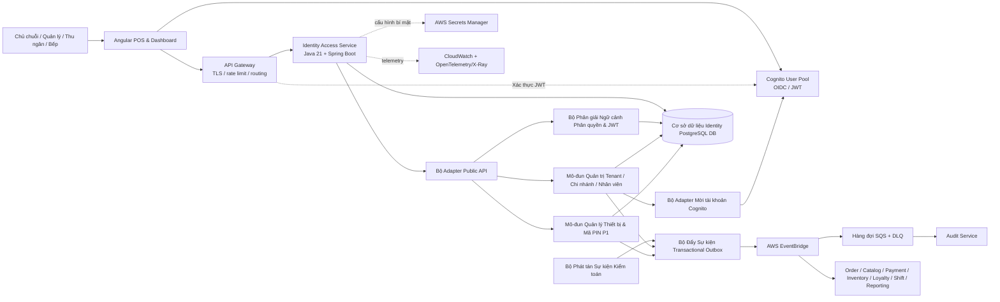
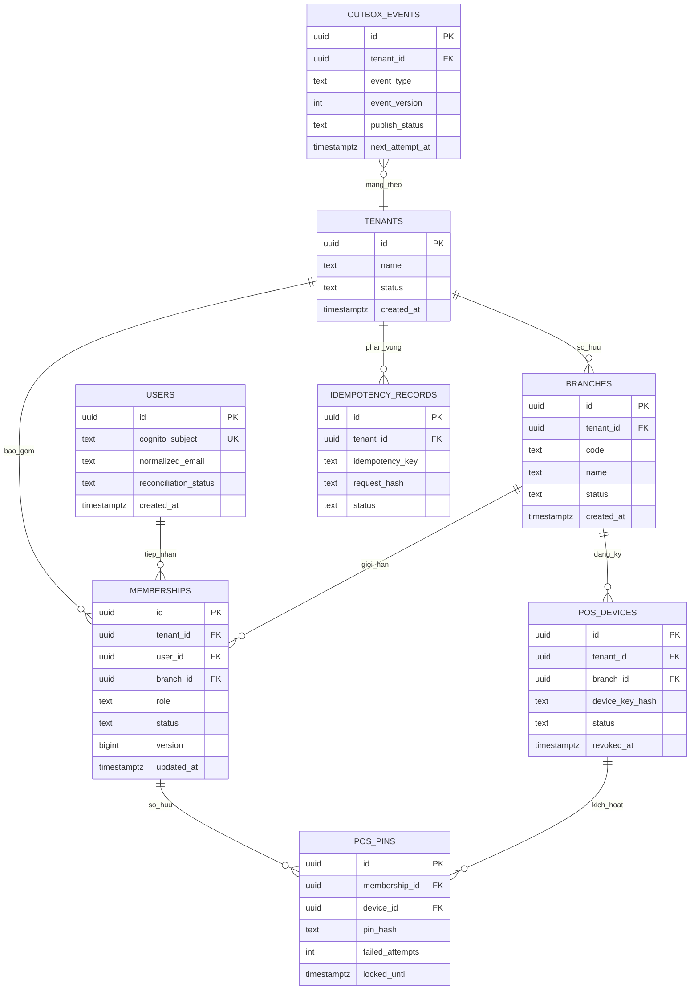

# Kiến trúc Module: Identity & Access (Quản trị Định danh & Phân quyền)

## Nguồn tham chiếu

- **Tầm nhìn (Vision):** [`2026-10-12-vision.md`](./2026-10-12-vision.md)
- **Đánh giá Tầm nhìn (Vision Review):** [`2026-10-12-vision-review.md`](./2026-10-12-vision-review.md)
- **Yêu cầu Hệ thống (Requirements):** [`2026-10-12-requirements.md`](./2026-10-12-requirements.md)
- **Kiến trúc POS Platform:** [`pos-platform/2026-10-12-architecture.md`](../pos-platform/2026-10-12-architecture.md)
- **Hợp đồng POS Platform:** [`pos-platform/2026-10-12-contracts.md`](../pos-platform/2026-10-12-contracts.md)

---

## Mục tiêu Kiến trúc (Architecture Goals)

1. Tách biệt hoàn toàn tầng Xác thực danh tính (do Cognito đảm nhiệm) khỏi tầng Cấp quyền truy cập tenant/chi nhánh (do Identity Access làm chủ).
2. Đảm bảo mọi quyết định truy cập đều nhận biết chính xác ngữ cảnh tenant và chi nhánh; lệnh thu hồi quyền (`REVOKED`) phải có hiệu lực ngay tại request tiếp theo.
3. Duy trì tính toàn vẹn giao dịch và khả năng kiểm toán cho toàn bộ trạng thái nhân sự, chi nhánh và tư cách thành viên.
4. Cung cấp ngữ cảnh phân quyền có đánh số phiên bản cho các microservice cấp dưới mà không cho phép các service đó truy vấn trực tiếp vào Identity DB.
5. Giữ cho lát cắt P0 hoàn toàn độc lập và không bị ảnh hưởng bởi tính năng đổi nhanh bằng mã PIN ở P1.
6. Hỗ trợ khởi chạy cục bộ mượt mà với Docker Compose và sẵn sàng triển khai thành dịch vụ phi trạng thái (stateless) trên AWS ECS Fargate.

---

## Kiến trúc Thành phần (Component Architecture)

### Sơ đồ Khối Thành phần (Component Overview)



### Ranh giới Trách nhiệm và Quyền sở hữu (Responsibility Boundaries)

`identity-access` là một microservice độc lập có cấu trúc mô-đun hóa nội bộ rõ ràng. Xác thực danh tính người dùng là chức năng ủy thác cho AWS Cognito; service không lưu trữ mật khẩu hay tự xây dựng hệ thống cấp phát token.

| Hạng mục | Identity Access sở hữu và làm chủ | Identity Access KHÔNG sở hữu |
|---|---|---|
| **Dữ liệu & Nghiệp vụ** | - Định danh và vòng đời của Tenant và Chi nhánh.<br/>- Ánh xạ mã định danh Cognito `sub` và thông tin nhân viên cơ bản.<br/>- Trạng thái membership, phân công chi nhánh, vai trò và phân giải quyền.<br/>- Điều phối quy trình mời nhân viên và đối soát với Cognito.<br/>- Trạng thái thiết bị POS và mã PIN thu ngân (phase P1).<br/>- Sinh sự kiện kiểm toán an ninh và thay đổi phân quyền. | - Mật khẩu, lưu trữ refresh token hoặc cấp token đăng nhập.<br/>- Đơn hàng, menu, thanh toán, kho, điểm thưởng, ca làm việc, KDS hoặc số liệu doanh thu.<br/>- Dữ liệu nghiệp vụ của các service khác (cấm SQL JOIN chéo DB).<br/>- Kho lưu trữ và truy vấn báo cáo kiểm toán dài hạn (do Audit Service sở hữu). |

---

## Kiến trúc Giao tiếp (Communication Architecture)

### 1. Luồng Xác thực và Quyết định Phân quyền Trực tuyến (Online Authorization Lookup)

```text
1. Ứng dụng Angular chuyển hướng người dùng sang Cognito để đăng nhập và nhận về OIDC access/ID token.
2. API Gateway kiểm tra tính hợp lệ sơ bộ của token và chuyển tiếp tiêu đề correlation ID.
3. Identity Access và từng downstream service độc lập xác thực chữ ký số, issuer, audience, thời hạn của JWT dựa trên bộ khóa công khai JWK được cache cục bộ từ Cognito.
4. Downstream service gửi subject, tenant/branch yêu cầu và permission cần thiết tới endpoint phân quyền nội bộ (/internal/v1) của Identity Access qua mTLS hoặc workload credentials.
5. Identity Access truy vấn trực tiếp trạng thái membership từ primary database Identity DB và trả về kết quả Cho phép/Từ chối (allow/deny) kèm ngữ cảnh phân quyền có đánh số phiên bản.
6. Downstream service áp dụng ngữ cảnh phân quyền này vào các câu truy vấn repository và logic nghiệp vụ của chính mình.
```

- **Nguyên tắc đóng cửa an toàn (Fail-Closed):** Nếu Identity Access gặp sự cố và không thể phân giải quyền, downstream service bắt buộc phải từ chối request; tuyệt đối không được phép tự động fallback sang tin tưởng role claim tĩnh của client.
- **Bảo đảm tính tức thì khi thu hồi quyền (Immediate Revocation):** Việc phân giải quyền P0 được truy vấn trực tiếp từ Primary DB để đảm bảo ngay khi lệnh thu hồi quyền (`REVOKED`) commit, request tiếp theo sẽ bị chặn ngay lập tức mà không phụ thuộc vào thời hạn của token JWT cũ.

### 2. Giao tiếp Đồng bộ (Synchronous APIs)

- Phục vụ giao diện Angular thông qua các endpoint RESTful `/api/v1`.
- Phục vụ các microservice nội bộ kiểm tra quyền thông qua các endpoint riêng tư `/internal/v1` được bảo vệ bằng mTLS hoặc Service Workload Identity.
- Các lệnh gửi lời mời ghi nhận dữ liệu bền vững vào Outbox/Database và trả kết quả ngay; tiến trình gửi email qua Cognito được xử lý ngầm (asynchronous worker).
- Mọi API command có tác dụng phụ đều yêu cầu tiêu đề `Idempotency-Key`, `X-Correlation-Id` và kiểm tra khóa lạc quan (Optimistic Concurrency Control qua `If-Match` / `version`).

### 3. Giao tiếp Bất đồng bộ qua Sự kiện (Asynchronous Events)

```text
Giao dịch trong Identity DB
  ├─ Cập nhật trạng thái tenant / chi nhánh / membership
  └─ Ghi bản ghi sự kiện vào bảng outbox
        ↓
Tiến trình Outbox Publisher → AWS EventBridge → Hàng đợi SQS của các Consumer → Cập nhật Audit / Read Model
```

- Bản ghi outbox được ghi cùng một transaction với nghiệp vụ chính, loại bỏ nguy cơ Dual-Write.
- Các sự kiện thay đổi phân quyền (`MembershipRevoked`, `MembershipRoleChanged`) được phát tán để các service cấp dưới xóa cache hoặc cập nhật phân tích; nhưng không thay thế cơ chế kiểm tra quyền trực tuyến của P0.

---

## Kiến trúc Dữ liệu (Data Architecture)

### Sơ đồ Quan hệ Thực thể (Entity Relationship Diagram - ERD)



> **Ghi chú về ràng buộc:** Cột `branch_id` trong bảng `memberships` chỉ được phép mang giá trị `NULL` đối với vai trò Chủ chuỗi (`OWNER`) có thẩm quyền trên toàn bộ tenant. Các vai trò Quản lý (`MANAGER`), Thu ngân (`CASHIER`) và Bếp (`KITCHEN`) bắt buộc phải gắn với một chi nhánh cụ thể (`branch_id NOT NULL`).

---

### Chiến lược Chỉ mục và Ràng buộc (Index & Constraint Strategy)

| Bảng dữ liệu | Ràng buộc / Chỉ mục bắt buộc | Mục đích nghiệp vụ |
|---|---|---|
| `branches` | Unique `(tenant_id, normalized_code)` | Đảm bảo mã chi nhánh là duy nhất trong cùng một chuỗi thương hiệu. |
| `memberships` | Unique `(tenant_id, user_id, branch_id)` đối với trạng thái `ACTIVE` và `INVITED` | Đảm bảo một nhân viên chỉ có duy nhất một vai trò hiệu lực tại một chi nhánh. |
| `memberships` | Index `(tenant_id, branch_id, status, role)` | Tối ưu hóa truy vấn danh sách nhân viên chi nhánh và kiểm tra quyền. |
| `memberships` | Index `(user_id, status)` và `(tenant_id, user_id, status)` | Phục vụ API `/me` và truy vấn phân giải quyền theo Cognito subject. |
| `users` | Unique `cognito_subject` và Unique `normalized_email` | Định danh người dùng ổn định và chống tạo tài khoản trùng lặp. |
| `idempotency_records`| Unique `(tenant_id, actor_subject, idempotency_key)` | Đảm bảo tính lũy kế, chống gửi lặp lệnh ghi và phát hiện xung đột dữ liệu. |
| `outbox_events` | Index `(publish_status, next_attempt_at)` | Tối ưu hóa việc quét các sự kiện chờ phát tán của background worker. |
| `pos_pins` (P1) | Unique `(device_id, membership_id)` | Mỗi thu ngân chỉ có một mã PIN trên một thiết bị POS cụ thể. |

---

## Các Quyết định Kiến trúc Trọng yếu của Module (ADRs)

| # | Quyết định (Decision) | Các phương án đã cân nhắc | Rationale (Cơ sở lựa chọn) |
|---|---|---|---|
| **ADR-IA-01** | **Cognito cho Xác thực, Identity DB cho Phân quyền** | Dùng Cognito Group/Claims làm nguồn sự thật; Tự xây dựng hệ thống authentication | Việc thu hồi quyền hoặc đổi chi nhánh đòi hỏi hiệu lực tức thì phía server; Cognito chỉ nên đóng vai trò là nhà cung cấp danh tính (IdP) được quản lý. |
| **ADR-IA-02** | **Một Service độc lập với các mô-đun nội bộ rõ ràng** | Tách ngay thành các microservice riêng: Tenant Service, Employee Service, PIN Service | Toàn bộ các chức năng này thuộc cùng một Bounded Context; việc gộp chung giúp tránh việc phân tán transaction không cần thiết ở giai đoạn MVP. |
| **ADR-IA-03** | **Truy vấn phân quyền trực tuyến từ Primary DB cho P0** | Tin tưởng JWT claims tĩnh; Dùng projection/cache dài hạn | Truy vấn trực tuyến đáp ứng trọn vẹn yêu cầu chặn ngay ở request tiếp theo khi thu hồi quyền (`REVOKED`); cache chỉ được dùng cho khóa công khai JWK. |
| **ADR-IA-04** | **PostgreSQL, Khóa chính UUID v7, Ràng buộc tường minh** | Cơ sở dữ liệu NoSQL; Khóa chính số nguyên tự tăng | Ràng buộc duy nhất, tính toàn vẹn ACID, khóa lạc quan và chỉ mục phân cấp rất phù hợp với bài toán quản lý phân quyền và nhân sự. |
| **ADR-IA-05** | **Xuất sự kiện qua Transactional Outbox → EventBridge/SQS** | Gọi trực tiếp EventBridge trong code nghiệp vụ; Dùng 2-Phase Commit | Ngăn chặn việc mất sự kiện khi database commit thành công nhưng mạng tới broker bị đứt; cô lập hoàn toàn transaction nghiệp vụ khỏi broker. |
| **ADR-IA-06** | **Mã PIN P1 là ngữ cảnh thu ngân tạm thời gắn với thiết bị** | PIN thay thế mật khẩu; Cấp token Cognito mới khi nhập PIN | Đảm bảo tốc độ đổi ca nhanh chóng trên máy POS nhưng không làm phá vỡ ranh giới bảo mật hay cấp quyền vượt quá vai trò Thu ngân. |
| **ADR-IA-07** | **Không phân vùng bảng (Partitioning) ở giai đoạn MVP** | Phân vùng theo tháng hoặc theo tenant ngay từ đầu | Khối lượng dữ liệu của bảng định danh và nhân sự trong giai đoạn MVP dưới 10 triệu bản ghi, chưa cần thiết phải gánh thêm độ phức tạp của partitioning. |
| **ADR-IA-08** | **Áp dụng nguyên tắc Đóng cửa an toàn (Fail-Closed)** | Cho phép tiếp tục nếu không kết nối được Identity DB | Tính an toàn và bảo mật dữ liệu của doanh nghiệp luôn được đặt lên hàng đầu so với việc cho phép giao dịch khi chưa rõ quyền hạn. |
