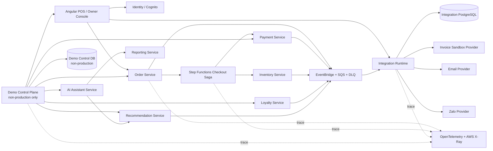
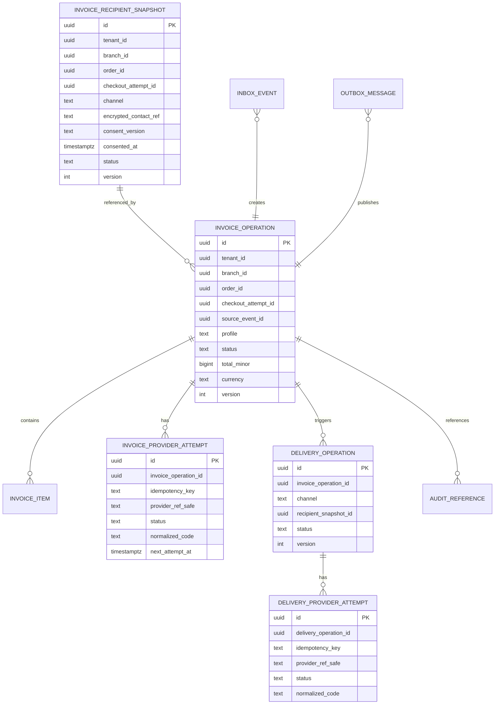

Started at: 2026/10/13 00:00:00
Finished at: 2026/10/13 00:00:00
Total time: 0 minutes
---

# Module 12 — Tích hợp mở rộng: Kiến trúc hệ thống (Architecture)

**Ngày:** 2026-10-13  
**Trạng thái:** Approved — Người dùng đã phê duyệt Kiến trúc và các biểu đồ tuần tự  
**Tầm nhìn:** [Integration & Demo Orchestration Vision](./2026-10-13-vision.md)  
**Yêu cầu nghiệp vụ:** [Integration & Demo Orchestration Requirements](./2026-10-13-requirements.md)  
**Đánh giá yêu cầu:** [Integration & Demo Orchestration Requirements Review](./2026-10-13-requirements-review.md)

## 1. Tóm tắt các quyết định kiến trúc cốt lõi (Architecture Decisions Summary)

Dịch vụ Integration được thiết kế thành một ngữ cảnh nghiệp vụ giới hạn (bounded context) với hai ranh giới triển khai hoàn toàn tách biệt:

1. **Integration Runtime (Môi trường thực thi tích hợp):** Vận hành sẵn sàng cho môi trường Production, bao gồm thu thập kênh nhận hóa đơn, quản lý tác vụ hóa đơn, adapter nhà cung cấp, chuyển phát Email/Zalo, cơ chế inbox/outbox, API truy vấn trạng thái và khả năng quan sát.
2. **Demo Control Plane (Phân hệ điều khiển Demo):** Chỉ triển khai duy nhất trên môi trường Non-production, chịu trách nhiệm điều phối kịch bản demo, manifest nạp/đặt lại dữ liệu hạt giống, đánh giá điểm kiểm tra (checkpoint), quản lý khóa thuê phiên chạy và tiêm lỗi thử nghiệm. Thành phần này tuyệt đối không được phép triển khai hay để lộ route trên môi trường Production.

Cả hai phân hệ đều tuân thủ các quy ước chung về sự kiện/schema và từ vựng truy vết (trace vocabulary) nhưng tuyệt đối không dùng chung quyền hạn vận hành hoặc cơ sở dữ liệu production. Phân hệ Integration Runtime không thay thế Checkout Saga của Order/Step Functions; phân hệ Demo Control Plane chỉ gọi các giao ước chuẩn mực và quan sát trạng thái từ các dịch vụ nguồn chân lý.

| Quyết định kiến trúc | Lựa chọn thiết kế | Lý do và cơ sở lựa chọn |
|---|---|---|
| Ranh giới dịch vụ | Tách biệt thành dịch vụ Integration chuyên biệt | Cách ly thông tin xác thực/quy tắc thử lại/giới hạn tần suất của nhà cung cấp và không biến các dịch vụ domain thành đầu mối tích hợp |
| Phân tách Production / Demo | Tách biệt vai trò triển khai; Demo Control Plane chỉ có ở `DEMO`/`TEST` | Ngăn chặn triệt để nguy cơ nạp/đặt lại dữ liệu hoặc tiêm lỗi lọt vào môi trường Production |
| Điểm kích hoạt hóa đơn | Chỉ tiêu thụ sự kiện chuẩn mực `OrderPaid.v1` | Sự kiện `PaymentPaid` không phải là chân lý hoàn tất đơn hàng; tránh phát hành hóa đơn sớm hoặc trùng lặp |
| Chế độ hóa đơn | Adapter trung lập với nhà cung cấp, hồ sơ `SANDBOX_TECHNICAL` trong MVP | Tránh khóa cứng vào nhà cung cấp hoặc năng lực pháp lý thuế trước khi có quyết định chính thức |
| Tính nhất quán Hóa đơn / Chuyển phát | Worker bất đồng bộ + Inbox/Outbox + Tính lũy quyền | Sự cố từ phía nhà cung cấp bên ngoài không làm nghẽn luồng checkout hoặc trạng thái PAID tại quầy |
| Dữ liệu người nhận | Bản chụp đã mã hóa/token hóa do Integration sở hữu, trỏ bởi `invoiceRecipientRef` mờ | Không phát dữ liệu PII qua sự kiện Order hoặc truy vấn trực tiếp DB của Loyalty |
| Truyền tải thông điệp | EventBridge → Hàng đợi SQS `pos-integration-events` + DLQ | Đảm bảo tính chất ít nhất một lần, hỗ trợ thử lại, phát lại và cách ly schema an toàn |
| Tiêm lỗi thử nghiệm | Khóa thuê lỗi phụ thuộc trong phạm vi phiên chạy non-prod, mặc định `PAYMENT_UNAVAILABLE` | Chứng minh luồng bồi hoàn Saga tất định mà không cần tắt service thật hay gây sự cố diện rộng |
| Trạng thái kịch bản Demo | Cơ sở dữ liệu Demo Control DB riêng trên non-prod và manifest tài nguyên | Quá trình đặt lại dữ liệu có giới hạn, có thể kiểm toán và cách ly hoàn toàn với DB nghiệp vụ |
| Doanh thu tăng thêm cho AI | Tận dụng Trợ lý AI sẵn có → các công cụ Reporting/Recommendation đã duyệt | Reporting sở hữu số liệu chuẩn mực; Integration chỉ cung cấp ngữ cảnh liên kết kịch bản demo |
| Dấu vết phân tán | Chuẩn ngữ cảnh W3C trace / OpenTelemetry + lan truyền qua AWS X-Ray | Tạo chuỗi liên kết correlation duy nhất xuyên suốt qua API, sự kiện, worker và Saga |
| Cơ sở dữ liệu chính | PostgreSQL riêng cho Integration Runtime; Demo Control DB riêng trên non-prod | Giao dịch cục bộ cho CAS/lũy quyền/lưu trữ; tuyệt đối không dùng chung cơ sở dữ liệu |

## 2. Ngữ cảnh hệ thống và sơ đồ thành phần (System Context & Component Map)



### 2.1 Các thành phần của phân hệ Integration Runtime

| Thành phần | Trách nhiệm chính | Điều cấm kỵ (Must not do) |
|---|---|---|
| Ranh giới API / Xác thực | Xác thực Cognito/tải công việc, phạm vi, tính lũy quyền, kiểm tra input, phản hồi an toàn | Tin tưởng tenant/chi nhánh/môi trường do client tự gửi hoặc để lộ liên hệ thô |
| Dịch vụ tùy chọn người nhận | Xác thực kênh/thông tin liên hệ, lưu bản chụp sự đồng ý mã hóa, cấp mã ref mờ | Tự tra cứu số điện thoại Loyalty hoặc gửi tin trước khi có sự đồng ý |
| Consumer sự kiện OrderPaid | Kiểm tra schema/nguồn, khử trùng lặp inbox, tạo tác vụ hóa đơn/outbox nguyên tử | Tiêu thụ sự kiện PaymentPaid đơn lẻ làm chân lý hóa đơn |
| Bộ điều phối hóa đơn | Chuyển đổi trạng thái bằng CAS, quản lý hồ sơ nhà cung cấp, xử lý thử lại/đối soát | Thay đổi trạng thái nghiệp vụ của Order, Payment, Loyalty hay Inventory |
| Adapter nhà cung cấp hóa đơn | Chuẩn hóa yêu cầu/phản hồi sandbox, kiểm soát timeout, chữ ký số/lũy quyền provider | Làm lộ thông tin xác thực/payload của provider hoặc sở hữu trạng thái Order |
| Bộ điều phối chuyển phát | Tạo các lần thử theo kênh, kiểm soát rate limit, giãn cách thử lại, hết hạn, gửi lại | Tự ý đổi kênh gửi khi người dùng chưa chọn hoặc chưa có chính sách |
| Adapter Email/Zalo | Chuẩn hóa API/webhook của nhà cung cấp và cập nhật trạng thái chuyển phát an toàn | Làm lộ token nhà cung cấp/thông tin liên hệ hoặc bỏ qua kiểm tra sự đồng ý |
| Workers bảng Inbox/Outbox | Đảm bảo xử lý ít nhất một lần, chuyển phát DLQ, phát lại, cập nhật mốc kiểm chứng | Xác nhận hoàn tất (ACK) trước khi transaction dữ liệu cục bộ commit thành công |
| API tra cứu trạng thái | Cung cấp trạng thái/lịch sử hóa đơn và chuyển phát an toàn theo đúng phạm vi phân quyền | Trả về thông tin PII thô / phản hồi nhà cung cấp hoặc truy vấn không giới hạn |
| Adapter Kiểm toán / Viễn thám | Bắn các tham chiếu kiểm toán đã che giấu, chỉ số đo lường, span trace AWS X-Ray | Trở thành kho lưu trữ kiểm toán gốc hoặc ghi nhật ký khóa bí mật |

### 2.2 Các thành phần của phân hệ Demo Control Plane

| Thành phần | Trách nhiệm chính | Quy tắc cách ly an toàn |
|---|---|---|
| API phiên chạy Demo | Tạo, đọc, thực thi, đặt lại phiên chạy; kiểm tra môi trường và vai trò | Route chỉ được phép tồn tại trên bản triển khai `DEMO` hoặc `TEST` |
| Bộ đánh giá điều kiện sơ bộ | Kiểm tra sức khỏe, năng lực, dữ liệu hạt giống và kết nối trace | Tuyệt đối không báo ĐẠT khi phụ thuộc bắt buộc bị chậm hoặc không khả dụng |
| Bộ điều phối kịch bản | Thực thi chuỗi hành động có thứ tự và đối chiếu điểm kiểm tra kỳ vọng | Chỉ gọi qua API/giao ước chuẩn mực, không truy cập DB của dịch vụ cha |
| Adapter nạp / đặt lại dữ liệu | Khởi tạo tài nguyên tất định và quản lý manifest dọn dẹp | Hoạt động trong namespace, đảm bảo tính lũy quyền, không có route trên prod |
| Bộ đánh giá điểm kiểm tra | Đối chiếu trạng thái thực tế quan sát được với trạng thái kỳ vọng | Không suy diễn trạng thái nghiệp vụ ngầm định chỉ dựa vào file log |
| Quản lý khóa thuê tiêm lỗi | Cấp phát, thu hồi và quản lý thời hạn khóa thuê lỗi `PAYMENT_UNAVAILABLE` | Đóng ngắt an toàn nếu môi trường không khớp; có thời hạn và được kiểm toán |
| Adapter tóm tắt dấu vết | Trả về các tham chiếu trace AWS X-Ray được phân quyền và tóm tắt span đã che giấu | Không bao giờ trả về thuộc tính span thô, thông tin PII hay khóa bí mật |

## 3. Ranh giới dịch vụ và ma trận nguồn chân lý (Source of Truth Matrix)

| Mối quan tâm nghiệp vụ | Đơn vị sở hữu nguồn chân lý | Vai trò của Integration |
|---|---|---|
| Mở / Đóng ca làm việc | Dịch vụ Shift | Demo gọi giao ước và kiểm tra trạng thái |
| Đơn hàng / Giỏ hàng / Lượt checkout | Dịch vụ Order | Demo gọi API; tiêu thụ sự kiện `OrderPaid` và bằng chứng thất bại |
| Trình tự Saga / Bồi hoàn | Dịch vụ Order + AWS Step Functions | Demo quan sát trực quan; không cài đặt lại logic của Saga |
| Thanh toán / IPN / Kiểm tra Checksum | Dịch vụ Payment | Demo sử dụng sandbox và tiêm lỗi không khả dụng trong phiên chạy |
| Giữ kho / Commit / Giải phóng tồn kho | Dịch vụ Inventory | Demo xác minh sự kiện giải phóng kho và điểm kiểm tra commit |
| Sổ cái khách hàng và điểm tích lũy | Dịch vụ Loyalty | Demo gọi luồng nhận diện khách và xác minh việc cộng điểm từ `OrderPaid` |
| Gợi ý món hiển thị / Chấp nhận | Dịch vụ Recommendation + Bằng chứng Order | Demo kiểm chứng phả hệ tương tác và việc thêm dòng món hợp lệ |
| Doanh thu / Mức tăng trưởng / Chỉ số AOV | Dịch vụ Reporting | Trợ lý AI đọc số liệu từ Reporting; Integration không lưu chân lý số liệu |
| Hiển thị ngôn ngữ tự nhiên | Dịch vụ AI Assistant | Demo gọi luồng gọi hàm chỉ đọc sẵn có của trợ lý ảo |
| Trạng thái tích hợp hóa đơn / Chuyển phát | Dịch vụ Integration | Nguồn chân lý duy nhất cho trạng thái tác vụ của nhà cung cấp hóa đơn/gửi tin |
| Thông tin xác thực / Trạng thái nhà cung cấp | Ranh giới Adapter của Integration | Payload của nhà cung cấp được chuẩn hóa và giảm thiểu dữ liệu tối đa |
| Lưu trữ kiểm toán / Bằng chứng truy cập | Dịch vụ Audit | Integration phát ra các sự kiện và tham chiếu kiểm toán đã che giấu |

## 4. Kiến trúc truyền thông và giao tiếp (Communication Architecture)

### 4.1 Luồng sản xuất hướng sự kiện (Event-Driven Production Path)

```text
Giao dịch cục bộ Order + Outbox(OrderPaid.v1)
        → EventBridge
        → Hàng đợi SQS pos-integration-events
        → Giao dịch Inbox / Khử trùng lặp tại Integration
        → Bảng invoice_operations + Outbox(InvoiceOperationRequested.v1)
        → Worker xử lý hóa đơn
        → Invoice Adapter → Nhà cung cấp Sandbox
        → Cập nhật trạng thái hóa đơn + Outbox(InvoiceIssued/Failed.v1)
        → Worker xử lý chuyển phát (nếu có bản chụp sự đồng ý)
        → Email/Zalo Adapter
        → Cập nhật trạng thái chuyển phát + Outbox(InvoiceDeliveryStatusChanged.v1)
```

Việc xác nhận hoàn tất (ACK) trên hàng đợi chỉ diễn ra sau khi quá trình khử trùng lặp inbox, chuyển đổi trạng thái cục bộ, cập nhật mốc kiểm chứng watermark và ghi outbox cục bộ đã commit thành công. Các cuộc gọi sang nhà cung cấp bên ngoài diễn ra ngoài transaction cơ sở dữ liệu; khóa lũy quyền của provider kết hợp cơ chế đối soát sẽ giải quyết rủi ro mất đồng bộ khi worker bị crash.

### 4.2 Luồng API đồng bộ (Synchronous API Path)

- Thu ngân trên POS gửi ý định kênh nhận hóa đơn trước khi thanh toán thông qua API của Integration.
- Integration xác thực ngữ cảnh chi nhánh/đơn hàng/lượt checkout thông qua ngữ cảnh dịch vụ tin cậy hoặc gọi API nội bộ của Order; không query DB của Order.
- Integration trả về mã tham chiếu mờ `invoiceRecipientRef`.
- Dịch vụ Order đưa mã ref mờ này vào ngữ cảnh checkout và phát lại trong sự kiện `OrderPaid.v1`.
- Chủ quán/Quản lý/Thu ngân chỉ xem được trạng thái an toàn trong phạm vi phân quyền; API đọc không bao giờ trả về liên hệ thô hay payload provider.

### 4.3 Cổng giao tiếp Adapter nhà cung cấp (Provider Adapter Port)

```text
InvoicePort.issue(IssueInvoiceCommand, idempotencyKey)
  → ProviderIssueResult(profile, status, safeRef, retryability, normalizedCode)

DeliveryPort.send(SendDeliveryCommand, idempotencyKey)
  → ProviderDeliveryResult(channel, status, safeRef, retryAfter, normalizedCode)
```

Việc ánh xạ yêu cầu, chữ ký số, xử lý webhook callback và giới hạn tần suất đặc thù của từng nhà cung cấp đều được đóng gói bên trong adapter. Các bộ điều phối domain chỉ phụ thuộc vào các cổng giao tiếp (ports) trừu tượng này chứ không phụ thuộc vào SDK riêng của provider.

## 5. Kiến trúc phân hệ Demo Control Plane (Demo Control Plane Architecture)

### 5.1 Namespace của phiên chạy Demo (Run Namespace)

Mỗi phiên chạy demo bao gồm:

- `demoRunId`, `scenarioVersion`, `seedVersion`, `environment`, `tenantNamespace`, `branchNamespace`;
- Người sở hữu / tải công việc, thời điểm tạo / hết hạn / khóa thuê và trạng thái dọn dẹp;
- Manifest tài nguyên ghi nhận toàn bộ các bản ghi Order, Shift, khách hàng, danh mục/quy tắc, giao dịch thanh toán, giữ kho và correlation ID đã tạo ra;
- Trình tự các điểm kiểm tra kỳ vọng và kết quả thực tế quan sát được kèm liên kết trace;
- Khóa thuê tiêm lỗi (fault leases) gắn chặt với duy nhất một phiên chạy, phụ thuộc, bước chạy và thời hạn hết hạn.

Phân hệ Demo Control Plane chỉ ghi dữ liệu vào database điều khiển riêng của mình. Các tài nguyên trên các dịch vụ cha được tạo/đặt lại thông qua các API/adapter non-production đã được phê duyệt, và quá trình dọn dẹp (cleanup) tuân thủ nghiêm ngặt thứ tự ngược lại của các phụ thuộc: artifact chuyển phát/hóa đơn → giao dịch thanh toán → dữ liệu đơn hàng/checkout → dữ liệu khách hàng demo → dữ liệu tồn kho/danh mục/quy tắc.

### 5.2 Quyết định về cơ chế tiêm lỗi thử nghiệm (Fault Injection Decision)

Phiên bản MVP áp dụng giải pháp **Khóa thuê tiêm lỗi Payment không khả dụng trong phạm vi phiên chạy (Run-scoped Payment unavailability lease)** được triển khai ngay tại ranh giới phụ thuộc của Payment trên non-production. Giải pháp ưu tiên là một test adapter hoặc chính sách điều phối lưu lượng bên trong dịch vụ Payment nhằm từ chối các cuộc gọi mang đúng cặp `demoRunId` và `faultLeaseId` được cấp quyền.

Các biện pháp bảo vệ bắt buộc:

- Môi trường bắt buộc phải là `DEMO` hoặc `TEST`;
- Loại lỗi phải nằm trong danh mục trắng cho phép;
- Khóa thuê phải có người sở hữu, lý do, thời hạn hết hạn và gắn với phiên chạy;
- Yêu cầu gửi đi phải mang theo `demoRunId`/`faultLeaseId` xuyên suốt qua ngữ cảnh Saga;
- Khi khóa thuê hết hạn hoặc bị thu hồi, hệ thống tự động quay về hành vi bình thường của Payment (fail-open) và ghi nhận kiểm toán;
- Tuyệt đối không cho phép bất kỳ client nào bật cờ lỗi thanh toán trên toàn hệ thống;
- Cung cấp công tắc ngắt khẩn cấp (kill switch) để vô hiệu hóa toàn bộ khóa thuê ngay lập tức.

Giải pháp này chứng minh chính xác đường dẫn bồi hoàn của Checkout Saga do Order/Step Functions điều phối mà không gây gián đoạn môi trường dùng chung.

### 5.3 Danh mục các điểm kiểm tra trong kịch bản Demo (Demo Checkpoints)

| Bước kịch bản | Điểm kiểm tra nguồn chân lý kỳ vọng |
|---|---|
| Mở ca (Shift open) | Phản hồi và trạng thái của Shift là `OPEN` trong namespace ca làm việc của demo |
| Đặt gà rán (Order) | Đơn hàng nháp lưu đúng bản chụp danh mục món và tenant/chi nhánh |
| Gợi ý Coca hiển thị / chấp nhận | Có đầy đủ sự kiện Recommendation + bằng chứng thêm món của Order; ID tương tác khớp |
| Nhận diện Loyalty | Phản hồi nhận diện khách hàng hợp lệ; không lộ số điện thoại thô trong báo cáo demo |
| Quét QR VNPAY / IPN | Giao dịch thanh toán chuyển từ chờ sang `PAID` hợp lệ; Payment sở hữu IPN/checksum |
| Đơn hàng thanh toán xong | Trạng thái Order là `PAID`, phát ra duy nhất một sự kiện `OrderPaid.v1` |
| Tích điểm Loyalty | Sổ cái Loyalty ghi nhận duy nhất một giao dịch tích điểm gắn với `OrderPaid` |
| Trừ tồn kho Inventory | Bản chiếu công thức/tồn kho ghi nhận trừ kho; không trừ trùng lặp |
| Sự cố Payment | Ghi nhận lỗi Saga, kích hoạt bồi hoàn và giải phóng kho; không phát sinh `OrderPaid` |
| Hỏi đáp Trợ lý AI | Câu trả lời AI mang đầy đủ nguồn gốc, độ tươi mới và phiên bản số liệu từ Reporting/Recommendation |

## 6. Kiến trúc dữ liệu (Data Architecture)

### 6.1 Cơ sở dữ liệu Integration Runtime PostgreSQL



Mọi cột trong bảng bắt buộc phải có câu lệnh `COMMENT ON COLUMN`. Thông tin liên hệ thô được mã hóa khi lưu trữ trong bảng giới hạn quyền hoặc thay thế bằng mã token; các bản chiếu thông thường chỉ lưu trữ mã che giấu, mã băm hoặc tham chiếu mờ. Payload thô của nhà cung cấp không phải là trường lưu trữ bền vững bắt buộc; nếu tạm thời lưu trữ phục vụ điều tra pháp y, nó phải được mã hóa và phân loại lưu trữ riêng biệt.

### 6.2 Cơ sở dữ liệu Demo Control DB

Demo DB chỉ tồn tại trên môi trường Non-production và sở hữu:

- `demo_runs`, `demo_scenario_versions`, `demo_resource_manifests`;
- `demo_checkpoints`, `demo_step_attempts`, `demo_fault_leases`;
- `demo_trace_references`, `demo_reset_operations`, `demo_audit_references`.

Tuyệt đối không sao chép dữ liệu của Order, Payment, Loyalty hay Inventory vào Demo DB để làm nguồn chân lý. Manifest tài nguyên chỉ chứa các ID mờ và trạng thái an toàn.

### 6.3 Chiến lược đánh chỉ mục và phân vùng (Index & Partition Strategy)

- Integration Runtime MVP sử dụng các chỉ mục theo tenant/chi nhánh/đơn hàng/thời gian phục vụ tra cứu hóa đơn/chuyển phát, hàng đợi thử lại, khử trùng lặp inbox/outbox và theo dõi mốc watermark.
- Việc truy cập bản chụp người nhận và lần thử nhà cung cấp luôn nằm trong phạm vi tác vụ cụ thể; tuyệt đối không hỗ trợ quét danh sách thông tin liên hệ diện rộng.
- Phân vùng RANGE theo tháng chỉ xem xét áp dụng cho các bảng ghi nhận lần thử/sự kiện sau khi hệ thống đạt quy mô đo đạc thực tế; không bật phân vùng chỉ phục vụ cho demo.
- Demo Control DB sử dụng chỉ mục dọn dẹp theo thời hạn TTL của phiên chạy; không ảnh hưởng tới chính sách lưu trữ của production.

## 7. Tính nhất quán, tính lũy quyền và xử lý sự cố (Consistency & Idempotency)

### 7.1 Xử lý sự kiện nguồn (Source Event Handling)

- Khóa duy nhất cho Inbox: Bộ `(producer, sourceEventId)` kết hợp với khóa hội tụ nghiệp vụ `(tenantId, orderId, checkoutAttemptId, profile)`.
- Việc phát lại sự kiện bảo toàn ID và dấu thời gian gốc; Integration không bao giờ phát ra cuộc gọi tạo hóa đơn thứ hai cho một tác vụ đã ở trạng thái `ISSUED`.
- Trường hợp thiếu mã `invoiceRecipientRef`, tác vụ hóa đơn vẫn tiếp tục tạo bình thường; bước chuyển phát sẽ được bỏ qua an toàn với trạng thái chất lượng `NO_RECIPIENT`.
- Sự kiện `OrderCheckoutFailed` nếu đến sau `OrderPaid` tuyệt đối không được phép hủy bỏ hóa đơn đã phát hành; thứ tự ưu tiên của phiên bản nguồn sẽ tạo ra bản ghi đối soát để kiểm tra.

### 7.2 Khoảng trống rủi ro khi gọi nhà cung cấp (Provider Crash Window)

Cuộc gọi sang nhà cung cấp bên ngoài diễn ra độc lập ngoài transaction cơ sở dữ liệu cục bộ:

1. Xác lập quyền xử lý tác vụ thông qua khóa thuê (lease) và tạo khóa lũy quyền tất định.
2. Lưu bản ghi lần thử ở trạng thái `STARTED` kèm thời hạn khóa thuê.
3. Thực hiện cuộc gọi sang nhà cung cấp kèm khóa lũy quyền và giới hạn thời gian chờ timeout.
4. Ghi nhận kết quả chuẩn hóa và commit transaction trạng thái / outbox.
5. Nếu worker bị crash sau khi nhà cung cấp đã chấp thuận, tiến trình thử lại hoặc đối soát sẽ truy vấn lại nhà cung cấp hoặc gửi lại cùng một khóa lũy quyền để hội tụ an toàn.

Adapter nhà cung cấp bắt buộc phải phân biệt rạch ròi giữa trạng thái `UNKNOWN` (chưa rõ kết quả) và `FAILED` (thất bại); trạng thái chưa rõ kết quả không được coi là lỗi kết thúc cho đến khi quy trình đối soát có giới hạn hoàn tất.

### 7.3 Phục hồi kịch bản Demo (Demo Recovery)

- Bộ đánh giá điểm kiểm tra đọc dữ liệu trực tiếp từ API/sự kiện chuẩn mực có thẩm quyền chứ không chỉ dựa vào log.
- Một bước kiểm thử thất bại chỉ có thể được thử lại bằng cùng khóa lũy quyền của bước đó hoặc tạo một phiên bản lần thử mới tường minh.
- Thao tác đặt lại dữ liệu (reset) là một tác vụ riêng biệt có khóa thuê; việc gọi thực thi và đặt lại đồng thời sẽ trả về lỗi xung đột.
- Khi khóa thuê tiêm lỗi thanh toán hết hạn, hệ thống không tự ý đảo ngược Saga; Order/Step Functions luôn là chủ sở hữu trạng thái duy nhất.

## 8. Kiến trúc an ninh, quyền riêng tư và tuân thủ (Security & Privacy)

- Cognito xác thực danh tính người dùng; Identity đưa ra quyết định phân quyền; Integration tiếp tục áp dụng điều kiện lọc tenant/chi nhánh tại tầng repository.
- Định danh tải công việc (workload identity) được phân tách theo từng dịch vụ; khóa bí mật của nhà cung cấp được quản lý bằng AWS Secrets Manager/KMS và không bao giờ lan truyền sang Order, Payment, Loyalty hay Inventory.
- Phân quyền luôn được kiểm tra trước khi truy xuất dữ liệu/xuất báo cáo/thử lại; nghiêm cấm trình duyệt hoặc CDN lưu cache thông tin người nhận hay chi tiết lần thử nhà cung cấp.
- Thông tin liên hệ của người nhận được mã hóa/token hóa kèm phiên bản khóa; bản chụp sự đồng ý là bất biến và gắn chặt với đơn hàng/lượt checkout/kênh gửi.
- File log, trace và sự kiện chỉ chứa thông tin liên hệ đã che giấu, mã tham chiếu an toàn, mã lỗi chuẩn hóa và correlation ID.
- Toàn bộ các thao tác tiêm lỗi và chạy demo đều được ghi nhận kiểm toán; mọi sự sai lệch về môi trường triển khai đều dẫn đến việc đóng ngắt an toàn.
- Integration chỉ phát ra các tham chiếu kiểm toán đã che giấu; dịch vụ Audit sở hữu thẩm quyền quyết định lưu trữ bằng chứng pháp lý 7 năm.
- Năng lực phát hành hóa đơn thuế chính thức (production) là một hồ sơ năng lực tách biệt hoàn toàn, không mặc định suy diễn từ trạng thái sandbox `SANDBOX_TECHNICAL` hoặc `ISSUED`.

## 9. Khả năng quan sát và vận hành hệ thống (Observability & Operations)

### Các chỉ số đo lường chính (Metrics)

- `order_paid_consumer_lag`, `invoice_operation_lag`, `invoice_issue_success_rate`, `invoice_provider_latency`, `invoice_retry_count`;
- `delivery_success_rate{channel}`, `delivery_provider_latency{channel}`, `delivery_retry_count`, `delivery_expired_count`;
- `inbox_duplicate_count`, `outbox_lag`, `dlq_depth`, `watermark_age`, `provider_unknown_count`;
- `demo_preflight_failure`, `demo_step_duration`, `demo_checkpoint_failure`, `demo_reset_duration`, `fault_lease_active_count`;
- `trace_export_failure`, `redaction_failure`, `authorization_denial`, `scope_conflict`.

### Nhật ký và dấu vết phân tán (Logs & Traces)

Nhật ký có cấu trúc lưu trữ thông tin dịch vụ, thao tác, các ID an toàn, mã băm phạm vi tenant/chi nhánh, loại/phiên bản sự kiện, số lần thử/trạng thái, mã lỗi chuẩn hóa, số lần thử lại và correlation ID. Các span AWS X-Ray/OpenTelemetry bao quát toàn bộ hành trình từ POS/Order/Saga, message broker, worker của Integration, adapter nhà cung cấp cho tới điểm kiểm tra demo. Nghiêm cấm ghi dữ liệu PII, khóa bí mật hay ghi chú tùy ý của khách hàng.

### Cảnh báo và quy trình vận hành (Alerts & Runbooks)

- Cảnh báo độ trễ tiêu thụ sự kiện nguồn, tăng trưởng hàng đợi DLQ, bão thử lại, timeout/vượt rate limit từ phía nhà cung cấp, trạng thái provider chưa rõ kết quả kéo dài, tác vụ hóa đơn/chuyển phát bị treo khóa thuê;
- Cảnh báo khóa thuê lỗi hết hạn hoặc kéo dài bất thường, thao tác đặt lại dữ liệu ngoài namespace, lỗi bộ xuất trace, sai lệch che giấu thông tin;
- Xây dựng tài liệu runbook hướng dẫn phát lại sự kiện, đối soát nhà cung cấp, gửi lại chuyển phát thủ công, dọn dẹp namespace demo, công tắc ngắt khẩn cấp tiêm lỗi và xoay vòng khóa mã hóa.

## 10. Triển khai và mở rộng quy mô (Deployment & Scaling)

| Thành phần triển khai | Mô hình Runtime | Quy tắc mở rộng quy mô và rào chắn bảo vệ |
|---|---|---|
| Integration API | Dịch vụ ECS/Fargate phi trạng thái | Mở rộng theo độ trễ yêu cầu và số kết nối đồng thời; không lưu quyền trong RAM |
| Consumer / Worker xử lý hóa đơn | Worker lắng nghe SQS | Mở rộng theo độ sâu hàng đợi; khóa thuê và lũy quyền kiểm soát cuộc gọi đồng thời |
| Worker xử lý chuyển phát | Nhóm worker theo từng kênh | Kiểm soát rate limit / ngắt mạch theo kênh; tách hàng đợi thử lại riêng biệt |
| Demo Control Plane | ECS / Job runner chỉ trên non-prod | Rào chắn môi trường nghiêm ngặt, hạn ngạch chạy đồng thời, tự dọn dẹp theo TTL |
| Integration PostgreSQL | Cơ sở dữ liệu mã hóa chuyên biệt | Có sao lưu/phục hồi định kỳ, quản lý migration, phân quyền nghiêm ngặt bảng PII |
| Demo Control DB | Cơ sở dữ liệu mã hóa trên non-prod | Thời hạn TTL ngắn, thông tin xác thực cô lập, sẵn sàng xóa/xây dựng lại khi cần |
| EventBridge / SQS / DLQ | Message broker nền tảng dùng chung | Kiểm tra schema sự kiện, áp dụng chính sách thử lại và cảnh báo hàng đợi DLQ |
| AWS Secrets Manager / KMS | Quản lý bảo mật nền tảng | Hỗ trợ xoay vòng khóa bí mật/phiên bản khóa và kiểm tra hợp lệ lúc khởi động |

## 11. Các quyết định kiến trúc đã phê duyệt (ADRs)

| Mã ADR | Quyết định kiến trúc | Các phương án thay thế bị từ chối | Lý do lựa chọn |
|---|---|---|---|
| INT-ADR-01 | Tách riêng thành dịch vụ Integration chuyên biệt | Nhồi logic tích hợp vào Order hoặc Payment | Giữ vững ranh giới domain và cách ly hoàn toàn sự cố từ nhà cung cấp bên ngoài |
| INT-ADR-02 | Xử lý hóa đơn/chuyển phát bất đồng bộ từ `OrderPaid` | Phát hành hóa đơn đồng bộ lúc checkout; dùng `PaymentPaid` | Bảo vệ luồng thanh toán tại quầy và duy trì sự kiện doanh thu chuẩn duy nhất |
| INT-ADR-03 | Sử dụng hồ sơ trung lập `SANDBOX_TECHNICAL` trong MVP | Khóa cứng vào một nhà cung cấp pháp lý ngay từ đầu | Phục vụ tốt kịch bản demo và mở đường cho việc chọn nhà cung cấp chính thức sau này |
| INT-ADR-04 | Tách biệt Demo Control Plane chỉ trên Non-production | Nhúng các route demo vào API production; chạy thủ công | Đảm bảo tính tất định và khả năng kiểm chứng kèm rào chắn an toàn tuyệt đối |
| INT-ADR-05 | Khóa thuê tiêm lỗi Payment trong phạm vi phiên chạy | Tắt service Payment dùng chung; dùng feature flag toàn cục | Chứng minh luồng bồi hoàn Saga thật mà không gây gián đoạn môi trường chung |
| INT-ADR-06 | Bản chụp sự đồng ý do Integration sở hữu qua ref mờ | Nhồi liên hệ thô vào OrderPaid; tự query số Loyalty | Giảm thiểu tối đa việc phân tán PII và giữ quyền sở hữu liên hệ cục bộ |
| INT-ADR-07 | Reporting/AI sở hữu công thức tính tăng trưởng | Integration hoặc LLM tự tính toán doanh thu | Duy trì một định nghĩa số liệu duy nhất kèm độ tươi mới và nguồn gốc minh bạch |

## 12. Danh mục các biểu đồ tuần tự ứng viên (Sequence Diagrams)

Các biểu đồ tuần tự L1 (cấp hệ thống) và L2 (nội bộ backend) đã được xây dựng hoàn chỉnh trong tài liệu [Sequence Diagrams](./2026-10-13-sequence-diagrams.adoc):

| # | Luồng nghiệp vụ | Thành phần tham gia L1 | Trọng tâm phân tích L2 |
|---|---|---|---|
| 1 | Thu thập sự đồng ý kênh nhận hóa đơn | POS, Identity, Integration API, Integration DB | Xác thực/phạm vi, kiểm tra liên hệ, bản chụp sự đồng ý, tính lũy quyền |
| 2 | `OrderPaid` → Phát hành hóa đơn | Order, EventBridge/SQS, Integration Runtime, Integration DB, Sandbox Hóa đơn | Khử trùng lặp inbox, khóa hội tụ, worker hóa đơn, adapter provider, outbox |
| 3 | Hóa đơn phát hành → Chuyển phát Email/Zalo | Integration Runtime, Nhà cung cấp Email/Zalo, DB, EventBridge/SQS | Chính sách kênh, rate limit, lần thử nhà cung cấp, cơ chế thử lại / DLQ |
| 4 | Kịch bản Demo thành công xuyên suốt | Demo Control Plane, POS/Shift, Order/Saga, Recommendation, Loyalty, Payment/VNPAY, Inventory, Reporting, AI, EventBridge/SQS, X-Ray | Adapter từng bước kịch bản, bộ đánh giá điểm kiểm tra, manifest phiên chạy, tóm tắt trace |
| 5 | Demo bồi hoàn khi Payment không khả dụng | Demo Control Plane, Order/Saga, Ranh giới lỗi Payment, Inventory, EventBridge/SQS, X-Ray | Khóa thuê lỗi, sự cố kỳ vọng, điểm kiểm tra bồi hoàn, xác minh không sinh thanh toán |
| 6 | Truy vấn Trợ lý AI về mức tăng trưởng | Demo / Chủ quán, AI Assistant, Identity, Reporting, Recommendation | Gọi công cụ chỉ đọc, kiểm tra tính quy kết, độ tươi mới và nguồn gốc số liệu |
| 7 | Phục hồi khi trùng lặp / phát lại / provider crash | EventBridge/SQS, Integration, Nhà cung cấp, DB / DLQ | Khử trùng lặp inbox, lũy quyền nhà cung cấp, worker đối soát phục hồi |
| 8 | Đặt lại dữ liệu Demo / Hết hạn khóa thuê | Demo Control Plane, Adapter dọn dẹp dịch vụ cha, Demo DB, Audit / Trace | Dọn dẹp tài nguyên theo manifest ngược, xử lý xung đột / TTL, công tắc ngắt khẩn cấp |

## 13. Cổng phê duyệt kiến trúc (Architecture Approval Gate)

- **Trạng thái hiện tại:** Approved — Người dùng đã xác nhận hai ranh giới triển khai, mô hình adapter/khóa thuê lỗi, cơ sở dữ liệu lưu trữ, mô hình an ninh/PII và danh mục thành phần của biểu đồ tuần tự.
- **Yêu cầu trước khi vào Contracts:** Đã hoàn thành; các công việc còn lại về schema và fixture trở thành cổng kiểm soát trong tài liệu Giao ước (Contracts).
- **Quy tắc triển khai:** Chưa viết mã nguồn ứng dụng; tài liệu Giao ước (Contracts) bắt buộc phải cụ thể hóa toàn bộ OpenAPI/AsyncAPI/JSON Schema, migration cơ sở dữ liệu, cổng adapter nhà cung cấp, schema kịch bản demo và các bộ vector fixture kiểm thử.
