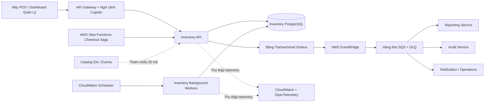

# Module 6 — Dịch Vụ Kho Nguyên Liệu (Inventory Service): Kiến Trúc Hệ Thống (Architecture)

**Ngày:** 2026-10-13  
**Trạng thái:** Đã phê duyệt (Approved)  
**Phạm vi:** M — Luồng Service Tiêu chuẩn (Standard Service Flow)  
**Module:** Kho nguyên liệu (Inventory Service)

## Tài Liệu Nguồn & Ngữ Cảnh Hệ Thống Cha

- [Tầm nhìn Inventory (Inventory Vision)](./2026-10-13-vision.md)
- [Yêu cầu kỹ thuật Inventory (Inventory Requirements)](./2026-10-13-requirements.md)
- [Đánh giá yêu cầu Inventory (Inventory Requirements Review)](./2026-10-13-requirements-review.md)
- [Kiến trúc POS Platform (Parent Platform Architecture)](../pos-platform/2026-10-12-architecture.md)
- [Hợp đồng POS Platform (Parent Platform Contracts)](../pos-platform/2026-10-12-contracts.md)
- [Kiến trúc Order Service](../order/2026-10-12-architecture.md)
- [Kiến trúc Payment Service](../payment/2026-10-12-architecture.md)

---

## 1. Ranh Giới & Quyền Sở Hữu (Boundary & Ownership)

### Inventory Service sở hữu:
- Danh mục nguyên liệu master, đơn vị đo cơ sở (`base_unit`) và metadata quy đổi đơn vị mua hàng.
- Phiên bản công thức định lượng (`versioned recipe`) cho các món ăn, biến thể và tùy chọn thêm trong Catalog (`item/variant/modifier`).
- Bảng số dư tồn kho chi nhánh (`stock_balance` gồm `onHand`, `reserved`, `available`).
- Sổ cái biến động kho bất biến (`append-only stock_ledger`) và cơ chế tái tạo bảng số dư (projection rebuild).
- Vòng đời giữ chỗ nguyên liệu (`reservation lifecycle`) trong luồng Saga checkout.
- Phiếu nhập kho (`receipt`), điều chỉnh kiểm kê (`count adjustment`), cảnh báo tồn thấp (`low-stock alert`) và dự báo nhu cầu P2 (`forecast`).
- Bảng transactional outbox, cơ chế idempotency, nhật ký kiểm toán, tiến trình dọn dẹp hết hạn và hồ sơ đối soát ngoại lệ.

### Inventory Service không sở hữu và không làm:
- Tuyệt đối không đọc trực tiếp cơ sở dữ liệu của Catalog, Order hoặc Payment Service.
- Không sở hữu tên món/giá bán, tổng giá trị đơn hàng, trạng thái thanh toán hay điểm tích lũy thành viên.
- Không tự ý lắng nghe sự kiện `PaymentPaid` để trừ kho; chỉ AWS Step Functions (Saga orchestrator) mới có quyền gọi lệnh `CommitReservation`.
- Không tự ý hoàn tất đơn hàng (`finalize Order`), hoàn tiền (`refund Payment`) hoặc cộng điểm (`award Loyalty`).
- Không xóa cứng (hard delete) các dữ liệu đã được công thức, đơn giữ chỗ hoặc sổ cái tham chiếu.

*Nguyên tắc tích hợp:* Các tham chiếu liên service sử dụng chuỗi UUID mờ (opaque UUID) kèm snapshot cần thiết cho lịch sử. Tuyệt đối không dùng foreign key xuyên cơ sở dữ liệu hoặc truy vấn SQL join chéo service.

---

## 2. Tô-pô Hệ Thống (System Topology)



### 2.1 Quy Tắc Giao Tiếp Giữa Các Thành Phần

| Luồng giao tiếp | Giao thức | Mục đích nghiệp vụ | Mức độ nhất quán |
|---|---|---|---|
| **POS / Dashboard → Inventory API** | HTTPS REST / OpenAPI 3.1 | Quản lý nguyên liệu, công thức, số dư, nhập kho, kiểm kê, cảnh báo và truy vấn dự báo | Nhất quán cục bộ trong DB transaction |
| **Step Functions → Inventory API** | Internal REST + Workload Identity | Các lệnh giữ chỗ (`Reserve`), trừ kho (`Commit`), giải phóng (`Release`) | Nhất quán mạnh (Strong consistency) trong Inventory DB |
| **Inventory API → PostgreSQL** | Local SQL Transaction | Mở rộng công thức, biến động số dư, ghi sổ cái, lưu reservation và outbox | Nhất quán mạnh (ACID) |
| **Outbox → EventBridge** | Async Publish | Phát hành các sự kiện nghiệp vụ và tích hợp domain | At-least-once (Ít nhất một lần) |
| **EventBridge → SQS / DLQ** | Async Delivery | Phân phối tới Reporting, Audit, Notification | Nhất quán sau (Eventual consistency), khử trùng lặp |
| **Scheduler → Background Worker** | Hàng đợi / Phân bổ Lease lock | Quét hết hạn reservation, retry outbox, quét đối soát, tính toán dự báo | Transaction idempotent của worker |

*Lưu ý:* Mã định danh từ Catalog là opaque ID. Inventory Service có thể tiêu thụ bản chiếu Catalog có phiên bản để hỗ trợ kiểm tra dữ liệu, nhưng tính đúng đắn của giao dịch giữ chỗ tại quầy không bao giờ phụ thuộc vào việc đọc Catalog trong lúc giữ database lock.

---

## 3. Trách Nhiệm Các Thành Phần Nội Bộ

| Thành phần | Trách nhiệm chi tiết |
|---|---|
| **Public API Adapter** | Xác thực JWT từ Cognito, kiểm tra thẩm quyền tenant/chi nhánh, xử lý các thao tác CRUD danh mục/quản trị và chuẩn hóa mã lỗi phản hồi. |
| **Internal Saga API Adapter** | Xác thực định danh hệ thống (Workload identity), kiểm tra tính hợp lệ của payload `Reserve`/`Commit`/`Release` và đối soát ngữ cảnh idempotency. |
| **Recipe Application Service** | Quản lý vòng đời công thức (soạn thảo, kích hoạt, lưu trữ), kiểm tra phiên bản lạc quan và đảm bảo bất biến chỉ có một bản `ACTIVE` duy nhất. |
| **Recipe Expansion Engine** | Phân giải một bộ công thức `ACTIVE` nhất quán, áp dụng định lượng cho từng modifier/topping, tính toán hệ số hao hụt và tổng hợp nhu cầu nguyên liệu. |
| **Stock Transaction Service** | Khóa dòng số dư, kiểm tra tồn khả dụng, cập nhật view số dư, ghi thêm sổ cái kho và khởi tạo trạng thái reservation. |
| **Reservation State Machine** | Quản lý chuyển đổi trạng thái của đơn giữ chỗ, xác thực khớp ngữ cảnh thanh toán, xử lý hết hạn và chuyển trạng thái đối soát. |
| **Count / Adjustment Service** | Quản lý snapshot phiên kiểm kê, tính toán biến động phát sinh đồng thời, kiểm soát phiên bản phê duyệt và ghi sổ cái điều chỉnh `COUNT_ADJUSTMENT`. |
| **Alert / Forecast Service** | Kiểm tra điều kiện cắt ngưỡng tồn kho thấp, quản lý vòng đời cảnh báo, tính toán dự báo nhu cầu kèm metadata độ tin cậy và độ tươi dữ liệu. |
| **Outbox Publisher** | Quét các bản ghi pending theo cơ chế lease lock, gửi sự kiện lên EventBridge theo mô hình at-least-once, retry có kiểm soát và chuyển lỗi vĩnh viễn vào DLQ. |
| **Expiry / Reconciliation Worker** | Quét và chuyển các reservation quá hạn sang `EXPIRED`, phát hiện các ca cần đối soát và phát tín hiệu vận hành; tuyệt đối không mở lại reservation đã kết thúc. |
| **Projection Rebuild Worker** | Tái tạo lại view số dư tồn kho từ lịch sử sổ cái và các đơn giữ chỗ đang hoạt động trong chế độ bảo trì hệ thống. |
| **PostgreSQL Repositories** | Thực thi các điều kiện lọc `tenant_id` và `branch_id` bắt buộc, bảo đảm ràng buộc toàn vẹn, thực hiện khóa dòng bi quan và kiểm tra phiên bản lạc quan. |
| **Audit / Observability Adapter** | Ghi nhận nhật ký biến động có cấu trúc, gắn correlation ID, đo lường metrics, truy vết phân tán và làm mờ (redact) dữ liệu nhạy cảm. |

---

## 4. Kiến Trúc Transaction Cơ Sở Dữ Liệu

### 4.1 Đường Dẫn Tính Đúng Đắn Cốt Lõi (Correctness Path)
PostgreSQL là đường dẫn duy nhất đảm bảo tính đúng đắn cho các luồng nghiệp vụ P0. Tuyệt đối không sử dụng Redis/cache, view bất đồng bộ hay sự kiện downstream để đưa ra quyết định có cho phép giữ chỗ hoặc trừ kho hay không.

Mọi transaction làm thay đổi trạng thái đều tuân thủ quy trình nghiêm ngặt:
1. Xác thực phạm vi quyền hạn tin cậy và ngữ cảnh idempotency trước khi bước vào transaction thay đổi dữ liệu.
2. Nạp thực thể aggregate cục bộ và xác định trạng thái hiện tại.
3. Khóa các dòng dữ liệu theo thứ tự đã được quy định chuẩn hóa.
4. Áp dụng các điều kiện kiểm tra bất biến (invariants) và thực hiện biến động trạng thái.
5. Ghi các dòng sổ cái, nhật ký audit và các bản ghi transactional outbox.
6. Commit transaction, sau đó mới trả kết quả về cho client hoặc phát hành sự kiện ra ngoài.

*Nguyên tắc sống còn:* Tuyệt đối không thực hiện bất kỳ cuộc gọi REST ra ngoài, không gọi broker, không tra cứu Catalog hay Payment trong lúc đang nắm giữ khóa dòng số dư kho.

### 4.2 Chi Tiết Transaction Giữ Chỗ (Reserve Transaction)
1. Chuẩn hóa payload đầu vào và tính toán mã hash yêu cầu chuẩn (canonical request hash).
2. Nếu phát hiện yêu cầu retry trùng lặp cho cùng cặp `(tenantId, checkoutAttemptId)`, trả lại kết quả đã lưu trước đó.
3. Đọc toàn bộ các phiên bản công thức đang `ACTIVE` và thực hiện mở rộng định lượng cho từng món/biến thể/topping bên ngoài phạm vi khóa số dư.
4. Bắt đầu một database transaction ngắn và tái xác thực phiên bản/trạng thái của các công thức đã sử dụng.
5. Tổng hợp toàn bộ nhu cầu theo từng `ingredientId`, thực hiện làm tròn số lượng ở bước cuối cùng với độ chính xác 3 chữ số thập phân (`NUMERIC(18,3)`).
6. Khóa các dòng tương ứng trong bảng `stock_balances` theo thứ tự tăng dần của `ingredientId` (`SELECT ... FOR UPDATE`).
7. Kiểm tra điều kiện tồn khả dụng: `available >= required` cho từng nguyên liệu; nếu có bất kỳ nguyên liệu nào thiếu hụt, lập tức rollback toàn bộ giao dịch.
8. Tăng chỉ số `reserved`, ghi bản ghi `reservation` kèm snapshot công thức và nhu cầu nguyên liệu, đồng thời ghi bản ghi sự kiện vào outbox.
9. Commit transaction thành công trước khi trả về kết quả `RESERVED` cho caller.

*Xử lý tranh chấp công thức:* Nếu có giao dịch kích hoạt công thức mới xảy ra đồng thời với bước 4, hệ thống hủy và retry toàn bộ quy trình mở rộng với một bộ công thức nhất quán duy nhất. Tuyệt đối không bao giờ trộn lẫn công thức cũ và mới trong cùng một đơn giữ chỗ.

### 4.3 Chi Tiết Transaction Trừ Kho (Commit Transaction)
1. Xác thực danh tính hệ thống của Step Functions Saga và kiểm tra ngữ cảnh thanh toán thành công.
2. Khóa dòng reservation tương ứng trước (`SELECT ... FOR UPDATE`).
3. Nếu reservation đã ở trạng thái kết thúc (terminal state), trả về kết quả idempotent tương ứng hoặc mã lỗi conflict.
4. Nếu reservation đang ở trạng thái `RESERVED`, tiếp tục khóa các dòng số dư `stock_balances` liên quan theo thứ tự `ingredientId` tăng dần.
5. Ghi các dòng sổ cái `SALE_COMMITTED` với số lượng âm cho từng nguyên liệu trong danh sách nhu cầu.
6. Đồng thời giảm `reserved`, giảm tồn vật lý `onHand`, tính toán lại `available`, cập nhật trạng thái reservation sang `COMMITTED` và ghi outbox trong cùng một transaction.
7. Commit transaction trước khi phản hồi thành công về cho Step Functions.

### 4.4 Chi Tiết Transaction Hủy Giữ Chỗ / Hết Hạn (Release / Expiry Transaction)
1. Khóa dòng reservation trước tiên.
2. Nếu trạng thái không phải là `RESERVED`, trả về kết quả no-op/conflict mà không làm thay đổi số dư kho.
3. Khóa các dòng số dư `stock_balances` liên quan theo thứ tự `ingredientId` tăng dần.
4. Giảm chỉ số `reserved`, giữ nguyên tồn vật lý `onHand`, chuyển trạng thái reservation sang `RELEASED` hoặc `EXPIRED`, đồng thời ghi outbox và audit log.
5. Commit transaction trước khi hoàn tất.

*Thứ tự khóa thống nhất:* Cả ba lệnh Commit, Release và Expiry đều áp dụng chung một thứ tự khóa bất biến: Khóa dòng `reservation` trước, sau đó mới khóa các dòng `stock_balances` đã được sắp xếp tăng dần theo ID. Transaction đầu tiên giành được khóa trên dòng reservation là bên chiến thắng xác định trạng thái terminal.

---

## 5. Chính Sách Khóa Dữ Liệu, Idempotency & Xử Lý Tranh Chấp

### 5.1 Chính Sách Khóa Dữ Liệu (Locking Policy)
- Áp dụng khóa dòng bi quan (Pessimistic row lock: `SELECT ... FOR UPDATE`) cho mọi biến động trên bảng `stock_balances`.
- Quản lý công thức và cấu hình áp dụng khóa lạc quan (Optimistic locking) thông qua trường `version` kết hợp ràng buộc partial unique index cho công thức `ACTIVE`.
- Các thao tác cập nhật reservation luôn khóa dòng reservation trước khi khóa các dòng số dư kho.
- Lệnh giữ chỗ (`Reserve`) chỉ khóa các dòng số dư đã sắp xếp; không giữ khóa ngoài và không gọi sang service khác.
- Ngưỡng thời gian chờ khóa (Lock wait): 2 giây; thời gian timeout câu lệnh SQL: 4 giây; thời hạn phản hồi API nội bộ: 5 giây.
- Cho phép tối đa 3 lần retry khi gặp lỗi deadlock, lock timeout hoặc lỗi kết nối database tạm thời, áp dụng exponential backoff có thêm độ nhiễu ngẫu nhiên (jitter).
- Tuyệt đối không retry đối với các lỗi xác thực dữ liệu, thiếu tồn kho, xung đột trạng thái terminal, lỗi phân quyền hay sai lệch ngữ cảnh thanh toán.

### 5.2 Chính Sách Đảm Bảo Tính Idempotent (Idempotency Policy)
- Khóa nghiệp vụ duy nhất cho Reserve: Cặp `(tenantId, checkoutAttemptId)` kết hợp với mã hash chuẩn hóa của payload.
- Khóa tầng giao vận: Bắt buộc truyền header `Idempotency-Key` cho toàn bộ các API làm thay đổi trạng thái.
- Ràng buộc duy nhất trong sổ cái kho: `(tenantId, branchId, sourceType, sourceId, idempotencyKey)`.
- Gửi lại cùng key và cùng nội dung request sẽ trả về kết quả ngữ nghĩa giống hệt ban đầu.
- Gửi cùng checkout attempt nhưng khác nội dung payload sẽ bị từ chối với lỗi `409 RESERVATION_REQUEST_CONFLICT`.
- Các lệnh Commit, Release hoặc Expiry gửi tới sau khi reservation đã ở trạng thái kết thúc (terminal) tuyệt đối không đảo ngược trạng thái và không nhân bản tác dụng phụ.

### 5.3 Ma Trận Kết Quả Xử Lý Tranh Chấp (Race Outcomes)

| Tình huống tranh chấp | Bên chiến thắng | Hành vi của bên thua cuộc |
|---|---|---|
| **Nhiều yêu cầu giữ chỗ cùng tranh mua 1 nguyên liệu** | Transaction đầu tiên giành được lock và thỏa mãn điều kiện tồn khả dụng | Nhận thông báo thiếu hàng (`insufficient_stock`) hoặc lỗi conflict có thể retry; không bao giờ bị giữ chỗ dở dang một phần |
| **Commit chạy đồng thời với Release** | Transaction giành được khóa trên dòng reservation trước | Nhận kết quả trạng thái terminal hoặc lỗi conflict; không đảo ngược trạng thái kho |
| **Commit chạy đồng thời với Expiry** | Transaction giành được khóa trên dòng reservation trước khi hết hạn | Yêu cầu đến sau không thể tiêu hao hoặc giải phóng một reservation đã ở trạng thái kết thúc |
| **Kích hoạt công thức mới đồng thời với giữ chỗ** | Một phiên bản công thức duy nhất được tái xác thực nguyên tử | Transaction giữ chỗ retry lại từ đầu với bộ công thức mới hoặc báo lỗi; không tạo reservation bị lai tạp hai phiên bản |
| **Duyệt kiểm kê đồng thời với biến động kho** | Kiểm tra khóa dòng số dư và phiên bản kiểm kê | Phiên bản phê duyệt bị lỗi thời sẽ nhận lỗi conflict định kiểu rõ ràng |

---

## 6. Vòng Đời Trạng Thái Reservation & Quy Trình Đối Soát

```text
RESERVED → COMMITTED
RESERVED → RELEASED
RESERVED → EXPIRED
RESERVED → RECONCILIATION_REQUIRED
```

- Trạng thái `RECONCILIATION_REQUIRED` là trạng thái kết thúc bất biến ở cấp độ reservation.
- Step Functions Saga chịu trách nhiệm retry lệnh. Bản thân Inventory Service không bao giờ tự ý mở lại một reservation sau khi đã phát sinh mâu thuẫn giữa thanh toán và hết hạn.
- Hồ sơ đối soát ngoại lệ lưu vết: tham chiếu reservation, order, payment, nguyên nhân chi tiết, trạng thái an toàn cuối cùng, correlation ID, metadata cảnh báo và mã tham chiếu giải quyết của nhân viên vận hành.
- Trường hợp thanh toán thành công sau khi reservation đã hết hạn (`EXPIRED`) hoặc xảy ra lỗi phần cứng không thể commit kho sẽ lập tức tạo hồ sơ đối soát và phát sự kiện `InventoryReconciliationRequired.v1`.
- Mọi thao tác điều chỉnh kho vật lý do nhân viên vận hành can thiệp sau đó đều phải tạo một dòng sổ cái định kiểu mới; tuyệt đối không chỉnh sửa reservation bị lỗi hay sửa các dòng sổ cái cũ.

---

## 7. Kiến Trúc Mô Hình Dữ Liệu

### 7.1 Các Aggregate Logic Cốt Lõi

| Thực thể Aggregate | Cấu trúc lưu trữ | Mức độ nhất quán |
|---|---|---|
| **Ingredient (Nguyên liệu)** | Bảng master cấp tenant, kiểm soát phiên bản lạc quan | Nhất quán mạnh cục bộ |
| **Recipe Version (Công thức)** | Phiên bản bất biến + các dòng định lượng, tối đa 1 bản `ACTIVE` cho mỗi Catalog item/variant | Nhất quán mạnh cục bộ |
| **Stock Balance (Số dư kho)** | Đúng 1 dòng cho mỗi bộ ba `(tenantId, branchId, ingredientId)` | Khóa dòng bi quan (`SELECT ... FOR UPDATE`) |
| **Reservation (Giữ chỗ)** | Header + danh sách nhu cầu nguyên liệu đã mở rộng + snapshot input/recipe | Nhất quán mạnh cục bộ |
| **Stock Ledger (Sổ cái)** | Bảng chỉ ghi thêm các biến động có dấu (+/-) | Ghi thêm bất biến, nhất quán mạnh |
| **Count Session (Kiểm kê)** | Snapshot ban đầu + số liệu kiểm đếm + phiên bản phê duyệt | Nhất quán mạnh cục bộ |
| **Low-Stock Alert (Cảnh báo)** | Vòng đời theo dõi cắt ngưỡng tồn khả dụng | Nhất quán mạnh cục bộ |
| **Forecast (Dự báo)** | Kết quả tính toán chỉ đọc + metadata độ tin cậy và độ tươi | Read model, có thể tái tạo |

### 7.2 Tái Tạo Bảng Tổng Hợp Số Dư (Projection Rebuild)
- Chỉ số `onHand` được tính toán lại bằng tổng đại số các dòng sổ cái biến động kho (`stock_ledger`).
- Chỉ số `reserved` được tính toán lại bằng tổng nhu cầu của các reservation đang ở trạng thái `RESERVED`.
- Chỉ số `available` được tính toán bằng công thức: `onHand - reserved`.
- Quá trình tái tạo ghi nhận số phiên bản projection mới và thời điểm hoàn tất.
- Quá trình tái tạo chạy trong tiến trình worker bảo trì và tuyệt đối không bao giờ ghi đè trực tiếp các transaction đang giữ chỗ của quầy POS mà không có bước kiểm tra đối soát checksum an toàn.
- Giai đoạn P0 chưa phân vùng bảng (partitioning); xem xét phân vùng theo tháng khi bảng sổ cái vượt ngưỡng 10 triệu dòng.

### 7.3 Công Thức Điều Chỉnh Kiểm Kê Kho (Count Adjustment)
Khi mở phiên kiểm kê, hệ thống chụp lại: `snapshotOnHand`, `snapshotReserved`, `snapshotAvailable` và `snapshotVersion`.

Tại thời điểm Quản lý phê duyệt kết quả kiểm đếm:
```text
expectedOnHandAtApproval = snapshotOnHand + sum(ledgerDeltaAfterSnapshot)
countAdjustment = countedQuantity - expectedOnHandAtApproval
```
Quy trình phê duyệt thực hiện khóa dòng số dư `stock_balances`, kiểm tra phiên bản phiên kiểm kê chưa từng được duyệt, ghi nhận dòng sổ cái `COUNT_ADJUSTMENT`, và từ chối mọi trường hợp dẫn tới `onHand < 0` hoặc `available < 0`.

---

## 8. Kiến Trúc Các Tiến Trình Nền (Worker Architecture P1/P2)

| Tiến trình Worker | Cơ chế kích hoạt | Quyền biến động dữ liệu | Cơ chế an toàn |
|---|---|---|---|
| **Reservation Expiry Worker** | CloudWatch Scheduler định kỳ quét | `RESERVED → EXPIRED`, giảm `reserved` | Tuân thủ thứ tự khóa reservation trước; xử lý idempotent |
| **Outbox Publisher** | Quét chu kỳ ngắn hoặc SQS trigger | Chỉ cập nhật trạng thái bản ghi outbox và thời hạn lease | Phân phối at-least-once, retry có giới hạn, đẩy DLQ |
| **Reconciliation Scanner** | Lịch định kỳ hoặc sự kiện ngoại lệ | Cập nhật metadata hồ sơ đối soát/cảnh báo; không mở lại reservation | Đội ngũ vận hành/Saga sở hữu quyền bồi hoàn |
| **Projection Rebuild Worker** | Lệnh bảo trì thủ công của Admin | Cập nhật bảng projection có phiên bản | So khớp checksum, không bypass khóa dòng của quầy POS |
| **Forecast Calculation Worker** | Lịch định kỳ ban đêm hoặc truy vấn | Ghi kết quả dự báo mới | Chỉ đọc dữ liệu lịch sử đã commit; bắt buộc có chỉ số chất lượng |

*Nguyên tắc kiến trúc:* Inventory Service không có bất kỳ consumer nào lắng nghe trực tiếp sự kiện thanh toán để tự ý commit hoặc release reservation.

---

## 9. Kiến Trúc Thuật Toán Dự Báo Nhu Cầu (P2 Forecast)

Hệ thống dự báo đọc lịch sử tiêu thụ thực tế đã commit (`SALE_COMMITTED`) theo từng chi nhánh/nguyên liệu, kết hợp với tồn khả dụng hiện tại, thời gian giao hàng (lead time) và định mức tồn an toàn (safety stock).

| Mức độ tin cậy | Điều kiện dữ liệu lịch sử | Thuật toán áp dụng |
|---|---|---|
| `INSUFFICIENT_HISTORY` | Chưa có ngày nào phát sinh tiêu thụ hợp lệ | Không đưa ra khuyến nghị số lượng cần nhập |
| `LOW` | Có từ 1 đến 13 ngày tiêu thụ hợp lệ | Tính trung bình đơn giản, không áp dụng hệ số ngày trong tuần |
| `MEDIUM` | Có từ 14 đến 27 ngày tiêu thụ hợp lệ | Trung bình trượt có trọng số (WMA) trên dữ liệu hiện có |
| `HIGH` | Có tối thiểu 28 ngày tiêu thụ hợp lệ | Trung bình trượt có trọng số kết hợp hiệu chỉnh theo ngày trong tuần |

Công thức đề xuất lượng cần nhập:
```text
recommendedQuantity = max(0, demandDuringLeadTime + safetyStock - available)
```
Chủ chuỗi cấu hình mức tồn an toàn mặc định cho toàn tenant; Quản lý cửa hàng có thể ghi đè cho chi nhánh thuộc thẩm quyền. Phản hồi API trả về đầy đủ số lượng mẫu, khoảng thời gian khảo sát, mức độ tin cậy, nguồn cấu hình tồn an toàn, phiên bản mô hình, thời điểm tính toán và độ tươi dữ liệu.

---

## 10. Thông Số Vận Hành Kỹ Thuật (Operational Configuration)

| Tham số cấu hình | Giá trị mặc định ban đầu | Đơn vị sở hữu / Quản lý |
|---|---:|---|
| **Thời gian chờ khóa DB (DB lock wait)** | 2 giây | Cấu hình service nội bộ |
| **Timeout câu lệnh SQL (Statement timeout)** | 4 giây | Cấu hình service nội bộ |
| **Thời hạn API nội bộ (Internal API deadline)** | 5 giây | Hợp đồng giao tiếp Saga / Client |
| **Số lần retry lỗi tạm thời DB** | 3 lần | Cấu hình service nội bộ |
| **Thời gian giãn cách retry (Backoff)** | 50ms / 100ms / 200ms + Jitter | Cấu hình service nội bộ |
| **Thời gian sống Reservation (TTL default)** | 15 phút (tối đa 30 phút) | Chính sách Saga / Tenant |
| **Chính sách retry Outbox** | Giới hạn số lần, sau đó đẩy DLQ | Quản trị hạ tầng Platform |
| **Cửa sổ dữ liệu dự báo (Forecast window)** | 28 ngày | Chính sách mô hình dự báo |

Mọi thay đổi cấu hình đều được ghi nhận nhật ký kiểm toán và không làm thay đổi ngữ nghĩa lịch sử của các công thức, reservation hay dòng sổ cái đã phát sinh.

---

## 11. An Toàn Bảo Mật & Cô Lập Dữ Liệu Đa Tenant

- **Xác thực API công khai:** Bắt buộc có Cognito JWT Token, kiểm tra vai trò người dùng và tư cách thành viên tenant/chi nhánh đang hoạt động.
- **Xác thực API nội bộ:** Bắt buộc sử dụng Workload Identity với danh sách API được phép gọi (allowlist).
- **Trích xuất Tenant ID:** `tenantId` luôn được trích xuất từ token tin cậy ở server, sau đó đối chiếu với các tham chiếu trong request body.
- **Phòng thủ chuyên sâu tại Repository:** Mọi câu lệnh SQL đọc/ghi đều bắt buộc gắn điều kiện `tenant_id = :tenantId`; các thao tác kho gắn thêm `branch_id = :branchId`.
- **Chống tấn công IDOR:** Kiểm tra quyền sở hữu tài nguyên trước khi trả về trạng thái chi tiết hoặc thông tin xung đột.
- **Kiểm tra thao tác hàng loạt (Batch Operations):** Xác thực toàn bộ các phần tử trong danh sách đều thuộc về đúng tenant và chi nhánh hợp lệ.
- **Bảo vệ dữ liệu nhạy cảm:** Nhật ký log và sự kiện loại bỏ hoàn toàn các thông tin thanh toán bí mật, token Cognito và dữ liệu PII không cần thiết.

---

## 12. Khả Năng Quan Sát (Observability) & Kịch Bản Xử Lý (Runbooks)

### 12.1 Hệ Thống Chỉ Số Đo Lường (Metrics)
- Số lượng giữ chỗ thành công, số lượng từ chối do thiếu hàng, lỗi thiếu công thức và xung đột request.
- Thời gian chờ khóa (lock wait duration), số lượt retry do deadlock, thời gian thực thi transaction và độ trễ phản hồi API p95/p99.
- Tuổi thọ của các đơn giữ chỗ, số lượng hết hạn, tranh chấp giữa commit/release và tuổi thọ hồ sơ đối soát ngoại lệ.
- Tỷ lệ lỗi ghi sổ cái, độ lệch kiểm tra checksum của bảng số dư và thời gian thực hiện rebuild projection.
- Số lượng sự kiện tồn đọng trong outbox, số lần retry publish, độ sâu hàng đợi DLQ và độ trễ của consumer.
- Tần suất kích hoạt cảnh báo tồn thấp và mức độ tin cậy/độ tươi của các dự báo nhu cầu nguyên liệu.

### 12.2 Nhật Ký & Truy Vết Phân Tán (Logs & Traces)
Mỗi lệnh và sự kiện đều mang đầy đủ: `requestId`, `correlationId`, `causationId`, `tenantId`, `branchId`, `aggregateId`, và mã hash của `idempotencyKey`. Sử dụng định dạng log JSON có cấu trúc và tự động che mờ các trường nhạy cảm.

### 12.3 Kịch Bản Vận Hành Chuẩn (Runbooks)
1. **Thiếu hàng và lỗi kích hoạt công thức:** Hướng dẫn kiểm tra tồn khả dụng và khắc phục lỗi công thức bị thiếu nguyên liệu.
2. **Đột biến tranh chấp khóa dòng (Lock Contention):** Hướng dẫn phân tích các nguyên liệu "hot" gây nghẽn và điều chỉnh cấu hình connection pool.
3. **Thanh toán thành công nhưng trừ kho thất bại:** Hướng dẫn đối soát hồ sơ `RECONCILIATION_REQUIRED` và quy trình hoàn tiền hoặc xuất kho bù.
4. **Xử lý sự kiện lỗi trong DLQ:** Hướng dẫn kiểm tra nguyên nhân gốc rễ và replay sự kiện an toàn từ DLQ.
5. **Lệch số dư và tái tạo Projection:** Quy trình chạy kiểm tra checksum và thực hiện rebuild bảng `stock_balances` trong cửa sổ bảo trì.
6. **Xung đột khi phê duyệt kiểm kê:** Quy trình xử lý khi có hai quản lý cùng duyệt hoặc có biến động bán hàng lớn trong lúc kiểm đếm.
7. **Truy cập sai tenant:** Quy trình điều tra cảnh báo an ninh khi phát hiện các yêu cầu cố tình truy cập tài nguyên ngoài phạm vi phân quyền.

---

## 13. Chiến Lược Triển Khai & Khả Năng Mở Rộng

- **Môi trường Demo / Local:** Có thể chạy database PostgreSQL của Inventory chung trong container database của dự án nhưng sử dụng database name và user credentials hoàn toàn tách biệt; tuyệt đối không dùng chung schema hay join SQL.
- **Môi trường Production:** Triển khai trên AWS RDS/Aurora PostgreSQL độc lập, tích hợp AWS Secrets Manager, EventBridge, SQS và các worker ECS Fargate theo lịch trình.
- **Mở rộng API:** Tăng số lượng instance của Inventory API theo chiều ngang; tính đúng đắn của dữ liệu được đảm bảo tuần tự hóa nhờ cơ chế khóa dòng của PostgreSQL.
- **Mở rộng Worker:** Mở rộng các tiến trình xử lý outbox và quét dọn theo cơ chế phân bổ lease lock và idempotency; không mở rộng bằng cách chia nhỏ một dòng số dư cho nhiều writer.
- **Lưu trữ dữ liệu dài hạn:** Lưu trữ lịch sử sổ cái và audit log tối thiểu 7 năm; kích hoạt phân vùng bảng theo tháng khi số dòng sổ cái vượt ngưỡng 10 triệu.

---

## 14. Bảng Ghi Nhận Quyết Định Kiến Trúc (Architecture Decision Records - ADR)

| Mã ADR | Quyết định đã chốt | Lý do & Căn cứ kỹ thuật |
|---|---|---|
| **INV-ADR-01** | Sử dụng transaction cục bộ trong PostgreSQL làm đường dẫn đảm bảo tính đúng đắn cho số dư | Ngăn chặn triệt để tình trạng bán vượt tồn (oversell) và đảm bảo các tác dụng phụ của Saga diễn ra có tính tất định. |
| **INV-ADR-02** | Khóa dòng bi quan cho số dư kho, khóa lạc quan cho công thức | Các cập nhật số dư có mức độ tranh chấp cao cần được tuần tự hóa; trong khi sửa đổi công thức cần phát hiện xung đột phiên bản. |
| **INV-ADR-03** | Sổ cái kho chỉ ghi thêm kết hợp bảng số dư có thể tái tạo | Đảm bảo khả năng kiểm toán tối đa và phục hồi dữ liệu khi có sự cố mà không bao giờ can thiệp sửa đổi lịch sử. |
| **INV-ADR-04** | Nhận lệnh commit trực tiếp từ AWS Step Functions Saga | Ngăn chặn các sự cố do sự kiện thanh toán đến sai thứ tự hoặc trùng lặp làm biến động kho ngoài tầm kiểm soát. |
| **INV-ADR-05** | Khóa dòng reservation trước khi khóa các dòng số dư cho các lệnh terminal | Xác định bên chiến thắng rõ ràng và tất định khi có tranh chấp đồng thời giữa Commit, Release và Expiry. |
| **INV-ADR-06** | Sử dụng Transactional Outbox cho các sự kiện downstream | Tránh nguy cơ mất mát dữ liệu do dual-write giữa database và message broker, đồng thời giữ transaction giữ chỗ tại POS ngắn nhất có thể. |
| **INV-ADR-07** | Tuyệt đối không dùng cache trong đường dẫn kiểm tra giữ chỗ | Dữ liệu tồn kho bị trễ (stale cache) có thể dẫn đến việc chấp nhận các đơn hàng vượt quá số lượng tồn thực tế. |

---

## 15. Sơ Đồ Tuần Tự (Sequence Diagrams)

Các sơ đồ PlantUML cấp L1 (Tương tác giữa các hệ thống) và L2 (Chi tiết luồng transaction nội bộ) đã được người dùng phê duyệt và lưu trữ tại tài liệu: [2026-10-13-sequence-diagrams.adoc](./2026-10-13-sequence-diagrams.adoc).

Phạm vi bao quát của sơ đồ:
- Luồng checkout thành công: Giữ chỗ (`Reserve`) → Thanh toán (`Payment`) → Trừ kho (`Commit`) → Hoàn tất đơn hàng (`Order Finalize`).
- Luồng thiếu hàng khi giữ chỗ và luồng bồi hoàn giải phóng (`Release`).
- Luồng hết hạn giữ chỗ và đối soát khi thanh toán đến muộn.
- Luồng transaction chi tiết bên trong Inventory Service cho các lệnh Reserve, Commit và Release.
- Xử lý tranh chấp đồng thời giữa Commit, Release và Expiry.
