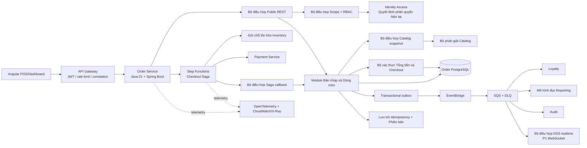
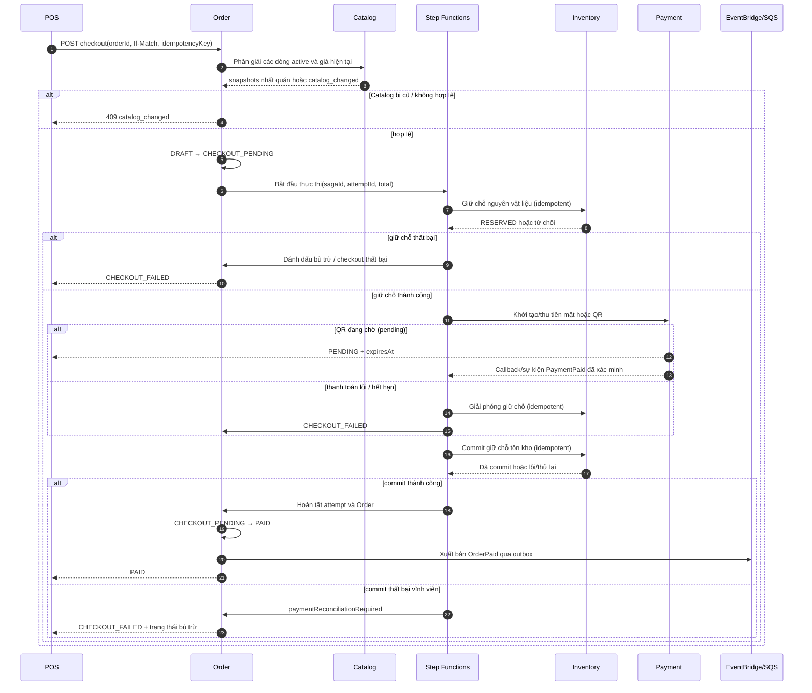
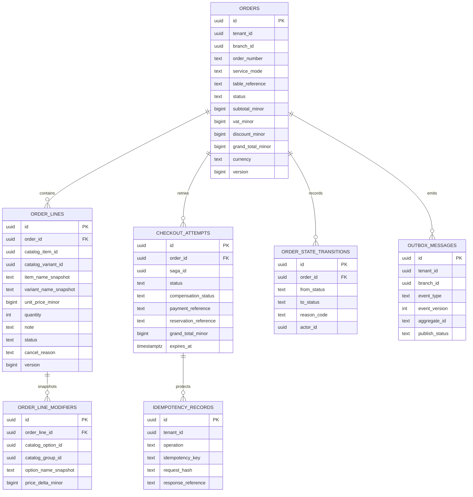

Started at: 2026/10/12 16:32:04 +07
Finished at: 2026/10/12 16:32:04 +07
Total time: 0 minutes
---

# Kiến trúc Hệ thống: Order Service (Dịch vụ Đơn hàng)

## Nguồn tài liệu

- [Tầm nhìn Order (Vision)](./2026-10-12-vision.md)
- [Yêu cầu Kỹ thuật Order (Requirements)](./2026-10-12-requirements.md)
- [Kiến trúc Nền tảng POS](../pos-platform/2026-10-12-architecture.md)
- [Hợp đồng Nền tảng POS](../pos-platform/2026-10-12-contracts.md)
- [Hợp đồng Identity & Access](../identity-access/2026-10-12-contracts.md)
- [Kiến trúc Catalog](../catalog/2026-10-12-architecture.md)
- [Hợp đồng Catalog](../catalog/2026-10-12-contracts.md)

## Mục tiêu Kiến trúc

1. Duy trì Order là nguồn chân lý duy nhất (single source of truth) cho vòng đời đơn hàng, trạng thái dòng món, các ảnh chụp snapshot Catalog bất biến và bản ghi các lượt thử thanh toán (checkout attempts).
2. Đảm bảo mọi thao tác công khai và nội bộ đều có phạm vi theo tenant/chi nhánh, với các mệnh đề điều kiện phòng thủ chiều sâu tại tầng repository.
3. Giúp việc chỉnh sửa đơn nháp an toàn cho nhiều thu ngân POS hoạt động đồng thời thông qua cơ chế kiểm soát tương tranh lạc quan mà không cần dùng khóa phân tán (distributed locks).
4. Điều phối các tác dụng phụ của Inventory, Payment và Order thông qua một quy trình Saga bền bỉ trên AWS Step Functions với các lệnh có tính bất biến (idempotent) do từng service sở hữu.
5. Đảm bảo không có callback nào bị thất bại, trùng lặp hoặc đến muộn có thể âm thầm tạo ra khoản thanh toán thứ hai, giữ chỗ trùng, hoàn tất lặp hoặc sự thật `OrderPaid` giả mạo.
6. Giữ cho các bảng chiếu sự kiện và màn hình bếp KDS ở P1 hoạt động bất đồng bộ trong khi vẫn duy trì ranh giới giao dịch cục bộ mạnh mẽ cho trạng thái của Order.
7. Giữ các tính năng bàn/tách/gộp/KDS của P1 và tự order qua QR của P2 nằm ngoài đường dẫn chạy P0 trong khi vẫn để lại các điểm mở rộng tương thích.

## Kiến trúc Thành phần

### Ngữ cảnh Hệ thống (System Context)



### Các Thành phần và Trách nhiệm

| Thành phần | Trách nhiệm | Công nghệ / Ranh giới |
|---|---|---|
| Bộ điều hợp Public REST | Các lệnh tạo/liệt kê/đọc/sửa/tính lại giá/hủy/checkout; ánh xạ envelope chuẩn | Spring MVC + OpenAPI |
| Bộ điều hợp Phân quyền | Xác thực ngữ cảnh Cognito qua Identity; xây dựng `TenantBranchScope`; thực thi quyền | REST nội bộ Identity / mTLS |
| Module Bản nháp và Dòng món | Vòng đời đơn hàng, biến đổi dòng món, hủy món và kiểm tra phiên bản | Module ứng dụng / domain của Order |
| Bộ điều hợp Catalog snapshot | Phân giải lựa chọn món/biến thể/modifier hiện tại và so sánh phiên bản Catalog | REST nội bộ sang Catalog |
| Bộ xác thực Tổng tiền / Checkout | Tính toán các khoản tổng số nguyên, xác thực dòng active và các tiền điều kiện checkout | Pure domain service + giao dịch Order DB |
| Module Lượt thử Thanh toán | Lưu trữ attempt, tham chiếu Saga, các trường timeout/đối soát/bù trừ | Order DB |
| Bộ điều hợp Saga callback | Xác thực và áp dụng kết quả tác vụ / callback Step Functions một cách bất biến | Bộ điều hợp REST/event nội bộ |
| Transactional outbox | Lưu trữ bền vững các sự kiện vòng đời/audit/tích hợp cùng thay đổi trạng thái cục bộ | Order DB + publisher worker |
| Step Functions | Điều phối bền bỉ, thử lại, chờ đợi, timeout và bù trừ | Bộ điều hợp AWS / local |
| Catalog Service | Nguồn chân lý cho lựa chọn thực đơn, giá và tính sẵn sàng của thực đơn hiện tại | Service / DB riêng biệt |
| Inventory Service | Mở rộng công thức, reserve/commit/release và sở hữu tồn kho vật lý | Service / DB riêng biệt |
| Payment Service | Trạng thái tiền mặt/VNPAY, xác minh IPN, quyết toán/đối soát thanh toán | Service / DB riêng biệt |
| Loyalty/Reporting/Audit | Tiêu thụ sự kiện và xây dựng các bảng chiếu dữ liệu (projections) | SQS consumers / mô hình đọc |
| Bộ điều hợp KDS | Chuyển phát sự kiện món ăn bền bỉ sang WebSocket / phát lại ở P1 | Bộ điều hợp P1 riêng; WebSocket không phải nguồn chân lý |

### Ranh giới Trách nhiệm của Service

Order sở hữu:

- Bảng `orders`, `order_lines`, các snapshot modifier/tên/giá, trạng thái đơn/dòng và phiên bản.
- Bảng `checkout_attempts`, tham chiếu Saga, các cờ đối soát và bản ghi idempotency cục bộ.
- Số hiệu đơn hàng (order number) có phạm vi theo chi nhánh và mô hình đọc/truy vấn đơn hàng.
- Vòng đời đơn hàng và sự thật đơn đã thanh toán chuẩn mực `OrderPaid`.

Order không sở hữu:

- Trạng thái món Catalog, giá biến thể hay quy tắc modifier.
- Nguyên vật liệu, công thức, tồn kho hay sổ cái giữ chỗ tồn kho.
- Giao dịch cổng thanh toán, chữ ký checksum IPN hay trạng thái quyết toán thanh toán.
- Số điện thoại/hồ sơ khách hàng, số dư loyalty hay sổ cái tích điểm.
- Lưu trữ audit dài hạn hay trạng thái phiên kết nối socket của KDS.

Tuyệt đối không có lệnh SQL join hay khóa ngoại cơ sở dữ liệu thời gian chạy nào vượt qua ranh giới của các service này. Các ID chéo service là các tham chiếu mờ (opaque references) được xác thực thông qua hợp đồng và ngữ cảnh tenant/chi nhánh.

## Kiến trúc Giao tiếp

### Luồng Lệnh cho Đơn Nháp (Draft Command Flow)

1. Angular gửi một lệnh công khai kèm Cognito JWT, chi nhánh được chọn, correlation ID, idempotency key cho thao tác có thể thử lại và header `If-Match` cho các cập nhật có phiên bản.
2. API Gateway thực hiện kiểm tra token cơ bản; Order gọi sang Identity để lấy quyền hạn hiện tại và tư cách thành viên chi nhánh.
3. Order xác thực quyền sở hữu `tenantId`/`branchId` từ ngữ cảnh đã phân giải và nạp đơn hàng với mệnh đề điều kiện tenant/chi nhánh.
4. Đối với các thay đổi về món/biến thể/modifier, Order gọi bộ phân giải hàng loạt của Catalog và nhận về tên, giá, quy tắc lựa chọn nhất quán và `catalogVersion`.
5. Order ghi snapshot dòng món, các khoản tổng, phiên bản và outbox trong cùng một giao dịch.
6. Phản hồi trả về phiên bản/ETag mới của Order và các trường snapshot bất biến. Các bên ghi mang phiên bản cũ nhận mã lỗi `409 catalog_version_conflict` mà không gây ra bất kỳ ghi nhận dở dang nào.

### Luồng Checkout Saga (Checkout Saga Flow)



Biểu đồ trên mang tính khái niệm và hướng theo hợp đồng. Đây không phải là vết chạy thời gian thực do chưa có mã nguồn Order; biểu đồ PlantUML L1/L2 thực tế sẽ là sản phẩm bàn giao sau khi dựng khung dự án.

### Luồng Bù trừ và Xử lý IPN Đến Muộn

```mermaid
sequenceDiagram
    autonumber
    participant P as Payment
    participant SF as Step Functions
    participant I as Inventory
    participant O as Order
    participant R as Đối soát (Reconciliation)

    P-->>SF: PaymentFailed / timeout
    SF->>I: releaseReservation(attemptId, idempotencyKey)
    alt giải phóng được chấp nhận / hoàn tất
        SF->>O: Đánh dấu CHECKOUT_FAILED, bù trừ an toàn
    else giải phóng lỗi tạm thời
        SF->>I: Thử lại với lùi thời gian (backoff)
        SF->>O: compensationStatus=RETRYING
    else giải phóng lỗi vĩnh viễn
        SF->>O: compensationStatus=FAILED, khóa thử lại
        SF-->>R: Phát cảnh báo / đẩy DLQ cho vận hành
    end

    P-->>O: PaymentPaid đã xác minh sau khi giải phóng tồn kho
    O->>R: Ghi nhận late_payment_reconciliation
    O-->>O: Giữ Order ở CHECKOUT_FAILED; tuyệt đối không tự động phục hồi
```

### Luồng Sự kiện (Event Flow)

- Biến đổi trạng thái Order và chèn sự kiện outbox commit trong cùng một giao dịch cục bộ.
- Tiến trình Publisher gửi các sự kiện `OrderCreated`, `OrderCancelled`, `OrderCheckoutFailed`, `OrderPaid` và sự kiện món ăn P1 tới EventBridge.
- EventBridge định tuyến tới các hàng đợi SQS có giới hạn số lần thử lại và hàng đợi DLQ cho Loyalty, Reporting, Audit và KDS.
- `OrderPaid` là sự thật đơn hàng đã thanh toán chuẩn mực duy nhất. Sự kiện `PaymentPaid` là sự thật thanh toán phục vụ Saga/đối soát, không phải là trigger trực tiếp cho tồn kho, không phải sự thật doanh thu hay trigger tích điểm loyalty.
- Các consumer khử trùng lặp theo `eventId`, xác thực phạm vi tenant và hiển thị độ tươi mới của bảng chiếu. Độ trễ nhất quán cuối cùng của bảng chiếu không bao giờ được dùng để cấp phép cho một biến đổi Order công khai.

### Ranh giới Độ Tin Cậy (Trust Boundaries)

- Client công khai → API Gateway → Order: Cognito access token, giới hạn tốc độ (rate limit) và correlation.
- Order → Identity/Catalog/Inventory/Payment: mTLS / workload identity, ngữ cảnh tenant/chi nhánh tường minh và timeout có giới hạn.
- Nhà cung cấp cổng thanh toán → Duy nhất Payment: Chữ ký/checksum của nhà cung cấp do Payment xác minh; Order không bao giờ nhận trực tiếp các trường của nhà cung cấp.
- Step Functions → API của các service: Danh tính tác vụ, yêu cầu có chữ ký / mTLS, tính bất biến theo `sagaId`/`attemptId` và quyền sở hữu trạng thái.
- EventBridge/SQS → Consumers: Xác thực schema sự kiện, khử trùng lặp theo event ID, hàng đợi DLQ và không truy cập database trực tiếp.

## Kiến trúc Dữ liệu

### Mô hình Thực thể Quan hệ (Entity Relationship Model)



### Các Quyết định Cơ sở Dữ liệu

| Quyết định | Lựa chọn | Cơ sở lý luận |
|---|---|---|
| Cơ sở dữ liệu | PostgreSQL riêng cho Order Service | Giao dịch cục bộ mạnh mẽ cho trạng thái đơn / snapshot / attempt. |
| ID | UUID v7 | Có thể sắp xếp theo thời gian, sinh phân tán và tương thích toàn nền tảng. |
| Tiền tệ | `BIGINT` số nguyên VND | Triệt tiêu hoàn toàn sai số tài chính dấu phẩy động. |
| Thời gian | UTC `TIMESTAMPTZ` | Xử lý timeout và sự kiện chéo service nhất quán. |
| Snapshots | Các cột bất biến kết hợp snapshot modifier đã chuẩn hóa | Hiển thị Order lịch sử không bao giờ phụ thuộc vào tính sẵn sàng của Catalog. |
| Lịch sử trạng thái | Bản ghi chuyển đổi chỉ nối thêm (append-only) cho các bước chuyển quan trọng | Phục vụ audit/debug mà không biến Audit DB thành một phụ thuộc giao dịch. |
| Outbox | Cùng giao dịch DB với biến đổi trạng thái | Ngăn ngừa việc thất lạc sự kiện Order. |
| Idempotency | Khóa duy nhất tenant/operation/key + hash yêu cầu | An toàn khi phát lại lệnh và tác vụ Saga. |
| Phân vùng | Không phân vùng các bảng cốt lõi trong MVP | Quy mô thử nghiệm dự kiến chưa đòi hỏi độ phức tạp vận hành này; theo dõi outbox riêng. |
| Mô hình đọc | Chỉ mục PostgreSQL cho danh sách giao dịch; Reporting sở hữu bảng chiếu phân tích | Tránh các lệnh join phân tích chéo service. |

### Các Bất biến Cốt lõi (Core Invariants)

- Các trường `orders.tenant_id` và `orders.branch_id` là bắt buộc và bất biến.
- Khóa ngoại `order_lines.order_id` phải thuộc cùng tenant/chi nhánh với Order cha thông qua kiểm tra ứng dụng và ràng buộc sở hữu phức hợp khi khả thi.
- Bắt buộc có ít nhất một dòng `ACTIVE` để thực hiện checkout; các dòng đã hủy vẫn có thể truy vấn để xem lịch sử.
- Điều kiện `grand_total_minor >= 0`; mọi giá trị tiền tệ thành phần đều là số nguyên không âm trong cùng một đơn vị tiền tệ.
- Chỉ có duy nhất một checkout attempt đang ở trạng thái `CHECKOUT_PENDING` / chưa kết thúc cho mỗi Order.
- `PAID` và `CANCELLED` là các trạng thái kết thúc đối với các biến đổi công khai trong P0.
- Sự kiện `OrderPaid` chỉ phát ra đúng một lần cho mỗi Order nhờ bộ bảo vệ hoàn tất đơn duy nhất, ngay cả khi callback Saga bị thử lại nhiều lần.
- Cùng một idempotency key nhưng khác hash yêu cầu sẽ trả về lỗi `duplicate_request`; không bao giờ thực thi tác dụng phụ thứ hai.
- Thao tác hủy dòng món không thể diễn ra ngoài trạng thái `DRAFT` hoặc khi thiếu lý do / tác nhân thực hiện.
- Tuyệt đối không tạo khóa ngoại chéo service cho các ID của Catalog, Identity, Inventory, Payment, Loyalty hay Audit.

### Chiến lược Chỉ mục (Index Strategy)

| Chỉ mục (Index) | Mục đích |
|---|---|
| `(tenant_id, branch_id, created_at DESC)` | Danh sách đơn hàng chi nhánh và lịch sử POS gần đây. |
| `(tenant_id, branch_id, status, created_at DESC)` | Bộ lọc đơn nháp / pending / đã thanh toán / thất bại. |
| `(tenant_id, branch_id, order_number)` duy nhất | Số hiệu đơn hàng thân thiện với người dùng theo chi nhánh. |
| `(tenant_id, id)` duy nhất | Tra cứu ID có phạm vi và phòng thủ lỗ hổng IDOR. |
| `(order_id, status)` | Truy vấn các dòng active và lịch sử dòng món. |
| `(order_id, created_at)` | Lịch sử các lượt thử thanh toán (checkout attempts). |
| `(tenant_id, status, expires_at)` | Tiến trình worker xử lý timeout các attempt đang pending. |
| `(tenant_id, operation, idempotency_key)` duy nhất | Kiểm tra tính bất biến (idempotency) công khai và Saga. |
| `(publish_status, next_attempt_at, created_at)` | Tiến trình polling của outbox publisher. |
| `(tenant_id, event_id)` duy nhất | Bảo vệ chống trùng lặp / phát lại sự kiện. |

## Tính Nhất Quán, Tương Tranh và Xử Lý Sự Cố

### Tương tranh khi Sửa Đơn Nháp

- Nạp Order kèm theo mệnh đề tenant/chi nhánh và phiên bản (version).
- Xác thực header `If-Match` trước khi áp dụng biến đổi.
- Tính toán lại các khoản tổng và ghi phiên bản dòng/đơn trong cùng một giao dịch.
- Trả về ETag/phiên bản hiện tại khi biến đổi thành công; các yêu cầu mang phiên bản cũ nhận mã lỗi `409` và phải đọc lại dữ liệu mới.
- Không giữ khóa phân tán trong khi gọi sang Catalog. Việc phân giải Catalog diễn ra trước giao dịch ghi ngắn của Order; bước kiểm tra phiên bản bảo vệ lần ghi cuối cùng.

### Tính Nhất Quán khi Checkout

- Lệnh checkout trước tiên xác thực bản nháp và phiên bản Catalog, sau đó chuyển trạng thái sang `CHECKOUT_PENDING` trong giao dịch cục bộ trước khi khởi động Saga.
- Step Functions sở hữu việc sắp xếp thứ tự chéo service nhưng mỗi service tự sở hữu tác dụng phụ và giao dịch cục bộ của riêng mình.
- Thao tác hoàn tất Order kiểm tra `attemptId`, các tham chiếu thanh toán/giữ chỗ tồn kho kỳ vọng, snapshot tổng tiền và trạng thái attempt hiện tại. Một callback cũ chỉ được chấp nhận như một thao tác no-op bất biến hoặc chuyển sang đối soát.
- Thanh toán thành công nhưng commit tồn kho thất bại tuyệt đối không bao giờ được coi là một Order thành công. Cơ chế thử lại có giới hạn; ngoại lệ vĩnh viễn sẽ đặt cờ đối soát và chặn các lượt thử mới.
- Thanh toán thành công đến muộn sau khi đã giải phóng tồn kho không thể phục hồi lại Order. Payment/đối soát sở hữu ngoại lệ quyết toán từ nhà cung cấp.

### Chính sách Retry và Hàng đợi DLQ

- Các lệnh gọi phụ thuộc đồng bộ chỉ áp dụng timeout, circuit breaker và thử lại lùi số mũ có giới hạn cho các lỗi tạm thời.
- Các tác vụ Step Functions sử dụng các idempotency key có tính tiền định được sinh từ `tenantId`, `orderId`, `attemptId` và tên tác vụ.
- Tiến trình Outbox publisher thử lại kèm lùi thời gian; lỗi schema/xác thực được đưa vào hàng đợi DLQ kèm event ID và metadata correlation.
- Tác dụng phụ của consumer lưu trữ event ID trước khi xác nhận (ack) trong trường hợp consumer sở hữu một giao dịch cục bộ.
- Bù trừ thất bại duy trì khóa thử lại trên Order và phát sinh metric/cảnh báo; bắt buộc phải có hành động từ nhân viên vận hành / đối soát trước khi cho phép checkout mới.

## An Toàn Bảo Mật, Audit và Khả Năng Quan Sát

- Phân quyền hiện tại từ Identity được kiểm tra tại bộ điều hợp công khai và ánh xạ thành đối tượng domain `TenantBranchScope`; tầng repository lặp lại các mệnh đề tenant/chi nhánh.
- Các trường `orderId`, `lineId`, `branchId`, `catalogItemId`, `paymentReference` và `reservationReference` không bao giờ được tin cậy nếu chưa qua xác thực quyền sở hữu.
- Ghi chú món ăn có giới hạn độ dài, được làm sạch và loại bỏ khỏi các log có cấu trúc thông thường; các sự kiện chỉ mang các trường mà consumer đòi hỏi.
- Audit thao tác hủy món là một sự kiện outbox của Order mang actor, vai trò, lý do, tóm tắt trước/sau, ID đơn/dòng, chi nhánh, correlation ID và phiên bản kết quả.
- Log có cấu trúc bao gồm service, môi trường, request ID, correlation ID, tenant/chi nhánh, actor/workload, ID đơn/attempt/saga, bước chuyển đổi, kết quả và thời gian thực thi.
- Các chỉ số đo lường (metrics) bao gồm p95 biến đổi nháp, xung đột phiên bản, khởi tạo checkout, thời gian/kết quả Saga, thời gian pending, lỗi giữ chỗ/thanh toán, thử lại/lỗi bù trừ, ngoại lệ thanh toán muộn, độ trễ outbox, độ tuổi hàng đợi và độ sâu DLQ.
- Các span của OpenTelemetry kết nối liền mạch: Yêu cầu POS → Order → Catalog → Step Functions → Inventory/Payment → Hoàn tất Order. Các bí mật, JWT và chữ ký thô của nhà cung cấp đều được che giấu.

## Kiến Trúc Triển Khai

### Môi trường Cục bộ / Demo

- Docker Compose chạy PostgreSQL của Order tách biệt hoàn toàn với cơ sở dữ liệu và thông tin xác thực của Catalog/Inventory/Payment.
- Các bộ điều hợp cục bộ cho Step Functions, EventBridge và SQS bảo toàn nguyên vẹn ngữ nghĩa lệnh/sự kiện/idempotency; chúng không được phép đi tắt qua quyền sở hữu trạng thái.
- Dữ liệu mẫu (seed data) tạo nhiều tenant/chi nhánh, các bản nháp, biến thể, modifier và dữ liệu mẫu kiểm thử lỗi có tính tiền định.

### Môi trường Mục tiêu trên AWS

- Order API chạy dưới dạng các tác vụ stateless trên ECS Fargate nằm sau API Gateway / Load Balancer.
- Order PostgreSQL là một cơ sở dữ liệu RDS PostgreSQL do service tự sở hữu với thông tin xác thực quản lý qua Secrets Manager.
- AWS Step Functions vận hành máy trạng thái checkout với các chính sách timeout/retry/catch cho từng tác vụ.
- EventBridge định tuyến các sự kiện của Order tới các hàng đợi SQS và DLQ cho Loyalty, Reporting, Audit và KDS ở P1.
- CloudWatch/X-Ray/OpenTelemetry giám sát sức khỏe của API, Saga, outbox, hàng đợi và quy trình đối soát.
- Chiến lược triển khai Blue/green đòi hỏi các migration schema/sự kiện phải tương thích ngược và đảm bảo tính tương thích của các attempt đang pending.

## Các Bản ghi Quyết định Kiến trúc (ADRs)

| # | Quyết định | Các giải pháp thay thế | Cơ sở lý luận |
|---|---|---|---|
| ORD-01 | Order sở hữu snapshot Catalog bất biến | Đọc Catalog mỗi lần hiển thị; chỉ lưu ID | Đơn hàng lịch sử không được phép thay đổi khi thực đơn đổi giá hoặc bị lưu trữ. |
| ORD-02 | Step Functions điều phối checkout | Tự điều phối trong process của Order; chỉ dùng choreography | Chờ đợi bền bỉ, bù trừ tường minh, quản lý timeout và truy vết chéo service là các kết quả bắt buộc trong P0. |
| ORD-03 | Kiểm soát tương tranh lạc quan cho đơn nháp | Khóa phân tán; khóa theo thiết bị | Hỗ trợ nhiều thu ngân cùng thao tác mà không gặp sự phức tạp trong quản lý vòng đời khóa. |
| ORD-04 | Transactional outbox cho sự kiện/audit của Order | Xuất bản trực tiếp sau commit; ghi đồng bộ sang Audit DB | Ngăn chặn việc thất lạc sự kiện và tránh việc tính sẵn sàng của Audit chặn các biến đổi Order. |
| ORD-05 | `OrderPaid` là sự thật đơn đã thanh toán chuẩn mực | Loyalty/Reporting tiêu thụ sự kiện PaymentPaid | Ngăn chặn việc tích điểm hoặc tính doanh thu trùng lặp trước khi Order hoàn tất chính thức. |
| ORD-06 | Thanh toán muộn không tự ý phục hồi đơn hàng | Giữ chỗ lại và tự hoàn tất; ép buộc chuyển PAID | Tránh việc trừ tiền hai lần / bán âm kho và làm cho ngoại lệ hiển thị rõ ràng phục vụ đối soát. |
| ORD-07 | Tham chiếu bàn dạng chuỗi tự do trong P0 | Đưa danh mục bàn chuẩn vào P0 | Giữ cho sơ đồ bàn/trạng thái có khách/tách/gộp đơn nằm ngoài lát cắt dọc thanh toán P0. |
| ORD-08 | Không xóa cứng; các trạng thái vòng đời kết thúc | Xóa / tạo lại Order | Bảo toàn tính toàn vẹn của các tham chiếu audit, thanh toán, giữ chỗ tồn kho và báo cáo. |

## Ma trận Xác thực Kiến trúc (Architecture Validation Matrix)

| Nhóm yêu cầu | Phạm vi bao phủ kiến trúc |
|---|---|
| Đơn tại quầy / mang đi / tại bàn | Bộ điều hợp Public REST, chế độ phục vụ và `tableReference` trong Order DB. |
| Sửa / hủy đơn nháp | Module bản nháp, phiên bản lạc quan, vòng đời dòng món và outbox audit. |
| Snapshot Catalog | Bộ điều hợp Catalog, snapshot dòng/modifier bất biến và luồng tính lại giá. |
| Checkout Saga | Step Functions, tác vụ Inventory/Payment bất biến, callback hoàn tất đơn và bù trừ. |
| Thanh toán pending / IPN muộn | Trạng thái attempt, thời gian hết hạn 15 phút, ranh giới đối soát của Payment. |
| Bù trừ thất bại | Retry/DLQ, các trường trạng thái/khóa, cảnh báo và đối soát vận hành. |
| Cô lập tenant/chi nhánh | Bộ điều hợp Identity kết hợp mệnh đề repository / kiểm tra sở hữu phức hợp. |
| Sự kiện / báo cáo / loyalty | Transactional outbox, EventBridge/SQS và sự kiện chuẩn `OrderPaid`. |
| KDS ở P1 | Sự kiện món ăn bền bỉ và bộ điều hợp WebSocket nằm ngoài nguồn chân lý. |
| NFR / An toàn bảo mật | Chỉ mục, lệnh gọi có giới hạn, metadata truy vết, làm sạch dữ liệu, metrics và cấu trúc triển khai. |

## Biểu đồ Trình tự (Sequence Diagrams)

- **Trạng thái:** Đã bao gồm các biểu đồ Mermaid khái niệm cho luồng checkout P0 và luồng bù trừ / IPN đến muộn.
- **Truy vết thời gian chạy (Runtime trace):** Được hoãn lại cho đến khi controller, bộ điều hợp, định nghĩa tác vụ và event listener được triển khai thực tế.
- **Sản phẩm bàn giao dự kiến:** Sinh các biểu đồ PlantUML L1/L2 định dạng `.adoc` sau khi khung dự án và các hợp đồng được triển khai, tuân thủ cổng xác nhận của kỹ năng `sequence-diagram`.

## Các Kỹ năng Chuyên môn được Tham chiếu

- **api-design:** Phân định ranh giới lệnh/truy vấn, định hướng REST/OpenAPI, mô hình lỗi/tương tranh/idempotency và API workload nội bộ.
- **database-design:** Lược đồ chuẩn hóa do Order tự sở hữu, snapshot bất biến, ràng buộc, chỉ mục, UUID v7, tiền tệ số nguyên và chiến lược migration.
- **log-processing:** Các trường correlation/audit có cấu trúc, metrics Saga, đo đạc outbox/DLQ và làm sạch dữ liệu nhạy cảm.
- **sequence-diagram:** Dùng để định hình các luồng trọng yếu về mặt khái niệm; việc truy vết mã nguồn được hoãn lại do chưa có mã triển khai.

## Phê duyệt

- **Trạng thái:** Đã được người dùng phê duyệt
- **Giai đoạn:** Thiết kế Kiến trúc (Architecture Design)
- **Giai đoạn tiếp theo sau phê duyệt:** Hợp đồng Dữ liệu & API (API & Data Contracts)
