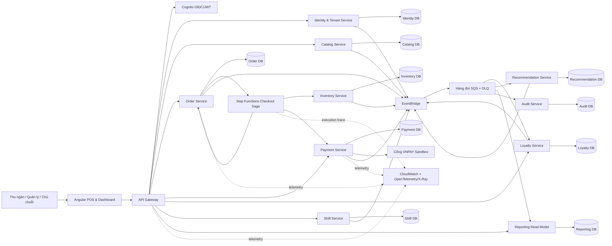

# Kiến trúc Hệ thống: POS Platform (Nền tảng POS Đa Tenant)

## Nguồn tham chiếu

- **Tầm nhìn (Vision):** [`2026-10-12-vision.md`](./2026-10-12-vision.md)
- **Đánh giá Tầm nhìn (Vision Review):** [`2026-10-12-vision-review.md`](./2026-10-12-vision-review.md)
- **Yêu cầu Hệ thống (Requirements):** [`2026-10-12-requirements.md`](./2026-10-12-requirements.md)

---

## Mục tiêu Kiến trúc (Architecture Goals)

1. Vận hành hoàn chỉnh một lát cắt dọc P0 (vertical slice) từ đầu đến cuối (end-to-end) trong môi trường lai (hybrid: cục bộ kết hợp cloud).
2. Duy trì ranh giới độc lập tuyệt đối giữa các Bounded Context, quyền sở hữu cơ sở dữ liệu riêng biệt (database ownership) và các hợp đồng tích hợp chuẩn hóa.
3. Làm cho quy trình bồi hoàn lỗi (compensation) của Saga, cơ chế thử lại (retry) và tính nhất quán sau cùng (eventual consistency) có thể quan sát trực quan và minh bạch.
4. Bảo vệ tính cách ly dữ liệu giữa các tenant và chi nhánh (tenant/branch isolation) qua nhiều tầng phòng thủ theo chiều sâu.
5. Cho phép mở rộng quy mô và triển khai độc lập từng microservice mà không làm biến bản MVP thành một hệ thống cồng kềnh khó vận hành.

---

## Kiến trúc Thành phần (Component Architecture)

### Sơ đồ Tổng quan Hệ thống (System Overview)



### Trách nhiệm và Quyền sở hữu Dữ liệu của từng Thành phần

| Thành phần | Trách nhiệm chính | Quyền sở hữu dữ liệu | Giao thức giao tiếp |
|---|---|---|---|
| **Angular POS & Dashboard** | Giao diện thu ngân, phân quyền giao diện theo vai trò, màn hình báo cáo trực quan, hiển thị độ tươi mới dữ liệu và thông báo lỗi | Chỉ lưu trạng thái giao diện (UI State) | HTTPS REST / OpenAPI |
| **API Gateway** | Đầu mối bảo mật TLS, định tuyến request, giới hạn tần suất (rate limiting), gắn correlation ID, tích hợp Cognito Authorizer | Không sở hữu dữ liệu nghiệp vụ | HTTPS chuyển tiếp tới các service |
| **Cognito** | Quản lý định danh người dùng, xác thực đăng nhập, cấp phát JWT token và vòng đời tài khoản | Trạng thái của Identity Provider | OAuth2 / OIDC / JWT |
| **Identity & Tenant Service** | Quản lý thông tin chuỗi (tenant), chi nhánh (branch), thành viên nhân viên, vai trò (role) và chính sách phân quyền | Cơ sở dữ liệu Identity DB | REST API + Domain Events |
| **Catalog Service** | Quản lý danh mục, món ăn, biến thể (size), topping/modifier và trạng thái còn/hết hàng | Cơ sở dữ liệu Catalog DB | REST API + Domain Events |
| **Order Service** | Quản lý đơn nháp, lưu ảnh chụp giá (price snapshot), vòng đời đơn hàng, đầu mối kích hoạt quy trình checkout | Cơ sở dữ liệu Order DB + Outbox | REST API + Saga + Events |
| **Payment Service** | Quản lý trạng thái thanh toán tiền mặt và VNPAY, tiếp nhận IPN, kiểm tra chữ ký checksum và đối soát giao dịch | Cơ sở dữ liệu Payment DB + Outbox | REST API, Callback, Events |
| **Inventory Service** | Quản lý nguyên vật liệu, công thức định lượng, số dư tồn kho, cơ chế giữ chỗ (reserve), xác nhận trừ kho (commit) và giải phóng (release) | Cơ sở dữ liệu Inventory DB + Outbox | Saga REST + Events |
| **Loyalty Service** | Quản lý hồ sơ khách hàng thân thiết, sổ cái điểm thưởng bất biến (points ledger), tính toán số dư và xử lý thu hồi điểm | Cơ sở dữ liệu Loyalty DB + Outbox | REST API + Events |
| **Shift Service** | Quản lý việc mở/đóng ca làm việc và kiểm soát số tiền mặt đầu ca/cuối ca | Cơ sở dữ liệu Shift DB + Outbox | REST API + Events |
| **Recommendation Service** | Khai phá luật kết hợp (association rules), lọc gợi ý món theo giỏ hàng/tồn kho và theo dõi chỉ số hiệu quả gợi ý | Cơ sở dữ liệu Recommendation DB | REST API + Events |
| **Reporting Read Model** | Lắng nghe các sự kiện nghiệp vụ để xây dựng các bảng chiếu báo cáo doanh thu theo ngày, chi nhánh và top món bán chạy | Cơ sở dữ liệu Reporting DB | SQS Consumers + REST Query |
| **Audit Service** | Ghi nhận nhật ký kiểm toán bất biến (append-only) phục vụ an ninh và đối soát nghiệp vụ | Cơ sở dữ liệu Audit DB | SQS Consumer + Restricted REST Query |
| **Step Functions Checkout Saga** | Điều phối toàn bộ quy trình thanh toán: Giữ chỗ kho → Thanh toán → Hoàn tất đơn và tự động bồi hoàn khi có lỗi | Trạng thái thực thi quy trình (Execution State) | HTTPS Task calls + Callback correlation |
| **EventBridge + Hàng đợi SQS** | Định tuyến sự kiện domain, cô lập consumer, tự động thử lại (retry) và chuyển thông điệp lỗi vào DLQ | Metadata của Message Broker | Vận chuyển sự kiện bất đồng bộ |
| **Khả năng quan sát (Observability)** | Thu thập logs có cấu trúc, chỉ số metrics, distributed traces, cảnh báo tự động và dashboard giám sát | Kho lưu trữ Telemetry | OpenTelemetry / CloudWatch / X-Ray |

---

### Quy tắc Ranh giới Dịch vụ (Service Boundary Rules)

1. **Nguyên tắc độc lập dữ liệu:** Mỗi service chỉ được phép đọc và ghi vào cơ sở dữ liệu do chính mình sở hữu.
2. **Cấm liên kết chéo DB:** Tuyệt đối không sử dụng khóa ngoại vật lý (foreign key) hoặc câu lệnh SQL JOIN xuyên qua các cơ sở dữ liệu khác nhau; mọi tham chiếu liên service phải dùng UUID mờ (opaque ID) và lưu ảnh chụp dữ liệu (snapshot) tại thời điểm giao dịch.
3. **Bảo toàn lịch sử:** Order Service tự lưu ảnh chụp giá, tên món và biến thể tại thời điểm khách chọn món, đảm bảo lịch sử đơn hàng không bị thay đổi khi Catalog cập nhật bảng giá sau này.
4. **Không phụ thuộc trạng thái chéo:** Payment Service tham chiếu đến `orderId` nhưng không sở hữu hay can thiệp trực tiếp vào trạng thái đơn hàng của Order Service.
5. **Ranh giới nguyên liệu:** Inventory Service tham chiếu đến `catalogItemId` và phiên bản công thức qua hợp đồng; tuyệt đối không truy vấn trực tiếp vào Catalog DB.
6. **Mô hình báo cáo chỉ đọc:** Reporting Read Model và Audit Service chỉ tiếp nhận sự kiện (events/facts), không bao giờ trở thành nguồn dữ liệu để các transaction nghiệp vụ đọc phụ thuộc.
7. **Chia sẻ mã nguồn tối thiểu:** Mã nguồn dùng chung (shared code) chỉ giới hạn ở các cấu trúc dữ liệu nguyên thủy (schema primitives), cấu trúc bọc lỗi chuẩn (error envelope), thông tin correlation/tenant context và metadata của sự kiện; cấm dùng chung Domain Entity hoặc Repository.

---

## Kiến trúc Giao tiếp (Communication Architecture)

### 1. Luồng Giao tiếp Đồng bộ (Synchronous Path)

- Ứng dụng Angular gọi tới API Gateway thông qua giao thức bảo mật HTTPS.
- API Gateway thực hiện xác thực Cognito Authorizer, kiểm tra tính hợp lệ cơ bản và định tuyến đến service sở hữu tài nguyên tương ứng.
- Service nhận request, xác thực token JWT, trích xuất ngữ cảnh tenant/branch và xử lý lệnh/truy vấn cục bộ.
- Mọi lệnh thay đổi dữ liệu có tác dụng phụ (mutation commands) bắt buộc phải truyền tiêu đề `Idempotency-Key`.
- Toàn bộ API áp dụng chuẩn RESTful, kiến trúc hướng tài nguyên, tuân thủ đặc tả OpenAPI v3.1, trả về cấu trúc lỗi chuẩn hóa và truyền thừa các mã `requestId` / `correlationId`.
- Giao tiếp đồng bộ giữa các service nội bộ (service-to-service) chỉ được phép sử dụng cho các bước điều phối của Saga hoặc các truy vấn cần kết quả ngay lập tức; nghiêm cấm tạo chuỗi gọi API đồng bộ kéo dài.

### 2. Luồng Giao tiếp Bất đồng bộ (Asynchronous Path)

1. Service thực hiện ghi dữ liệu nghiệp vụ và bản ghi Outbox trong **cùng một transaction cục bộ của PostgreSQL**.
2. Tiến trình Outbox Publisher định kỳ đọc các bản ghi chưa gửi và publish sự kiện có đánh số phiên bản lên AWS EventBridge.
3. EventBridge định tuyến sự kiện tới các hàng đợi SQS chuyên biệt của từng consumer/bounded context.
4. Consumer nhận thông điệp, kiểm tra khử trùng lặp (idempotent handling), cập nhật bảng chiếu (projection) và gửi xác nhận hoàn tất (acknowledge) để xóa message khỏi hàng đợi.
5. Trường hợp xử lý lỗi, message được tự động thử lại theo thuật toán lũy thừa (Exponential Backoff); nếu vượt quá số lần thử lại tối đa, message sẽ được đưa vào hàng đợi Dead-Letter Queue (DLQ) để phục vụ việc điều tra.

Cấu trúc bao bì sự kiện tiêu chuẩn (Event Envelope):

```text
eventId, eventType, eventVersion, occurredAt,
tenantId, branchId, aggregateType, aggregateId,
correlationId, causationId, producer, payload
```

### Danh mục Định tuyến Sự kiện (Event Routing Ownership)

| Tên sự kiện | Service phát tán (Producer) | Service tiếp nhận (Consumers) | Mục đích nghiệp vụ |
|---|---|---|---|
| `CatalogItemAvailabilityChanged` | Catalog | Recommendation, Reporting | Loại bỏ món hết hàng khỏi danh sách gợi ý và mô hình đọc báo cáo |
| `OrderCreated` | Order | Recommendation, Reporting, Audit | Ghi nhận đơn hàng mới và cập nhật dữ liệu phân tích |
| `SuggestionShown` | Recommendation | Reporting, Audit | Đo lường số lượt hiển thị gợi ý món |
| `SuggestionAccepted` | Recommendation | Reporting, Audit | Đo lường tỷ lệ khách đồng ý chọn món và giá trị đơn hàng tăng thêm |
| `InventoryReserved` | Inventory | Saga, Order, Audit | Xác nhận đã giữ chỗ nguyên liệu thành công để quy trình checkout tiếp tục |
| `InventoryReservationReleased` | Inventory | Saga, Order, Audit | Xác nhận đã giải phóng nguyên liệu (khi bồi hoàn Saga) |
| `PaymentInitiated` | Payment | Saga, Audit | Bắt đầu và ghi nhận nỗ lực thanh toán của đơn hàng |
| `PaymentPaid` | Payment | Saga, Audit | Xác nhận thanh toán thành công để Saga điều phối bước trừ kho chính thức (`CommitReservation`) |
| `PaymentFailed` | Payment | Saga, Order, Audit | Kích hoạt luồng bồi hoàn Saga và cập nhật trạng thái lỗi |
| `OrderPaid` | Order | Loyalty, Reporting, Audit | **Sự thật chuẩn mực (Canonical Fact)** về đơn hàng đã thanh toán; nguồn duy nhất để tính điểm thành viên và số liệu doanh thu |
| `LoyaltyPointsAccrued` | Loyalty | Reporting, Audit | Cập nhật số điểm thưởng đã tích lũy vào báo cáo |
| `LoyaltyPointsReversed` | Loyalty | Reporting, Audit | Ghi nhận bản ghi đối ứng trên sổ cái khi thu hồi điểm |
| `ShiftOpened` / `ShiftClosed` | Shift | Reporting, Audit | Cập nhật báo cáo dòng tiền và tình trạng ca làm việc |
| `AuditRecorded` | Toàn bộ các service | Audit | Lưu vết kiểm toán an ninh và nghiệp vụ bất biến |

---

## Kiến trúc Luồng Checkout Saga (Checkout Saga Architecture)

### Cơ chế Điều phối (Orchestration)

Quy trình sử dụng AWS Step Functions làm bộ điều phối trung tâm; mỗi bước (task) thực thi một API có tính lũy kế của service sở hữu trạng thái đó. Bản ghi thực thi Saga luôn mang theo các thông tin: `sagaId`, `orderId`, `tenantId`, `branchId` và `correlationId`.

```text
Yêu cầu Checkout được gửi đến
  → Order Service kiểm tra tính toàn vẹn của đơn hàng và chuyển sang CHECKOUT_PENDING
  → Gọi Inventory.reserve(orderId, recipeVersion, idempotencyKey) để giữ chỗ nguyên liệu
  → Gọi Payment.initiate(orderId, amount, method, idempotencyKey) để bắt đầu thanh toán
  → [Tiền mặt: Thành công tức thì | VNPAY: Tạm dừng đợi nhận webhook IPN đã xác thực chữ ký]
  → Gọi Order.finalizePaid(orderId) chốt đơn thành công
  → Phát sự kiện OrderPaid
  → Loyalty Service nhận sự kiện và cộng điểm cho khách
  → Reporting Service nhận sự kiện và cập nhật doanh thu

Xử lý sự cố (Thanh toán lỗi / Quá thời gian chờ / Lỗi hệ thống)
  → Payment được đánh dấu là FAILED hoặc EXPIRED
  → Tự động kích hoạt bù trừ: Gọi Inventory.releaseReservation(orderId, idempotencyKey)
  → Order Service đánh dấu đơn hàng là CHECKOUT_FAILED hoặc CANCELLED
  → Phát sự kiện thông báo kết quả bồi hoàn
  → Nếu việc bồi hoàn thất bại sau số lần retry giới hạn, đưa vào DLQ để can thiệp thủ công
```

### Quyền sở hữu Trạng thái (State Ownership)

| Trạng thái | Service sở hữu | Nguồn kích hoạt chuyển trạng thái hợp lệ |
|---|---|---|
| `DRAFT` / `CHECKOUT_PENDING` / `PAID` / `CHECKOUT_FAILED` | Order Service | Lệnh từ API thu ngân + Callback từ Saga |
| `RESERVED` / `COMMITTED` / `RELEASED` / `EXPIRED` | Inventory Service (Reservation Aggregate) | Lệnh từ Saga + Quá hạn tự động + Job đối soát |
| `PENDING` / `PAID` / `FAILED` / `EXPIRED` / `CANCELLED` | Payment Service | Lệnh API thanh toán + Webhook IPN + Job đối soát |
| `ACTIVE` / `CLOSED` | Shift Service | Lệnh từ API đóng/mở ca của thu ngân |
| `PENDING` / `POSTED` / `REVERSED` | Loyalty Service (Sổ cái Ledger Entry) | Sự kiện thanh toán thành công hoặc lệnh hủy đơn |

---

## Kiến trúc Dữ liệu (Data Architecture)

### Phân vùng Cơ sở dữ liệu (Database Topology)

| Service | Cơ sở dữ liệu chính | Các bảng / Aggregate cốt lõi | Mức độ cách ly dữ liệu |
|---|---|---|---|
| **Identity & Tenant** | PostgreSQL | `tenants`, `branches`, `users`, `memberships`, `role_scopes` | Cách ly theo Tenant và Chi nhánh; bảo vệ thông tin PII |
| **Catalog** | PostgreSQL | `categories`, `items`, `variants`, `modifiers`, `availability` | Cách ly theo Tenant (bảng giá riêng theo chi nhánh ở P1) |
| **Order** | PostgreSQL | `orders`, `order_lines`, `price_snapshots`, `outbox`, `idempotency_records` | Cách ly chặt chẽ theo Tenant và Chi nhánh |
| **Payment** | PostgreSQL | `payment_attempts`, `provider_callbacks`, `reconciliations`, `outbox` | Cách ly theo Tenant; tuyệt đối không lưu dữ liệu thẻ thô |
| **Inventory** | PostgreSQL | `ingredients`, `recipes`, `stock_ledger`, `reservations`, `outbox` | Cách ly chặt chẽ theo Tenant và Chi nhánh |
| **Loyalty** | PostgreSQL | `customers`, `loyalty_accounts`, `ledger_entries`, `balance_projection`, `outbox` | Cách ly theo Tenant; che giấu số điện thoại khách hàng |
| **Shift** | PostgreSQL | `shifts`, `opening_cash`, `cash_movements`, `outbox` | Cách ly chặt chẽ theo Tenant và Chi nhánh |
| **Recommendation** | PostgreSQL | `association_rules`, `suggestion_events`, `item_features` | Cách ly theo Tenant; lưu dữ liệu phái sinh phân tích |
| **Reporting** | PostgreSQL (Read Model) | `sales_daily`, `sales_by_branch`, `top_items`, `recommendation_metrics` | Bảng chiếu phục vụ truy vấn, được tái tạo hoàn toàn từ sự kiện |
| **Audit** | PostgreSQL (Append-only) | `audit_events`, `security_events` | Bảng ghi nhật ký bất biến phân vùng theo Tenant và thời gian |

> **Lưu ý triển khai môi trường Demo cục bộ:** Để thuận tiện cho việc khởi chạy demo trên máy cá nhân, toàn bộ các cơ sở dữ liệu trên có thể đặt chung trong cùng một container PostgreSQL nhưng bắt buộc phải tạo thành **các Database độc lập và cấp phát tài khoản/mật khẩu riêng biệt cho từng service**. Việc này đảm bảo tính độc lập tuyệt đối về mặt logic và phân quyền mạng, không cho phép thực hiện truy vấn chéo dữ liệu. Khi triển khai lên môi trường Cloud thật, các database này có thể dễ dàng tách ra thành các cụm AWS Aurora riêng mà không cần thay đổi bất kỳ dòng mã nguồn nào.

---

## Các Quyết định Kiến trúc Trọng yếu (Architecture Decision Records - ADRs)

| # | Quyết định (Decision) | Các phương án đã cân nhắc | Rationale (Cơ sở lựa chọn) |
|---|---|---|---|
| **ADR-1** | **Mô hình Dịch vụ phân tán lai (Hybrid Distributed Services)** | Triển khai 100% trên AWS ngay từ ngày đầu; Kiến trúc khối mô-đun (Modular Monolith) | Giúp bài demo có thể tái lập và chạy mượt mà trên môi trường cục bộ, đồng thời giữ trọn vẹn ranh giới microservice, ranh giới lỗi và các điểm tích hợp thực tế. |
| **ADR-2** | **REST/OpenAPI cho đồng bộ, EventBridge/SQS cho bất đồng bộ** | Dùng GraphQL toàn diện; Chuỗi gọi REST đồng bộ kéo dài; Chia sẻ database chung | Các thao tác POS cần hợp đồng API tường minh và dễ đoán; trong khi luồng phân tích và báo cáo hưởng lợi tối đa từ sự cô lập bất đồng bộ. |
| **ADR-3** | **Saga Orchestration bằng Step Functions cho luồng Checkout** | Saga Biên đạo phân tán (Choreography); Điều phối nội bộ trong cùng tiến trình | Khả năng kiểm soát bù trừ minh bạch và đồ thị thực thi trực quan là mục tiêu trình diễn kiến trúc cốt lõi của bài toán. |
| **ADR-4** | **Cơ sở dữ liệu PostgreSQL riêng cho từng service** | Dùng chung 1 database schema duy nhất; Đa dạng hóa nhiều loại DB (Polyglot) ngay từ MVP | Tính toàn vẹn giao dịch ACID của PostgreSQL rất phù hợp với tiền tệ, đơn hàng, kho và sổ cái; việc tách DB riêng thể hiện đúng tư duy Bounded Context. |
| **ADR-5** | **Định danh phân tán bằng UUID v7** | UUID v4 ngẫu nhiên; ULID; Twitter Snowflake | UUID v7 cho phép sinh ID độc lập không cần điều phối trung tâm, đồng thời có tính sắp xếp theo thời gian giúp tối ưu hóa chỉ mục B-Tree trên PostgreSQL. |
| **ADR-6** | **Mô hình đọc báo cáo CQRS độc lập** | Truy vấn phân tích trực tiếp chéo các database; Phân tán truy vấn báo cáo đồng bộ | Tránh việc báo cáo làm nghẽn các giao dịch bán hàng trực tiếp và giúp kiểm chứng trực quan tính nhất quán sau cùng (eventual consistency). |
| **ADR-7** | **Mẫu thiết kế Transactional Outbox cho mọi service sinh sự kiện** | Publish trực tiếp lên Broker sau khi commit DB; Áp dụng 2-Phase Commit (2PC) | Ngăn ngừa hoàn toàn nguy cơ mất đồng bộ giữa cơ sở dữ liệu và message broker (Dual-Write problem), đồng thời hỗ trợ thử lại và phát lại sự kiện. |
| **ADR-8** | **Cấm tuyệt đối việc đọc/ghi chéo cơ sở dữ liệu giữa các service** | Sử dụng câu lệnh JOIN xuyên database cho báo cáo; Khóa ngoại liên kết chéo schema | Bảo vệ tính tự chủ hoàn toàn của từng microservice, cho phép triển khai, nâng cấp và nâng cấp schema độc lập mà không ảnh hưởng lẫn nhau. |

---

## Kiến trúc An ninh và Bảo mật (Security Architecture)

- **Xác thực đa tầng (Defense in Depth):** API Gateway thực hiện kiểm tra sơ bộ chữ ký JWT từ Cognito; từng Spring Boot service khi nhận request cũng xác thực lại chữ ký số, nhà phát hành (`iss`), đối tượng nhận (`aud`) và thời gian hết hạn (`exp`).
- **Ngữ cảnh phân quyền máy chủ (Server-side Scope):** Phạm vi truy cập tenant và chi nhánh được phân giải từ cơ sở dữ liệu Identity DB dựa trên thông tin thành viên thực tế của người dùng; câu lệnh truy vấn tại Repository bắt buộc phải chứa điều kiện lọc theo tenant/branch scope.
- **Phòng chống lỗ hổng IDOR:** Mọi mã định danh truyền trên URL (ví dụ `/orders/{id}`) đều phải được đối chiếu và xác minh tính sở hữu thuộc tenant/branch của người gọi trước khi thực hiện hành động.
- **Bảo vệ dữ liệu thanh toán và PII:** Toàn bộ chữ ký số, khóa bí mật của VNPAY được quản lý tập trung trong AWS Secrets Manager; số điện thoại của khách hàng được che mờ (masking) trên giao diện người dùng và log; không lưu trữ dữ liệu thẻ ngân hàng thô.
- **Nhật ký kiểm toán an ninh:** Mọi thao tác quản trị hoặc hành động nhạy cảm đều được lưu vào bảng Audit append-only với đầy đủ thông tin: người thực hiện, hành động, tài nguyên tác động, phạm vi, lý do, ảnh chụp trước/sau và mã `correlationId`.
