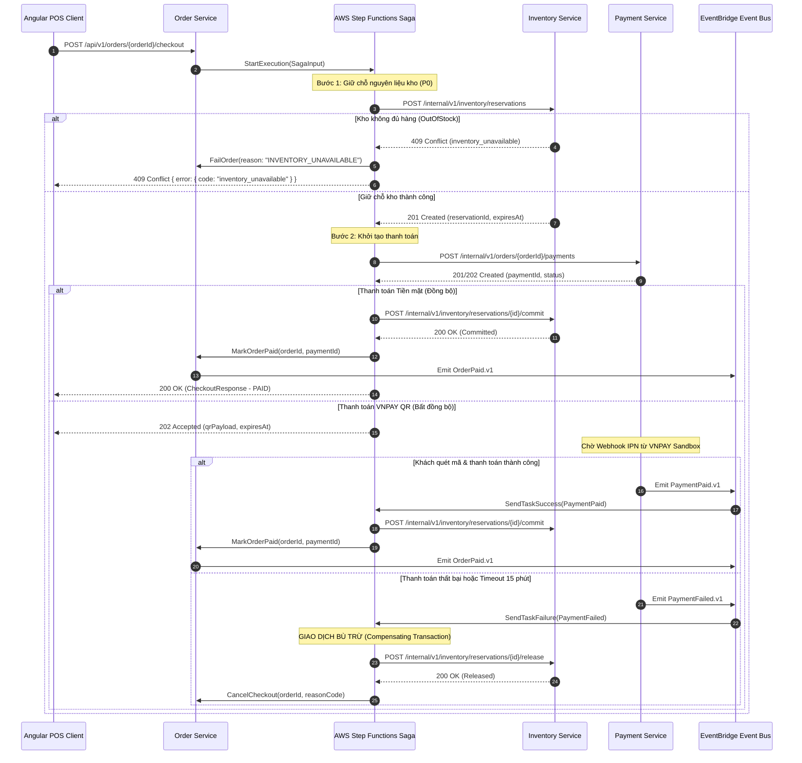

# Hợp đồng Giao tiếp & Cấu trúc Dữ liệu: POS Platform

## Nguồn tham chiếu

- **Kiến trúc (Architecture):** [`2026-10-12-architecture.md`](./2026-10-12-architecture.md)
- **Yêu cầu Hệ thống (Requirements):** [`2026-10-12-requirements.md`](./2026-10-12-requirements.md)
- **Tầm nhìn (Vision):** [`2026-10-12-vision.md`](./2026-10-12-vision.md)

---

## Quy ước Hợp đồng (Contract Conventions)

### Phong cách API và Quản lý Phiên bản (Versioning)

- **Phong cách chuẩn:** RESTful + OpenAPI 3.1 cho các API đồng bộ; AsyncAPI 2.6 + CloudEvents v1.0 cho các sự kiện bất đồng bộ.
- **Tiền tố đường dẫn (Base path):**
  - `/api/v1` dành cho các Public API phục vụ giao diện người dùng (Angular POS & Dashboard).
  - `/internal/v1` dành cho các Private API giao tiếp nội bộ giữa các service (mTLS / IAM Workload Identity).
  - `/callbacks/v1` dành cho các Webhook tiếp nhận callback từ nhà cung cấp bên ngoài (VNPAY IPN, Hóa đơn điện tử).
- **Định dạng dữ liệu:** `application/json; charset=utf-8`.
- **Quy ước đặt tên tài nguyên:** Danh từ số nhiều ở định dạng `kebab-case`. Các endpoint hành động chỉ sử dụng động từ ở đường dẫn con khi thực hiện các bước chuyển đổi trạng thái (ví dụ: `/checkout`, `/cancel`, `/close`).
- **Thay đổi phá vỡ tương thích (Breaking changes):** Bắt buộc phải nâng cấp phiên bản lớn trên URI (ví dụ: `/v2`). Việc bổ sung thêm các trường tùy chọn hoặc sự kiện mới được coi là thay đổi tương thích ngược.
- **Chuẩn định dạng:** Toàn bộ mốc thời gian là chuỗi ISO-8601 theo múi giờ UTC (kết thúc bằng ký tự `Z`); toàn bộ mã định danh nội bộ (ID) là chuỗi UUID v7.

### Xác thực và Ngữ cảnh Phân quyền (Authentication & Scope)

```http
Authorization: Bearer <Cognito JWT Token>
X-Correlation-Id: <Mã định danh truy vết UUIDv7 - bắt buộc xuyên suốt toàn bộ log và event>
Idempotency-Key: <Khóa UUIDv7 bắt buộc cho các lệnh POST/PUT/PATCH có tác dụng phụ để retry an toàn>
X-Active-Branch-Id: <Mã UUIDv7 chi nhánh đang thao tác - máy chủ bắt buộc thẩm định quyền>
```

- API Gateway kiểm tra sơ bộ chữ ký và nhà phát hành của Cognito; từng Spring Boot service khi nhận request sẽ xác thực lại các claim cốt lõi: `sub`, `iss`, `aud`, `exp`.
- **Chính sách phân quyền máy chủ:** Các claim như `tenant_memberships`, `roles`, `branch_ids` trong JWT token chỉ mang tính chất gợi ý cho giao diện người dùng, **tuyệt đối không được coi là bằng chứng pháp lý để phân quyền nghiệp vụ**. Từng service phải gọi sang quyết định phân quyền của Identity Access Service để lấy scope hiệu lực và áp dụng vào câu truy vấn database của chính mình.
- Client không được phép tự gán ngữ cảnh tenant qua body. Tiêu đề `X-Active-Branch-Id` chỉ có hiệu lực lựa chọn chi nhánh sau khi server đã xác thực người dùng thực sự có quyền tại chi nhánh đó.
- Các endpoint nội bộ (`/internal/v1/**`) bắt buộc phải có chứng chỉ Workload Identity / mTLS, hoàn toàn không được cấu hình công khai ra ngoài Internet.

---

### Cấu trúc Bao bì Chuẩn hóa (Success and Error Envelopes)

#### Phản hồi Thành công (Success Envelope)

```json
{
  "data": {},
  "meta": {
    "requestId": "req_0192b2d0-7f1d-7abc-8d2c-123456789001",
    "correlationId": "cor_0192b2d0-7f1d-7abc-8d2c-123456789002",
    "timestamp": "2026-10-12T07:00:00Z"
  }
}
```

#### Phản hồi Lỗi (Error Envelope)

```json
{
  "error": {
    "code": "validation_error",
    "message": "Dữ liệu yêu cầu không hợp lệ",
    "details": [
      {
        "field": "lines[0].quantity",
        "code": "min_value",
        "message": "Số lượng món phải lớn hơn 0"
      }
    ],
    "requestId": "req_0192b2d0-7f1d-7abc-8d2c-123456789001",
    "correlationId": "cor_0192b2d0-7f1d-7abc-8d2c-123456789002",
    "timestamp": "2026-10-12T07:00:00Z"
  }
}
```

#### Bảng Mã Lỗi Tiêu chuẩn

| Mã lỗi (Error Code) | HTTP Status | Ý nghĩa và Ngữ cảnh sử dụng |
|---|---:|---|
| `validation_error` | 422 | Dữ liệu đầu vào hoặc tham số nghiệp vụ không hợp lệ |
| `unauthorized` | 401 | Thiếu JWT token, token không hợp lệ hoặc đã hết hạn |
| `forbidden` | 403 | Người dùng đã đăng nhập nhưng không có quyền trên role/tenant/branch |
| `not_found` | 404 | Tài nguyên không tồn tại trong phạm vi chi nhánh/tenant được phân quyền |
| `conflict` | 409 | Xung đột chuyển trạng thái, sai phiên bản `If-Match` hoặc xung đột khóa idempotency |
| `payment_pending` | 202 | Yêu cầu đã được tiếp nhận, đang chờ cổng thanh toán xử lý callback |
| `inventory_unavailable` | 409 | Số lượng nguyên liệu trong kho không đủ để giữ chỗ (hết hàng) |
| `duplicate_request` | 409 | Cùng một `Idempotency-Key` nhưng nội dung request body lại khác nhau |
| `rate_limited` | 429 | Đã vượt quá giới hạn tần suất gọi API của Gateway hoặc Provider |
| `service_unavailable` | 503 | Dịch vụ phụ thuộc tạm thời không khả dụng sau khi đã thử lại nhiều lần |
| `internal_error` | 500 | Lỗi hệ thống bất ngờ; không bao giờ trả về stack trace ra phía client |

---

### Phân trang và Bộ lọc (Pagination & Filtering)

- Các tập dữ liệu giao dịch và kiểm toán lớn sử dụng **Phân trang theo con trỏ (Cursor Pagination)**:
  `GET /api/v1/orders?limit=20&cursor=<opaque_cursor>&status=PAID`
  Trả về `data: []` và `meta: { hasMore: true, nextCursor: "...", requestId: "...", correlationId: "..." }`.
- Các tập dữ liệu cấu hình hoặc danh mục quản trị (Catalog, Branches) sử dụng **Phân trang theo vị trí (Offset Pagination)** phục vụ lưới hiển thị của Angular: `page`, `limit`, `total`, `totalPages`.
- Giới hạn kích thước trang (`limit`): mặc định là 20, tối đa là 100.
- Các trường sắp xếp (`sort`) phải nằm trong danh sách cho phép (allowlist); nghiêm cấm nhận câu lệnh SQL ORDER BY tùy tiện từ client.

---

## Danh mục Hợp đồng API (API Contracts)

### 1. Identity & Tenant Service

| Phương thức | Đường dẫn | Phân quyền / Phạm vi | Dữ liệu gửi lên (Request) | Dữ liệu trả về (Response) | Mã phản hồi HTTP |
|---|---|---|---|---|---|
| GET | `/api/v1/me` | JWT hợp lệ | — | `MeResponse` | 200, 401 |
| POST | `/api/v1/tenants` | Quyền khởi tạo Platform Owner | `CreateTenantRequest` | `TenantResponse` | 201, 422, 409 |
| GET | `/api/v1/tenants/{tenantId}/branches` | Đọc trong tenant | Query phân trang | `BranchPage` | 200, 403, 404 |
| POST | `/api/v1/tenants/{tenantId}/branches` | Quản trị tenant | `CreateBranchRequest` | `BranchResponse` | 201, 403, 422 |
| POST | `/api/v1/tenants/{tenantId}/memberships` | Quản trị tenant | `CreateMembershipRequest` | `MembershipResponse` | 201, 403, 422, 409 |

### 2. Catalog Service

| Phương thức | Đường dẫn | Phân quyền / Phạm vi | Dữ liệu gửi lên (Request) | Dữ liệu trả về (Response) | Mã phản hồi HTTP |
|---|---|---|---|---|---|
| GET | `/api/v1/catalog/items` | Đọc tại chi nhánh | Bộ lọc + Phân trang | `CatalogItemPage` | 200, 403 |
| GET | `/api/v1/catalog/items/{itemId}` | Đọc tại chi nhánh | — | `CatalogItemResponse` | 200, 403, 404 |
| POST | `/api/v1/catalog/items` | Owner / Manager | `CreateCatalogItemRequest` | `CatalogItemResponse` | 201, 403, 422 |
| PATCH | `/api/v1/catalog/items/{itemId}` | Owner / Manager | `UpdateCatalogItemRequest` + `If-Match` | `CatalogItemResponse` | 200, 403, 404, 409 |
| POST | `/api/v1/catalog/items/{itemId}/availability` | Owner / Manager / Cashier | `AvailabilityChangeRequest` | `CatalogItemResponse` | 200, 403, 404, 409 |

### 3. Shift Service

| Phương thức | Đường dẫn | Phân quyền / Phạm vi | Dữ liệu gửi lên (Request) | Dữ liệu trả về (Response) | Mã phản hồi HTTP |
|---|---|---|---|---|---|
| POST | `/api/v1/branches/{branchId}/shifts` | Cashier / Manager | `OpenShiftRequest` (tiền đầu ca) | `ShiftResponse` | 201, 403, 409, 422 |
| GET | `/api/v1/branches/{branchId}/shifts/current` | Cashier / Manager | — | `ShiftResponse` | 200, 403, 404 |
| POST | `/api/v1/shifts/{shiftId}/close` | Cashier / Manager | `CloseShiftRequest` (tiền cuối ca) | `ShiftResponse` | 200, 403, 404, 409 |

### 4. Order Service

| Phương thức | Đường dẫn | Phân quyền / Phạm vi | Dữ liệu gửi lên (Request) | Dữ liệu trả về (Response) | Mã phản hồi HTTP |
|---|---|---|---|---|---|
| POST | `/api/v1/orders` | Cashier / Manager | `CreateOrderRequest` | `OrderResponse` | 201, 403, 422 |
| GET | `/api/v1/orders/{orderId}` | Đọc tại chi nhánh | — | `OrderResponse` | 200, 403, 404 |
| GET | `/api/v1/orders` | Đọc tại chi nhánh | Phân trang con trỏ + Bộ lọc | `OrderPage` | 200, 403 |
| PATCH | `/api/v1/orders/{orderId}` | Cashier / Manager | `UpdateOrderRequest` + `If-Match` | `OrderResponse` | 200, 403, 404, 409 |
| POST | `/api/v1/orders/{orderId}/line-items/{lineItemId}/cancel` | Manager (phê duyệt) | `CancelLineItemRequest` | `OrderResponse` | 200, 403, 404, 409 |
| POST | `/api/v1/orders/{orderId}/checkout` | Cashier / Manager | `CheckoutRequest` | `CheckoutResponse` | 202/200, 403, 404, 409, 422 |

### 5. Inventory Service (Nội bộ / Internal)

| Phương thức | Đường dẫn | Phân quyền / Phạm vi | Dữ liệu gửi lên (Request) | Dữ liệu trả về (Response) | Mã phản hồi HTTP |
|---|---|---|---|---|---|
| POST | `/internal/v1/inventory/reservations` | Step Functions Saga | `ReserveInventoryRequest` | `ReservationResponse` | 201, 409, 422, 503 |
| POST | `/internal/v1/inventory/reservations/{reservationId}/commit` | Step Functions Saga | `CommitReservationRequest` | `ReservationResponse` | 200, 404, 409, 422, 503 |
| POST | `/internal/v1/inventory/reservations/{reservationId}/release` | Step Functions Saga | `ReleaseReservationRequest` | `ReservationResponse` | 200, 404, 409 |

### 6. Payment Service

| Phương thức | Đường dẫn | Phân quyền / Phạm vi | Dữ liệu gửi lên (Request) | Dữ liệu trả về (Response) | Mã phản hồi HTTP |
|---|---|---|---|---|---|
| POST | `/internal/v1/orders/{orderId}/payments` | Order / Saga identity | `InitiatePaymentRequest` | `PaymentResponse` | 201/202, 409, 422, 503 |
| GET | `/api/v1/payments/{paymentId}` | Đọc tại chi nhánh | — | `PaymentResponse` | 200, 403, 404 |
| POST | `/callbacks/v1/vnpay/ipn` | Xác thực chữ ký VNPAY | `VnpayIpnRequest` | `VnpayIpnResponse` | 200, 400, 401, 409 |
| POST | `/internal/v1/payments/reconciliation/run` | Scheduler định kỳ | `ReconciliationRunRequest` | `ReconciliationRunResponse` | 202, 409, 503 |

### 7. Loyalty Service

| Phương thức | Đường dẫn | Phân quyền / Phạm vi | Dữ liệu gửi lên (Request) | Dữ liệu trả về (Response) | Mã phản hồi HTTP |
|---|---|---|---|---|---|
| POST | `/api/v1/customers/lookup` | Cashier / Manager | `CustomerLookupRequest` (số điện thoại) | `CustomerResponse` | 200, 403, 404, 422 |
| POST | `/api/v1/customers` | Cashier / Manager | `CreateCustomerRequest` | `CustomerResponse` | 201, 403, 409, 422 |
| GET | `/api/v1/customers/{customerId}/loyalty-balance` | Cashier / Manager / Owner | — | `LoyaltyBalanceResponse` | 200, 403, 404 |
| POST | `/internal/v1/loyalty/accruals` | Event Consumer identity | `AccruePointsRequest` | `LedgerEntryResponse` | 201/200, 409, 422 |

### 8. Recommendation Service

| Phương thức | Đường dẫn | Phân quyền / Phạm vi | Dữ liệu gửi lên (Request) | Dữ liệu trả về (Response) | Mã phản hồi HTTP |
|---|---|---|---|---|---|
| POST | `/api/v1/recommendations` | Cashier / Manager | `RecommendationRequest` (giỏ hàng) | `RecommendationResponse` | 200, 403, 422 |
| POST | `/api/v1/recommendations/{suggestionId}/accept` | Cashier / Manager | `AcceptSuggestionRequest` | `SuggestionAcceptanceResponse` | 201/200, 403, 404, 409 |

### 9. Reporting và Audit Service

| Phương thức | Đường dẫn | Phân quyền / Phạm vi | Dữ liệu gửi lên (Request) | Dữ liệu trả về (Response) | Mã phản hồi HTTP |
|---|---|---|---|---|---|
| GET | `/api/v1/reports/sales/daily` | Owner / Manager | `from`, `to`, `branchId` | `DailySalesReport` | 200, 403, 422 |
| GET | `/api/v1/reports/top-items` | Owner / Manager | `from`, `to`, `branchId`, phân trang | `TopItemsReport` | 200, 403, 422 |
| GET | `/api/v1/audit-events` | Owner / Auditor | Phân trang con trỏ + Bộ lọc | `AuditEventPage` | 200, 403 |

### 10. AI Assistant Service

| Phương thức | Đường dẫn | Phân quyền / Phạm vi | Dữ liệu gửi lên (Request) | Dữ liệu trả về (Response) | Mã phản hồi HTTP |
|---|---|---|---|---|---|
| POST | `/api/v1/ai/conversations` | Owner / Manager (`ai:report:read`) | `CreateConversationRequest` | `ConversationResponse` | 201, 401, 403, 422 |
| POST | `/api/v1/ai/conversations/{conversationId}/turns` | Owner / Manager (`ai:report:read`) | `CreateTurnRequest` | `TurnResponse` | 200, 202, 403, 409, 422 |
| GET | `/api/v1/ai/daily-summaries` | Owner / Manager (`ai:summary:read`) | Query ngày, chi nhánh, phân trang | `SummaryPage` | 200, 403, 422 |
| POST | `/api/v1/ai/daily-summaries/{summaryId}/reruns` | Owner / Manager (`ai:summary:rerun`)| `RerunSummaryRequest` | `SummaryJobResponse` | 202, 403, 409, 429 |

### 11. Integration & E-Invoice Service

| Phương thức | Đường dẫn | Phân quyền / Phạm vi | Dữ liệu gửi lên (Request) | Dữ liệu trả về (Response) | Mã phản hồi HTTP |
|---|---|---|---|---|---|
| POST | `/api/v1/invoice-recipient-intents` | Cashier / Manager (`pos:order:write`) | `InvoiceRecipientIntentRequest` | `InvoiceRecipientIntentResponse` | 201, 403, 422 |
| GET | `/api/v1/invoices` | Owner / Manager (`pos:report:read`) | Query ngày, chi nhánh, trạng thái | `InvoicePage` | 200, 403, 422 |
| POST | `/callbacks/v1/invoice-providers/{providerKey}/invoice-status`| Provider HMAC Signature | `ProviderInvoiceStatusCallback` | `CallbackAckResponse` | 200, 401, 409 |
| POST | `/internal/v1/demo/runs` | Platform Admin / Testing | `DemoRunRequest` | `DemoRunResponse` | 201, 403, 422 |

---

## Cấu trúc Lược đồ Yêu cầu và Phản hồi Cốt lõi

### `CreateOrderRequest`

| Trường | Kiểu | Bắt buộc | Ràng buộc / Ý nghĩa nghiệp vụ |
|---|---|:---:|---|
| `branchId` | UUID | Có | Mã chi nhánh hợp lệ mà người dùng được phân quyền |
| `shiftId` | UUID | Có | Mã ca làm việc đang mở tại chi nhánh đó |
| `serviceMode` | Enum | Có | Loại hình phục vụ: `COUNTER` (tại quầy), `TAKEAWAY` (mang đi), `TABLE` (tại bàn) |
| `tableReference` | String | Không | Tên/số bàn tự do (chưa có sơ đồ bàn ở P0) |
| `customerId` | UUID | Không | Mã khách hàng thành viên nếu có |
| `lines` | Array<OrderLineInput> | Có | Danh sách món gọi (tối thiểu 1 món) |
| `note` | String | Không | Ghi chú cho toàn đơn (tối đa 500 ký tự) |

*Cấu trúc của từng `OrderLineInput`:* `catalogItemId` (UUID), `variantId` (UUID tùy chọn), `modifierIds` (danh sách UUID các topping/món phụ), `quantity` (số nguyên dương), `note` (tối đa 250 ký tự).

#### Chi tiết Kỹ thuật API `POST /api/v1/orders`

##### Tiêu đề Yêu cầu (Headers)
```http
Authorization: Bearer <Cognito-JWT>
Content-Type: application/json
X-Correlation-ID: 0192b2d0-7f1d-7abc-8d2c-123456789001
Idempotency-Key: 0192b2d0-7f1d-7abc-8d2c-123456789002
X-Active-Branch-Id: 0192b2d0-7f1d-7abc-8d2c-123456789010
```

##### Request Body Mẫu
```json
{
  "branchId": "0192b2d0-7f1d-7abc-8d2c-123456789010",
  "shiftId": "0192b2d0-7f1d-7abc-8d2c-123456789020",
  "serviceMode": "COUNTER",
  "tableReference": null,
  "customerId": "0192b2d0-7f1d-7abc-8d2c-123456789030",
  "lines": [
    {
      "catalogItemId": "0192b2d0-7f1d-7abc-8d2c-123456789040",
      "variantId": "0192b2d0-7f1d-7abc-8d2c-123456789041",
      "modifierIds": [
        "0192b2d0-7f1d-7abc-8d2c-123456789050",
        "0192b2d0-7f1d-7abc-8d2c-123456789051"
      ],
      "quantity": 2,
      "note": "Ít đá 50%, ngọt 70%"
    }
  ],
  "note": "Khách dùng tại quầy"
}
```

##### Response Body Thành công `201 Created`
```json
{
  "data": {
    "orderId": "0192b2d0-7f1d-7abc-8d2c-123456789099",
    "orderNumber": "ORD-20261012-0042",
    "status": "DRAFT",
    "branchId": "0192b2d0-7f1d-7abc-8d2c-123456789010",
    "shiftId": "0192b2d0-7f1d-7abc-8d2c-123456789020",
    "serviceMode": "COUNTER",
    "tableReference": null,
    "customerId": "0192b2d0-7f1d-7abc-8d2c-123456789030",
    "lines": [
      {
        "lineItemId": "0192b2d0-7f1d-7abc-8d2c-123456789100",
        "catalogItemId": "0192b2d0-7f1d-7abc-8d2c-123456789040",
        "itemName": "Trà sữa Ô long nướng",
        "variantId": "0192b2d0-7f1d-7abc-8d2c-123456789041",
        "variantName": "Size L",
        "unitPriceMinor": 45000,
        "quantity": 2,
        "modifiers": [
          {
            "modifierId": "0192b2d0-7f1d-7abc-8d2c-123456789050",
            "modifierName": "Trân châu hoàng kim",
            "priceMinor": 10000
          }
        ],
        "lineTotalMinor": 110000,
        "note": "Ít đá 50%, ngọt 70%"
      }
    ],
    "subtotalMinor": 110000,
    "discountMinor": 0,
    "taxMinor": 11000,
    "totalMinor": 121000,
    "currency": "VND",
    "createdAt": "2026-10-12T07:15:00Z"
  },
  "meta": {
    "requestId": "req_0192b2d0-7f1d-7abc-8d2c-123456789001",
    "correlationId": "cor_0192b2d0-7f1d-7abc-8d2c-123456789002",
    "timestamp": "2026-10-12T07:15:01Z"
  }
}
```

---

### `CheckoutRequest` và `CheckoutResponse`

| Trường yêu cầu | Kiểu | Bắt buộc | Ý nghĩa nghiệp vụ |
|---|---|:---:|---|
| `paymentMethod` | Enum | Có | Phương thức thanh toán: `CASH` (tiền mặt), `VNPAY_QR` (mã QR) |
| `cashReceivedMinor` | Integer | Với tiền mặt | Số tiền khách đưa (bằng số nguyên VND), phải ≥ tổng tiền đơn hàng |
| `returnUrl` | URI | Với VNPAY | Địa chỉ điều hướng sau khi quét mã QR trên môi trường sandbox |
| `clientReference` | String | Không | Mã tham chiếu của client phục vụ tracking giao diện |

*Dữ liệu phản hồi (`CheckoutResponse`):* Trả về `sagaId`, `orderId`, `paymentId`, `orderStatus`, `paymentStatus`, `cashChangeMinor` (tiền thừa trả khách), `qrPayload` (chuỗi nội dung mã QR nếu thanh toán qua VNPAY), `expiresAt`, `correlationId`. Đối với tiền mặt trả về HTTP `200`; đối với VNPAY trả về HTTP `202 ACCEPTED` với trạng thái thanh toán là `PENDING`.

#### Chi tiết Kỹ thuật API `POST /api/v1/orders/{orderId}/checkout`

##### Tiêu đề Yêu cầu (Headers)
```http
Authorization: Bearer <Cognito-JWT>
Content-Type: application/json
X-Correlation-ID: 0192b2d0-7f1d-7abc-8d2c-123456789001
Idempotency-Key: 0192b2d0-7f1d-7abc-8d2c-123456789003
X-Active-Branch-Id: 0192b2d0-7f1d-7abc-8d2c-123456789010
```

##### Request Body - Thanh toán Tiền mặt (CASH)
```json
{
  "paymentMethod": "CASH",
  "cashReceivedMinor": 150000,
  "clientReference": "pos-terminal-01-order-42"
}
```

##### Response Body Thành công `200 OK` (CASH)
```json
{
  "data": {
    "sagaId": "0192b2d0-7f1d-7abc-8d2c-123456789201",
    "orderId": "0192b2d0-7f1d-7abc-8d2c-123456789099",
    "paymentId": "0192b2d0-7f1d-7abc-8d2c-123456789301",
    "orderStatus": "PAID",
    "paymentStatus": "PAID",
    "totalMinor": 121000,
    "cashReceivedMinor": 150000,
    "cashChangeMinor": 29000,
    "currency": "VND",
    "paidAt": "2026-10-12T07:16:30Z"
  },
  "meta": {
    "requestId": "req_0192b2d0-7f1d-7abc-8d2c-123456789001",
    "correlationId": "cor_0192b2d0-7f1d-7abc-8d2c-123456789002",
    "timestamp": "2026-10-12T07:16:30Z"
  }
}
```

##### Request Body - Thanh toán VNPAY QR
```json
{
  "paymentMethod": "VNPAY_QR",
  "returnUrl": "https://pos.app.domain/branches/0192b2d0-7f1d-7abc-8d2c-123456789010/orders/0192b2d0-7f1d-7abc-8d2c-123456789099/complete",
  "clientReference": "pos-terminal-01-order-42"
}
```

##### Response Body Tiếp nhận `202 Accepted` (VNPAY_QR)
```json
{
  "data": {
    "sagaId": "0192b2d0-7f1d-7abc-8d2c-123456789202",
    "orderId": "0192b2d0-7f1d-7abc-8d2c-123456789099",
    "paymentId": "0192b2d0-7f1d-7abc-8d2c-123456789302",
    "orderStatus": "PENDING_PAYMENT",
    "paymentStatus": "INITIATED",
    "totalMinor": 121000,
    "currency": "VND",
    "qrPayload": "00020101021238580010A000000727012600069704540112VNPAYQR202652045411530370454061210005802VN62240820ORD2026101200426304A1B2",
    "expiresAt": "2026-10-12T07:31:30Z"
  },
  "meta": {
    "requestId": "req_0192b2d0-7f1d-7abc-8d2c-123456789001",
    "correlationId": "cor_0192b2d0-7f1d-7abc-8d2c-123456789002",
    "timestamp": "2026-10-12T07:16:31Z"
  }
}
```

---

## Luồng Điều Phối Saga Checkout P0 (AWS Step Functions)



---

## Ma trận Phân quyền Tiêu chuẩn (Standard Authorization Matrix)

| Quyền hạn / Thao tác | Owner (Chủ chuỗi) | Manager (Quản lý) | Cashier (Thu ngân) | Kitchen (Bếp) |
|---|:---:|:---:|:---:|:---:|
| Quản trị chuỗi, chi nhánh, nhân sự | Toàn bộ tenant | Chi nhánh được gán | ❌ Không có quyền | ❌ Không có quyền |
| Xem danh mục món bán | Toàn bộ tenant | Chi nhánh được gán | Chi nhánh được gán | Chi nhánh được gán |
| Thêm/sửa món, đổi giá | ✅ Toàn quyền | ✅ Toàn quyền | ❌ Không có quyền | ❌ Không có quyền |
| Tạo và cập nhật đơn hàng | ✅ Có quyền | ✅ Có quyền | Chi nhánh được gán | ❌ Không có quyền |
| Phê duyệt hủy món nhạy cảm | ✅ Có quyền | ✅ Có quyền | ❌ Cần xin duyệt | ❌ Không có quyền |
| Thu tiền và thanh toán đơn | ✅ Có quyền | ✅ Có quyền | Chi nhánh được gán | ❌ Không có quyền |
| Tra cứu tích điểm khách hàng | ✅ Có quyền | ✅ Có quyền | Chi nhánh được gán | ❌ Không có quyền |
| Xem báo cáo doanh thu | Toàn bộ tenant | Chi nhánh được gán | ❌ Không có quyền | ❌ Không có quyền |
| Xem nhật ký kiểm toán (Audit) | Toàn bộ tenant | Chi nhánh được gán | ❌ Không có quyền | ❌ Không có quyền |
| Gọi API nội bộ của Saga | ❌ Cấm người dùng | ❌ Cấm người dùng | ❌ Cấm người dùng | ❌ Cấm người dùng |

*(Lưu ý: Các API nội bộ của Saga chỉ chấp nhận xác thực giữa các service - Service Workload Identity).*

---

## Hợp đồng Dữ liệu & Cơ sở dữ liệu (Data Contracts)

### Quy ước Chung về Dữ liệu

- **Các kiểu dữ liệu PostgreSQL chuẩn:** `UUID`, `TEXT`, `BIGINT`, `INTEGER`, `BOOLEAN`, `NUMERIC(18,3)`, `JSONB`, `TIMESTAMPTZ`.
- **Độ chính xác tiền tệ:** Lưu trữ dưới dạng số nguyên `BIGINT` (đơn vị minor unit; với tiền VND là số nguyên đồng). Số lượng tồn kho và định lượng nguyên liệu sử dụng kiểu `NUMERIC(18,3)` với cơ chế làm tròn `HALF_UP`.
- **Khóa chính:** Mọi bảng dữ liệu cốt lõi đều sử dụng khóa chính `id` kiểu UUID v7 (`uuid_generate_v7()` hoặc ứng dụng tự sinh tuần tự).
- **Dấu vết thời gian:** Mọi bảng có trạng thái thay đổi bắt buộc phải có hai cột `created_at` và `updated_at` (UTC).
- **Quy chuẩn chú thích database:** Mọi cột được tạo ra bởi Flyway migration đều phải có câu lệnh `COMMENT ON COLUMN` mô tả rõ ràng mục đích nghiệp vụ.
- **Sổ cái bất biến (Append-only Ledger):** Các bảng `stock_movements`, `loyalty_ledger`, `audit_events`, `case_actions` tuyệt đối không có `UPDATE` hoặc `DELETE` vật lý; chỉ cấp quyền `INSERT` và `SELECT`.

---

## Hợp đồng Tích hợp Sự kiện (Integration Event Contracts)

### Cấu trúc Bao bì Sự kiện Tiêu chuẩn (CloudEvents v1.0 Envelope)

```json
{
  "specversion": "1.0",
  "id": "0192b2d0-7f1d-7abc-8d2c-123456789901",
  "type": "com.pos.order.OrderPaid.v1",
  "source": "https://service.pos.internal/order",
  "time": "2026-10-12T07:16:30Z",
  "datacontenttype": "application/json",
  "tenantid": "0192b2d0-7f1d-7abc-8d2c-123456789001",
  "branchid": "0192b2d0-7f1d-7abc-8d2c-123456789010",
  "correlationid": "0192b2d0-7f1d-7abc-8d2c-123456789002",
  "data": {
    "orderId": "0192b2d0-7f1d-7abc-8d2c-123456789099",
    "paymentId": "0192b2d0-7f1d-7abc-8d2c-123456789301",
    "totalMinor": 121000,
    "currency": "VND"
  }
}
```

### Danh mục Chi tiết các Sự kiện Domain (Domain Events)

| STT | Tên sự kiện | Các trường dữ liệu bắt buộc trong Data Payload | Luồng điều hướng (Producer → Consumers) |
|---|---|---|---|
| 1 | `InventoryReserved.v1` | `reservationId`, `orderId`, `checkoutAttemptId`, `sagaId`, `branchId`, `expiresAt`, `lines[]` | Inventory → Saga, Order, Audit |
| 2 | `InventoryReservationCommitted.v1` | `reservationId`, `orderId`, `checkoutAttemptId`, `sagaId`, `branchId`, `paymentId`, `committedAt` | Inventory → Saga, Order, Audit |
| 3 | `InventoryReservationReleased.v1` | `reservationId`, `orderId`, `checkoutAttemptId`, `sagaId`, `branchId`, `reasonCode`, `releasedAt` | Inventory → Saga, Order, Audit |
| 4 | `InventoryStockChanged.v1` | `ledgerEntryId`, `branchId`, `ingredientId`, `movementType`, `quantityDelta`, `onHand`, `reserved`, `available` | Inventory → Reporting, Audit |
| 5 | `PaymentInitiated.v1` | `paymentId`, `orderId`, `method`, `amountMinor`, `currency`, `expiresAt` | Payment → Saga, Audit |
| 6 | `PaymentPaid.v1` | `paymentId`, `orderId`, `provider`, `providerTransactionId`, `amountMinor`, `paidAt` | Payment → Saga, Audit; Saga phát lệnh commit kho |
| 7 | `PaymentFailed.v1` | `paymentId`, `orderId`, `reasonCode`, `retryable`, `failedAt` | Payment → Saga, Order, Audit |
| 8 | `OrderCreated.v1` | `orderId`, `branchId`, `shiftId`, `lines[]`, `totalMinor`, `createdAt` | Order → Reporting, Audit |
| 9 | `OrderPaid.v1` | `orderId`, `branchId`, `customerId`, `lines[]`, `totals`, `paidAt` | Order → Loyalty, Reporting, Audit, Integration (Sự thật doanh thu) |
| 10 | `OrderCancelled.v1` | `orderId`, `branchId`, `reasonCode`, `cancelledBy`, `cancelledAt` | Order → Reporting, Audit |
| 11 | `LoyaltyPointsAccrued.v1` | `ledgerEntryId`, `customerId`, `orderId`, `pointsDelta`, `balanceAfter` | Loyalty → Reporting, Audit |
| 12 | `LoyaltyPointsRedeemed.v1`| `ledgerEntryId`, `customerId`, `orderId`, `pointsDelta`, `balanceAfter` | Loyalty → Reporting, Audit |
| 13 | `LoyaltyPointsReversed.v1` | `ledgerEntryId`, `reversesEntryId`, `customerId`, `pointsDelta`, `reason` | Loyalty → Reporting, Audit |
| 14 | `SuggestionShown.v1` | `suggestionId`, `orderId`, `itemId`, `ruleId`, `shownAt` | Recommendation → Reporting, Audit |
| 15 | `SuggestionAccepted.v1` | `suggestionId`, `orderId`, `itemId`, `acceptedAt`, `attributedValueMinor` | Recommendation → Reporting, Audit |
| 16 | `ShiftOpened.v1` | `shiftId`, `branchId`, `actorId`, `openingCashMinor`, `occurredAt` | Shift → Reporting, Audit |
| 17 | `ShiftClosed.v1` | `shiftId`, `branchId`, `actorId`, `closingCashMinor`, `expectedCashMinor`, `occurredAt` | Shift → Reporting, Audit |
| 18 | `InvoiceIssued.v1` | `invoiceOperationId`, `orderId`, `invoiceNumber`, `lookupCode`, `issuedAt` | Integration → Reporting, Audit |
| 19 | `AuditRecorded.v1` | `auditEventId`, `action`, `resourceType`, `resourceId`, `actorId`, `reason` | Bất kỳ service nào → Audit |

---

## Kế hoạch Thực thi Cơ sở Dữ liệu với Flyway (Migration Plan)

- **Công cụ:** Tích hợp Flyway độc lập trong từng Spring Boot service.
- **Quyền hạn:** Mỗi service quản lý lịch sử migration và tài khoản/mật khẩu database riêng biệt.
- **Thư mục chứa script:** `src/main/resources/db/migration/`.
- **Quy tắc đặt tên:** `V1__create_core_tables.sql`, `V2__create_outbox_and_idempotency.sql`, `V3__add_indexes_and_constraints.sql`, sau đó là các migration tăng dần theo phiên bản.
- **Nguyên tắc an toàn:** Không bao giờ chạy lệnh `flyway:clean` trên môi trường staging hoặc production. Mọi thay đổi schema đều áp dụng nguyên tắc tương thích tiến (Forward-only migration: Mở rộng → Di chuyển → Thu hẹp).
- **Trình tự Khởi chạy Cơ sở Dữ liệu Toàn Hệ thống:**
  1. `identity-access-service`: `V1__init_identity.sql` đến `V4__seed_bootstrap.sql`.
  2. `catalog-service`: `V1__init_catalog.sql` đến `V5__seed_catalog_sample.sql`.
  3. `inventory-service`: `V1__init_inventory.sql` đến `V5__seed_ingredients.sql`.
  4. `shift-service`: `V1__init_shifts.sql` đến `V4__init_shift_reconciliation.sql`.
  5. `order-service`: `V1__init_orders.sql` đến `V5__init_order_idempotency.sql`.
  6. `payment-service`: `V1__init_payments.sql` đến `V5__init_vnpay_ipn.sql`.
  7. `loyalty-service`: `V1__init_loyalty.sql` đến `V6__seed_loyalty_tiers.sql`.
  8. `recommendation-service`: `V1__init_recommendations.sql` đến `V5__seed_rules.sql`.
  9. `reporting-service`: `V1__init_reporting_read_models.sql` đến `V5__init_views.sql`.
  10. `audit-loss-prevention-service`: `V1__init_audit_events.sql` đến `V5__init_cases.sql`.
  11. `ai-assistant-service`: `V1__init_ai_conversations.sql` đến `V5__init_ai_jobs.sql`.
  12. `integration-service`: `V1__init_invoices.sql` đến `V5__init_demo_plane.sql`.
