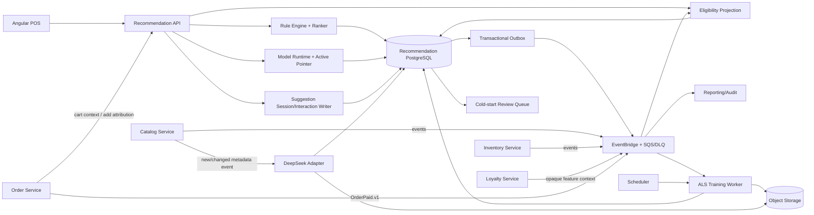

Started at: 2026/10/13 00:00:00
Finished at: 2026/10/13 00:00:00
Total time: 0 minutes
---

# Module 8 — Gợi ý món / Upsell: Architecture

**Ngày:** 2026-10-13  
**Trạng thái:** Approved  
**Requirements:** [Recommendation Requirements](./2026-10-13-requirements.md)  
**Requirements review:** [Recommendation Requirements Review](./2026-10-13-requirements-review.md)  
**Parent architecture:** [POS Platform Architecture](../pos-platform/2026-10-12-architecture.md)

## 1. Tóm tắt kiến trúc (Architecture summary)

Recommendation Service là một bounded context độc lập, bao gồm các thành phần:

- API thời gian thực (stateless realtime API) phục vụ gợi ý giỏ hàng và các lệnh tương tác;
- Cơ sở dữ liệu PostgreSQL lưu trữ luật, hình chiếu (projections), phiên gợi ý / tương tác, metadata mô hình và trạng thái tác vụ;
- Consumer tiếp nhận sự kiện qua EventBridge/SQS từ Catalog, Inventory, Order và Loyalty;
- Worker ML chạy ban đêm (nightly ML worker) xử lý ảnh chụp dữ liệu, huấn luyện ALS, thẩm định và kích hoạt mô hình;
- Kho lưu trữ đối tượng (Object Storage) lưu trữ các blob ảnh chụp huấn luyện và artifact mô hình bất biến;
- Adapter DeepSeek bất đồng bộ phục vụ làm giàu dữ liệu khởi động nguội (P2 cold-start).

Đường dẫn xử lý yêu cầu P0/P1 tuyệt đối không gọi DeepSeek, nhà cung cấp thời tiết hay worker huấn luyện. Realtime API sử dụng bộ nhớ đệm (cache) cục bộ cho luật/mô hình kết hợp với read model trong PostgreSQL; Order luôn là thẩm quyền cuối cùng khi thêm dòng món vào đơn hàng.

## 2. Kiến trúc các cấu phần (Component architecture)



### Trách nhiệm của các cấu phần (Component responsibilities)

| Cấu phần (Component) | Trách nhiệm chính | Những gì không sở hữu |
|---|---|---|
| Recommendation API | Xác thực/phân quyền, kiểm tra yêu cầu giỏ hàng, đóng gói phản hồi, xử lý lệnh tương tác | Trạng thái gốc của Order / Catalog / Inventory / Loyalty |
| Rule Engine + Ranker | Biên dịch/đánh giá các phiên bản luật active, xếp hạng top-K tất định, quy kết luật | Lưu trữ chỉnh sửa luật và thẩm quyền công bố ra production |
| Eligibility Projection | Hình chiếu món/chi nhánh/tồn kho, quản lý phiên bản nguồn / watermark / TTL | Thay đổi số lượng tồn kho vật lý |
| Model Runtime | Nạp artifact ALS active, tính điểm cho khách hàng theo đặc trưng opaque, fallback khi lỗi | Nguồn dữ liệu huấn luyện chuẩn |
| Suggestion Session/Interaction Writer | Lưu phiên/ứng viên/bằng chứng bất biến, khử trùng lặp hiển thị/chấp thuận, ghi outbox | Nghiệp vụ thêm dòng vào đơn / thanh toán của Order |
| Training Worker | Tạo ảnh chụp dữ liệu, huấn luyện, đánh giá, cập nhật/rollback con trỏ mô hình, lưu trạng thái | Xử lý các yêu cầu realtime |
| DeepSeek Adapter | Làm giàu metadata đã khử độc (P2), kiểm tra schema, quản lý thử lại và ngân sách gọi API | Thay đổi Catalog gốc và xếp hạng realtime |
| Recommendation PostgreSQL | Lưu trữ trạng thái cục bộ mạnh, phiên bản, tính lũy nghiệm, checkpoint, outbox | Các truy vấn join xuyên service |
| Object Storage | Lưu trữ các blob ảnh chụp huấn luyện và artifact mô hình bất biến | Quyết định kích hoạt mô hình |
| EventBridge / SQS / DLQ | Vận chuyển sự kiện ít nhất một lần (at-least-once) và cách ly hàng đợi | Quyền sở hữu trạng thái nghiệp vụ |

## 3. Ranh giới và mô hình giao tiếp (Boundary and communication model)

### 3.1 Luồng yêu cầu thời gian thực P0/P1 (Realtime P0/P1 request)

1. POS gọi Recommendation kèm `orderId`, ngữ cảnh chi nhánh, phiên bản giỏ hàng và trường tùy chọn khóa khách hàng opaque từ Loyalty.
2. Recommendation thẩm định quyền tenant / chi nhánh / vai trò và phân giải ngữ cảnh giỏ hàng chuẩn tắc thông qua hợp đồng đọc nội bộ có giới hạn thời gian từ Order, hoặc từ phiên bản hình chiếu cục bộ khớp với request.
3. Rule Engine nạp phiên bản luật đang active của tenant; Model Runtime chỉ được kích hoạt khi khách hàng hợp lệ và có mô hình tương ứng.
4. Eligibility Projection loại bỏ các món đã có trong giỏ hàng, các ứng viên ngừng bán / sai chi nhánh / quá hạn / hết hàng.
5. Ranker trả về danh sách top-K tất định có giới hạn và lưu vết phiên gợi ý / ảnh chụp ứng viên vào database.
6. API phản hồi mã gợi ý, ảnh chụp ứng viên, lý do gợi ý, điểm số / phiên bản và metadata độ tươi dữ liệu.

Recommendation tuyệt đối không gọi trực tiếp vào database của Inventory hay Catalog. Hệ thống tiêu thụ các sự kiện nguồn và duy trì các read projection. Nếu ngữ cảnh giỏ hàng chuẩn tắc hoặc dữ liệu khả dụng không thể xác thực an toàn, hệ thống trả về phản hồi rỗng an toàn chứ không suy đoán.

### 3.2 Chiến lược lấy ngữ cảnh giỏ hàng (Cart context strategy)

Thiết kế ưu tiên sử dụng hợp đồng `OrderContextClient` có giới hạn thời gian (bounded) để đọc phiên bản giỏ hàng hiện tại, kết hợp bộ nhớ đệm / hình chiếu cục bộ làm đường dẫn nhanh (fast path):

- Nếu hình chiếu/cache cục bộ có sẵn và khớp chính xác `orderVersion` → không cần gọi sang Order;
- Nếu bị miss hoặc phiên bản bị trễ → thực hiện duy nhất một lệnh đọc đồng bộ có giới hạn thời gian sang Order;
- Nếu Order không khả dụng hoặc phiên bản không khớp → trả về mã lỗi `cart_context_unavailable`, không gợi ý dựa trên dữ liệu giỏ hàng cũ;
- Client không bao giờ xem các dòng ID tùy tiện do body POS gửi lên là có thẩm quyền nếu thiếu ràng buộc phiên bản đơn hàng.

Cơ chế này tránh được chuỗi gọi dịch vụ kéo dài trong khi vẫn bảo đảm tính toàn vẹn cho các thay đổi trên giỏ hàng nháp. Thao tác thêm dòng của Order vẫn giữ vai trò thẩm định quyền sở hữu và tính khả dụng cuối cùng.

### 3.3 Các lệnh tương tác (Interaction commands)

- Endpoint `/shown` ghi nhận lượt hiển thị sau khi giao diện frontend xác nhận đã render thành công.
- Endpoint `/accept` chỉ được chấp thuận khi ứng viên thuộc phiên đó và có bằng chứng thêm dòng thành công từ Order (`orderLineId` hoặc phiên bản đơn hàng sau khi thêm).
- Cả hai lệnh đều được thực thi trong một transaction cơ sở dữ liệu cục bộ + bảng outbox; việc phân phối tiếp theo sang Reporting/Audit diễn ra hoàn toàn bất đồng bộ.
- Thao tác thử lại dựa trên ID tương tác / khóa nguồn; việc phân phối sự kiện trùng lặp là an toàn (lũy nghiệm).

## 4. Kiến trúc động cơ luật và tính đủ điều kiện (Rule engine and eligibility architecture)

### 4.1 Mô hình luật (Rule model)

Các luật kết hợp là các phiên bản production áp dụng toàn tenant với chữ ký giỏ hàng chuẩn tắc:

```text
RuleVersion
  tenantId
  antecedentSignature = danh sách định danh món/biến thể/topping chuẩn tắc đã sắp xếp
  consequentIdentity
  support
  confidence
  lift
  priority
  effectiveFrom / effectiveTo
  status = DRAFT | PUBLISHED | RETIRED
  version
```

Các luật đã công bố (published) mang tính bất biến. Trình chỉnh sửa luật chỉ thao tác trên bản nháp (draft); khi Chủ chuỗi công bố sẽ sinh ra một phiên bản bất biến mới và phát sự kiện outbox tương ứng. Bộ nhớ đệm luật được đánh khóa theo cặp `(tenantId, activeRuleSetVersion)`.

### 4.2 Đánh giá tất định (Deterministic evaluation)

1. Chuẩn hóa giỏ hàng hiện tại thành các khóa định danh chuẩn tắc.
2. Tìm kiếm các luật ứng viên bằng cách so khớp chính xác hoặc so khớp tập con theo cấu hình với chữ ký giỏ hàng.
3. Gộp các món kết quả trùng nhau trong khi vẫn bảo toàn quy kết cho luật có chất lượng tốt nhất.
4. Áp dụng các vị từ thẩm định tính khả dụng trước khi tính điểm đầu ra.
5. Sắp xếp danh sách theo: độ ưu tiên → `confidence` → `lift` → `support` → ID ứng viên ổn định.
6. Trả về top-K kèm phiên bản luật / mô hình đã áp dụng.

Xóa bộ nhớ đệm luật (Cache invalidation):

- Sự kiện `RecommendationRulePublished.v1` hoặc `Retired.v1` sẽ xóa cache luật của tenant tương ứng.
- Khi cache bị miss, hệ thống sẽ đọc phiên bản active từ PostgreSQL.
- Mọi phản hồi API đều mang phiên bản active; cache bị cũ không thể âm thầm mạo nhận một phiên bản mới hơn.

### 4.3 Hình chiếu tính đủ điều kiện (Eligibility projection)

Các bảng hình chiếu cục bộ lưu trữ:

- Định danh món/biến thể Catalog, ảnh chụp tên/giá bán, trạng thái và khả năng bán theo từng chi nhánh;
- Trạng thái khả dụng tồn kho từ Inventory, phiên bản nguồn và thời điểm ghi nhận;
- Checkpoint của hình chiếu theo từng nguồn / tenant / chi nhánh.

Chính sách lọc ứng viên:

- Trạng thái món ở nguồn là ngừng kinh doanh hoặc chi nhánh không được bán → loại bỏ;
- Trạng thái khả dụng từ nguồn báo hết hàng → loại bỏ;
- Khoảng cách thời gian `now - lastSourceEventAt > eligibilityTTL` → loại bỏ và trả về cờ trạng thái độ tươi an toàn;
- Thiếu dữ liệu hình chiếu → loại bỏ;
- Thao tác thêm dòng cuối cùng của Order vẫn có quyền từ chối ứng viên nếu trạng thái nguồn tại thời điểm đó đã thay đổi.

Consumer của hình chiếu thực hiện khử trùng lặp theo ID sự kiện / phiên bản nguồn, bỏ qua các bản tin có phiên bản cũ hơn, commit checkpoint sau khi cập nhật trạng thái và hỗ trợ phát lại/tái dựng từ sự kiện lưu trữ hoặc ảnh chụp nguồn.

## 5. Kiến trúc cá nhân hóa và mô hình ML (Personalization and model architecture)

### 5.1 Ranh giới đặc trưng opaque của Loyalty (Opaque Loyalty feature boundary)

Loyalty tiếp tục là đơn vị sở hữu số điện thoại và danh tính khách hàng. Dịch vụ này công bố hoặc cung cấp ngữ cảnh đặc trưng bảo đảm quyền riêng tư:

```text
tenantId
opaqueCustomerKey
eligibility = ELIGIBLE | INELIGIBLE | DELETED
consentVersion
featureVersion
generatedAt
```

Recommendation tuyệt đối không bao giờ nhận số điện thoại plaintext. Realtime API có thể sử dụng khóa opaque để chọn vector chấm điểm ALS đang active; worker huấn luyện sử dụng ánh xạ / ảnh chụp được phân lập theo tenant do Loyalty cung cấp. Các khóa bị xóa hoặc không đủ điều kiện sẽ được đánh dấu xóa (tombstone) và loại bỏ khỏi các lần huấn luyện/tái dựng sau này.

### 5.2 Quy trình huấn luyện ALS (ALS training pipeline)

```text
Bộ lập lịch (Scheduler)
  → Bộ điều phối lần chạy huấn luyện (Training Run Orchestrator)
  → Trình tạo ảnh chụp đơn hàng đã thanh toán (Paid Interaction Snapshot Builder)
  → Trình huấn luyện ALS phân lập theo tenant (Tenant-isolated ALS Trainer)
  → Bộ thẩm định chất lượng (Quality Validator)
  → Đăng ký mô hình / Con trỏ active (Model Registry / Active Pointer)
  → Làm mới cache Model Runtime (Model Runtime cache refresh)
```

Dữ liệu đầu vào là các đơn hàng đã thanh toán `OrderPaid.v1` được khử trùng lặp kèm khóa khách hàng opaque, định danh món, số lượng/trọng số tương tác, tenant và watermark nguồn. Tuyệt đối không dùng đơn nháp, đơn chưa thanh toán hay số điện thoại thô.

Ảnh chụp huấn luyện và artifact mô hình là các đối tượng bất biến lưu trên Object Storage. PostgreSQL chỉ lưu trữ manifest, checksum, chỉ số đánh giá, trạng thái và con trỏ điều khiển, không lưu trữ blob dữ liệu lớn.

### 5.3 Kích hoạt mô hình (Model activation)

- Mô hình mới khởi tạo ở trạng thái `CANDIDATE`, sau đó chuyển sang `VALIDATING`.
- Bộ thẩm định kiểm tra: số lượng dữ liệu tối thiểu, chỉ số Recall@K/NDCG@K, độ bao phủ, độ tươi, cách ly tenant, mã băm checksum và metadata phục vụ tái lập kết quả.
- Kích hoạt mô hình sử dụng câu lệnh compare-and-swap trên bộ ba `(tenantId, modelFamily, activeVersion)`.
- Một ứng viên thất bại không bao giờ được phép thay thế mô hình đang active.
- Thao tác rollback trỏ về một artifact đã được thẩm định trước đó và ghi nhận sự kiện audit/outbox.
- Các pod API nạp mô hình active một cách bất đồng bộ; trong thời gian nạp, các luật kết hợp đóng vai trò là đường dẫn dự phòng an toàn.

### 5.4 Cơ chế fallback thời gian thực (Runtime fallback)

```text
Khách hàng đủ điều kiện + Mô hình ALS active và khỏe mạnh
  → Xếp hạng ALS → Lọc khả dụng → Trả về top-K
Trường hợp khác
  → Xếp hạng theo luật kết hợp → Lọc khả dụng → Trả về top-K
Trường hợp khác
  → Trả về danh sách rỗng (items=[])
```

Không áp dụng cơ chế gợi ý món bán chạy (popular items) trong phạm vi P0/P1.

## 6. Kiến trúc tích hợp DeepSeek P2 (P2 DeepSeek architecture)

DeepSeek được cô lập hoàn toàn sau một adapter bất đồng bộ:

1. Sự kiện thay đổi metadata món ăn từ Catalog tạo ra một tác vụ cold-start.
2. Worker khử độc các trường tên/mô tả/thẻ được phép và áp dụng ngân sách gọi API của tenant/nhà cung cấp.
3. Adapter gọi DeepSeek với cấu hình prompt/mô hình có đánh phiên bản.
4. Dữ liệu phản hồi có cấu trúc phải vượt qua bài kiểm tra schema, từ vựng cho phép, độ an toàn và điểm tin cậy.
5. Đặc trưng ứng viên được lưu trữ kèm nguồn gốc và trạng thái `PENDING_REVIEW`.
6. Chủ chuỗi hoặc nhân viên vận hành được ủy quyền thực hiện phê duyệt/từ chối; đặc trưng được duyệt sẽ được đưa vào các lần sinh ứng viên tiếp theo.

Sự cố từ nhà cung cấp được thử lại theo thuật toán backoff có giới hạn kết hợp DLQ. Kết quả từ nhà cung cấp không bao giờ làm biến đổi dữ liệu gốc của Catalog hay làm gián đoạn luồng P0/P1.

## 7. Kiến trúc dữ liệu (Data architecture)

### 7.1 Quyền sở hữu trong PostgreSQL

| Dữ liệu | Vị trí lưu trữ | Mức độ nhất quán |
|---|---|---|
| Bản nháp / phiên bản / trạng thái công bố luật | Recommendation PostgreSQL | Transaction cục bộ mạnh |
| Hình chiếu Catalog / tính khả dụng | Recommendation PostgreSQL | Nhất quán cuối cùng, có checkpoint/phiên bản |
| Phiên gợi ý / ứng viên / tương tác | Recommendation PostgreSQL | Transaction cục bộ mạnh + khử trùng lặp duy nhất |
| Lần chạy huấn luyện / snapshot / chỉ số / con trỏ mô hình | Recommendation PostgreSQL | Trạng thái có đánh phiên bản mạnh |
| Blob mô hình / ảnh chụp dữ liệu | Object Storage | Blob bất biến + manifest/checksum trong DB |
| Tính đủ điều kiện của đặc trưng / ngữ cảnh | Hình chiếu Recommendation hoặc ảnh chụp mã hóa | Phân lập theo tenant, nhận biết việc xóa dữ liệu |
| Các sự kiện | Outbox + EventBridge/SQS | Ít nhất một lần (At-least-once) |

### 7.2 Các bảng và aggregate cốt lõi

- `association_rule_sets`, `association_rule_versions`, `rule_antecedents`, `rule_consequents`;
- `catalog_item_projections`, `branch_item_eligibility`, `inventory_availability_projections`, `projection_checkpoints`;
- `suggestion_sessions`, `suggestion_candidates`, `suggestion_interactions`;
- `customer_feature_contexts`, `paid_interaction_projections`;
- `training_runs`, `training_snapshot_manifests`, `model_registry`, `model_metrics`;
- `cold_start_jobs`, `cold_start_feature_candidates`;
- `outbox_messages`, `inbox_events`, `idempotency_records`, `audit_references`.

Mọi bảng đều bắt buộc có phạm vi tenant; các bảng theo chi nhánh bắt buộc có thêm branch ID. Dữ liệu PII bị loại bỏ hoàn toàn ngay từ tầng thiết kế schema.

### 7.3 Chính sách chỉ mục và phân vùng (Index and partition policy)

Các chỉ mục cơ sở:

- Luật active theo `(tenant_id, status, effective_from, effective_to, version)`;
- Mã băm chữ ký vế điều kiện theo `(tenant_id, signature_hash, status)`;
- Tính khả dụng theo chi nhánh theo `(tenant_id, branch_id, item_id, status, source_version)`;
- Phiên gợi ý theo `(tenant_id, branch_id, order_id, cart_version, expires_at)`;
- Tương tác duy nhất theo `(tenant_id, suggestion_id, event_type, interaction_key)`;
- Đơn hàng đã thanh toán theo `(tenant_id, customer_key_hash, occurred_at, item_id)`;
- Lần chạy huấn luyện theo `(tenant_id, model_family, status, created_at)`;
- Outbox / inbox / checkpoint theo nguồn và thời gian.

Giai đoạn MVP không phân vùng các bảng nhỏ. Các bảng có khối lượng giao dịch lớn như bảng tương tác, hình chiếu đơn đã thanh toán, outbox và lịch sử audit sẽ áp dụng phân vùng RANGE theo tháng khi dung lượng dữ liệu yêu cầu.

## 8. Kiến trúc giao tiếp và sự kiện (Communication and event architecture)

### Các dữ kiện tiêu thụ (Consumed facts)

| Sự kiện / API | Cấu phần tiêu thụ | Hành vi xử lý |
|---|---|---|
| `CatalogItemCreated/Updated.v1` | Hình chiếu Catalog, cold-start worker | Cập nhật phiên bản; kích hoạt job P2 |
| `CatalogItemAvailabilityChanged.v1` | Hình chiếu tính khả dụng | Cập nhật tính khả dụng theo chi nhánh |
| `InventoryStockChanged.v1` | Hình chiếu tồn kho | Cập nhật trạng thái còn/hết hàng và phiên bản |
| API / sự kiện giỏ hàng Order | Trình phân giải ngữ cảnh | Lấy chính xác phiên bản giỏ hàng / đơn hàng |
| `OrderPaid.v1` | Hình chiếu đơn thanh toán / Trainer | Khử trùng lặp và lưu dữ liệu huấn luyện |
| Đặc trưng Loyalty dạng opaque | Hình chiếu đặc trưng / Runtime | Cập nhật tính đủ điều kiện / phiên bản / xóa dữ liệu |

### Các dữ kiện phát ra (Produced facts)

| Tên sự kiện | Cấu phần phát sinh | Bên tiêu thụ |
|---|---|---|
| `SuggestionShown.v1` | Interaction writer | Reporting, Audit |
| `SuggestionAccepted.v1` | Interaction writer | Reporting, Audit |
| `RecommendationRulePublished.v1` | Lệnh quản trị luật | Reporting, Audit, xóa cache luật |
| `RecommendationRuleRetired.v1` | Lệnh quản trị luật | Reporting, Audit, xóa cache luật |
| `RecommendationModelActivated.v1` | Vòng đời mô hình | Reporting, Audit, làm mới runtime |
| `RecommendationModelRolledBack.v1` | Vòng đời mô hình | Reporting, Audit, làm mới runtime |
| `RecommendationTrainingRunCompleted.v1` | Training worker | Reporting, Audit, vận hành |
| `ColdStartFeatureCandidateCreated.v1` | DeepSeek worker | Chủ chuỗi xét duyệt, Audit |

Toàn bộ sự kiện sử dụng envelope chuẩn và được công bố qua Transactional Outbox. Các consumer khử trùng lặp theo ID sự kiện / phiên bản nguồn và xác nhận hoàn tất sau khi đã commit dữ liệu.

## 9. Tính nhất quán, độ tin cậy và khôi phục sự cố (Consistency, reliability and recovery)

| Vấn đề | Thiết kế xử lý |
|---|---|
| Công bố luật | Một transaction cục bộ duy nhất tạo phiên bản bất biến, con trỏ active và sự kiện outbox |
| Phiên gợi ý | Ghi nhận cục bộ mạnh ràng buộc chặt chẽ phiên bản đơn/giỏ hàng/luật/mô hình/hình chiếu |
| Tương tác | Khóa nguồn duy nhất; gửi trùng lặp là thao tác no-op hoặc trả lại kết quả cũ |
| Hình chiếu | Consumer ít nhất một lần, chốt chặn tăng đơn điệu phiên bản nguồn, commit checkpoint sau khi ghi |
| Huấn luyện | Cơ chế khóa thuê (lease) theo tenant/dòng mô hình; lệnh trùng lặp trả về lần chạy hiện có |
| Kích hoạt mô hình | Con trỏ CAS; mô hình active cũ được bảo toàn cho đến khi ứng viên đạt 100% cổng kiểm soát |
| Sự cố worker | Tiếp tục từ trạng thái/manifest lần chạy; mã băm checksum ngăn chặn kích hoạt một phần |
| Sự cố broker | Outbox thử lại có giới hạn qua DLQ; phản hồi P0 không bị chặn bởi Reporting/Audit |
| Tái dựng hình chiếu | Làm sạch và tái dựng bảng phái sinh từ sự kiện lưu trữ/ảnh chụp nguồn, sau đó đẩy tiến checkpoint |
| Xóa dữ liệu riêng tư | Sự kiện xóa từ Loyalty sẽ xóa/chặn feature key và loại bỏ khỏi snapshot tương lai; job dọn dẹp theo chính sách |

## 10. Bảo mật, quyền riêng tư và khả năng quan sát (Security, privacy and observability)

### Bảo mật và quyền riêng tư (Security/privacy)

- Public API: Cognito JWT + kiểm tra phân quyền tenant / chi nhánh / vai trò hiện tại.
- API nội bộ / worker: Workload identity / mTLS, ngữ cảnh tenant có chữ ký xác thực.
- Công bố luật / kích hoạt mô hình: Bắt buộc quyền của Chủ chuỗi (Owner) kèm lý do và lưu vết kiểm toán.
- Tầng repository: Luôn áp dụng vị từ tenant; áp dụng vị từ chi nhánh cho dữ liệu theo chi nhánh/phiên.
- Khách hàng: Duy nhất khóa dạng opaque; không có số điện thoại plaintext hay dữ liệu đặc trưng có thể dịch ngược.
- Object Storage: Mã hóa dữ liệu lưu trữ (encryption at rest), phân quyền khóa/tiền tố theo tenant, kiểm tra mã băm checksum.
- DeepSeek: Chỉ gửi metadata Catalog đã khử độc; dữ liệu phản hồi từ nhà cung cấp bị coi là dữ liệu chưa tin cậy.

### Chỉ số, nhật ký và truy vết (Metrics, logs, traces)

Các chỉ số giám sát:

- Độ trễ p50/p95/p99 của yêu cầu và tỷ lệ fallback;
- Số lượng ứng viên bị loại theo lý do và vi phạm độ trễ/TTL của hình chiếu;
- Tỷ lệ hiển thị/chấp thuận và số lượng khử trùng lặp nguồn;
- Tuổi của mô hình active, số lần nạp mô hình thất bại, số lần rollback;
- Thời lượng / trạng thái / chất lượng / độ bao phủ của lần chạy huấn luyện và watermark ảnh chụp;
- Độ trễ / lỗi / ước tính chi phí / giới hạn tần suất / độ sâu DLQ của DeepSeek;
- Độ trễ outbox/inbox, số lần thử lại và độ sâu hàng đợi DLQ.

Structured logs lưu đầy đủ ID yêu cầu, correlation, tenant/chi nhánh, đơn hàng, gợi ý, luật, mô hình, lần chạy, phiên bản, kết quả và độ trễ. Tuyệt đối không log số điện thoại, vector đặc trưng, nội dung prompt, artifact mô hình, token xác thực hay secret nhà cung cấp.

## 11. Triển khai và mở rộng quy mô (Deployment and scaling)

- Các pod API thời gian thực hoàn toàn stateless và mở rộng theo chiều ngang độc lập.
- Nhóm worker được tách biệt hoàn toàn khỏi nhóm API; tài nguyên CPU/RAM cho huấn luyện/cold-start không làm nghẽn API P0.
- PostgreSQL là ranh giới nhất quán cục bộ có thẩm quyền cao nhất.
- Object Storage lưu trữ các ảnh chụp và artifact lớn; API không bao giờ tải toàn bộ artifact trên mỗi request.
- Bộ nhớ đệm luật và mô hình active được duy trì trên từng pod kèm kiểm tra phiên bản; việc nạp lại cache được giới hạn thời gian.
- Phân tách hàng đợi EventBridge/SQS riêng biệt cho hình chiếu, phân tích, huấn luyện và cold-start với các DLQ độc lập.
- Baseline nền tảng: 100 chi nhánh và 100k đơn hàng/ngày; đánh giá ứng viên được giới hạn bởi top-K và chỉ mục luật active.
- Tuyệt đối không gọi nhà cung cấp thời tiết, DeepSeek hay huấn luyện đồng bộ trên đường dẫn P0.

## 12. Các quyết định kiến trúc (Architecture decisions / ADRs)

| Mã ADR | Quyết định | Lý do |
|---|---|---|
| ADR-REC-001 | Kết hợp luật realtime + ALS bất đồng bộ | P0 tất định / độ trễ thấp, P1 cá nhân hóa mà không cần huấn luyện lúc runtime |
| ADR-REC-002 | Hình chiếu tính khả dụng Catalog/Inventory cục bộ | Tránh truy cập chéo database và chuỗi gọi đồng bộ kéo dài; hiển thị rõ độ tươi dữ liệu |
| ADR-REC-003 | Ngữ cảnh giỏ hàng liên kết chặt chẽ với Order | Ngăn chặn việc dữ liệu giỏ hàng cũ/tùy tiện từ client trở thành chân lý gợi ý |
| ADR-REC-004 | Mô hình/luật cấp tenant, lọc ứng viên theo chi nhánh | Tận dụng khối lượng dữ liệu lớn hơn trong khi vẫn bảo đảm tính chính xác tại chi nhánh |
| ADR-REC-005 | Phiên bản luật/mô hình bất biến + con trỏ active | Bảo đảm khả năng tái lập kết quả, hỗ trợ rollback tức thì và lưu vết kiểm toán |
| ADR-REC-006 | Ngữ cảnh đặc trưng Loyalty dạng opaque | Tối thiểu hóa nguy cơ lộ số điện thoại/PII và giữ quyền sở hữu danh tính tại Loyalty |
| ADR-REC-007 | Chỉ tích hợp DeepSeek bất đồng bộ | Độ trễ/chi phí/rủi ro an toàn từ nhà cung cấp không ảnh hưởng đến quầy POS P0/P1 |
| ADR-REC-008 | Order luôn là thẩm quyền cuối cùng khi thêm món | Gợi ý chỉ mang tính tư vấn; ứng viên bị trễ không thể tạo ra đơn hàng sai lệch |

## 13. Cổng xác nhận sơ đồ tuần tự (Sequence diagram confirmation gate)

Repository hiện chưa có mã nguồn triển khai Recommendation; các luồng nghiệp vụ dưới đây là thiết kế mức design-level dựa trên Requirements đã duyệt và hợp đồng parent. Order, Catalog, Inventory, Loyalty, Reporting/Audit và adapter DeepSeek được biểu diễn như các ranh giới hệ thống / hộp đen đã được xác nhận.

### Danh sách các thành phần tham gia đề xuất (Proposed participants)

| # | Thành phần | Cấp độ | Giao thức | Vai trò |
|---:|---|---|---|---|
| 1 | POS / Angular | L1 | HTTPS REST | Giao diện giỏ hàng, xác nhận render/tương tác |
| 2 | Recommendation Service | L1 | HTTPS REST | Bề mặt API thời gian thực và ranh giới sở hữu |
| 3 | Order Service | L1 | HTTP đồng bộ + Sự kiện | Dữ liệu giỏ hàng chuẩn tắc / thêm dòng / đơn đã thanh toán |
| 4 | Catalog Service | L1 | Sự kiện bất đồng bộ | Nguồn trạng thái khả dụng của món / thực đơn / chi nhánh |
| 5 | Inventory Service | L1 | Sự kiện bất đồng bộ | Nguồn trạng thái khả dụng tồn kho |
| 6 | Loyalty Service | L1 | Sự kiện / API nội bộ | Tính đủ điều kiện đặc trưng khách hàng dạng opaque |
| 7 | EventBridge / SQS | L1 | Bất đồng bộ | Vận chuyển sự kiện / thử lại / hàng đợi DLQ |
| 8 | Reporting / Audit | L1 | Bất đồng bộ | Bên tiêu thụ phân tích đo lường và kiểm toán |
| 9 | DeepSeek | L1 | HTTPS async adapter | Hộp đen nhà cung cấp AI ngoại vi cho P2 |
| 10 | RecommendationController | L2 | Nội bộ | Ranh giới tiếp nhận HTTP |
| 11 | RecommendationApplicationService | L2 | Nội bộ | Điều phối ngữ cảnh / xếp hạng / phiên gợi ý |
| 12 | OrderContextClient | L2 | HTTP adapter | Ranh giới đọc ngữ cảnh giỏ hàng hiện tại |
| 13 | CandidateEligibilityProjection | L2 | Nội bộ | Lọc ứng viên theo chi nhánh / catalog / tồn kho |
| 14 | RuleEngine / ModelRuntime | L2 | Nội bộ | Chấm điểm theo luật / ALS và cơ chế fallback |
| 15 | Recommendation DB | L2 | SQL | Trạng thái cục bộ của luật / phiên / mô hình / tác vụ |
| 16 | Outbox / ML Worker | L2 | Nội bộ / bất đồng bộ | Outbox, huấn luyện, kích hoạt mô hình, cold-start |

### Các luồng nghiệp vụ cần biểu diễn (Flows to render)

1. Yêu cầu gợi ý giỏ hàng P0: Lấy ngữ cảnh giỏ hàng → Đánh giá luật → Lọc khả dụng → Phản hồi tất định.
2. Ghi nhận hiển thị và chấp thuận P0: Xác nhận render, bằng chứng Order thêm dòng thành công, sự kiện lũy nghiệm.
3. Hình chiếu Catalog/Inventory bị trễ: Độ trễ hình chiếu → Loại bỏ ứng viên / Phản hồi rỗng an toàn → Order thẩm định lần cuối.
4. Yêu cầu cá nhân hóa ALS P1: Ngữ cảnh khách hàng opaque → Chấm điểm mô hình active → Lọc chi nhánh/giỏ hàng → Fallback về luật kết hợp.
5. Huấn luyện ALS ban đêm: Ảnh chụp đơn thanh toán → Huấn luyện/Thẩm định → Kích hoạt hoặc giữ mô hình cũ → Làm mới runtime.
6. Xử lý sự cố mô hình / rollback và phát lại sự kiện trùng lặp / sai thứ tự.
7. Khởi động nguội DeepSeek P2: Sự kiện Catalog → Tác vụ bất đồng bộ đã khử độc → Thẩm định ứng viên → Phê duyệt của con người.

Theo hướng dẫn kỹ năng `sequence-diagram`, các sơ đồ PlantUML sẽ được tạo lập dựa trên danh sách thành phần và tóm tắt luồng đã được xác nhận này.

## 14. Cổng phê duyệt kiến trúc (Architecture approval gate)

- **Trạng thái hiện tại:** Approved (Đã phê duyệt)
- **Yêu cầu trước khi làm Contracts:** Sinh các sơ đồ tuần tự; tiến hành soạn thảo Hợp đồng API & Dữ liệu (API/Data Contracts).
- **Các điều chỉnh hợp đồng bắt buộc:** API hiển thị/chấp thuận của Recommendation, quy kết thêm dòng của Order, ngữ cảnh đặc trưng Loyalty opaque, schema luật/phiên bản, vòng đời mô hình và các trường sự kiện nguồn.
