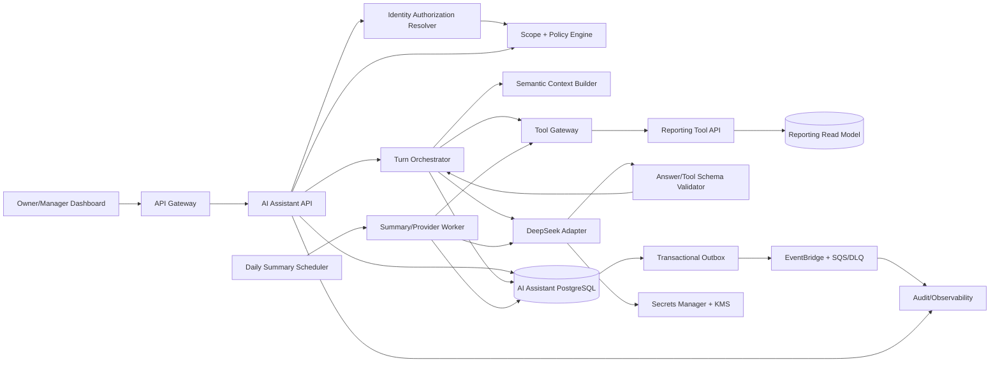
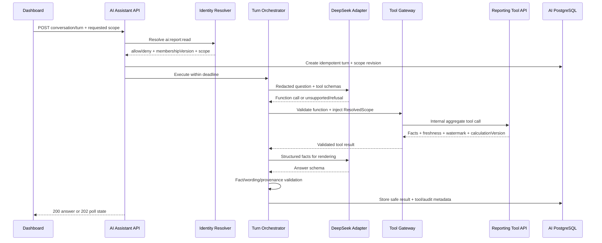
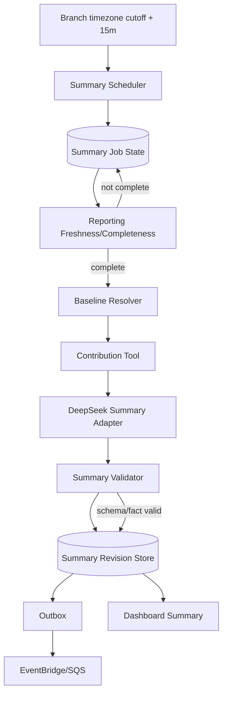
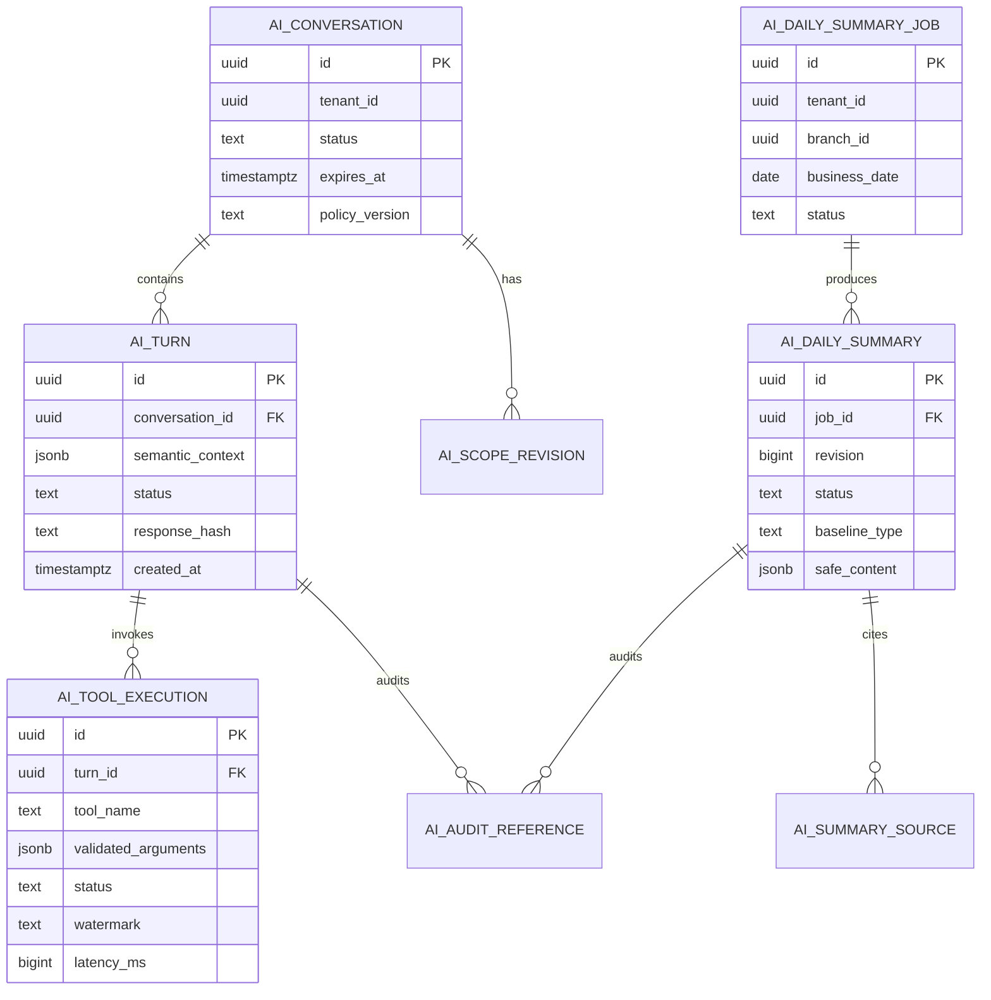

Started at: 2026/10/13 00:00:00
Finished at: 2026/10/13 00:00:00
Total time: 0 minutes
---

# Module 9 — Trợ lý AI cho chủ quán: Architecture

**Ngày:** 2026-10-13  
**Trạng thái:** Approved  
**Requirements:** [AI Assistant Requirements](./2026-10-13-requirements.md)  
**Requirements review:** [AI Assistant Requirements Review](./2026-10-13-requirements-review.md)  
**Sequence diagrams:** [AI Assistant Sequences](./2026-10-13-sequence-diagrams.adoc)  
**Parent architecture:** [POS Platform Architecture](../pos-platform/2026-10-12-architecture.md)

## 1. Architecture summary

AI Assistant là một bounded service read-only đứng giữa Owner/Manager dashboard và Reporting read model. Kiến trúc dùng DeepSeek function calling nhưng tách rõ ba quyền:

1. **Identity quyết định caller scope** — AI Assistant gọi Identity authorization decision ở mỗi protected conversation/turn.
2. **Reporting quyết định facts/metrics** — Tool Gateway chỉ gọi các Reporting tools đã allowlist; không có arbitrary SQL.
3. **AI Assistant quyết định presentation/state** — session, tool-loop, validator, redacted audit và daily-summary revision thuộc service.

P1 chat chạy synchronous trong 10 giây nếu có thể; turn quá deadline chuyển sang `202 + polling`. P2 daily summary chạy async theo branch business cutoff, chờ Reporting completeness watermark, sau đó mới gọi DeepSeek để diễn đạt contribution facts.

## 2. Component architecture



### Component responsibilities

| Component | Responsibility | Must not do |
|---|---|---|
| Dashboard | Send question/scope, render answer state/provenance/freshness, poll queued turn | Decide authorization or display raw tool payload as trusted fact |
| AI Assistant API | Auth boundary, idempotency, session/turn endpoint, response envelope | Read Order/Payment/Catalog DB or mutate domain state |
| Identity Resolver | Current role/tenant/branch permission and membership version | Return raw membership data outside decision contract |
| Scope + Policy Engine | Build immutable `ResolvedScope`, validate period/range/role, enforce budget/tool policy | Trust client/LLM branch IDs as authority |
| Turn Orchestrator | Bounded model/tool loop, timeout, retry, structured answer assembly | Execute arbitrary functions or accept model prose as fact |
| Semantic Context Builder | Convert previous turns to structured intent/period/metric context without raw transcript | Store or forward raw transcript by default |
| Tool Gateway | Allowlist, argument schema, scope injection, redaction assertion, timeout/circuit breaker | Accept SQL/table/filter expressions from LLM |
| Reporting Tool API | Execute canonical aggregate/report queries and return watermark/calculation version | Accept arbitrary query or derive authorization from caller text |
| DeepSeek Adapter | Provider request/response mapping, token/budget/timeout, secret use | Send PII/raw IDs or fallback silently to another provider |
| Validator | Validate function JSON and final answer schema/fact consistency | Repair indefinitely or invent missing values |
| Summary Worker | Process cutoff/completeness jobs, baseline/contribution/render/revision | Publish incomplete facts as final |
| AI PostgreSQL | Store safe state, lineage, policy refs, idempotency/outbox | Become a second Reporting metric store |
| Outbox/Event bus | Deliver audit/summary/turn events at least once | Carry prompt/PII/provider secrets |
| Audit/Observability | Store redacted evidence, metrics, traces, security signals | Log raw prompt/provider payload |

## 3. Authorization and trust boundaries

### 3.1 Request path

```text
Dashboard JWT
  → API Gateway coarse validation
  → AI Assistant API validates JWT + correlation
  → Identity /internal/v1/authorization-decisions (online authority)
  → Scope + Policy Engine creates ResolvedScope
  → every Tool Gateway call carries trusted scope + membershipVersion
  → Reporting applies tenant/branch repository predicates
```

Identity’s online decision is required because membership revoke/role change must apply on the next protected request. `AuthorizationContextChanged.v1` may invalidate non-authoritative caches but cannot extend access after a revoke.

`ResolvedScope` is immutable for one turn:

```json
{
  "scopeType": "BRANCH",
  "tenantId": "tenant-uuid",
  "branchIds": ["branch-uuid"],
  "subjectId": "opaque-user-id",
  "role": "MANAGER",
  "permission": "ai:report:read",
  "membershipVersion": 12,
  "authorizationVersion": 7,
  "resolvedAt": "2026-10-13T08:00:00Z"
}
```

Owner tenant scope is explicit `scopeType=TENANT`; wildcard branch values are invalid. Reporting trusts only workload-authenticated/signed context and still checks tenant/branch predicates at its application/repository boundary.

### 3.2 LLM trust boundary

The user message, model output and retrieved tool facts are untrusted content. The LLM receives:

- fixed system policy and model/prompt policy version;
- safe role/scope summary without unnecessary membership detail;
- structured semantic context from prior turns;
- current user question after input redaction/size validation;
- tool schemas without internal SQL/table details;
- aggregate tool results after schema and PII assertion.

The LLM never receives JWTs, phone numbers, customer names, raw order/payment IDs, secrets, SQL, database schema, hidden prompts or unrestricted branch lists.

## 4. P1 chat architecture

### 4.1 Turn state flow



### 4.2 Bounded tool loop

1. Build initial prompt and call DeepSeek with tool registry.
2. If no tool call, validate `UNSUPPORTED`/clarification or safe answer schema.
3. If function call exists, validate name/args against registry; scope and policy are injected by server.
4. Execute at most three tool calls per turn, sequentially by default; parallel calls are allowed only when tools are independent and share the exact scope/period.
5. Send only validated aggregate facts back to DeepSeek for rendering.
6. Validate final response against schema and facts; one bounded repair/regenerate is allowed.
7. On mismatch/unavailability, return structured facts/error; never fabricate a number.

### 4.3 Sync/async execution

- API attempts synchronous execution up to a 10-second turn deadline.
- If the provider/tool worker cannot finish safely before deadline, transaction commits `QUEUED`/`RUNNING` turn and returns `202` with polling location.
- Poll response exposes only state/provenance/error; no partial prose is marked final.
- MVP does not use SSE/WebSocket for assistant responses.
- `Idempotency-Key` + `clientTurnId` ensure retry returns the same turn/result.

## 5. Tool Gateway and Reporting architecture

### 5.1 Tool registry

Tool registry is versioned configuration, not an LLM-controlled list:

| Tool | Reporting owner | Max period | Output |
|---|---|---:|---|
| `getSalesSummary` | daily/branch sales projection | 31 business days | order count, gross/net/VAT, delta, freshness |
| `getOrderCount` | paid-order projection | 31 business days | count/delta/freshness |
| `getAverageOrderValue` | canonical AOV projection/formula | 31 business days | AOV/denominator/delta/rounding version |
| `getTopItems` | top-item projection | 31 business days | safe item label, quantity, revenue, rank |
| `compareBranches` | branch sales projection | 31 business days | authorized branch aggregates |
| `getHourlySales` | hourly projection | 7 business days | hour bucket and aggregate |
| `getContributionDrivers` | contribution projection | one business date + baseline | signed drivers/materiality/version |

Tool descriptor contains JSON Schema, permission, max range/result, timeout, freshness policy, PII class, calculation version and owner. Tool Gateway rejects unknown or disabled versions before any Reporting call.

### 5.2 Reporting source of truth

Reporting owns:

- `sales_daily` and `sales_by_branch` built from canonical `OrderPaid.v1` plus approved correction/refund events;
- `sales_by_hour` keyed by branch business date/hour/timezone;
- `top_items` from paid line snapshots;
- `aov` using `netMinor / paidOrderCount` and deterministic rounding;
- `contribution_drivers` with signed delta/contribution/materiality/calculation version.

Interactive tool calls synchronously read these projections. `ReportProjectionWatermarkUpdated.v1` and `BusinessDayReady.v1` are asynchronous scheduler/cache hints; they do not replace a current freshness query.

AI Assistant never computes revenue from `OrderPaid` directly. This prevents metric drift and cross-service analytical joins.

### 5.3 Freshness and completeness

Reporting returns a `DataQualityEnvelope`:

```json
{
  "freshnessStatus": "FRESH",
  "completenessStatus": "COMPLETE",
  "projectionVersion": 901,
  "watermark": "reporting:branch:42:v901",
  "lastUpdatedAt": "2026-10-13T08:00:00Z",
  "missingSources": [],
  "calculationVersion": "sales-metric-v2"
}
```

`STALE` may be shown with warning for interactive queries if policy permits. `INCOMPLETE` blocks a published daily summary and produces explicit waiting/data-late state.

## 6. P2 daily-summary architecture



### 6.1 Cutoff/completeness policy

- Scheduler creates one job per `(tenant, branch, businessDate, summaryPolicyVersion)` at cutoff + 15 minutes.
- Worker waits up to 30 minutes for Reporting completeness.
- If complete, resolve same-weekday-last-week baseline; fallback to seven comparable business days; otherwise `NO_BASELINE`.
- If late facts change source watermark after publish, Reporting emits freshness update or scheduler polls; worker creates a new immutable summary revision.
- Old revision becomes `SUPERSEDED`; it is never overwritten, and the event carries old/new lineage.

### 6.2 Contribution and wording

Reporting computes signed drivers. AI Assistant passes structured facts to DeepSeek. A deterministic validator checks:

- every number in text has a matching fact/allowed rounding;
- baseline/period/scope labels are present;
- causal words are rejected unless an explicit `causalEvidence=false` policy allows only “liên quan/đóng góp”; default wording template is non-causal;
- missing/uncertain facts appear in caveats.

## 7. Data architecture

### 7.1 AI Assistant PostgreSQL ownership



Raw user message/prompt/LLM response is not a required column. `semantic_context` and `safe_content` contain only structured/redacted values. Every column requires PostgreSQL `COMMENT ON COLUMN` in Contracts.

### 7.2 Index/retention policy

- `ai_conversations`: `(tenant_id, created_at DESC)`, status/expiry cleanup index.
- `ai_turns`: `(tenant_id, conversation_id, created_at DESC)`, unique `(tenant_id, conversation_id, client_turn_id)`.
- `ai_tool_executions`: `(tenant_id, turn_id, created_at)`, tool/status/latency metrics index.
- `ai_daily_summary_jobs`: unique `(tenant_id, branch_id, business_date, policy_version)` and `(status, next_attempt_at)` worker lease index.
- `ai_daily_summaries`: unique active revision per `(tenant_id, branch_id, business_date, policy_version)`; lineage index by source watermark.
- High-volume turn/tool/audit records may use monthly RANGE partitions after measured volume/retention need; no partition in MVP by default.
- Semantic context default TTL is 90 days; raw prompt retention is zero; redacted audit references follow parent audit/legal retention. Deletion/tombstone must remove future model/provider use.

## 8. Reliability and recovery

### 8.1 Idempotency

- Public turn command key: `(tenant, conversation, clientTurnId)`.
- Summary job key: `(tenant, branch, businessDate, policyVersion)`.
- Summary rerun key includes source watermark/revision.
- Provider retry does not create a new turn/summary; local state machine owns attempt identity.
- Outbox emits one event per committed state transition; duplicate consumer delivery is a no-op by event ID.

### 8.2 Failure behavior

| Failure | Behavior |
|---|---|
| Identity unavailable | Fail closed; no tool call; safe `authorization_unavailable`. |
| Reporting unavailable | `PARTIAL` only if facts are sufficient and policy allows; otherwise `SERVICE_UNAVAILABLE`; no invented answer. |
| Reporting stale/incomplete | Visible warning; daily summary waits; interactive query follows tool freshness policy. |
| DeepSeek timeout | One bounded retry within budget, then structured facts/error. |
| Invalid tool call | Reject before Reporting; audit policy violation; no model loop beyond bound. |
| Invalid final prose | One repair; then structured facts or provider error. |
| AI DB unavailable before commit | Return safe error; no external provider call without durable turn identity. |
| Outbox/broker unavailable | Local state remains committed; publisher retries/DLQ; dashboard reads state. |
| Late report fact | New immutable summary revision/superseded event. |

### 8.3 Circuit breakers and budgets

- Provider adapter has timeout, one retry, circuit breaker and per-tenant/day cost budget.
- Tool Gateway has per-tool timeout and concurrent-call limit.
- Scheduler/worker leases jobs with heartbeat and bounded retry; poison jobs go to DLQ with safe error code.
- Ops can replay summary job/tool event only with explicit scope and idempotency key.

## 9. Security, privacy and observability

### Security/privacy

- Cognito/JWT at edge; online Identity decision for every protected turn.
- Internal Reporting/provider calls use workload identity/mTLS.
- Scope is signed/trusted context plus repository predicates; client/LLM cannot widen it.
- Provider payload redaction occurs in Tool Gateway/Prompt Builder; raw prompt is never logged.
- Secrets Manager/KMS stores provider key and encryption key references; no secrets in DB/prompt/event.
- Audit records actor/scope/tool/policy/status but not raw question/response/PII.
- Mutation endpoints are absent from tool registry and network policy.

### Metrics/logs/traces

- Metrics: turn/intent/status, tool call/status/latency, provider latency/tokens/cost, scope refusals, prompt injection refusals, freshness, summary lag/status, outbox/DLQ.
- Logs: safe IDs, scope type/count, intent, tool/status, watermark, policy/model versions and latency only.
- Traces: dashboard → API → Identity → Tool Gateway → Reporting/DeepSeek → DB/outbox; span attributes are redacted.
- Alerts: provider circuit open/budget exhausted, auth denial spike, cross-scope attempt, tool timeout, stale/incomplete report, summary lag, DLQ growth and redaction failure.

## 10. Deployment and scaling

| Workload | Deployment/scaling |
|---|---|
| AI Assistant API | Stateless ECS Fargate service; scale on request latency/concurrency; no in-memory authority state. |
| Tool Gateway/Orchestrator | Same service boundary initially; isolate worker pool/concurrency from API request threads. |
| Summary Worker | Separate ECS task/worker deployment; scale on queued jobs and provider latency. |
| Scheduler | Durable scheduled trigger; idempotent job creation, single-leader/claim semantics. |
| PostgreSQL | Dedicated AI Assistant database/schema, encrypted at rest, Flyway migrations, backup/restore. |
| Reporting | Existing separate read-model database/service; no shared DB credentials. |
| EventBridge/SQS | Dedicated assistant event route/queue/DLQ; at-least-once and inbox dedupe. |
| DeepSeek | Adapter egress through controlled secret/network boundary; no direct dashboard-to-provider call. |

## 11. Architecture decisions / ADRs

| ADR | Decision | Alternatives rejected | Reason |
|---|---|---|---|
| ADR-AI-01 | Use LLM + allowlisted function calling over Reporting tools | Direct SQL generation; generic agent | Security, metric ownership and deterministic audit. |
| ADR-AI-02 | Reporting remains metric/source-of-truth owner | Recompute metrics in AI Assistant | Prevent dashboard/assistant drift and cross-service joins. |
| ADR-AI-03 | Online Identity authorization per protected turn | Trust static role/branch claim or long cache | Revocation must apply on next request. |
| ADR-AI-04 | Structured semantic context, no raw transcript by default | Store full conversation/prompt | PII minimization and stable follow-up scope. |
| ADR-AI-05 | Synchronous chat with bounded `202 + polling` fallback | SSE/WebSocket first | Simpler MVP and explicit final state. |
| ADR-AI-06 | Async cutoff/completeness/revision pipeline for daily summary | Generate at fixed midnight blindly | Late facts and report freshness need lineage/correction. |
| ADR-AI-07 | No provider fallback in MVP | Silent multi-provider fallback | Predictable data egress, cost and evaluation boundary. |

## 12. Sequence diagram confirmation gate

Repository có AI Assistant/Reporting chưa có code implementation, nên sequence diagrams sẽ là **contract-driven design diagrams**, không phải runtime trace. Đề xuất render L1/L2 cho các flow sau:

1. P1 chat — authorized Owner/Manager asks a sales question and receives a tool-backed answer.
2. P1 scope refusal/prompt injection — Manager requests an unauthorized branch or asks for SQL/system prompt.
3. P1 provider/tool failure — Reporting stale/unavailable or DeepSeek timeout returns safe structured state.
4. P2 daily summary — cutoff → completeness → baseline/contribution → DeepSeek → publish.
5. P2 late fact/rerun — source watermark changes, new revision supersedes previous summary.
6. Authorization revocation — membership changes between turns and next request fails closed.

### Proposed L1 participants

| Participant | Type | Role |
|---|---|---|
| Owner/Manager Dashboard | Client | Sends chat/scope and renders state |
| AI Assistant Service | Service | API/orchestrator/policy/validator |
| Identity Access | Service | Online authorization decision |
| Reporting Service | Service | Canonical aggregate tool/read model |
| DeepSeek Provider | External provider | Function planning/rendering |
| AI Assistant PostgreSQL | Database | Conversation/tool/summary state |
| EventBridge/SQS/DLQ | Message broker | Audit/summary event delivery |
| Audit/Observability | Consumer | Redacted evidence/metrics/traces |
| Scheduler/Worker | Worker | P2 cutoff/job execution |

### Proposed L2 participants

`AI Assistant Controller`, `ScopePolicyEngine`, `TurnOrchestrator`, `ToolGateway`, `DeepSeekAdapter`, `SummaryWorker`, `AI Assistant PostgreSQL`, with Reporting/Identity/Outbox represented as outbound adapter boundaries.

**Required before sequence generation:** User xác nhận danh sách flows/participants trên. Sau khi xác nhận, dùng `sequence-diagram` để tạo L1/L2 PlantUML `.adoc`.

## 13. Architecture approval gate

- **Current status:** Approved.
- **Required before Contracts:** Approve component/data/reliability decisions and confirm sequence participants/flows.
- **Implementation rule:** Không tạo application code; Contracts phải materialize public/internal OpenAPI, Reporting tool schemas, provider policy, event schemas và PostgreSQL migrations.

