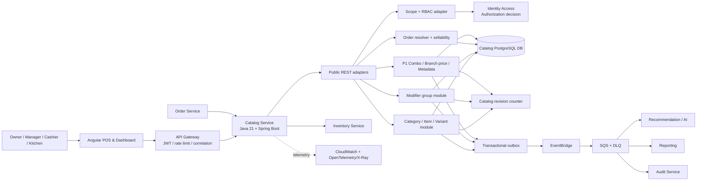
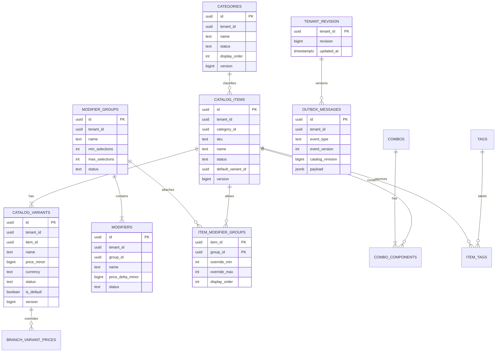

Started at: 2026/10/12 16:28:00
Finished at: 2026/10/12 16:28:00
Total time: 0 minutes
---

# Architecture: Catalog Service

## Sources

- [Vision](./2026-10-12-vision.md)
- [Vision review](./2026-10-12-vision-review.md)
- [Requirements](./2026-10-12-requirements.md)
- [POS Platform Architecture](../pos-platform/2026-10-12-architecture.md)
- [POS Platform Contracts](../pos-platform/2026-10-12-contracts.md)
- [Identity & Access Contracts](../identity-access/2026-10-12-contracts.md)

## Architecture Goals

1. Keep Catalog as the only source of truth for tenant menu structure, prices and menu availability.
2. Make every read/write tenant-scoped and every branch read authorization-aware.
3. Resolve a coherent item/variant/modifier selection for Order without a cross-service database read.
4. Preserve historical Order and Inventory references through soft archive and immutable IDs.
5. Publish durable versioned events for Recommendation, Reporting, Audit and cache invalidation.
6. Keep P0 simple and stable while leaving explicit extension points for combo, branch pricing and AI metadata.

## Component Architecture

### System Overview



### Components and Boundaries

| Component | Responsibility | Technology | Communication |
|---|---|---|---|
| Angular POS/Dashboard | Admin catalog forms, POS menu read, category/modifier selection and P1 screens | Angular | HTTPS REST/OpenAPI |
| API Gateway | TLS, route, coarse JWT validation, rate limiting and correlation propagation | AWS API Gateway or parent gateway | HTTPS |
| Public REST adapters | DTO validation, endpoint auth context, pagination, ETag and error mapping | Spring Boot MVC boundary | `/api/v1/catalog` |
| Scope/RBAC adapter | Calls Identity Access with verified user subject and requested tenant/branch/permission | Spring Security + internal client | Private `/internal/v1/authorization-decisions` |
| Category module | Flat category lifecycle, item category assignment and display order | Spring domain/application module | PostgreSQL + outbox |
| Item/Variant module | Item lifecycle, SKU, default variant, price and global sellability | Spring domain/application module | PostgreSQL + revision + outbox |
| Modifier module | Reusable groups, options, item links and effective selection rules | Spring domain/application module | PostgreSQL + revision + outbox |
| Order resolver | Coherent bulk validation of item/variant/modifier selections and current prices | Spring application module | Private REST to Order; PostgreSQL read transaction |
| Sellability policy | Combines Catalog state; exposes reason/version for Order and consumers | Domain policy module | Used by public read and resolver |
| P1 extension module | Combos, branch variant price overrides, description/tags and metadata events | Feature-flagged Spring modules | REST + PostgreSQL + outbox |
| Catalog revision counter | Monotonic tenant revision for ETag, snapshot trace and event invalidation | PostgreSQL row/transaction | Internal domain dependency |
| Transactional outbox | Writes event with the same transaction as catalog state | PostgreSQL worker | EventBridge/SQS |
| Catalog PostgreSQL DB | Owns all Catalog tables; no other service reads it | PostgreSQL/Aurora; local PostgreSQL | Private network/service credentials |
| Order Service | Owns order state and immutable order line snapshots | Existing parent service | Private REST/events |
| Inventory Service | Owns recipe and stock availability | Existing parent service | Private REST/events |
| Recommendation/Reporting/Audit | Consume Catalog events and build their own projections | Existing parent services | EventBridge/SQS |
| Observability | Structured logs, metrics and traces with tenant/correlation fields | OpenTelemetry + CloudWatch/X-Ray | SDK/agent |

### Service Responsibility Boundary

Catalog owns:

- Tenant-owned categories, items, variants, base variant prices and global menu status.
- Reusable modifier groups/options and item-group selection rules.
- P1 combo definitions, branch variant price overrides and normalized metadata.
- Current catalog revision and versioned menu events.
- Current Catalog sellability, excluding Inventory stock state.

Catalog does not own:

- User identity, branch membership or role policy; Identity Access owns those decisions.
- Orders, historical price snapshots or payment state; Order owns those records.
- Recipes, ingredients, stock and reservation state; Inventory owns those records.
- Recommendation scoring/ranking or AI cold-start training.
- Long-term audit query storage; Audit Service owns that projection.

## Communication Architecture

### Public POS Read Flow

```text
Angular → Gateway → Catalog API
  → validate JWT and resolve tenant/branch/catalog:read through Identity
  → query active category/item/variant/modifier graph for tenant
  → apply branch context and current Catalog revision
  → return menu DTO + ETag/catalogVersion
```

- The P0 menu is tenant-shared, but a branch-scoped authorization decision is still required for Manager/Cashier/Kitchen reads.
- An ETag may be returned for POS reads. `304 Not Modified` is allowed only after authentication and current scope validation.
- Cache keys include tenant, branch, audience (`POS` or `ADMIN`) and catalog revision. No response cache is shared across tenants.
- Inactive/archived configuration is excluded from POS reads; authorized admin reads may request inactive entries.

### Admin Mutation Flow

```text
Owner/Manager command
  → JWT + Identity authorization decision
  → validate all referenced category/item/variant/group IDs in the same tenant
  → transaction checks state/version and mutates Catalog records
  → increment tenant catalog revision
  → insert redacted outbox event
  → commit
  → return new resource version and catalogVersion
```

Manager writes are authorized from an active branch membership but have tenant-wide effect. Audit payloads must make that effect explicit.

### Order Resolution and Snapshot

```text
Order draft command
  → Order sends tenantId, branchId, item/variant/modifier selections to Catalog resolver
  → Catalog authenticates workload and validates tenant/branch context
  → repeatable-read transaction loads all requested records and effective rules/prices
  → Catalog rejects inactive, foreign, archived or rule-invalid selections
  → Catalog returns resolved names, prices, modifier deltas, catalogVersion and reasons
  → Order writes immutable snapshots into Order DB
```

- Catalog does not write Order data.
- Catalog does not call Inventory for stock in the resolver; Order/Saga uses Inventory for recipe and stock validation.
- The resolver returns a coherent `catalogVersion` for the read transaction. A later menu mutation does not rewrite an already-created Order snapshot.
- A missing `variantId` is resolved only when exactly one active variant exists; otherwise the resolver rejects the request.

### Event Flow

```text
Catalog state transaction
  ├─ update category/item/variant/modifier state
  ├─ increment tenant catalog revision
  └─ append outbox event with eventVersion/correlationId
        ↓
Outbox publisher → EventBridge → SQS queues + DLQs
        ├─ Recommendation/AI projection
        ├─ Reporting projection
        └─ Audit and cache invalidation
```

- Delivery is at least once; consumers deduplicate by `eventId`.
- Event payloads include IDs, tenant, branch when relevant, revision, changed state and safe summaries. No token, secret or unnecessary PII.
- A failed consumer does not roll back the Catalog mutation. Retry/DLQ and freshness metrics make the lag visible.

### Internal Trust

- Public requests use Cognito JWTs and current Identity authorization.
- Order and worker calls use workload identity/mTLS. The caller sends tenant/branch and IDs, but Catalog validates all ownership locally.
- No service receives Catalog DB credentials except Catalog.
- Internal APIs are private and omitted from the Angular route table.

## Data Architecture

### Entity Relationship Model



### Database Decisions

| Decision | Choice | Rationale |
|---|---|---|
| Database | PostgreSQL/Aurora PostgreSQL | Relational constraints fit tenant ownership, one primary category, one default variant, reusable groups and optimistic writes. |
| Model | Normalized tables plus explicit link tables | Prevents duplicated modifier definitions and makes effective rule validation deterministic. |
| ID | Application-generated UUID v7 | Parent convention, distributed creation and time-sortable indexes. |
| Money | `BIGINT price_minor` + `currency` | Exact VND arithmetic; no floating point. |
| Revision | One monotonic revision per tenant | Stable ETag, coherent Order resolver response and projection invalidation. |
| Consistency | Primary DB transaction for mutation/resolution; eventual consumers | Order needs coherent current catalog; Recommendation/Reporting tolerate event lag. |
| Archive | Soft archive | Preserves references from historical Orders, Inventory recipes and events. |
| Partitioning | None for core tables in MVP | Expected menu volume is below the database-design threshold; indexes are sufficient. |

### Core Tables and Invariants

| Table | Role | Required invariant |
|---|---|---|
| `categories` | Flat tenant category | Unique normalized name/code per tenant; archive blocked while non-archived items remain. |
| `catalog_items` | Menu item aggregate | Unique tenant SKU; exactly one category; active item requires active default variant. |
| `catalog_variants` | Size/default price | Belongs to same tenant/item; nonnegative price; at most one default per item; active item cannot lose all active variants. |
| `modifier_groups` | Reusable selection group | Same-tenant options; `0 ≤ min ≤ max`. |
| `modifiers` | Group option and surcharge | Same-tenant group; nonnegative P0 price delta; active option can be selected only through active group/link. |
| `item_modifier_groups` | Item-to-group rule | Composite unique `(item_id, group_id)`; overrides stay within option count; all IDs same tenant. |
| `tenant_catalog_revisions` | Monotonic change marker | Exactly one row per tenant; incremented in the same transaction as a catalog mutation. |
| `outbox_messages` | Durable event publication | Inserted in same transaction as mutation/revision increment; event ID immutable. |
| `idempotency_records` | Retry-safe mutation | Unique operation/tenant/actor/key and canonical request hash. |
| P1 `combos`/`combo_components` | Fixed-price composition | No component can reference a combo; same tenant; required component must resolve. |
| P1 `branch_variant_prices` | Branch current override | Unique `(tenant_id, branch_id, variant_id)`; branch belongs to tenant; delete reverts to base price. |
| P1 `tags`/`item_tags` | AI metadata | Tenant-unique normalized tag slug; many-to-many item mapping without duplicate links. |

### Tenant and Cross-Service Isolation

- Every core table contains `tenant_id` directly or has a tenant-owned parent with a composite ownership check.
- Catalog repository methods require an explicit `TenantScope` and reject empty scope for tenant-owned data.
- Composite keys/FKs inside Catalog ensure `category_id`, `item_id`, `group_id`, `variant_id` and P1 branch references do not cross tenant boundaries.
- There are no runtime FKs to Identity, Order, Inventory or Recommendation databases.
- Branch IDs for P1 pricing and request context are opaque references validated through Identity/branch ownership; Catalog does not copy branch membership as an authority source.

### Index Strategy

| Access pattern | Index |
|---|---|
| POS item list | `(tenant_id, status, category_id, display_order, id)` on items. |
| Tenant SKU lookup | Unique `(tenant_id, normalized_sku)` on items. |
| Active variants by item | `(tenant_id, item_id, status, display_order, id)` on variants. |
| Group options | `(tenant_id, group_id, status, display_order, id)` on modifiers. |
| Item effective modifier groups | `(tenant_id, item_id, display_order, group_id)` on item links. |
| Admin searches | Allowlisted normalized name/SKU indexes scoped by tenant; no arbitrary SQL sort. |
| Outbox publisher | `(publish_status, next_attempt_at, created_at)`. |
| Idempotency | Unique `(tenant_id, operation, actor_subject, idempotency_key)`. |
| P1 branch price | Unique `(tenant_id, branch_id, variant_id)` and lookup by branch/variant. |
| P1 tags | Unique `(tenant_id, normalized_slug)` and `(tenant_id, item_id, tag_id)`. |

### Revision and Read Consistency

1. A mutation opens a PostgreSQL transaction and locks the tenant revision row.
2. It validates all aggregate states and `If-Match` versions.
3. It updates entities, increments `tenant_catalog_revisions.revision`, and inserts outbox events carrying that revision.
4. Commit makes the graph and revision visible together.
5. Order resolver uses a repeatable-read transaction and returns the observed revision.
6. ETag is derived from tenant, audience/branch context and revision. Cache invalidation can be event-driven, but correctness uses current authorization and revision validation.

### Migration and Partitioning

- Use Flyway versioned SQL with `COMMENT ON COLUMN` for every new field.
- Suggested order: extensions/schema → categories/items/variants → modifier tables/links → revision/idempotency/outbox → P1 tables → deterministic local seed.
- Deploy additive nullable fields before enforcing required constraints; use expand/backfill/contract for breaking changes.
- Core catalog tables are not partitioned for MVP. Review outbox retention and event volume separately; move long-term event history to Audit/observability retention where appropriate.
- Validate migrations against empty and copied databases; rollback uses backup/repair or forward compensating migration.

## Sellability and Pricing Policies

### P0 Effective Sellability

```text
Category ACTIVE
  AND Item ACTIVE
  AND Variant ACTIVE
  AND selected modifiers belong to active attached groups/options
  AND selection counts satisfy effective min/max
```

Inventory stock is a separate condition evaluated by Inventory/Order. Catalog may expose `catalogSellable`, while Order combines it with `inventoryAvailable` before checkout.

### P0 Price Resolution

```text
variant.basePriceMinor
  + sum(selected active modifier.priceDeltaMinor)
  → Catalog resolver response
  → Order applies its own tax/rounding policy and stores snapshot
```

Catalog does not compute discounts, VAT or payment totals in P0.

### P1 Price/Combo Extension

- Branch price lookup applies only when a current `branch_variant_prices` row exists; otherwise base variant price is used.
- Combo price is fixed and returned with component snapshots; it does not recursively resolve nested combos.
- Description/tag mutation increments the tenant revision and emits a metadata event for AI consumers.

## Security and Observability

- Cognito JWT validation is performed at Gateway and Catalog service; current Catalog permission is resolved through Identity Access.
- Owner/Manager/Cashier/Kitchen behavior follows the Identity membership state at request time; cached UI role data is never authority.
- All resource IDs and association IDs are checked against tenant scope before persistence/query.
- Public error responses do not reveal another tenant's item/category/SKU existence.
- Inputs are schema-validated and parameterized; descriptions/tags are sanitized and bounded.
- Logs include `requestId`, `correlationId`, tenant, actor/effective membership, resource, action, outcome and duration. Do not log JWTs, raw authorization headers, secrets or unmasked sensitive data.
- Metrics include catalog read p95, resolver rejection reasons, mutation conflicts, active item invariant failures, outbox lag, DLQ depth, event lag and cache hit/miss.
- Audit events include tenant-wide effect for Manager mutations and redacted before/after summaries.

## Deployment Architecture

### Cloud

- ECS Fargate runs stateless Catalog API and outbox worker tasks separately.
- Aurora/RDS PostgreSQL is private and reachable only by Catalog service credentials.
- EventBridge bus routes versioned Catalog events to SQS queues for Recommendation, Reporting and Audit, each with retry/DLQ.
- Secrets Manager supplies DB/broker/config secrets; no secrets are committed.
- Read replicas/cache may be added after measuring resolver and POS read load; primary remains the mutation and Order resolution source.

### Local/Demo

- Docker Compose runs Catalog API/worker, PostgreSQL, local broker adapter/LocalStack and a stub Identity authorization client.
- Seed profile creates one tenant with flat categories, standard/size variants, reusable modifier groups and representative inactive/archive records.
- Local event contracts and failure behavior match cloud adapters; consumers can replay fixtures for Recommendation/Reporting.

## Sequence Diagrams

Deferred to Step 5c. No Catalog implementation exists yet, so the `sequence-diagram` skill cannot trace actual code paths. The flow sections above define design-level interactions; implementation-trace diagrams should be generated after the first Catalog vertical slice.

## Architecture Decision Records

| # | Decision | Alternatives considered | Rationale |
|---|---|---|---|
| ADR-CAT-01 | Normalized PostgreSQL Catalog DB | One JSON document per menu; split product/pricing services | Constraints, reusable groups, concurrency and tenant queries are relational; split services add premature distributed consistency. |
| ADR-CAT-02 | Variant owns base price and every item has a default variant | Item-level price with optional overrides; variants as labels only | Order already references `variantId`; this makes size pricing and snapshot semantics explicit. |
| ADR-CAT-03 | Reusable modifier groups with item-level rule overrides | Flat per-item modifiers; groups without selection rules | Supports common toppings while preserving per-item required/min/max behavior. |
| ADR-CAT-04 | Tenant-global P0 availability and current price | Branch-specific P0 state; independent item/variant policies | Matches parent MVP boundary and keeps first slice simple; P1 extension has a clear table/contract. |
| ADR-CAT-05 | Online Identity authorization plus Catalog repository scope | Trust JWT claims; local role copy | Current membership/revocation remains authoritative and Catalog cannot rely on stale client data. |
| ADR-CAT-06 | Private Order resolver with immutable Order snapshot | Order reads Catalog DB; Catalog writes Order snapshot | Preserves service ownership while giving Order a coherent current price/configuration. |
| ADR-CAT-07 | Tenant revision + transactional outbox | Timestamp-derived ETag; direct fan-out | A monotonic revision gives deterministic cache/snapshot invalidation and outbox prevents lost events. |
| ADR-CAT-08 | No core-table partitioning in MVP | Partition every Catalog table | Expected catalog scale does not justify partition overhead; monitor outbox separately. |

## Architecture Validation Matrix

| Requirement group | Architecture coverage |
|---|---|
| Categories/items | Category and Item/Variant modules, normalized tables, lifecycle transaction. |
| Variant pricing | Variant price, default variant invariant, resolver and Order snapshot flow. |
| Modifier rules | Reusable group/option/link tables, effective rule policy and validation. |
| Global availability | Sellability policy, tenant revision and P0 status cascade. |
| RBAC/isolation | Identity resolver, explicit TenantScope, repository predicates and composite constraints. |
| Order integration | Private bulk resolver, repeatable-read transaction, versioned response and no cross-DB read. |
| Inventory integration | Item/variant/recipe opaque references; Inventory owns stock and fulfillment. |
| Events | Transactional outbox, EventBridge/SQS routing, event version and consumer deduplication. |
| P1 combo/pricing/tags | Feature-flagged modules/tables with non-nested combo and current branch override. |
| NFR/operations | Indexes, ETag, bounded pagination, metrics, structured logs, ECS and failure handling. |

## Domain Skills Referenced

- **api-design:** public/admin/read APIs, private Order resolver, auth headers, pagination, ETag and errors.
- **database-design:** normalized relational model, tenant constraints, UUID v7, integer money, indexes, migration remarks and partitioning.
- **log-processing:** structured audit/correlation fields and redaction requirements.
- **sequence-diagram:** applicability reviewed; implementation trace deferred because source code does not exist.

## Approval

- **Status:** Approved by user
- **Phase:** Architecture Design
- **Next phase after approval:** API & Data Contracts
