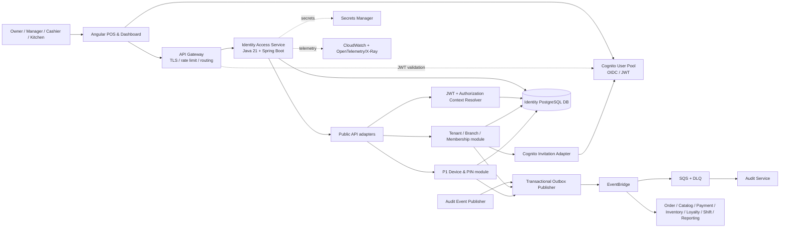
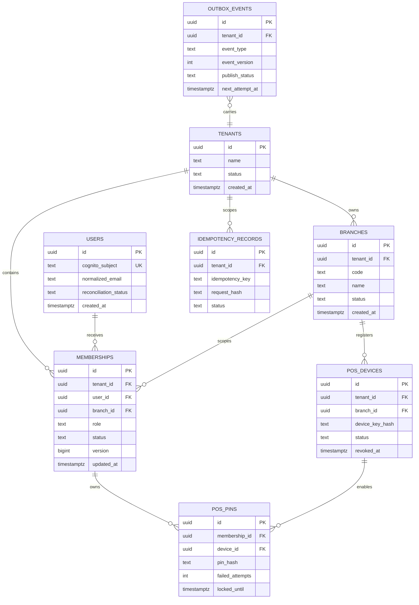

Started at: 2026/10/12 15:08:00
Finished at: 2026/10/12 15:08:00
Total time: 0 minutes
---

# Architecture: Identity & Access

## Source

- **Vision:** [2026-10-12-vision.md](./2026-10-12-vision.md)
- **Vision review:** [2026-10-12-vision-review.md](./2026-10-12-vision-review.md)
- **Requirements:** [2026-10-12-requirements.md](./2026-10-12-requirements.md)
- **Parent architecture:** [POS Platform Architecture](../pos-platform/2026-10-12-architecture.md)
- **Parent contracts:** [POS Platform Contracts](../pos-platform/2026-10-12-contracts.md)

## Architecture Goals

1. Keep Cognito authentication separate from tenant/branch authorization owned by Identity Access.
2. Make every protected decision tenant- and branch-aware, with revocation effective on the next request.
3. Keep employee/branch/membership state transactional and auditable.
4. Allow downstream services to consume a versioned authorization context without reading the Identity DB.
5. Keep P0 independent from the P1 POS PIN quick-switch feature.
6. Run locally with Docker Compose and deploy as a stateless Spring Boot service on AWS ECS Fargate.

## Component Architecture

### System Overview



### Deployment and Module Boundaries

`identity-access` is one independently deployable service with modular internal boundaries. Authentication remains an external Cognito capability; the service does not implement passwords or a second login system.

| Component | Responsibility | Technology | Communication |
|---|---|---|---|
| Angular POS/Dashboard | Login redirect, branch selector, employee/admin screens, P1 quick-switch UI | Angular | HTTPS REST/OpenAPI; OIDC with Cognito |
| API Gateway | TLS termination, routing, coarse JWT validation, rate limiting, correlation propagation | AWS API Gateway or parent gateway | HTTPS |
| Cognito User Pool | Login, invitation delivery, password policy, token issuance and external user lifecycle | Amazon Cognito | OIDC, JWT/JWK, AWS SDK adapter |
| Public API adapters | Validate DTOs, resolve request context, map domain outcomes to standard HTTP envelopes | Spring MVC/WebFlux boundary | `/api/v1` |
| JWT validator | Verify issuer/signature/audience/expiry and expose stable `sub`; never decide tenant role alone | Spring Security Resource Server | Local JWK cache; no business DB access |
| Authorization Context Resolver | Query current membership state, validate tenant/branch/permission and return versioned context | Spring application module | Internal service API + PostgreSQL |
| Tenant/Branch module | Tenant bootstrap, branch lifecycle, branch scope and owner invariant | Spring application/domain module | REST + repository + domain events |
| Membership module | Invitations, activation, role/branch assignments, suspend/revoke and reconciliation | Spring application/domain module | REST + Cognito adapter + outbox |
| Cognito Invitation Adapter | Translate idempotent invitation jobs to Cognito operations and reconcile failures | AWS SDK adapter/worker | Internal async worker |
| P1 Device/PIN module | Register/revoke branch devices, hash/verify cashier PIN, lockout and short-lived switch context | Spring application/domain module | REST + PostgreSQL + audit events |
| Transactional outbox | Persist publishable event with the same transaction as the state mutation; retry safely | PostgreSQL worker | EventBridge/SQS |
| Audit event publisher | Produce redacted security/management events for Audit Service | Shared application adapter | Outbox → EventBridge/SQS |
| Identity PostgreSQL DB | Source of truth for tenant, branch, user mapping and membership authorization | Amazon Aurora/RDS PostgreSQL; local PostgreSQL | Private network, service-owned credentials |
| Downstream services | Enforce their own business permissions using the versioned auth context; own their databases | Spring Boot services | Public request path or internal service calls |
| Observability | Logs, metrics, traces and alerts without secrets/PII | OpenTelemetry + CloudWatch/X-Ray | Sidecar/agent or SDK |

### Responsibility Boundary

Identity Access owns:

- Tenant and branch identity/lifecycle.
- Cognito subject mapping and minimal employee profile.
- Membership status, branch assignment, role and permission resolution.
- Invitation orchestration and external Cognito reconciliation.
- POS device/PIN state for P1.
- Authorization context and security/management event production.

Identity Access does not own:

- Passwords, refresh-token storage or custom authentication.
- Orders, catalog, payment, inventory, loyalty, shifts, KDS workflow or reporting facts.
- Downstream service data or cross-service SQL joins.
- The canonical long-term audit query store; Audit Service owns that projection.

## Communication Architecture

### Authentication and Request Authorization

```text
1. Angular redirects the user to Cognito and receives an OIDC access/ID token.
2. API Gateway checks token presence/signature/routing policy and forwards correlation context.
3. Identity Access and each downstream service independently validate JWT issuer, signature,
   audience, expiry and subject using cached Cognito JWKs.
4. The target service sends the subject, requested tenant/branch and required permission to
   Identity Access internal authorization endpoint over mTLS/workload credentials.
5. Identity Access reads current membership state from the primary Identity DB and returns
   allow/deny plus a versioned authorization context.
6. The target service applies the context to its own repository queries and business rules.
```

The API Gateway may reject obviously invalid tokens, but it is not the final source of authorization. A service must fail closed if Identity Access cannot resolve authorization for a protected operation. Client-provided role, tenant or branch context is never forwarded as trusted authority.

### Online Authorization Decision

P0 uses an online authorization lookup for protected requests because the requirement is that a membership revoke/suspend applies on the next request. A local membership projection or long-lived authorization cache would create a stale-access window and is therefore not the P0 source of truth.

- JWK caching is allowed because key caching does not cache business authorization.
- `/me` may use a short-lived read optimization only if it is invalidated by membership version changes; protected mutation authorization still reads current state.
- Any future cache must include tenant, branch, subject, permission and membership version, and must fail closed when invalidation cannot be confirmed.

### Synchronous APIs

- Angular uses `/api/v1` REST/OpenAPI endpoints.
- Downstream authorization resolution uses private `/internal/v1` endpoints protected by mTLS or signed workload credentials.
- Cognito calls are isolated behind an adapter and never occur inline on every business request.
- Invitation commands create durable work and return before email delivery is guaranteed; delivery state is observable and retryable.
- Public mutations use `Idempotency-Key`, `X-Correlation-Id`, optimistic versioning and the parent standard error envelope.

### Asynchronous Events

```text
Identity DB transaction
  ├─ mutate tenant/branch/membership/device state
  └─ insert outbox record
        ↓
Outbox publisher → EventBridge → SQS consumer queues → Audit/Downstream projections
```

- Outbox publication is at-least-once.
- Consumers deduplicate by `eventId` and acknowledge only after their state/projection commit.
- Retries use bounded exponential backoff; terminal failures go to DLQ with correlation/causation metadata.
- Authorization-change events are used for cache invalidation and downstream observability, but they do not replace the online P0 authorization lookup.

### Service-to-Service Trust

- Public user requests carry a Cognito JWT.
- Internal authorization calls carry workload identity/mTLS and the original correlation ID; a user-supplied internal header is never accepted from the public edge.
- Saga/system jobs use workload credentials and explicit tenant/branch IDs in their command payload, validated by the receiving service.
- Internal endpoints are private and not present in the Angular route table.

## Data Architecture

### Conceptual Entity Model



`branch_id` is nullable only for tenant-wide membership such as an owner. A manager, cashier or kitchen membership always has a branch. The exact SQL nullability/check constraints and column remarks are defined in Contracts.

### Database Selection

| Decision | Choice | Rationale |
|---|---|---|
| Primary database | PostgreSQL/Aurora PostgreSQL | Membership/role/branch mutations need transactions, unique constraints, optimistic concurrency and relational queries. |
| Service ownership | One Identity DB owned only by Identity Access | Prevents downstream cross-service joins and keeps authorization state authoritative. |
| Data format | Structured relational columns; limited JSONB only for provider metadata/redacted event payload | Roles, statuses and scope are queried and constrained; arbitrary JSON must not hide authorization fields. |
| Consistency | Primary-read for authorization decisions; eventual consistency only for audit/downstream projections | Revoke/role changes must be visible on the next protected request. |
| Isolation | Explicit tenant/branch predicates in application service and repository; separate DB credentials/network policy | Defense-in-depth against IDOR and cross-tenant leakage. |
| Transactions | One transaction for domain mutation + idempotency result + outbox record | Prevent state/event divergence. |

### ID Strategy

- Use UUID v7 for all service-owned IDs, following the parent platform convention.
- Generate IDs in the application/domain boundary so outbox/event references are available before persistence.
- Store UUIDs in native PostgreSQL `uuid` columns.
- Cognito `sub` remains an external opaque string and is never used as the relational primary key.
- Human-readable branch codes and email addresses are alternate lookup keys, not IDs.

### Index and Constraint Strategy

The Contracts phase will provide exact DDL. The architecture requires these access paths:

| Data | Required constraint/index | Purpose |
|---|---|---|
| `branches` | Unique `(tenant_id, normalized_code)` | Prevent duplicate branch codes within a tenant. |
| `memberships` | Unique active/invited `(tenant_id, user_id, branch_id)`; check role/branch compatibility | One effective role per user/branch and no duplicate active invitation. |
| `memberships` | `(tenant_id, branch_id, status, role)` | Manager employee listing and branch authorization. |
| `memberships` | `(user_id, status)` and `(tenant_id, user_id, status)` | `/me` and authorization lookup by Cognito subject mapping. |
| `users` | Unique normalized email where policy permits; unique Cognito `sub` | Invitation lookup and stable subject mapping. |
| `idempotency_records` | Unique `(tenant_id, actor_subject, idempotency_key)` | Safe mutation retries and request-hash conflict detection. |
| `outbox_events` | `(publish_status, next_attempt_at)` and `(created_at)` | Efficient publisher polling and operational cleanup. |
| `pos_devices` | Unique active device identity; `(tenant_id, branch_id, status)` | Device registration and revocation lookup. |
| `pos_pins` | Unique `(device_id, membership_id)` | One device-scoped credential per cashier membership. |

All repository queries must project only needed fields, paginate at the database layer and avoid `SELECT *` for public/auth contexts.

### Partitioning and Retention

- Do not partition tenants, branches, users or memberships for MVP; expected volume is below the database-design threshold where partition overhead is justified.
- Do not partition outbox events initially; monitor row count and publish/cleanup latency.
- Audit query storage belongs to Audit Service and should evaluate time-range partitioning independently.
- If Identity-owned PIN/security attempt records grow beyond roughly 10 million rows or require retention deletion by time range, use monthly range partitions on `occurred_at`; before that, retain bounded aggregates/counters and emit detailed events to Audit Service.
- Retention and deletion jobs must not delete membership history needed for security investigations without an approved retention policy.

### Migration Strategy

- Use Flyway or Liquibase consistently with the parent service build; Architecture chooses the tool before implementation.
- Migration order: extensions/UUID support → tenants/branches/users → memberships/constraints/indexes → idempotency/outbox → P1 device/PIN tables → seed/bootstrap fixtures.
- Every new column has a descriptive database comment/remark in the migration artifact.
- Migrations are forward-compatible: add nullable/dual-write fields before making them required; avoid destructive rename/drop in one deployment.
- Validate migration on a data copy/staging environment and keep a tested rollback/repair procedure for each release.

## Core Data Flows

### Invitation and Activation

```text
Owner/Manager
  → Public API validates actor + role + branch scope
  → Transaction creates INVITED membership + idempotency result + InvitationRequested outbox
  → Worker calls Cognito invitation adapter
  → Cognito sends invitation or adapter records retryable failure
  → Employee completes Cognito invitation and signs in
  → Identity maps Cognito sub/email to membership
  → Transaction activates membership + writes MembershipActivated outbox
  → Downstream caches/projections invalidate; Audit receives redacted event
```

If the Cognito call fails, the durable membership remains `INVITED`; the worker retries with a bounded policy. If external Cognito state and Identity state diverge, reconciliation marks the discrepancy and does not grant access until the subject/membership is valid.

### Login, `/me` and Active Branch

```text
Angular → Cognito login → JWT
Angular → Gateway → Identity Access /me
Identity Access validates JWT → loads current memberships → returns authorized context
Angular selects tenant/branch
Angular → downstream API with JWT + active branch header
Downstream validates JWT → calls Identity internal authorization resolver
Identity returns current allow/deny + permission context
Downstream applies context to its own tenant/branch repository query
```

### Membership Mutation and Revocation

```text
Owner/Manager command
  → validate actor scope and target role/branch
  → lock/check membership version in transaction
  → mutate membership status/role/branch
  → write audit/outbox record atomically
  → commit primary DB
  → next protected request resolves new state and allows/denies accordingly
  → event consumers invalidate optional projections and update Audit
```

The authorization resolver reads the primary state, so event delivery latency cannot extend a revoked user’s authorization window.

### P1 PIN Quick Switch

```text
Authenticated POS session
  → device/branch context validated
  → submit cashier PIN over TLS
  → lookup device + active cashier membership + hash verification
  → apply device/branch/role checks and rate-limit counters
  → issue short-lived opaque POS context bound to base subject/device/branch
  → every request revalidates base JWT and switch context membership/version
```

The opaque POS context is not a Cognito token, is not accepted outside the registered device/branch route, and cannot grant a role broader than `CASHIER`.

## Security Architecture

- Cognito is the only user authentication provider for P0; no password column exists in Identity DB.
- JWT validation checks issuer, audience, signature, expiry and algorithm/key configuration; JWK cache is bounded and refreshable on key rotation.
- Internal endpoints require service identity/mTLS and are inaccessible through public routing.
- Authorization is deny-by-default. Every resource query receives an explicit scope object containing subject, tenant, branch, role/permission and membership version.
- Owner tenant-wide scope is explicit; it is not represented as a wildcard branch ID supplied by the client.
- Branch and tenant path/body IDs are compared to current membership/ownership before repository reads/writes.
- Employee email/phone, Cognito subject, device identifiers and audit payloads are protected in transit and at rest; logs use masking or opaque IDs.
- PIN hashes use Argon2id or bcrypt with managed cost parameters; raw PINs never enter logs, events, metrics or error messages.
- Rate limits and lockouts are enforced server-side by tenant, actor, device and target membership as applicable.
- Last-owner and branch-archive invariants are enforced in the transaction, not only in controllers.

## Observability Architecture

### Structured Logs

Use JSON logs with fields such as:

```text
timestamp, level, service, environment, requestId, correlationId,
actorSubjectHash, effectivePrincipalHash, tenantId, branchId,
action, resourceType, resourceId, outcome, durationMs, errorCode
```

Never include access/refresh tokens, raw JWTs, passwords, raw PINs, Cognito secrets, full provider payloads or unmasked PII. Logging follows the semantic structured approach from `log-processing` while keeping security events separate from ordinary application logs.

### Metrics and Alerts

- `identity_authorization_decision_total{outcome,reason}`
- `identity_membership_mutation_total{action,outcome}`
- `identity_invitation_total{provider,outcome}` and invitation activation lag
- `identity_cognito_dependency_latency_ms`
- `identity_outbox_pending_total`, publish age and DLQ depth
- `identity_pin_attempt_total{outcome}` and lockout count for P1
- `/me` and internal authorization p50/p95/p99 latency
- Alert on authorization dependency failures, unusual denial spikes, outbox age, reconciliation drift and repeated PIN lockouts.

### Trace Propagation

`X-Correlation-Id` and W3C trace context are propagated from the edge through Cognito adapter jobs, internal authorization calls, outbox publisher and event consumers. `causationId` links a membership mutation to its authorization-change/audit event.

## Deployment Architecture

### AWS/Cloud Deployment

- ECS Fargate runs stateless `identity-access` API and worker tasks.
- Aurora/RDS PostgreSQL is private and reachable only by Identity Access credentials/security group.
- EventBridge routes versioned Identity events to named SQS queues with DLQs for Audit and downstream consumers.
- Cognito, Secrets Manager, CloudWatch and OpenTelemetry/X-Ray are managed dependencies.
- Worker and API tasks scale separately; database connection pools and Cognito SDK concurrency are bounded.
- Health checks distinguish liveness from readiness. Readiness fails when the primary DB or required configuration is unavailable; protected APIs fail closed rather than using stale client claims.

### Local/Demo Deployment

- Docker Compose runs the Spring Boot API, worker profile, PostgreSQL, EventBridge/SQS-compatible local adapter or LocalStack, and a Cognito/email stub.
- Local adapters preserve the same ports, DTOs, event envelopes and failure semantics as AWS integrations.
- Seed data creates a demo tenant, branches, owner, manager, cashier and kitchen memberships without committing real secrets.
- Observability uses JSON console logs and local OpenTelemetry collector or a documented no-op fallback.

## Sequence Diagrams

Deferred to Step 5c. The repository has no implementation source yet, so the local `sequence-diagram` skill cannot truthfully trace actual calls. The architecture flow sections above are design-level flows; implementation-time sequence diagrams should be generated after the first vertical slice exists.

## Architecture Decision Records

| # | Decision | Alternatives considered | Rationale |
|---|---|---|---|
| ADR-IA-01 | Use Cognito for authentication and Identity DB for authorization | Cognito groups/claims as source of truth; custom authentication | Membership/role/branch changes require immediate server-side effect, while Cognito remains a managed authentication boundary. |
| ADR-IA-02 | Keep one independently deployable Identity Access service with internal modules | Split tenant, employee, authorization and PIN into separate services immediately | The scope is one bounded context; modular boundaries preserve cohesion without premature distributed transactions. |
| ADR-IA-03 | Resolve P0 authorization online from Identity DB primary state | Trust static JWT claims; local projection only; long-lived cache | Online lookup satisfies next-request revoke and role-change semantics. Projections/events remain useful for invalidation and consumers but not as P0 authority. |
| ADR-IA-04 | Use PostgreSQL with explicit constraints and UUID v7 | NoSQL; database-per-submodule; integer IDs | Relational uniqueness, transactions, optimistic concurrency, query patterns and parent platform convention fit the domain. |
| ADR-IA-05 | Publish changes with transactional outbox → EventBridge/SQS | Direct synchronous fan-out; dual-write without outbox | Prevents lost events and isolates Audit/downstream consumers from the authorization transaction. |
| ADR-IA-06 | Keep P1 PIN as a bounded, device/branch-scoped operator context | PIN as password replacement; PIN-issued Cognito JWT; global PIN | Shared POS needs speed, but PIN must not expand authentication or authorization scope. |
| ADR-IA-07 | Do not partition core Identity tables for MVP | Partition all tables from day one; NoSQL time buckets | Tenant/branch/membership volumes are below the threshold where partition complexity helps; Audit can partition independently. |
| ADR-IA-08 | Fail closed when current authorization cannot be resolved | Trust stale token/header claims during outage | Security correctness is more important than allowing potentially unauthorized business mutations. |

## Architecture Validation Matrix

| Requirement group | Architecture coverage |
|---|---|
| Cognito login/invitation | Cognito + JWT validator + invitation adapter + durable worker/reconciliation. |
| RBAC and manager limits | Authorization Context Resolver + Membership module + transaction-level invariants. |
| Tenant/branch isolation | Explicit scope object, online Identity DB lookup, repository predicates and private service boundaries. |
| Branch/employee management | Tenant/Branch and Membership modules with PostgreSQL constraints and outbox. |
| Immediate revoke | Primary DB authorization lookup on each protected request; no authority from stale claims. |
| P1 PIN | Device/PIN module, hashed credentials, rate limit/lockout and opaque short-lived context. |
| Audit/observability | Redacted audit events through outbox, structured logs, metrics and distributed tracing. |
| Reliability/idempotency | Idempotency records, optimistic versions, transactional outbox, retry and DLQ. |
| Parent stack/deployment | Java 21/Spring Boot, Angular, PostgreSQL, Docker Compose, AWS ECS Fargate and managed AWS dependencies. |

## Domain Skills Referenced

- **api-design:** REST/OpenAPI boundary, gateway/service auth, internal authorization calls, error/rate-limit semantics and versioning.
- **database-design:** PostgreSQL selection, UUID v7, normalized entity ownership, uniqueness/index strategy, migration/remarks and partitioning threshold.
- **log-processing:** structured logs, correlation/causation context, metrics and secret/PII redaction.
- **sequence-diagram:** reviewed for applicability; deferred because no implementation code exists for truthful tracing.

## Approval

- **Status:** Draft — awaiting user approval
- **Phase:** Architecture Design
- **Next phase after approval:** API & Data Contracts

