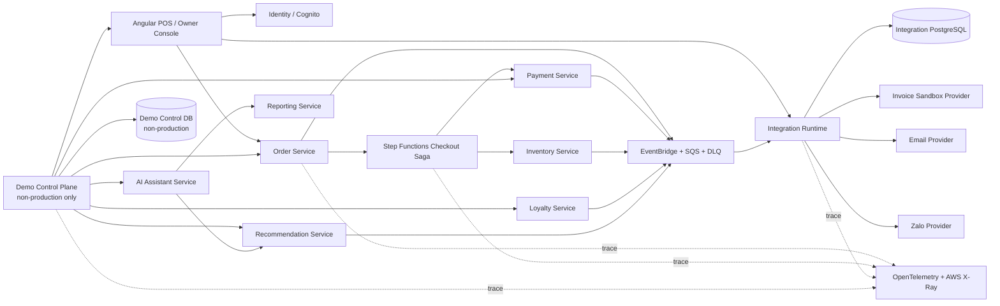
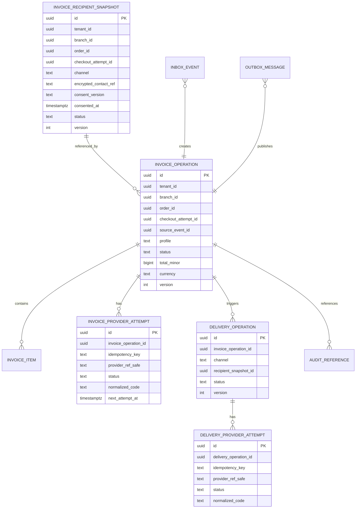

Started at: 2026/10/13 00:00:00
Finished at: 2026/10/13 00:00:00
Total time: 0 minutes
---

# Module 12 — Tích hợp mở rộng: Architecture

**Ngày:** 2026-10-13  
**Trạng thái:** Approved — user approved Architecture and sequence diagrams  
**Vision:** [Integration & Demo Orchestration Vision](./2026-10-13-vision.md)  
**Requirements:** [Integration & Demo Orchestration Requirements](./2026-10-13-requirements.md)  
**Requirements review:** [Integration & Demo Orchestration Requirements Review](./2026-10-13-requirements-review.md)

## 1. Architecture decision summary

Integration được thiết kế thành một bounded context với hai deployment boundary rõ ràng:

1. **Integration Runtime:** production-capable invoice recipient, invoice operation, provider adapter, email/Zalo delivery, inbox/outbox, status API và observability.
2. **Demo Control Plane:** non-production-only demo runner, seed/reset manifest, checkpoint evaluator, run lease và fault injection. Component này không được deploy hoặc expose trong production.

Cả hai boundary dùng chung event/schema conventions và trace vocabulary nhưng không dùng chung quyền vận hành hoặc database production. Integration Runtime không thay thế Order/Step Functions Saga; Demo Control Plane chỉ gọi contracts thật và quan sát các source-of-truth service.

| Decision | Choice | Rationale |
|---|---|---|
| Service boundary | Dedicated Integration service | Cô lập provider credentials/retry/rate limit và không làm domain services thành provider hub |
| Production/demo split | Separate deployable roles; Demo Control Plane only in `DEMO`/`TEST` | Ngăn seed/reset/fault injection lọt vào production |
| Invoice trigger | Consume canonical `OrderPaid.v1` only | PaymentPaid không phải paid-order truth; tránh duplicate/early invoice |
| Invoice mode | Provider-neutral adapter, `SANDBOX_TECHNICAL` profile MVP | Không khóa provider/legal tax capability trước khi có decision |
| Invoice/delivery consistency | Async workers + inbox/outbox + idempotency | Provider outage không chặn checkout/PAID |
| Recipient data | Integration-owned encrypted/tokenized snapshot referenced by opaque `invoiceRecipientRef` | Không phát PII qua Order event hoặc đọc Loyalty DB |
| Message transport | EventBridge → SQS `pos-integration-events` + DLQ | At-least-once, retry, replay và schema isolation |
| Fault injection | Run-scoped non-prod dependency fault lease, default `PAYMENT_UNAVAILABLE` | Deterministic Saga failure mà không cần kill production hoặc gây outage toàn môi trường |
| Demo state | Separate non-prod Demo Control DB/schema and resource manifest | Reset bounded, auditable, isolated from business DBs |
| AI uplift | Existing AI Assistant → approved Reporting/Recommendation tools | Reporting owns metric; Integration only links demo context |
| Trace | W3C trace context/OpenTelemetry + AWS X-Ray propagation | Một correlation chain xuyên API, events, workers và Saga |
| Primary DB | PostgreSQL riêng cho Integration Runtime; Demo Control DB riêng non-prod | Local CAS/idempotency/retention transaction; không shared DB |

## 2. System context and component map



### 2.1 Integration Runtime components

| Component | Responsibilities | Must not do |
|---|---|---|
| API/Auth boundary | Cognito/workload auth, scope, idempotency, input validation, safe response | Trust client tenant/branch/environment or expose raw contact |
| Recipient Preference Service | Validate channel/contact, store encrypted/tokenized consent snapshot, issue opaque ref | Query Loyalty phone or send before consent |
| OrderPaid Consumer | Validate schema/source, inbox dedupe, create invoice operation/outbox atomically | Consume PaymentPaid as invoice truth |
| Invoice Orchestrator | CAS state transitions, provider profile/capability, retry/reconciliation | Change Order/Payment/Loyalty/Inventory state |
| Invoice Provider Adapter | Normalize sandbox/provider request/response, timeout, signature/provider idempotency | Leak provider credentials/payload or own Order state |
| Delivery Orchestrator | Create channel attempts, rate limit, backoff, expiry, manual retry | Switch channel without explicit user/policy choice |
| Email/Zalo Adapters | Normalize provider APIs/callbacks and safe delivery status | Expose provider token/contact or bypass consent |
| Inbox/Outbox Workers | At-least-once processing, DLQ, replay, watermarks, produced events | Acknowledge before local transaction commit |
| Status/Query API | Scope-safe invoice/delivery status and history | Return raw PII/provider response or unbounded query |
| Audit/Telemetry Adapter | Redacted references, metrics, spans, X-Ray correlation | Become Audit source-of-record or log secrets |

### 2.2 Demo Control Plane components

| Component | Responsibilities | Isolation rule |
|---|---|---|
| Demo Run API | Create/read/execute/reset run; environment and role guard | Route exists only in `DEMO`/`TEST` deployment |
| Preflight Evaluator | Health/capability/seed/trace checks | Cannot return PASS when required dependency is stale/unavailable |
| Scenario Orchestrator | Versioned ordered actions and expected checkpoints | Calls APIs/contracts, never parent DBs |
| Seed/Reset Adapters | Provision deterministic resources and cleanup manifest | Namespace-scoped, idempotent, no production route |
| Checkpoint Evaluator | Compare observed authoritative state to expected state | Does not infer hidden state from logs alone |
| Fault Lease Manager | Issue/revoke/expire allowlisted `PAYMENT_UNAVAILABLE` lease | Fail closed on environment mismatch; time-bound and audited |
| Trace Summary Adapter | Return authorized X-Ray/trace references and redacted span summary | No raw span attributes/PII/secrets |

## 3. Service boundaries and source-of-truth matrix

| Concern | Owner | Integration role |
|---|---|---|
| Shift open/close | Shift service | Demo calls contract and checks state |
| Order/cart/checkout attempt | Order service | Demo calls API; consumes `OrderPaid`/failure evidence |
| Saga sequencing/compensation | Order + Step Functions | Demo observes; never reimplements Saga |
| Payment/IPN/checksum | Payment service | Demo uses sandbox and run-scoped unavailability injection |
| Reservation/commit/release/stock | Inventory service | Demo verifies release/commit event/checkpoint |
| Customer/points ledger | Loyalty service | Demo calls phone/context path and verifies `OrderPaid` accrual |
| Suggestion shown/accepted | Recommendation + Order evidence | Demo checks authoritative interaction/add-line lineage |
| Revenue/uplift/AOV | Reporting service | AI tool reads Reporting metric; Integration stores no metric truth |
| Natural-language presentation | AI Assistant | Demo invokes existing read-only function-calling path |
| Invoice/delivery integration state | Integration | Source of truth for invoice/delivery provider operation state |
| Provider credentials/status | Integration adapter boundary | Provider payload normalized and minimized |
| Audit retention/access evidence | Audit service | Integration emits redacted audit references/events |

## 4. Communication architecture

### 4.1 Event-driven production path

```text
Order local transaction + outbox(OrderPaid.v1)
        → EventBridge
        → SQS pos-integration-events
        → Integration inbox/dedupe transaction
        → invoice_operations + outbox(InvoiceOperationRequested.v1)
        → invoice worker
        → Invoice Adapter → sandbox/provider
        → invoice state + outbox(InvoiceIssued/Failed.v1)
        → delivery worker (if consent snapshot exists)
        → Email/Zalo Adapter
        → delivery state + outbox(InvoiceDeliveryStatusChanged.v1)
```

Consumer ack happens only after inbox dedupe, local state transition, projection/watermark update and local outbox write commit. Provider calls happen outside the DB transaction; a provider idempotency key and reconciliation path bridge the crash window.

### 4.2 Synchronous API path

- POS submits recipient intent before checkout through Integration API.
- Integration validates branch/order/attempt context using trusted service context or approved Order internal API; it does not query Order DB.
- Integration returns `invoiceRecipientRef`.
- Order includes the opaque ref in checkout context and `OrderPaid.v1`.
- Owner/Manager/Cashier read only scope-allowed safe status; query API never returns raw recipient/provider payload.

### 4.3 Provider adapter port

```text
InvoicePort.issue(IssueInvoiceCommand, idempotencyKey)
  → ProviderIssueResult(profile, status, safeRef, retryability, normalizedCode)

DeliveryPort.send(SendDeliveryCommand, idempotencyKey)
  → ProviderDeliveryResult(channel, status, safeRef, retryAfter, normalizedCode)
```

Provider-specific request mapping, signature, callback and rate limit remain inside adapters. Domain orchestrators depend on these ports, not provider SDKs.

## 5. Demo Control Plane architecture

### 5.1 Run namespace

Every run has:

- `demoRunId`, `scenarioVersion`, `seedVersion`, `environment`, `tenantNamespace`, `branchNamespace`;
- owner/workload, creation/expiry/lease and cleanup state;
- resource manifest for every created Order, Shift, customer reference, catalog/rule fixture, payment attempt, inventory reservation and event/correlation reference;
- expected checkpoint sequence and observed result/quality/trace references;
- fault leases scoped to one run, dependency, step and expiry.

Demo Control Plane writes only its own control DB. Parent resources are created/reset through approved non-production APIs/adapters, and cleanup follows reverse dependency order: delivery/invoice artifacts → payment attempts → order/checkout data → loyalty/demo customer fixtures → inventory/catalog/rule fixtures, according to each parent service's supported cleanup contract.

### 5.2 Fault injection decision

MVP uses a **run-scoped Payment unavailability lease** implemented at the non-production Payment dependency boundary. Preferred implementation is a Payment service test adapter/traffic policy that rejects calls bearing the authorized `demoRunId` and `faultLeaseId`. A service-mesh/network kill is optional for chaos testing, not the deterministic demo path.

Required safeguards:

- environment must equal `DEMO` or `TEST`;
- fault type must be allowlisted;
- lease must have owner, reason, expiry and run binding;
- request must carry `demoRunId`/`faultLeaseId` through Saga context;
- expired/revoked lease fails open to normal Payment behavior and is audited;
- no client can directly set a global Payment outage flag;
- a kill switch disables all leases immediately.

This proves the same Order/Step Functions compensation path while avoiding a shared-environment outage.

### 5.3 Demo checkpoints

| Step | Expected source-of-truth checkpoint |
|---|---|
| Shift open | Shift response/state is `OPEN` for demo shift namespace |
| Gà rán order | Order draft has expected catalog snapshot and tenant/branch |
| Coca shown/accepted | Recommendation event + Order add-line evidence present; interaction IDs correlate |
| Loyalty recognition | Approved Loyalty response/context reference; no raw phone in run summary |
| VNPAY QR/IPN | Payment pending then verified `PAID`; Payment owns checksum/IPN |
| Order paid | Order state `PAID`, exactly one `OrderPaid.v1` |
| Loyalty accrual | Loyalty ledger projection contains one accrual tied to `OrderPaid` |
| Inventory commit | Recipe/stock projection reflects commit; no duplicate decrement |
| Payment outage | Order/Saga failure/compensation and Inventory release evidence; no `OrderPaid` |
| AI question | AI answer carries Reporting/Recommendation provenance/freshness/metric version |

## 6. Data architecture

### 6.1 Integration Runtime PostgreSQL



Every column requires PostgreSQL `COMMENT ON COLUMN`. Raw contact may be encrypted at rest in a restricted table or replaced by a token reference; normal projections store only mask/hash/reference. Provider raw payload is not a required durable field; if temporarily retained for forensic policy, it is encrypted, minimized and separately classified.

### 6.2 Demo Control DB

Demo DB is non-production only and owns:

- `demo_runs`, `demo_scenario_versions`, `demo_resource_manifests`;
- `demo_checkpoints`, `demo_step_attempts`, `demo_fault_leases`;
- `demo_trace_references`, `demo_reset_operations`, `demo_audit_references`.

No parent Order/Payment/Loyalty/Inventory rows are copied into Demo DB as a source of truth. Resource manifests contain opaque IDs and safe status only.

### 6.3 Index/partition strategy

- Integration Runtime MVP uses tenant/branch/order/time indexes for invoice/delivery query, status/retry queues, source dedupe, outbox/inbox and watermarks.
- Recipient snapshot and provider-attempt access is operation-scoped; raw contact/reference lookup is never a broad list operation.
- Monthly RANGE partitioning is a candidate for high-volume attempts/events after measured scale; do not enable solely for the demo.
- Demo Control DB uses TTL cleanup indexes by run expiry/status; no production retention dependency.

## 7. Consistency, idempotency and failure handling

### 7.1 Source event handling

- Inbox unique key: `(producer, sourceEventId)` plus a business convergence key `(tenantId, orderId, checkoutAttemptId, profile)`.
- Event replay preserves original event IDs/timestamps; Integration never emits a second invoice issue attempt for an already `ISSUED` operation.
- Missing/unknown `invoiceRecipientRef` does not fail invoice creation; delivery is skipped with explicit `NO_RECIPIENT` quality state.
- An `OrderCheckoutFailed` arriving after `OrderPaid` never cancels an issued invoice; source version/state precedence produces a reconciliation reference.

### 7.2 Provider crash window

Provider call is outside the local DB transaction:

1. Claim operation with lease and deterministic idempotency key.
2. Persist attempt `STARTED`/lease.
3. Call provider with idempotency key and timeout.
4. Persist normalized result and state/outbox transaction.
5. If worker crashes after provider acceptance, retry/reconciliation queries provider or repeats same idempotency key.

Provider adapters must distinguish `UNKNOWN` from `FAILED`; unknown is not terminal until bounded reconciliation policy concludes.

### 7.3 Demo recovery

- Checkpoint evaluator reads authoritative API/event state, not only logs.
- A failed step can be retried only with the same step idempotency key or a new explicit attempt version.
- Reset is a separate operation with lease; concurrent execute/reset returns a conflict.
- Payment fault lease expiry does not rewind Saga; Order/Step Functions remains the only state owner.

## 8. Security, privacy and compliance architecture

- Cognito validates public user identity; Identity resolves permission/scope; Integration applies repository tenant/branch predicates again.
- Workload identities are service-specific; provider credentials live in Secrets Manager/KMS and are never propagated to Order/Payment/Loyalty/Inventory.
- Authorization occurs before cache/query/detail/export/retry; no browser/CDN caching for recipient/contact or provider-attempt detail.
- Recipient contact is encrypted/tokenized with key version; consent snapshot is immutable and tied to order/attempt/channel.
- Logs/traces/events contain masked contact, safe provider reference, normalized code and correlation IDs only.
- Fault leases and demo operations are audited; production environment mismatch fails closed.
- Integration emits redacted audit references; Audit owns seven-year forensic evidence/legal hold decisions where applicable.
- Legal tax invoice production is a separate capability/profile and release gate, not implied by `SANDBOX_TECHNICAL`/`ISSUED`.

## 9. Observability and operations

### Metrics

- `order_paid_consumer_lag`, `invoice_operation_lag`, `invoice_issue_success_rate`, `invoice_provider_latency`, `invoice_retry_count`;
- `delivery_success_rate{channel}`, `delivery_provider_latency{channel}`, `delivery_retry_count`, `delivery_expired_count`;
- `inbox_duplicate_count`, `outbox_lag`, `dlq_depth`, `watermark_age`, `provider_unknown_count`;
- `demo_preflight_failure`, `demo_step_duration`, `demo_checkpoint_failure`, `demo_reset_duration`, `fault_lease_active_count`;
- `trace_export_failure`, `redaction_failure`, `authorization_denial`, `scope_conflict`.

### Logs/traces

Structured logs include service, operation, safe IDs, tenant/branch scope hash, event type/version, attempt/status, normalized error, retry count and correlation. X-Ray/OpenTelemetry spans cover POS/Order/Saga, event broker, Integration workers, provider adapter and demo checkpoint. PII, secrets, raw provider payload and free-form customer notes are excluded.

### Alerts/runbooks

- Source consumer lag, queue/DLQ growth, retry storm, provider timeout/rate-limit, unknown provider result, stuck invoice/delivery lease;
- expired or overlong fault lease, reset outside namespace, trace exporter failure, consent/redaction failure;
- runbooks for replay, provider reconciliation, manual delivery retry, namespace cleanup, fault kill switch and key rotation.

## 10. Deployment and scaling

| Deployment | Runtime | Scaling/guard |
|---|---|---|
| Integration API | Stateless ECS/Fargate or equivalent | Scale on request latency/concurrency; no in-memory authority |
| Invoice consumer/worker | SQS worker | Scale on queue depth; leases/idempotency bound concurrent provider calls |
| Delivery worker | Per-channel worker pools | Channel rate limit/circuit breaker; separate retry queues if needed |
| Demo Control Plane | Non-prod only ECS/job runner | Explicit environment guard, run concurrency quota, TTL cleanup |
| Integration PostgreSQL | Dedicated encrypted DB | Backup/restore, migrations, restricted PII table role |
| Demo Control DB | Non-prod encrypted DB | Short TTL, isolated credentials, reset/rebuild disposable |
| EventBridge/SQS/DLQ | Shared platform broker with Integration routes | Schema validation, retry policy, DLQ alarm |
| Secrets/KMS | Platform managed | Provider/key version rotation and startup validation |

## 11. Architecture decision records

| ADR | Decision | Alternatives rejected | Reason |
|---|---|---|---|
| INT-ADR-01 | Dedicated Integration service | Add provider logic to Order/Payment | Preserves domain ownership and isolates external failure |
| INT-ADR-02 | Async invoice/delivery from `OrderPaid` | Synchronous checkout invoice; `PaymentPaid` trigger | Protects PAID path and keeps canonical revenue/order fact |
| INT-ADR-03 | Provider-neutral `SANDBOX_TECHNICAL` profile | Lock one legal provider in MVP | Supports demo and future provider choice without false legal semantics |
| INT-ADR-04 | Separate non-prod Demo Control Plane | Demo routes inside production API; manual runbook only | Deterministic replay/checkpoints with hard safety boundary |
| INT-ADR-05 | Run-scoped Payment fault lease | Kill shared Payment service; global feature flag | Proves real Saga path without broad outage |
| INT-ADR-06 | Integration-owned consent snapshot via opaque ref | Put raw contact in OrderPaid; lookup Loyalty phone | Minimize PII and keep contact/provider ownership local |
| INT-ADR-07 | Reporting/AI owns uplift metric | Integration/LLM calculates revenue | One canonical metric definition and freshness/provenance |

## 12. Sequence diagram candidates

Sequence diagrams đã được tạo sau khi user xác nhận participant set. Mỗi flow có L1 system-level và L2 internal backend diagram trong [Sequence Diagrams](./2026-10-13-sequence-diagrams.adoc).

| # | Flow | L1 participants | L2 focus |
|---|---|---|---|
| 1 | Capture invoice recipient consent | POS, Identity, Integration API, Integration DB | Auth/scope, contact validator, consent snapshot, idempotency |
| 2 | `OrderPaid` → invoice issue | Order, EventBridge/SQS, Integration Runtime, Integration DB, Invoice Sandbox | Inbox, convergence key, invoice worker, provider adapter, outbox |
| 3 | Invoice issued → email/Zalo delivery | Integration Runtime, Email/Zalo provider, DB, EventBridge/SQS | Channel policy, rate limit, provider attempt, retry/DLQ |
| 4 | Demo success end-to-end | Demo Control Plane, POS/Shift, Order/Saga, Recommendation, Loyalty, Payment/VNPAY, Inventory, Reporting, AI, EventBridge/SQS, X-Ray | Scenario step adapter, checkpoint evaluator, run manifest, trace summary |
| 5 | Demo Payment unavailable compensation | Demo Control Plane, Order/Saga, Payment fault boundary, Inventory, EventBridge/SQS, X-Ray | Fault lease, expected failure, compensation checkpoint, no-paid assertion |
| 6 | AI uplift query | Demo/Owner, AI Assistant, Identity, Reporting, Recommendation | Read-only tool call, attribution validation, freshness/provenance |
| 7 | Duplicate/replay/provider crash recovery | EventBridge/SQS, Integration, provider, DB/DLQ | Inbox dedupe, provider idempotency, reconciliation worker |
| 8 | Demo reset/lease expiry | Demo Control Plane, parent cleanup adapters, Demo DB, Audit/trace | Manifest reverse cleanup, conflict/TTL, fault kill switch |

## 13. Architecture approval gate

- **Current status:** Approved — user confirmed two deployment boundaries, provider/fault-lease model, data stores, security/PII model và sequence participant set.
- **Required before Contracts:** Completed; remaining schema/fixture work is now a Contracts/implementation gate.
- **Implementation rule:** Chưa viết code; Contracts phải materialize OpenAPI/AsyncAPI/JSON Schema, DB migrations, provider adapter ports, demo scenario schema and fixture vectors.
