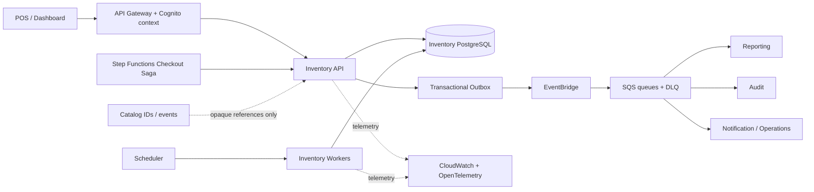

Started at: 2026-10-13 00:00:00
Finished at: 2026-10-13 00:00:00

# Module 6 — Inventory service: Architecture

**Ngày:** 2026-10-13  
**Trạng thái:** Approved  
**Phạm vi:** M — Standard Service Flow  
**Module:** Kho nguyên liệu (Inventory service)

## Source và parent context

- [Inventory Vision](./2026-10-13-vision.md)
- [Inventory Requirements](./2026-10-13-requirements.md)
- [Inventory Requirements Review](./2026-10-13-requirements-review.md)
- [Parent Platform Architecture](../pos-platform/2026-10-12-architecture.md)
- [Parent Platform Contracts](../pos-platform/2026-10-12-contracts.md)
- [Order Architecture](../order/2026-10-12-architecture.md)
- [Payment Architecture](../payment/2026-10-12-architecture.md)

## 1. Boundary và ownership

Inventory service sở hữu:

- Ingredient master, base unit và purchase conversion metadata.
- Versioned recipe cho Catalog item/variant/modifier.
- Branch stock balance (`onHand`, `reserved`, `available`).
- Append-only stock ledger và rebuild projection.
- Reservation lifecycle trong checkout Saga.
- Receipt, count adjustment, low-stock alert và P2 forecast.
- Inventory outbox, idempotency, audit reference, cleanup và reconciliation case.

Inventory không sở hữu hoặc không làm:

- Không đọc trực tiếp Catalog, Order hoặc Payment database.
- Không sở hữu item name/price, Order total, payment state hoặc loyalty points.
- Không tự consume `PaymentPaid` để commit; Saga là nơi gọi `CommitReservation`.
- Không tự finalize Order, refund Payment hoặc award Loyalty.
- Không hard delete dữ liệu đã được recipe/reservation/ledger tham chiếu.

Cross-service reference dùng opaque UUID và snapshot cần cho lịch sử. Không dùng cross-database foreign key hoặc SQL join.

## 2. System topology



### 2.1 Communication rules

| Path | Protocol | Purpose | Consistency |
|---|---|---|---|
| POS/Dashboard → Inventory API | HTTPS REST/OpenAPI | Ingredient, recipe, balance, receipt, count, alert và forecast query/command | Local DB transaction for mutations |
| Step Functions → Inventory API | Internal REST + workload identity | Reserve, commit, release | Strong within Inventory DB |
| Inventory → PostgreSQL | Local SQL transaction | Recipe expansion, balance mutation, ledger, reservation và outbox | Strong |
| Outbox → EventBridge | Async publish | Domain/integration facts | At-least-once |
| EventBridge → SQS/DLQ | Async delivery | Reporting, Audit, Notification | Eventual, deduplicated |
| Scheduler → Worker | Queue/lease | Expiry, outbox retry, reconciliation scan, forecast | Idempotent worker transaction |

Catalog IDs are opaque. Inventory may consume a versioned Catalog projection later for validation hints, but reserve correctness never depends on a Catalog read during the lock transaction.

## 3. Component responsibilities

| Component | Responsibility |
|---|---|
| Public API adapter | Cognito claim validation, tenant/branch authorization, admin CRUD/query and standard errors. |
| Internal Saga API adapter | Workload identity, reserve/commit/release payload validation and idempotency context. |
| Recipe application service | Draft/activate/archive recipe, optimistic version checks and active-version invariant. |
| Recipe expansion engine | Resolve one coherent active recipe set, apply modifier scope, quantity/waste formula and aggregate demand. |
| Stock transaction service | Lock balances, check available, update projections, append ledger and create reservation state. |
| Reservation state machine | Enforce `RESERVED` terminal transitions, payment-context match, expiry and reconciliation state. |
| Count/adjustment service | Snapshot count session, concurrent movement calculation, approval version and ledger adjustment. |
| Alert/forecast service | Threshold crossing, alert lifecycle, forecast quality and freshness metadata. |
| Outbox publisher | Lease pending rows, publish at-least-once, retry and route permanent failures to DLQ. |
| Expiry/reconciliation worker | Expire stale reservations, scan reconciliation cases and emit operational facts; never reopen a terminal reservation. |
| Projection rebuild worker | Rebuild balance/read projections from immutable ledger/reservation state in maintenance mode. |
| PostgreSQL repositories | Explicit tenant/branch predicates, constraints, row locks and optimistic versions. |
| Audit/observability adapter | Structured mutation audit, correlation, metrics, traces and redaction. |

Repository/DAO is not a separate architectural participant in the sequence diagrams; data access is shown as Application Service → Inventory DB.

## 4. Transaction architecture

### 4.1 Correctness path

PostgreSQL is the only P0 correctness path. No Redis/cache, asynchronous projection or downstream event is consulted to decide whether a reserve/commit is allowed.

Every state-changing transaction follows this shape:

1. Validate trusted scope and idempotency context before entering the mutation transaction where possible.
2. Resolve the local aggregate and current state.
3. Lock rows in the documented order.
4. Apply invariant checks and state changes.
5. Append ledger/audit facts and transactional outbox rows.
6. Commit, then return/publish the result.

No external REST call, broker call, Catalog lookup or Payment lookup is made while a balance lock is held.

### 4.2 Reserve transaction

1. Normalize input and calculate canonical request hash.
2. Return the stored result for an identical `(tenantId, checkoutAttemptId)` retry.
3. Read all active recipe versions and expand each selected item/variant/modifier outside the balance lock.
4. Start a short transaction and revalidate the recipe version/status used by the expansion.
5. Aggregate all demand by `ingredientId`, round at the final calculation step to scale 3.
6. Lock `stock_balances` rows in ascending `ingredientId` order.
7. Check every `available >= required`; any shortage rolls back the full reservation.
8. Increase `reserved`, write reservation/demand/recipe snapshots and an outbox event.
9. Commit before returning `RESERVED`.

If recipe activation races with step 4, abort/retry the complete expansion with one coherent recipe set. Never mix old/new recipe versions in one reservation.

### 4.3 Commit transaction

1. Authenticate Saga workload identity and validate payment context.
2. Lock reservation row first.
3. If state is terminal, return its idempotent terminal result or conflict semantics.
4. If state is `RESERVED`, lock all referenced balance rows in ascending `ingredientId` order.
5. Append one `SALE_COMMITTED` negative ledger entry per ingredient demand.
6. Decrease `reserved`, decrease `onHand`, recompute `available`, change reservation to `COMMITTED` and append outbox rows in one transaction.
7. Commit before returning to Saga.

### 4.4 Release/expiry transaction

1. Lock reservation row first.
2. If state is not `RESERVED`, return terminal no-op/conflict without changing balance.
3. Lock referenced balance rows in ascending `ingredientId` order.
4. Decrease `reserved`, leave `onHand` unchanged, change state to `RELEASED` or `EXPIRED` and write outbox/audit.
5. Commit before returning.

Commit, release and expiry have one lock order: reservation first, then sorted balance rows. The first transaction acquiring the reservation lock is the terminal winner.

## 5. Locking, idempotency và race policy

### 5.1 Lock policy

- Pessimistic row lock for `stock_balances` mutation.
- Recipe/config activation uses optimistic version and a partial unique active-recipe constraint.
- Reservation mutation locks the reservation row before balance rows.
- Reserve locks only sorted balance rows; it does not hold external locks or call other services.
- Lock wait target is 2 seconds; statement timeout is 4 seconds; API deadline is 5 seconds.
- Maximum three retries for deadlock, lock timeout or transient DB failure with jittered exponential backoff.
- No retry for validation, insufficient stock, state conflict, authorization or payment mismatch.

### 5.2 Idempotency policy

- Reserve business key: `(tenantId, checkoutAttemptId)` plus canonical request hash.
- Transport key: `Idempotency-Key` for every state-changing API.
- Ledger uniqueness: source type/source ID/idempotency key within tenant/branch.
- Same key and same request returns the original semantic result.
- Same checkout attempt with a different request hash returns `409 RESERVATION_REQUEST_CONFLICT`.
- Commit/release/expire after terminal state never reverses or duplicates a side effect.

### 5.3 Race outcomes

| Race | Winner | Loser behavior |
|---|---|---|
| Concurrent reserve for same ingredient | First transaction satisfying available check | Insufficient stock or bounded retry; no partial reservation |
| Commit vs release | First reservation lock holder | Terminal result/conflict; no state reversal |
| Commit vs expiry | First reservation lock holder before expiry validation | Later command cannot consume/release terminal state |
| Recipe activation vs reserve | One recipe version revalidated atomically | Full reserve expansion retries or fails; no mixed snapshot |
| Count approval vs stock mutation | Approval lock/version check | Stale approval gets typed conflict |

## 6. Reservation state and reconciliation

```text
RESERVED → COMMITTED
RESERVED → RELEASED
RESERVED → EXPIRED
RESERVED → RECONCILIATION_REQUIRED
```

- `RECONCILIATION_REQUIRED` is terminal and immutable at the reservation level.
- Saga owns command retry. Inventory does not reopen a reservation after a payment/expiry contradiction.
- A reconciliation case stores reservation/order/payment references, reason, last safe state, correlation ID, retry/alert metadata and operator resolution reference.
- Payment success after expiry or a terminal commit uncertainty creates a case and `InventoryReconciliationRequired.v1`.
- Any manual stock correction is a new typed ledger entry; it never edits the failed reservation or old ledger entry.

## 7. Data architecture

### 7.1 Logical aggregates

| Aggregate | Storage shape | Consistency |
|---|---|---|
| Ingredient | Tenant master row, optimistic version | Strong local |
| Recipe version | Immutable version + lines, one active per Catalog item/variant | Strong local |
| Stock balance | One row per tenant/branch/ingredient | Pessimistic row lock |
| Reservation | Header + expanded ingredient lines + input/recipe snapshot | Strong local |
| Stock ledger | Append-only signed movement | Strong append |
| Count session | Snapshot + counted values + approval version | Strong local |
| Low-stock alert | Threshold crossing lifecycle | Strong local |
| Forecast | Read-only calculated result + quality/freshness | Rebuildable/read model |

### 7.2 Projection rebuild

- `onHand` is rebuilt from signed stock ledger entries.
- `reserved` is rebuilt from non-terminal reservation lines/states.
- `available` is recomputed as `onHand - reserved`.
- Rebuild writes a projection version and calculated timestamp.
- Rebuild runs in a maintenance worker and never replaces the live lock transaction without an explicit cutover/checksum step.
- Ledger is not partitioned in P0 below the scale threshold; review monthly range partitioning near 10M rows or retention pressure.

### 7.3 Count adjustment

At count session open, store `snapshotOnHand`, `snapshotReserved`, `snapshotAvailable` and `snapshotVersion`.

At approval:

```text
expectedOnHandAtApproval = snapshotOnHand + sum(ledgerDeltaAfterSnapshot)
countAdjustment = countedQuantity - expectedOnHandAtApproval
```

The approval locks the balance row, checks the count session/version has not already been approved, applies `COUNT_ADJUSTMENT`, and rejects any result where `onHand < 0` or `available < 0`.

## 8. P1/P2 worker architecture

| Worker | Trigger | Allowed mutation | Safety |
|---|---|---|---|
| Reservation expiry | Scheduler/queue scan | `RESERVED → EXPIRED`, decrease reserved | Same reservation-first lock; idempotent |
| Outbox publisher | Short poll/queue trigger | Publish status/lease only | At-least-once, retry/DLQ |
| Reconciliation scanner | Schedule or case event | Case status/alert metadata; no reopen | Operator/Saga owns compensation |
| Projection rebuild | Manual/maintenance command | Rebuild projection version | Checksum, cutover guard, no checkout lock bypass |
| Forecast worker | Schedule or explicit query | Write forecast result | Read committed history; quality required |

Inventory has no direct Payment event consumer. There is no Inventory worker that automatically commits or releases from `PaymentPaid`.

## 9. Forecast architecture

Forecast reads committed consumption by branch/ingredient and combines it with current available, lead time and safety stock.

| Quality | Data condition | Algorithm |
|---|---|---|
| `INSUFFICIENT_HISTORY` | No valid consumption day | No recommended quantity |
| `LOW` | 1–13 valid days | Simple average, no weekday adjustment |
| `MEDIUM` | 14–27 valid days | Weighted moving average using available history |
| `HIGH` | At least 28 valid days | Weighted moving average + weekday adjustment |

```text
recommendedQuantity = max(0, demandDuringLeadTime + safetyStock - available)
```

Owner defines tenant default safety stock; Manager may override it for an authorized branch/ingredient. Forecast response stores sample count, input window, quality, safety-stock source, model version, calculated-at and freshness.

## 10. Operational configuration

| Setting | Initial default | Owner |
|---|---:|---|
| DB lock wait | 2 seconds | Service configuration |
| SQL statement timeout | 4 seconds | Service configuration |
| Internal API deadline | 5 seconds | Saga/client contract |
| DB transient retry count | 3 | Service configuration |
| Retry backoff | 50/100/200 ms + jitter | Service configuration |
| Reservation TTL default | 15 minutes | Tenant/Saga policy, max 30 minutes |
| Outbox retry | Bounded service policy then DLQ | Platform operations |
| Forecast window | 28 days | Forecast policy version |

Configuration changes are audited and do not rewrite historical recipe/reservation/ledger semantics.

## 11. Security and tenant isolation

- Public API requires Cognito JWT, role and active tenant/branch membership.
- Internal Saga API requires workload identity and operation allowlist.
- `tenantId` is derived from trusted context and compared with body/reference values.
- Repository predicates include tenant on every read/write; branch predicates apply to stock operations.
- Resource IDs are ownership-checked before returning current state or conflict details.
- Recipe/stock commands validate every batch item belongs to one tenant and authorized branch scope.
- Events carry tenant/branch metadata; consumers validate scope before projection.
- Logs/events omit payment secrets, Cognito tokens and unnecessary customer PII.

## 12. Observability and runbooks

### Metrics

- reserve success, insufficient stock, recipe missing/inactive and request conflict;
- lock wait, deadlock retry, transaction duration and API p95/p99;
- reserved age, expiry count, commit/release race and reconciliation case age;
- ledger append failures, projection checksum/freshness and rebuild duration;
- outbox backlog, publish retry, DLQ depth and consumer lag;
- low-stock crossing/acknowledge/resolve and forecast quality/freshness.

### Logs/traces

Every command/event carries `requestId`, `correlationId`, `causationId`, tenant, branch, aggregate and idempotency key hash. Logs use structured fields and redact raw payment/customer-sensitive values.

### Runbooks

- insufficient stock and recipe activation failure;
- deadlock/lock contention spike;
- payment success with commit failure or reservation expiry;
- outbox/DLQ replay;
- projection checksum mismatch/rebuild;
- count approval conflict;
- cross-tenant authorization denial.

## 13. Deployment and scaling

- Local demo may run Inventory PostgreSQL in the shared container with a separate database/credential; no cross-service SQL.
- Production-like deployment uses service-owned PostgreSQL/Aurora, Secrets Manager, EventBridge/SQS and scheduled workers.
- Scale API instances horizontally; correctness remains serialized by balance row locks.
- Scale outbox/worker consumers with leases and idempotency; do not scale by splitting a single balance row across writers.
- Keep ledger/audit history for at least seven years; evaluate range partitioning at the documented volume threshold.

## 14. Architecture decisions

| ADR | Decision | Rationale |
|---|---|---|
| INV-ADR-01 | PostgreSQL local transaction for balance correctness | Prevent oversell and make Saga side effects deterministic. |
| INV-ADR-02 | Pessimistic balance lock, optimistic recipe version | High-contention stock writes need serialization; recipe edits benefit from conflict detection. |
| INV-ADR-03 | Append-only ledger + rebuildable balance | Auditability and recovery without editing history. |
| INV-ADR-04 | Saga direct commit command | Prevent raw payment event ordering/duplicate paths from mutating stock. |
| INV-ADR-05 | Reservation-first lock for terminal commands | Deterministic commit/release/expiry race winner. |
| INV-ADR-06 | Outbox for downstream facts | Avoid DB/broker dual-write loss while keeping checkout local transaction short. |
| INV-ADR-07 | No cache in reserve correctness path | Stale availability must never authorize an overselling order. |

## 15. Sequence diagrams

PlantUML L1/L2 diagrams đã được xác nhận với user và lưu tại [2026-10-13-sequence-diagrams.adoc](./2026-10-13-sequence-diagrams.adoc).

Coverage:

- checkout reserve → payment → commit → Order finalize;
- reserve shortage and compensation release;
- expiry/late-payment reconciliation;
- internal reserve/commit/release transaction flow;
- terminal race giữa commit/release/expiry.

## 16. Domain skills referenced

- **brainstorming:** chốt locking, transaction boundary, race policy, worker ownership và forecast quality.
- **spec-reviewer:** kiểm tra cross-impact với parent contracts, tenant isolation và flow integrity.
- **api-design:** định hướng internal REST, idempotency, workload auth, error và pagination boundary.
- **database-design:** định hướng PostgreSQL schema boundary, precision, locking, indexes, rebuild và partition threshold.
- **sequence-diagram:** tạo L1/L2 PlantUML cho Saga và internal Inventory transaction flows sau confirmation gate.

## Approval

- **Status:** Approved by user
- **Scope:** M — Standard Service Flow
- **Next phase:** API/Data Contracts and Database Contract
