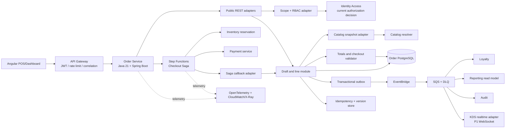
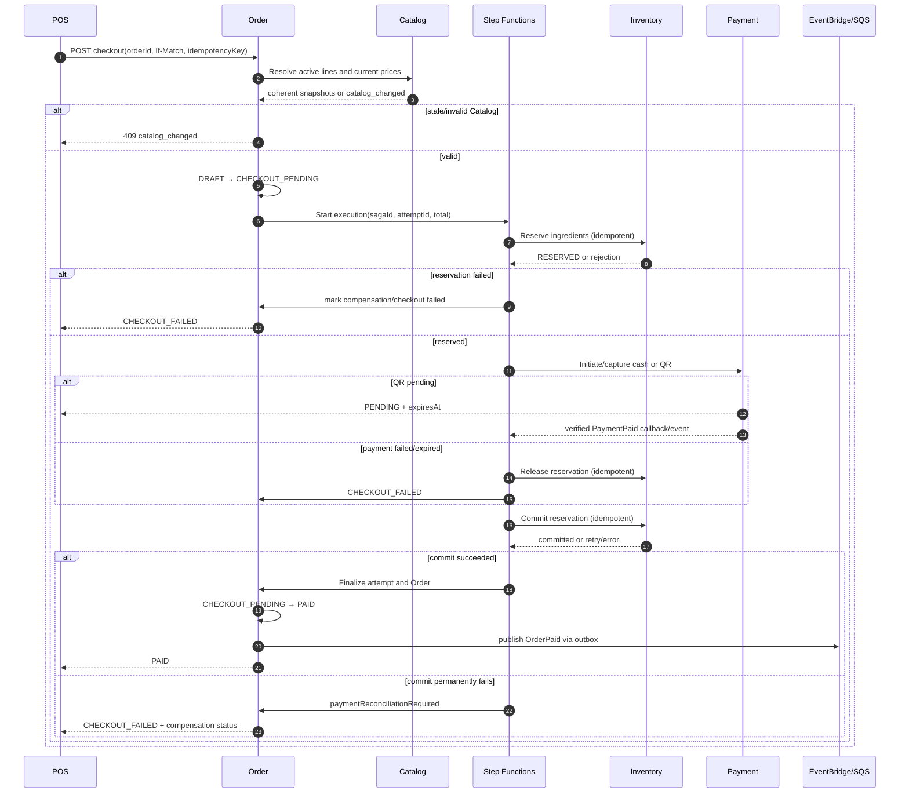
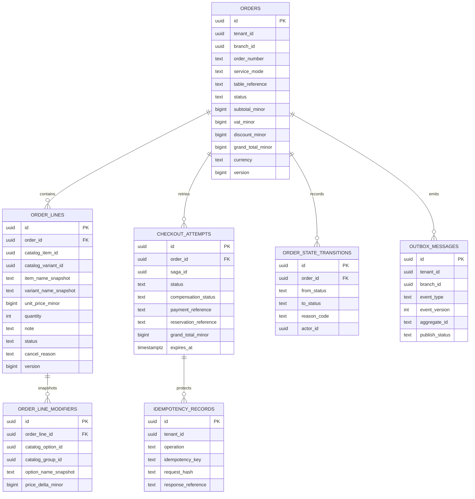

Started at: 2026/10/12 16:32:04 +07
Finished at: 2026/10/12 16:32:04 +07
Total time: 0 minutes
---

# Architecture: Order Service

## Sources

- [Order Vision](./2026-10-12-vision.md)
- [Order Requirements](./2026-10-12-requirements.md)
- [POS Platform Architecture](../pos-platform/2026-10-12-architecture.md)
- [POS Platform Contracts](../pos-platform/2026-10-12-contracts.md)
- [Identity & Access Contracts](../identity-access/2026-10-12-contracts.md)
- [Catalog Architecture](../catalog/2026-10-12-architecture.md)
- [Catalog Contracts](../catalog/2026-10-12-contracts.md)

## Architecture Goals

1. Keep Order as the only source of truth for order lifecycle, line state, immutable Catalog snapshots and checkout attempt records.
2. Make every public and internal operation tenant/branch scoped, with defense-in-depth repository predicates.
3. Make draft editing safe for multiple POS operators through optimistic concurrency without distributed locks.
4. Coordinate Inventory, Payment and Order side effects through a durable Step Functions Saga with idempotent service-owned commands.
5. Ensure no failed, duplicate or late callback can silently create a second payment, reservation, finalization or `OrderPaid` fact.
6. Keep event projections and P1 KDS asynchronous while preserving a strong local transaction boundary for Order state.
7. Keep P1 table/split/merge/KDS and P2 QR ordering outside the P0 runtime path while leaving compatible extension points.

## Component Architecture

### System Context



### Components and Responsibilities

| Component | Responsibility | Technology/Boundary |
|---|---|---|
| Public REST adapters | Create/list/read/update/reprice/cancel/checkout commands; map standard envelopes | Spring MVC + OpenAPI |
| Authorization adapter | Validate Cognito context through Identity; build `TenantBranchScope`; enforce permissions | Internal Identity REST/mTLS |
| Draft and line module | Order lifecycle, line mutations, cancellation and version checks | Order application/domain module |
| Catalog snapshot adapter | Resolve current item/variant/modifier selection and compare Catalog version | Private REST to Catalog |
| Totals/checkout validator | Calculate integer totals, validate active lines and checkout preconditions | Pure domain service + Order DB transaction |
| Checkout attempt module | Persist attempt, Saga references, timeout/reconciliation/compensation fields | Order DB |
| Saga callback adapter | Authenticate and idempotently apply Step Functions callback/task result | Internal REST/event adapter |
| Transactional outbox | Persist lifecycle/audit/integration events with local state changes | Order DB + publisher |
| Step Functions | Durable orchestration, retry, wait, timeout and compensation | AWS/local adapter |
| Catalog service | Current menu selection, price and sellability source of truth | Separate service/DB |
| Inventory service | Recipe expansion, reserve/commit/release and stock ownership | Separate service/DB |
| Payment service | Cash/VNPAY state, IPN verification, settlement/reconciliation | Separate service/DB |
| Loyalty/Reporting/Audit | Event consumers and projections | SQS consumers/read models |
| KDS adapter | P1 durable item event to WebSocket delivery/replay | Separate P1 adapter; WebSocket is not source of truth |

### Service Responsibility Boundary

Order owns:

- `orders`, `order_lines`, modifier/name/price snapshots, order/line state and version.
- `checkout_attempts`, Saga references, reconciliation flags and local idempotency records.
- Branch-scoped order number and order query/read model.
- Order lifecycle and canonical `OrderPaid` fact.

Order does not own:

- Catalog item status, variant price or modifier rules.
- Ingredient, recipe, stock or reservation ledger.
- Provider transaction, IPN checksum or payment settlement state.
- Customer phone/profile, loyalty balance or points ledger.
- Audit persistence or KDS socket session state.

No runtime SQL joins or database foreign keys cross these service boundaries. Cross-service IDs are opaque references validated by contract and tenant/branch context.

## Communication Architecture

### Draft Command Flow

1. Angular sends a public command with Cognito JWT, selected branch, correlation ID, idempotency key where retryable and `If-Match` for versioned updates.
2. Gateway performs basic token checks; Order calls Identity for current permission and branch membership.
3. Order validates `tenantId`/`branchId` ownership from the resolved context and loads the order with a tenant/branch predicate.
4. For item/variant/modifier changes, Order calls Catalog bulk resolver and receives coherent names, prices, selection rules and `catalogVersion`.
5. Order writes line snapshot, totals, version and outbox in one transaction.
6. The response returns the new Order version/ETag and immutable snapshot fields. Stale writers receive `409 catalog_version_conflict` without a partial write.

### Checkout Saga Flow



The diagram is conceptual and contract-driven. It is not a runtime trace because no Order source code exists yet; actual PlantUML L1/L2 diagrams are a post-skeleton deliverable.

### Compensation and Late IPN

```mermaid
sequenceDiagram
    autonumber
    participant P as Payment
    participant SF as Step Functions
    participant I as Inventory
    participant O as Order
    participant R as Reconciliation

    P-->>SF: PaymentFailed / timeout
    SF->>I: releaseReservation(attemptId, idempotencyKey)
    alt release accepted/complete
        SF->>O: mark CHECKOUT_FAILED, compensation safe
    else release transient failure
        SF->>I: retry with backoff
        SF->>O: compensationStatus=RETRYING
    else release terminal failure
        SF->>O: compensationStatus=FAILED, retry lock
        SF-->>R: alert/DLQ for operator
    end

    P-->>O: verified PaymentPaid after reservation release
    O->>R: record late_payment_reconciliation
    O-->>O: keep Order CHECKOUT_FAILED; never resurrect automatically
```

### Event Flow

- Order state mutation and outbox insert commit in one local transaction.
- Publisher sends `OrderCreated`, `OrderCancelled`, `OrderCheckoutFailed`, `OrderPaid` and P1 order-item events to EventBridge.
- EventBridge routes to SQS queues with bounded retries and DLQs for Loyalty, Reporting, Audit and KDS.
- `OrderPaid` is the canonical paid-order fact. `PaymentPaid` is a payment fact for Saga/reconciliation, not a direct Inventory trigger, revenue fact or loyalty trigger.
- Consumers deduplicate by `eventId`, validate tenant scope and expose projection freshness. Eventual projection lag never authorizes a public Order mutation.

### Trust Boundaries

- Public client → API Gateway → Order: Cognito access token, rate limit and correlation.
- Order → Identity/Catalog/Inventory/Payment: mTLS/workload identity, explicit tenant/branch context and bounded timeout.
- Payment provider → Payment only: provider checksum/signature is verified by Payment; Order never accepts provider fields directly.
- Step Functions → service APIs: task identity, signed/mTLS request, `sagaId`/`attemptId` idempotency and state ownership.
- EventBridge/SQS → consumers: event schema validation, event ID deduplication, DLQ and no direct database access.

## Data Architecture

### Entity Relationship Model



### Database Decisions

| Decision | Choice | Rationale |
|---|---|---|
| Database | PostgreSQL per Order service | Strong local transaction for order/snapshot/attempt state. |
| IDs | UUID v7 | Time-sortable, distributed and compatible with parent platform. |
| Money | `BIGINT` integer VND | No floating-point financial error. |
| Time | UTC `TIMESTAMPTZ` | Consistent cross-service event and timeout handling. |
| Snapshots | Immutable columns plus normalized modifier snapshots | Historical Order rendering never depends on Catalog availability. |
| State history | Append-only transition records for important lifecycle transitions | Audit/debug without making Audit DB a transaction dependency. |
| Outbox | Same DB transaction as state mutation | Prevent lost Order events. |
| Idempotency | Unique tenant/operation/key + request hash | Safe command and Saga task replay. |
| Partitioning | No core partitioning in MVP | Expected demo scale does not justify operational complexity; review outbox retention separately. |
| Read model | PostgreSQL indexes for transactional lists; Reporting owns analytics projections | Avoid cross-service analytical joins. |

### Core Invariants

- `orders.tenant_id` and `orders.branch_id` are required and immutable.
- `order_lines.order_id` must belong to the same tenant/branch as the parent Order through application checks and composite ownership constraints where practical.
- At least one `ACTIVE` line is required for checkout; cancelled lines remain queryable for history.
- `grand_total_minor >= 0`; all component money values are nonnegative integer values in the same currency.
- Only one current `CHECKOUT_PENDING`/non-terminal attempt exists per Order.
- `PAID` and `CANCELLED` are terminal for P0 public mutations.
- `OrderPaid` is emitted once per Order by a unique finalization guard, even if Saga callback is retried.
- An idempotency key with a different request hash returns `duplicate_request`; it never executes a second side effect.
- A line cancellation cannot occur outside `DRAFT` or without a reason/actor.
- No cross-service FK is used for Catalog, Identity, Inventory, Payment, Loyalty or Audit IDs.

### Index Strategy

| Index | Purpose |
|---|---|
| `(tenant_id, branch_id, created_at DESC)` | Branch order list and recent POS history. |
| `(tenant_id, branch_id, status, created_at DESC)` | Draft/pending/paid/failed filters. |
| `(tenant_id, branch_id, order_number)` unique | Human-readable branch order number. |
| `(tenant_id, id)` unique | Scoped ID lookup and IDOR defense. |
| `(order_id, status)` | Active-line and line history queries. |
| `(order_id, created_at)` | Checkout attempt history. |
| `(tenant_id, status, expires_at)` | Pending attempt timeout worker. |
| `(tenant_id, operation, idempotency_key)` unique | Public/Saga idempotency. |
| `(publish_status, next_attempt_at, created_at)` | Outbox publisher polling. |
| `(tenant_id, event_id)` unique | Event deduplication/replay guard. |

## Consistency, Concurrency and Failure Handling

### Draft concurrency

- Load Order with tenant/branch predicate and version.
- Validate `If-Match` before applying a mutation.
- Recalculate totals and write line/order versions in one transaction.
- Return the current ETag/version on successful mutation; stale requests receive `409` and must re-read.
- No distributed lock is held while calling Catalog. Catalog resolution occurs before the short Order write transaction; the version check protects the final write.

### Checkout consistency

- The checkout command first validates the draft and Catalog version, then transitions to `CHECKOUT_PENDING` in a local transaction before starting Saga.
- Step Functions owns cross-service sequencing but each service owns its side effect and local transaction.
- Order finalization checks `attemptId`, expected payment/reservation references, total snapshot and current attempt state. A stale callback is accepted only as an idempotent no-op or routed to reconciliation.
- Payment success plus Inventory commit failure is never silently treated as a successful Order. Retry is bounded; terminal exception sets reconciliation flags and blocks new attempts.
- A late Payment success after release cannot resurrect an Order. Payment/reconciliation owns the provider settlement exception.

### Retry/DLQ policy

- Synchronous dependency calls use timeout, circuit breaker and bounded exponential retry for transient failures only.
- Step Functions tasks use deterministic idempotency keys derived from `tenantId`, `orderId`, `attemptId` and task name.
- Outbox publisher retries with backoff; schema/validation failures go to DLQ with event ID and correlation metadata.
- Consumer side effects persist event IDs before acknowledgement where the consumer owns a local transaction.
- Compensation failure keeps a retry lock on the Order and raises a metric/alert; operator/reconciliation action is required before a new checkout.

## Security, Audit and Observability

- Identity current authorization is checked at the public adapter and mapped into a domain `TenantBranchScope`; repositories repeat tenant/branch predicates.
- `orderId`, `lineId`, `branchId`, `catalogItemId`, `paymentReference` and `reservationReference` are never trusted without ownership validation.
- Notes are length-limited, sanitized and excluded from normal structured logs; events carry only the fields required by consumers.
- Cancellation audit is an Order outbox event with actor, role, reason, before/after summary, order/line IDs, branch, correlation ID and resulting version.
- Structured logs include service, environment, request ID, correlation ID, tenant/branch, actor/workload, order/attempt/saga ID, transition, outcome and duration.
- Metrics include draft mutation p95, version conflicts, checkout initiation, Saga duration/outcome, pending age, reservation/payment failures, compensation retries/failures, late payment exceptions, outbox lag, queue age and DLQ depth.
- OpenTelemetry spans connect POS request → Order → Catalog → Step Functions → Inventory/Payment → Order finalization. Secrets, JWTs and raw provider signatures are redacted.

## Deployment Architecture

### Local/demo

- Docker Compose runs Order PostgreSQL separately from Catalog/Inventory/Payment databases or credentials.
- Local Step Functions, EventBridge and SQS adapters preserve the same command/event/idempotency semantics; they are not allowed to bypass state ownership.
- Seed data creates multiple tenants/branches, drafts, variants, modifiers and deterministic failure fixtures.

### AWS target

- Order API runs as stateless ECS Fargate tasks behind API Gateway/load balancing.
- Order PostgreSQL is a service-owned RDS PostgreSQL database with Secrets Manager credentials.
- Step Functions runs the checkout state machine with task timeout/retry/catch policies.
- EventBridge routes Order events to SQS queues and DLQs for Loyalty, Reporting, Audit and P1 KDS.
- CloudWatch/X-Ray/OpenTelemetry monitor API, Saga, outbox, queue and reconciliation health.
- Blue/green deployment requires backward-compatible event/schema migrations and pending-attempt compatibility.

## ADRs

| ADR | Decision | Alternatives | Rationale |
|---|---|---|---|
| ORD-01 | Order owns immutable Catalog snapshots | Read Catalog on every render; copy only IDs | Historical order must not change when menu changes or is archived. |
| ORD-02 | Step Functions orchestrates checkout | In-process Order orchestration; choreography only | Durable wait, explicit compensation, timeout and cross-service trace are P0 outcomes. |
| ORD-03 | Optimistic concurrency for drafts | Distributed lock; device lock | Supports multiple POS operators without lock lifecycle complexity. |
| ORD-04 | Transactional outbox for Order events/audit | Direct publish after commit; synchronous Audit write | Prevents lost events and avoids Audit availability blocking Order mutations. |
| ORD-05 | `OrderPaid` is canonical paid-order fact | Loyalty/Reporting consume PaymentPaid | Prevents duplicate points/revenue projection before Order finalization. |
| ORD-06 | Late payment never resurrects Order automatically | Re-reserve and auto-finalize; force PAID | Avoids double charge/oversell and makes exception visible for reconciliation. |
| ORD-07 | P0 free-form table reference | Table master in P0 | Keeps table map/occupancy/split/merge out of the checkout vertical slice. |
| ORD-08 | No hard delete; terminal lifecycle states | Delete/recreate Order | Preserves audit, payment, reservation and reporting references. |

## Architecture Validation Matrix

| Requirement group | Architecture coverage |
|---|---|
| Counter/takeaway/table order | Public REST adapter, service mode and `tableReference` in Order DB. |
| Draft edit/cancel | Draft module, optimistic version, line lifecycle and audit outbox. |
| Catalog snapshot | Catalog adapter, immutable line/modifier snapshot and reprice flow. |
| Checkout Saga | Step Functions, idempotent Inventory/Payment tasks, finalize callback and compensation. |
| Payment pending/late IPN | Attempt state, 15-minute expiry, Payment reconciliation boundary. |
| Compensation failure | Retry/DLQ, status/lock fields, alert and operator reconciliation. |
| Tenant/branch isolation | Identity adapter plus repository predicates/composite ownership checks. |
| Events/reporting/loyalty | Transactional outbox, EventBridge/SQS and canonical `OrderPaid`. |
| P1 KDS | Durable order-item events and WebSocket adapter outside source of truth. |
| NFR/security | Indexes, bounded calls, trace metadata, redaction, metrics and deployment topology. |

## Sequence Diagrams

- **Status:** Conceptual Mermaid diagrams included for P0 checkout and compensation/late IPN.
- **Runtime trace:** Deferred until controllers, adapters, task definitions and event listeners exist.
- **Planned deliverable:** Generate L1/L2 PlantUML `.adoc` diagrams after service skeleton and contracts are implemented, following the sequence-diagram skill confirmation gate.

## Domain Skills Referenced

- **api-design:** command/query boundary, REST/OpenAPI direction, error/concurrency/idempotency and internal workload API.
- **database-design:** Order-owned normalized schema, immutable snapshots, constraints, indexes, UUID v7, money and migration strategy.
- **log-processing:** structured correlation/audit fields, Saga metrics, outbox/DLQ telemetry and sensitive-data redaction.
- **sequence-diagram:** used to frame conceptual critical flows; source tracing is deferred because no implementation code exists.

## Approval

- **Status:** Approved by user
- **Phase:** Architecture Design
- **Next phase after approval:** API & Data Contracts
