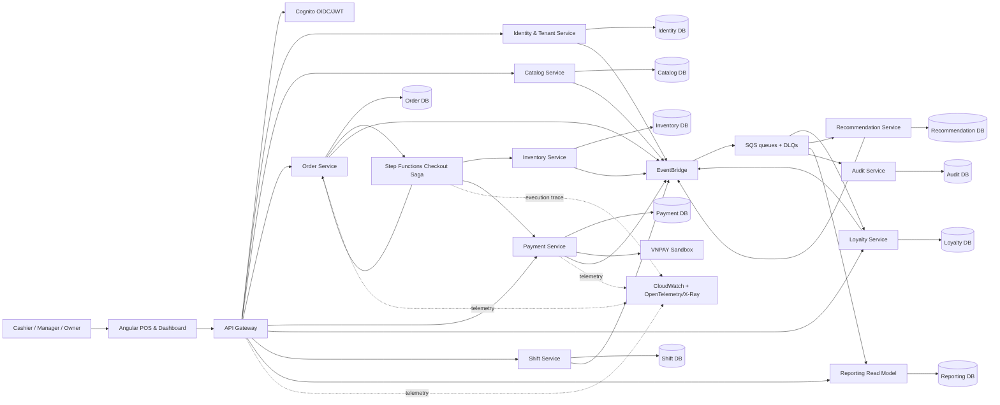

Started at: 2026/10/12 14:20:17
Finished at: 2026/10/12 14:20:17
Total time: 0 minutes
---

# Architecture: POS Platform

## Source

- **Vision:** [2026-10-12-vision.md](./2026-10-12-vision.md)
- **Requirements:** [2026-10-12-requirements.md](./2026-10-12-requirements.md)
- **Vision review:** [2026-10-12-vision-review.md](./2026-10-12-vision-review.md)

## Architecture Goals

1. Chạy được một vertical slice P0 end-to-end trong môi trường hybrid.
2. Giữ boundary rõ giữa bounded context, database ownership và integration contracts.
3. Làm cho Saga failure/compensation, retry và eventual consistency có thể quan sát.
4. Bảo vệ tenant/branch isolation ở nhiều lớp.
5. Cho phép scale và triển khai từng service độc lập mà không biến MVP thành một hệ thống khó chạy.

## Component Architecture

### System Overview



### Component Responsibilities

| Component | Responsibility | Owns | Communication |
|---|---|---|---|
| Angular POS & Dashboard | POS workflow, role-based navigation, reporting views, error/freshness display | UI state only | HTTPS REST/OpenAPI |
| API Gateway | TLS termination, routing, rate limiting, request correlation, Cognito authorizer integration | No business data | HTTPS to services |
| Cognito | Identity, login, token issuance and user lifecycle boundary | Identity provider state | OAuth2/OIDC/JWT |
| Identity & Tenant Service | Tenant, branch, employee membership, role and scope policy | Identity projection/membership DB | REST + domain events |
| Catalog Service | Menu category/item/variant/modifier and availability | Catalog DB | REST + domain events |
| Order Service | Draft/order lines, price snapshot, order lifecycle, checkout entrypoint | Order DB + outbox | REST + Saga + events |
| Payment Service | Cash/VNPAY payment state, IPN, checksum, reconciliation | Payment DB + outbox | REST, callback, events |
| Inventory Service | Ingredients, recipe, stock, reservation/commit/release and inventory ledger | Inventory DB + outbox | Saga REST + events |
| Loyalty Service | Customer profile, points ledger, balance projection and reversal | Loyalty DB + outbox | REST + events |
| Shift Service | Open/close shift and opening cash | Shift DB + outbox | REST + events |
| Recommendation Service | Association rules, availability/cart filtering, suggestion analytics | Recommendation DB | REST + events |
| Reporting Read Model | Consume facts and build daily/branch/item projections | Reporting DB | SQS consumers + REST query |
| Audit Service | Append-only security/business audit records | Audit DB | SQS consumer + restricted REST query |
| Step Functions Checkout Saga | Orchestrate reserve → payment → finalize and compensation | Execution state | HTTPS task calls + callback/event correlation |
| EventBridge + SQS | Route events, isolate consumers, retry and DLQ | Broker metadata | Async event transport |
| Observability | Logs, metrics, traces, alerts and dashboards | Telemetry stores | OpenTelemetry/CloudWatch/X-Ray |

### Service Boundary Rules

- Mỗi service chỉ đọc/ghi database của chính mình.
- Không dùng foreign key runtime hoặc SQL join xuyên service; cross-service reference dùng opaque ID và snapshot cần thiết.
- Order lưu price/name/variant snapshot tại thời điểm thêm món để lịch sử không thay đổi khi Catalog cập nhật.
- Payment tham chiếu `orderId` nhưng không sở hữu Order state.
- Inventory tham chiếu `catalogItemId`/recipe version qua contract; không đọc Catalog DB trực tiếp.
- Reporting và Audit chỉ nhận event/fact, không trở thành nguồn sự thật cho transaction.
- Shared code chỉ giới hạn ở schema primitives, error envelope, correlation/tenant context và event metadata; không chia sẻ domain entity hoặc repository.

## Communication Architecture

### Synchronous Path

- Angular gọi API Gateway qua HTTPS.
- Gateway route tới service sở hữu resource.
- Service xác thực JWT/tenant context và xử lý command/query cục bộ.
- Các command có side effect yêu cầu `Idempotency-Key`.
- API dùng REST/OpenAPI v1, resource-oriented path, standard error envelope và `requestId/correlationId`.
- Service-to-service synchronous calls chỉ dành cho orchestration step hoặc query cần kết quả ngay; không dùng để tạo query chain dài.

### Asynchronous Path

1. Service ghi business state và Outbox record trong cùng PostgreSQL transaction.
2. Outbox publisher gửi versioned event tới EventBridge.
3. EventBridge route event tới SQS queue theo consumer/bounded context.
4. Consumer xử lý idempotently, acknowledge sau khi commit projection/side effect.
5. Message lỗi retry theo exponential backoff; quá giới hạn vào DLQ.

Event envelope tối thiểu:

```text
eventId, eventType, eventVersion, occurredAt,
tenantId, branchId, aggregateType, aggregateId,
correlationId, causationId, producer, payload
```

### Event Routing Ownership

| Event | Producer | Consumers | Purpose |
|---|---|---|---|
| `CatalogItemAvailabilityChanged` | Catalog | Recommendation, Reporting | Loại item không bán được khỏi recommendation/read model |
| `OrderCreated` | Order | Recommendation, Reporting, Audit | Tạo fact và cập nhật derived model |
| `SuggestionShown` | Recommendation | Reporting, Audit | Đo impression |
| `SuggestionAccepted` | Recommendation | Reporting, Audit | Đo acceptance/AOV attribution |
| `InventoryReserved` | Inventory | Saga, Order, Audit | Cho phép bước checkout tiếp tục |
| `InventoryReservationReleased` | Inventory | Saga, Order, Audit | Xác nhận compensation |
| `PaymentInitiated` | Payment | Saga, Audit | Bắt đầu/ghi nhận payment attempt |
| `PaymentPaid` | Payment | Saga, Audit | Xác nhận payment thành công để Saga gọi `CommitReservation` tới Inventory |
| `PaymentFailed` | Payment | Saga, Order, Audit | Kích hoạt compensation/failure state |
| `OrderPaid` | Order | Loyalty, Reporting, Audit | Canonical paid order fact; source duy nhất cho points/revenue projections |
| `LoyaltyPointsAccrued` | Loyalty | Reporting, Audit | Cập nhật loyalty/reporting projections |
| `LoyaltyPointsReversed` | Loyalty | Reporting, Audit | Đối ứng ledger khi reversal |
| `ShiftOpened` / `ShiftClosed` | Shift | Reporting, Audit | Shift/cash reporting |
| `AuditRecorded` | Any service | Audit | Append-only audit trail, nếu audit event không ghi trực tiếp vào Audit DB |

## Checkout Saga Architecture

### Orchestration

Step Functions là orchestrator; mỗi task gọi API idempotent của service sở hữu state. Saga execution giữ `sagaId`, `orderId`, `tenantId`, `branchId` và `correlationId`.

```text
Checkout requested
  → Order validates order snapshot and creates CHECKOUT_PENDING
  → Inventory.reserve(orderId, recipeVersion, idempotencyKey)
  → Payment.initiate(orderId, amount, method, idempotencyKey)
  → [cash: immediate success | VNPAY: wait for verified IPN]
  → Order.finalizePaid(orderId)
  → publish OrderPaid
  → Loyalty accrues points
  → Reporting updates projections

Failure at payment/finalize/timeout
  → Payment is marked failed/expired when applicable
  → Inventory.releaseReservation(orderId, idempotencyKey)
  → Order marks checkout failed/cancelled
  → publish compensation result
  → DLQ/manual review if compensation cannot complete after bounded retries
```

### State Ownership

| State | Owner | Allowed transition source |
|---|---|---|
| `DRAFT` / `CHECKOUT_PENDING` / `PAID` / `CHECKOUT_FAILED` | Order | API + Saga callback |
| `RESERVED` / `COMMITTED` / `RELEASED` / `EXPIRED` / `RECONCILIATION_REQUIRED` | Inventory reservation aggregate | Saga command + timeout + reconciliation |
| `PENDING` / `PAID` / `FAILED` / `EXPIRED` / `CANCELLED` | Payment | Payment API/IPN/reconciliation |
| `ACTIVE` / `CLOSED` | Shift | Shift API |
| `PENDING` / `POSTED` / `REVERSED` | Loyalty ledger entry | Payment/order event or reversal command |

### VNPAY Callback Handling

- IPN endpoint is public only at the gateway boundary and applies strict schema/rate validation.
- Payment service verifies checksum before reading business fields.
- Provider transaction ID and order mapping are checked against the tenant/payment attempt.
- Duplicate IPN returns the previously recorded result without a second state transition.
- Out-of-order or invalid transition is persisted as a rejected callback/audit event and does not mutate payment state.
- Reconciliation job queries pending records and produces a deterministic correction event.

## Data Architecture

### Database Topology

| Service | Primary store | Core aggregates/tables | Isolation |
|---|---|---|---|
| Identity/Tenant | PostgreSQL | tenants, branches, users, memberships, role_scopes | Tenant/branch scoped; PII protected |
| Catalog | PostgreSQL | categories, items, variants, modifiers, availability | Tenant scoped; branch override reserved for P1 |
| Order | PostgreSQL | orders, order_lines, price_snapshots, outbox, idempotency_records | Tenant + branch scoped |
| Payment | PostgreSQL | payment_attempts, provider_callbacks, reconciliations, outbox | Tenant scoped; no raw card data |
| Inventory | PostgreSQL | ingredients, recipes, stock_ledger, reservations, outbox | Tenant + branch scoped |
| Loyalty | PostgreSQL | customers, loyalty_accounts, ledger_entries, balance_projection, outbox | Tenant scoped; phone PII protected |
| Shift | PostgreSQL | shifts, opening_cash, cash_movements, outbox | Tenant + branch scoped |
| Recommendation | PostgreSQL | association_rules, suggestion_events, item_features | Tenant scoped; derived data |
| Reporting | PostgreSQL read model | sales_daily, sales_by_branch, top_items, recommendation_metrics | Query-only projection, rebuilt from events |
| Audit | PostgreSQL append-only store | audit_events, security_events | Tenant scoped, retention/index by time |

Local demo may run these databases in one PostgreSQL container with separate databases and credentials. This is a deployment convenience only: service ownership and network permissions still prevent cross-database business queries. A production-like environment can move service databases to separately managed PostgreSQL/Aurora instances without changing domain contracts.

### Entity Relationships and Cross-Service References

```text
Tenant ──< Branch ──< Membership >── User       (Identity/Tenant)
Tenant ──< CatalogItem ──< Variant/Modifier      (Catalog)
Branch ──< Shift ──< Order ──< OrderLine          (Shift/Order)
Order ──< PaymentAttempt                           (Payment)
CatalogItem ──< Recipe ──< Ingredient              (Catalog/Inventory reference)
Order ──< InventoryReservation                     (Inventory)
Customer ──< LoyaltyLedgerEntry                   (Loyalty)
Event facts ──> Reporting projections             (CQRS)
Sensitive actions ──> Audit append-only events     (Audit)
```

Cross-service references are UUIDs plus a version/snapshot where historical correctness matters. There are no cross-database foreign keys.

### ID Strategy

- **Default:** UUID v7 for tenant, branch, user, catalog, order, payment, reservation, ledger and event IDs.
- **Rationale:** distributed generation without coordination, time-sortable for PostgreSQL index locality and useful for tracing/order-by-time.
- **Provider transaction IDs:** preserve VNPAY/provider ID as a separate unique external identifier; never use it as internal primary key.
- **Idempotency key:** client/provider supplied key is unique within `(tenantId, operation, key)` and stores the original response/result reference.
- **Correlation ID:** separate from entity ID; propagated across HTTP, Step Functions, EventBridge, SQS and logs.

### Money, Time and Data Precision

- Store amounts as `BIGINT amount_minor` plus `currency`; for VND the minor-unit convention maps to integer VND.
- Store timestamps as UTC `TIMESTAMPTZ`; render in the branch timezone in Angular.
- Store VAT rate and rounding mode explicitly in the order price snapshot.
- Never recompute historical order totals from current Catalog prices.

### Indexing and Partitioning

Required baseline indexes:

- Tenant-scoped reads: `(tenant_id, branch_id, created_at)` where applicable.
- Orders/payments: `(tenant_id, status, created_at)` and unique provider/idempotency keys.
- Inventory reservations: `(tenant_id, branch_id, status, expires_at)`.
- Loyalty lookup: tenant-scoped normalized/hashed phone key.
- Outbox/events/audit: `(published, occurred_at)` and `(tenant_id, occurred_at)`.
- Reporting: query-specific composite indexes for `(tenant_id, branch_id, business_date)` and top-item aggregation.

Partitioning policy:

- Do not partition small transactional tables during MVP; expected demo volume is below the 10M-row threshold where partition overhead is justified.
- Use monthly RANGE partition candidates for audit events, outbox history, provider callbacks and high-volume event facts when they approach 10M rows or retention operations require it.
- Keep tenant/branch columns in every partitioned table and index; do not use tenant LIST partitioning in MVP because tenant count/size distribution is unknown and could create operational overhead.
- Retention/archive policy is applied to audit/event history, never to financial ledger/order history without an explicit business retention decision.

### Consistency Model

| Data | Consistency | Mechanism |
|---|---|---|
| Order state and price snapshot | Strong within Order DB | Local transaction and state transition constraint |
| Payment state | Strong within Payment DB | Idempotent state machine and unique provider key |
| Inventory reservation | Strong within Inventory DB | PostgreSQL transaction, reservation-first lock for terminal commands, sorted balance-row pessimistic locks, outbox |
| Loyalty ledger | Strong append-only write; balance projection can be rebuilt | Unique source transaction and reversal link |
| Reporting | Eventual | Event consumer, projection version and `lastUpdatedAt` |
| Audit | Durable append-only | Transactional local audit/outbox and restricted writer |
| Cross-service checkout | Eventual across boundaries, orchestrated by Saga | Step Functions, outbox, retry, compensation and reconciliation |

## Deployment Architecture

### Local Demo

- Docker Compose runs Angular, API Gateway/reverse proxy, Spring Boot services, PostgreSQL container and local broker/adapters.
- Environment variables select local or AWS integration adapters.
- Local services emit OpenTelemetry to a collector or structured logs; trace IDs remain compatible with X-Ray format where possible.
- Seed data creates at least two tenants with multiple branches, roles, catalog, recipes, association rules and loyalty configuration.

### AWS Hybrid

- Cognito provides authentication.
- ECS/Fargate is the cloud runtime target for containerized Spring Boot services.
- API Gateway fronts public API routes and applies throttling/authorizer integration.
- EventBridge routes domain events to SQS queues; each consumer owns its queue and DLQ.
- Step Functions runs checkout Saga executions.
- VNPAY sandbox is an external provider boundary.
- Secrets Manager stores credentials and signing secrets.
- CloudWatch stores logs/metrics/alarms; OpenTelemetry/X-Ray provides distributed traces.
- Terraform owns environment resources/state; CI/CD builds images, runs contract/tests and deploys with health checks.

## Security Architecture

- Gateway validates Cognito JWT; each Spring Boot resource server also verifies signature, issuer, audience and expiry for defense in depth.
- Tenant/branch scope is resolved from server-side membership and attached to request context; repositories require scope as a mandatory query parameter.
- URL resource IDs are checked against tenant/branch ownership before read/update/delete.
- SQS consumers validate tenant/event metadata and do not trust producer payloads without schema/version validation.
- VNPAY secrets and signing keys are injected from Secrets Manager; raw callback signature/card-like data is not logged.
- PII such as phone number is masked in responses/logs; lookup uses normalized protected representation.
- Audit records are append-only and include actor, action, resource, scope, reason, before/after summary and correlation ID.
- Gateway and provider endpoints have rate limits, request-size limits, timeout and circuit-breaker policies.

## Observability Architecture

- Every incoming request receives or propagates `correlationId` and `traceId`.
- Structured logs include service, environment, tenantId/branchId where safe, actorId, aggregateId, eventId, outcome and latency; no secrets or full payloads.
- Metrics cover API latency/error, Saga duration/outcome, payment pending age, reservation failures, outbox backlog, queue age/DLQ depth, event lag, report freshness and authorization denials.
- Traces cover API Gateway → Spring Boot service → Step Functions → downstream service → broker consumer.
- Alerts are based on payment pending age, DLQ growth, compensation failure, outbox backlog, error-rate/p95 regression and cross-tenant denial spikes.

## Sequence Diagrams

**Status:** Deferred.

The repository has no Spring Boot controllers, consumers or configuration yet, so the `sequence-diagram` skill cannot trace actual code paths without inventing participants or endpoints. The architecture above documents the conceptual flows. L1/L2 PlantUML diagrams will be generated after API contracts or code skeletons exist and the concrete endpoint/topic names can be confirmed.

## Architecture Decision Records (ADRs)

| # | Decision | Alternatives Considered | Rationale |
|---|---|---|---|
| ADR-1 | Hybrid distributed services | Full AWS from day one; modular monolith | Keeps demo reproducible while preserving service/failure boundaries and real integration points. |
| ADR-2 | REST/OpenAPI for sync, EventBridge/SQS for async | GraphQL everywhere; synchronous REST chains; direct DB sharing | POS commands need predictable contracts; derived/reporting flows benefit from async isolation. |
| ADR-3 | Step Functions orchestration for checkout Saga | Choreography only; in-process orchestration | Explicit compensation and execution trace are core demo outcomes. |
| ADR-4 | PostgreSQL per service with strict ownership | One shared schema; polyglot DB from MVP | Strong transactions fit money/order/inventory/ledger; separate ownership demonstrates bounded contexts without premature DB diversity. |
| ADR-5 | UUID v7 internal IDs | UUID v4; ULID; Snowflake | Sortable distributed IDs without coordination and acceptable PostgreSQL locality. |
| ADR-6 | CQRS reporting read model | Cross-service analytical queries; synchronous report fan-out | Avoids query coupling and makes eventual consistency visible/testable. |
| ADR-7 | Transactional outbox for every event-producing service | Direct broker publish after DB commit; two-phase commit | Prevents DB/broker dual-write loss and supports retry/replay. |
| ADR-8 | No cross-service database reads/writes | Shared reporting joins; foreign keys across schemas | Preserves service autonomy and allows independent deployment/migration. |

## Risks and Mitigations

| Risk | Impact | Mitigation |
|---|---|---|
| Step Functions callback/IPN correlation is complex | Payment may stay pending or compensation may run twice | Explicit correlation state, unique provider keys, timeout/reconciliation job and integration tests. |
| Local broker differs from EventBridge/SQS | Demo passes locally but fails in AWS | Adapter contract tests and at least one AWS sandbox integration path. |
| Multi-tenant scope leaks through event consumers | Reporting/audit can expose another tenant | Validate tenant metadata in consumer, scope every projection key and run negative tests. |
| Too many services for first slice | Slow feedback and high setup cost | Build order/catalog/inventory/payment/loyalty vertical slice first; keep P1 services outside runtime. |
| Read model lag confuses users | Dashboard appears incorrect | Show freshness timestamp and event lag metric; document eventual consistency in UI. |

## Domain Skills Referenced

- **api-design:** REST/OpenAPI, auth, error/correlation contract, rate limiting and sync/async boundary.
- **database-design:** PostgreSQL choice, UUID v7, database ownership, indexing, partitioning and migration constraints.
- **sequence-diagram:** evaluated for critical-flow diagrams; deferred because no implementation exists to trace without inventing endpoints/participants.
- **log-processing:** structured logging, safe identifiers, correlation and observability constraints.

## Approval

- **Status:** Approved by user
- **Next phase:** Completed; API & Data Contracts approved
