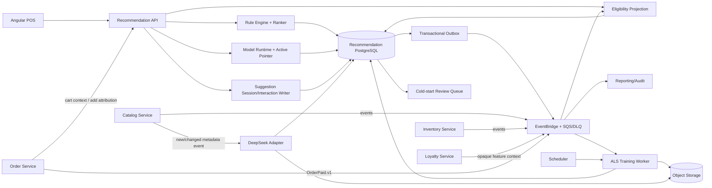

Started at: 2026/10/13 00:00:00
Finished at: 2026/10/13 00:00:00
Total time: 0 minutes
---

# Module 8 — Gợi ý món / Upsell: Architecture

**Ngày:** 2026-10-13  
**Trạng thái:** Approved  
**Requirements:** [Recommendation Requirements](./2026-10-13-requirements.md)  
**Requirements review:** [Recommendation Requirements Review](./2026-10-13-requirements-review.md)  
**Parent architecture:** [POS Platform Architecture](../pos-platform/2026-10-12-architecture.md)

## 1. Architecture summary

Recommendation Service là bounded context độc lập, gồm:

- stateless realtime API cho cart suggestion và interaction commands;
- PostgreSQL cho rules, projections, suggestion sessions/interactions, model metadata và job state;
- EventBridge/SQS consumers cho Catalog, Inventory, Order và Loyalty facts;
- nightly ML worker cho ALS snapshot/train/validation/activation;
- object storage cho immutable training snapshots và model artifacts;
- async DeepSeek adapter cho P2 cold-start enrichment.

P0/P1 request path không gọi DeepSeek, weather provider hoặc training worker. Realtime API dùng rule/model cache cục bộ + PostgreSQL read model; Order vẫn là authority cuối khi add-line.

## 2. Component architecture



### Component responsibilities

| Component | Responsibility | Does not own |
|---|---|---|
| Recommendation API | Auth/scope, cart request validation, response envelope, interaction commands | Order/Catalog/Inventory/Loyalty source state |
| Rule Engine + Ranker | Compile/evaluate active rule versions, deterministic top-K, rule attribution | Rule editing persistence and production publish authority |
| Eligibility Projection | Catalog/item/branch/stock projection, source version/watermark/TTL | Physical stock mutation |
| Model Runtime | Load active ALS artifact, score opaque customer candidates, fallback on failure | Training source truth |
| Suggestion Session/Interaction Writer | Immutable session/candidate/evidence, shown/accepted dedupe, outbox | Order add-line/payment |
| Training Worker | Snapshot, train, evaluate, activate/rollback pointer, run state | Realtime request handling |
| DeepSeek Adapter | P2 sanitized metadata enrichment, schema validation, provider retry/budget | Catalog mutation and realtime ranking |
| Recommendation PostgreSQL | Strong local state, versions, idempotency, checkpoints, outbox | Cross-service joins |
| Object Storage | Immutable training snapshot/model artifact blobs | Active model decision |
| EventBridge/SQS/DLQ | At-least-once event transport and isolation | Business state ownership |

## 3. Boundary and communication model

### 3.1 Realtime P0/P1 request

1. POS calls Recommendation with `orderId`, branch context, cart version and optional Loyalty-provided opaque customer key.
2. Recommendation validates tenant/branch/role and resolves canonical cart context through a bounded Order internal read contract or a locally projected version matching the request.
3. Rule Engine loads active tenant rule version; Model Runtime is used only when an eligible customer/model exists.
4. Eligibility Projection removes cart duplicates, inactive/wrong-branch/stale/unavailable candidates.
5. Ranker returns bounded deterministic top-K and persists suggestion session/candidate snapshot.
6. API returns suggestion ID, candidate snapshots, reason, score/version and freshness metadata.

Recommendation does not call Inventory DB or Catalog DB. It consumes source events and retains read projections. If canonical cart context or required eligibility data cannot be safely resolved, it returns an empty/typed safe response rather than guessing.

### 3.2 Cart context strategy

The primary design is a bounded `OrderContextClient` contract for current cart version, with a local projection/cache as a fast path:

- cache/projection hit with matching `orderVersion` → no cross-service call;
- miss or stale version → one bounded synchronous read to Order;
- Order unavailable or version mismatch → `cart_context_unavailable`, not a recommendation from stale cart lines;
- the client never treats arbitrary line IDs from the POS body as authoritative without order/version binding.

This avoids a long request chain while preserving correctness for draft cart changes. Order add-line remains the final ownership/availability check.

### 3.3 Interaction commands

- `/shown` writes an impression after frontend render confirmation.
- `/accept` is accepted only with session-bound item/order and Order add-line evidence (`orderLineId` or post-add order version).
- Both commands are local DB + outbox transactions; downstream Reporting/Audit delivery is asynchronous.
- Retry uses interaction ID/source key; duplicate event delivery is safe.

## 4. Rule engine and eligibility architecture

### 4.1 Rule model

Association rules are tenant-wide production versions with a canonical basket signature:

```text
RuleVersion
  tenantId
  antecedentSignature = sorted canonical item/variant/modifier identities
  consequentIdentity
  support
  confidence
  lift
  priority
  effectiveFrom/effectiveTo
  status = DRAFT | PUBLISHED | RETIRED
  version
```

Published rules are immutable. A rule editor writes a draft; Owner publish creates a new immutable version and outbox event. Rule cache entries are keyed by `(tenantId, activeRuleSetVersion)`.

### 4.2 Deterministic evaluation

1. Normalize current cart to canonical identity keys.
2. Generate candidate rules by exact or configured subset match against the basket signature.
3. Merge duplicate consequents while retaining the best rule attribution.
4. Apply eligibility predicates before scoring output.
5. Sort by priority, confidence, lift, support and stable candidate ID.
6. Return top-K and the rule/model version used.

Rule cache invalidation:

- `RecommendationRulePublished.v1`/`Retired.v1` invalidates tenant rule cache.
- Cache miss reads active versions from PostgreSQL.
- Every response carries the active version; stale cache cannot silently claim a newer version.

### 4.3 Eligibility projection

Local projection tables represent:

- Catalog item/variant identity, name/price snapshot, status and branch saleability;
- Inventory available state, source version and observed time;
- projection checkpoints per source/tenant/branch.

Candidate policy:

- source status inactive or branch not sellable → exclude;
- source availability false → exclude;
- `now - lastSourceEventAt > eligibilityTTL` → exclude and expose safe freshness status;
- missing projection → exclude;
- final Order add-line validation can still reject a candidate due to a newer source state.

Projection consumers use event ID/source version dedupe, ignore older versions, commit checkpoint after state update and support replay/rebuild from retained events or source snapshot.

## 5. Personalization and model architecture

### 5.1 Opaque Loyalty feature boundary

Loyalty remains owner of phone/customer identity. It publishes or serves a privacy-safe feature context containing:

```text
tenantId
opaqueCustomerKey
eligibility = ELIGIBLE | INELIGIBLE | DELETED
consentVersion
featureVersion
generatedAt
```

Recommendation never receives phone plaintext. The realtime API may use the opaque key to select an active ALS score vector; the training worker uses a tenant-isolated mapping/snapshot supplied by Loyalty. Deleted/ineligible keys are tombstoned and excluded from future training/rebuild.

### 5.2 ALS training pipeline

```text
Scheduler
  → Training Run Orchestrator
  → Paid Interaction Snapshot Builder
  → Tenant-isolated ALS Trainer
  → Quality Validator
  → Model Registry / Active Pointer
  → Model Runtime cache refresh
```

Input is deduplicated `OrderPaid.v1`/paid-order projection with customer opaque key, item identity, quantity/interaction weight, tenant and source watermark. No draft, unpaid or raw phone input is used.

Training snapshot and model artifact are immutable object-storage objects. PostgreSQL stores manifest/checksum/metrics/status/pointer, not the large artifact blob.

### 5.3 Model activation

- New model starts `CANDIDATE`, then `VALIDATING`.
- Validator checks minimum data, Recall@K/NDCG@K policy, coverage, freshness, tenant isolation, checksum and reproducibility metadata.
- Activation uses a compare-and-swap update on `(tenantId, modelFamily, activeVersion)`.
- A failed candidate never replaces the active model.
- Rollback points to a previously validated artifact and writes audit/outbox.
- API pods load active model asynchronously; until loaded, association rules remain the safe path.

### 5.4 Runtime fallback

```text
eligible customer + active healthy ALS
  → ALS rank → eligibility filter → top-K
otherwise
  → association rule rank → eligibility filter → top-K
otherwise
  → empty list
```

No popular-item fallback is introduced in P0/P1.

## 6. P2 DeepSeek architecture

DeepSeek is isolated behind an async adapter:

1. Catalog item metadata event creates a cold-start job.
2. Worker sanitizes allowed name/description/tag fields and applies tenant/provider budget.
3. Adapter calls DeepSeek with versioned prompt/model configuration.
4. Structured response passes schema, vocabulary, safety and confidence validation.
5. Candidate feature is stored with provenance and `PENDING_REVIEW` status.
6. Owner/approved operator accepts/rejects; accepted feature is consumed by future candidate generation.

Provider failures are retried with bounded backoff/DLQ. No provider result mutates Catalog source or blocks P0/P1.

## 7. Data architecture

### 7.1 PostgreSQL ownership

| Data | Store | Consistency |
|---|---|---|
| Rule drafts/versions/publish state | Recommendation PostgreSQL | Strong local transaction |
| Catalog/availability projections | Recommendation PostgreSQL | Eventual, checkpointed/versioned |
| Suggestion sessions/candidates/interactions | Recommendation PostgreSQL | Strong local transaction + unique dedupe |
| Training runs/snapshots/metrics/model pointer | Recommendation PostgreSQL | Strong versioned state |
| Model/training blobs | Object Storage | Immutable blob + DB manifest/checksum |
| Feature/context eligibility | Recommendation projection or encrypted snapshot | Tenant-scoped, deletion-aware |
| Events | Outbox + EventBridge/SQS | At-least-once |

### 7.2 Core aggregates/tables

- `association_rule_sets`, `association_rule_versions`, `rule_antecedents`, `rule_consequents`;
- `catalog_item_projections`, `branch_item_eligibility`, `inventory_availability_projections`, `projection_checkpoints`;
- `suggestion_sessions`, `suggestion_candidates`, `suggestion_interactions`;
- `customer_feature_contexts`, `paid_interaction_projections`;
- `training_runs`, `training_snapshot_manifests`, `model_registry`, `model_metrics`;
- `cold_start_jobs`, `cold_start_feature_candidates`;
- `outbox_messages`, `inbox_events`, `idempotency_records`, `audit_references`.

Every table is tenant-scoped; branch-scoped tables also include branch ID. PII is excluded by schema, not only by application convention.

### 7.3 Index and partition policy

Baseline indexes:

- active rules by `(tenant_id, status, effective_from, effective_to, version)`;
- rule antecedent hash/signature by `(tenant_id, signature_hash, status)`;
- branch eligibility by `(tenant_id, branch_id, item_id, status, source_version)`;
- sessions by `(tenant_id, branch_id, order_id, cart_version, expires_at)`;
- interactions by `(tenant_id, suggestion_id, event_type, interaction_key)` unique;
- paid interactions by `(tenant_id, customer_key_hash, occurred_at, item_id)`;
- training runs by `(tenant_id, model_family, status, created_at)`;
- outbox/inbox/checkpoints by source and time.

MVP does not partition small rule/session tables. High-volume interaction, paid-interaction projection, outbox and audit history are monthly RANGE partition candidates once row volume/retention requires it.

## 8. Communication and event architecture

### Consumed facts

| Event/API | Consumer component | Behavior |
|---|---|---|
| `CatalogItemCreated/Updated.v1` | Catalog projection, cold-start worker | Upsert version; trigger P2 job |
| `CatalogItemAvailabilityChanged.v1` | Eligibility projection | Upsert branch eligibility |
| `InventoryStockChanged.v1` | Inventory projection | Update available state/version |
| Order cart context API/event | Context resolver | Resolve exact order/cart version |
| `OrderPaid.v1` | Paid interaction projection/trainer | Dedupe and persist training input |
| Loyalty opaque feature context | Feature projection/runtime | Update eligibility/version/tombstone |

### Produced facts

| Event | Producer component | Consumers |
|---|---|---|
| `SuggestionShown.v1` | Interaction writer | Reporting, Audit |
| `SuggestionAccepted.v1` | Interaction writer | Reporting, Audit |
| `RecommendationRulePublished.v1` | Rule command | Reporting, Audit, cache invalidation |
| `RecommendationRuleRetired.v1` | Rule command | Reporting, Audit, cache invalidation |
| `RecommendationModelActivated.v1` | Model lifecycle | Reporting, Audit, runtime refresh |
| `RecommendationModelRolledBack.v1` | Model lifecycle | Reporting, Audit, runtime refresh |
| `RecommendationTrainingRunCompleted.v1` | Training worker | Reporting, Audit, ops |
| `ColdStartFeatureCandidateCreated.v1` | DeepSeek worker | Owner review/Audit |

All events use parent envelope and are published through transactional outbox. Consumers dedupe by event ID/source version and acknowledge after projection/side effect commit.

## 9. Consistency, reliability and recovery

| Concern | Design |
|---|---|
| Rule publish | One local transaction creates immutable version, active pointer and outbox event |
| Suggestion session | Strong local write binds order/cart/rule/model/projection versions |
| Interaction | Unique source key; duplicate is no-op/result replay |
| Projection | At-least-once consumer, source-version monotonic guard, checkpoint after commit |
| Training | Leased run per tenant/model family; duplicate scheduler command returns existing run |
| Model activation | CAS pointer; active model retained until candidate passes all hard gates |
| Worker crash | Resume from run state/manifest; artifact checksum prevents partial activation |
| Event outage | Outbox retry/DLQ; P0 response is not blocked by downstream Reporting/Audit |
| Projection rebuild | Clear/rebuild derived tables from retained event/source snapshot, then atomically advance checkpoint |
| Privacy deletion | Loyalty tombstone event removes/blocks feature key and excludes future snapshots; purge job follows retention policy |

## 10. Security, privacy and observability

### Security/privacy

- Public API: Cognito JWT + current tenant/branch/role authorization.
- Internal API/worker: workload identity/mTLS, signed tenant context and allowlisted operations.
- Rule publish/model activation: Owner permission, reason and audit.
- Repository layer: explicit tenant predicate; branch predicate for branch/session/projection data.
- Customer: opaque key only; no phone plaintext, raw lookup input or reversible feature material.
- Object storage: encryption at rest, tenant-scoped key/prefix policy, checksum and access audit.
- DeepSeek: sanitized Catalog metadata only; provider output treated as untrusted data.

### Metrics/logs/traces

Metrics:

- request p50/p95/p99 and fallback rate;
- candidate exclusion by reason and projection lag/TTL breaches;
- shown/accepted rate and source dedupe count;
- active model age, model load failure, rollback count;
- training run duration/state/quality/coverage and snapshot watermark;
- DeepSeek provider latency/error/cost estimate/rate-limit/DLQ;
- outbox/inbox lag, retry and DLQ depth.

Structured logs include request/correlation, tenant/branch, order/suggestion/rule/model/run IDs, versions, result and latency. Logs exclude phone, feature vectors, prompt payload, model artifact, access token and provider secret.

## 11. Deployment and scaling

- Realtime API pods are stateless and scale horizontally.
- Worker pool is separate from API pool; training/cold-start CPU/memory cannot starve P0 API.
- PostgreSQL is the authoritative local consistency boundary.
- Object storage holds large snapshots/artifacts; API never downloads full artifact per request.
- Active model/rule caches are per-pod with version checks; cache miss/reload is bounded.
- EventBridge/SQS queues are separated for projection, analytics, training and cold-start workloads with independent DLQs.
- Parent baseline: 100 branches and 100k orders/day; candidate evaluation is bounded by top-K and active-rule indexes.
- No weather provider, DeepSeek call or synchronous per-customer training call on P0 path.

## 12. Architecture decisions / ADRs

| ADR | Decision | Reason |
|---|---|---|
| ADR-REC-001 | Hybrid realtime rules + async ALS | P0 deterministic/low-latency, P1 personalization without runtime training |
| ADR-REC-002 | Local Catalog/Inventory eligibility projection | Avoid cross-service DB access and long synchronous chain; expose freshness |
| ADR-REC-003 | Order-bound cart context | Prevent stale/arbitrary client cart from becoming recommendation truth |
| ADR-REC-004 | Tenant-wide model/rules, branch-filtered candidates | Better data volume while preserving branch correctness |
| ADR-REC-005 | Immutable model/rule versions + active pointer | Reproducibility, rollback and audit |
| ADR-REC-006 | Opaque Loyalty feature context | Minimize phone/PII exposure and keep identity ownership in Loyalty |
| ADR-REC-007 | Async DeepSeek only | Provider latency/cost/safety cannot affect POS P0/P1 |
| ADR-REC-008 | Order remains add-line authority | Recommendation is advisory; stale candidate cannot create invalid order |

## 13. Sequence diagram confirmation gate

Repository không có Recommendation implementation source; các flow sau là design-level dựa trên approved Requirements và parent contracts. Order, Catalog, Inventory, Loyalty, Reporting/Audit và DeepSeek adapter được biểu diễn như confirmed system boundaries/black boxes.

### Participants đề xuất

| # | Participant | Level | Communication | Vai trò |
|---:|---|---|---|---|
| 1 | POS/Angular | L1 | HTTPS REST | Cart UI, render/interaction confirmation |
| 2 | Recommendation Service | L1 | HTTPS REST | Realtime API and ownership boundary |
| 3 | Order Service | L1 | HTTP sync + events | Canonical cart/add-line/paid facts |
| 4 | Catalog Service | L1 | Event async | Item/menu/branch availability source |
| 5 | Inventory Service | L1 | Event async | Stock availability source |
| 6 | Loyalty Service | L1 | Event/internal API | Opaque customer feature eligibility |
| 7 | EventBridge/SQS | L1 | Async | Event transport/retry/DLQ |
| 8 | Reporting/Audit | L1 | Async | Analytics/audit consumers |
| 9 | DeepSeek | L1 | HTTPS async adapter | P2 external provider black box |
| 10 | RecommendationController | L2 | Internal | HTTP boundary |
| 11 | RecommendationApplicationService | L2 | Internal | Orchestrates context/ranking/session |
| 12 | OrderContextClient | L2 | HTTP adapter | Current cart context boundary |
| 13 | CandidateEligibilityProjection | L2 | Internal | Filter branch/catalog/inventory candidates |
| 14 | RuleEngine/ModelRuntime | L2 | Internal | Rule/ALS scoring and fallback |
| 15 | Recommendation DB | L2 | SQL | Local rules/session/model/job state |
| 16 | Outbox/ML Worker | L2 | Internal/async | Outbox, training, model activation, cold-start |

### Flows cần render

1. P0 cart request: current cart context → rule evaluation → eligibility filter → deterministic response.
2. P0 shown/accepted: render confirmation, Order add-line success evidence, idempotent events.
3. Stale Catalog/Inventory projection: projection lag → candidate exclusion/empty safe response → Order final validation.
4. P1 ALS request: opaque customer context → active model scoring → branch/cart filtering → association fallback.
5. Nightly ALS: OrderPaid snapshot → train/validate → activate or retain old model → runtime refresh.
6. Model failure/rollback and duplicate/out-of-order event replay.
7. P2 DeepSeek cold-start: Catalog event → sanitized async job → validated candidate → review/approval.

Theo `sequence-diagram` skill, chưa render PlantUML cho đến khi user xác nhận participants và flow summary này.

## 14. Architecture approval gate

- **Current status:** Approved
- **Required before Contracts:** Sequence diagrams generated; proceed to API/Data Contracts.
- **Contract amendments required:** Recommendation shown/accepted APIs, Order add attribution, Loyalty opaque feature context, rule/version schemas, model lifecycle và source event fields.

