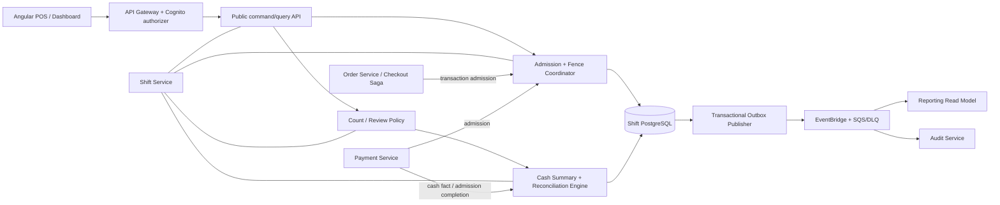

Started at: 2026/10/13 00:00:00
Finished at: 2026/10/13 00:00:00
Total time: 0 minutes
---

# Module 7 — Ca làm việc: Architecture

**Ngày:** 2026-10-13  
**Trạng thái:** Approved  
**Requirements:** [Shift Requirements](./2026-10-13-requirements.md)  
**Requirements review:** [Shift Requirements Review](./2026-10-13-requirements-review.md)  
**Parent architecture:** [POS Platform Architecture](../pos-platform/2026-10-12-architecture.md)

## 1. Architecture summary

Shift Service là một bounded context độc lập, dùng PostgreSQL riêng và transactional outbox. Service sở hữu lifecycle của shift, admission fence của branch, opening float, cash facts, count attempts, discrepancy review và reconciliation case. Order, Payment và Saga không đọc hoặc ghi Shift DB.

Kiến trúc chọn **synchronous admission + local close fence + asynchronous finalizer**:

1. Trước khi checkout/cash payment, Order/Saga/Payment xin một admission từ Shift.
2. Admission được ghi vào Shift DB với sequence tăng dần và opaque `admissionId`.
3. Close khóa admission mới bằng một fence sequence trong cùng transaction với shift row.
4. Admission đã được cấp trước fence được phép hoàn tất; admission sau fence bị từ chối.
5. Close finalizer chỉ tính các cash fact đã hoàn tất và các admission trước fence đã kết thúc. Nếu còn admission chưa xác định sau thời gian drain, shift không được đóng âm thầm; chuyển sang `PENDING_REVIEW` với reconciliation required.

Quyết định này tránh dùng timestamp best-effort để phân xử race giữa close và payment. Thứ tự được xác định bởi row lock và sequence do Shift DB cấp.

## 2. Boundary và component architecture



### Component responsibilities

| Component | Trách nhiệm | Không sở hữu |
|---|---|---|
| Public API | Auth context, DTO validation, command/query routing, idempotency envelope | Business facts của Order/Payment |
| Admission + Fence Coordinator | Cấp admission, đánh sequence, mở close fence, reject admission sau fence | Payment state, order checkout state |
| Cash Summary + Reconciliation Engine | Deduplicate cash facts, tính expected cash, kiểm tra watermark, tạo reconciliation case | Provider settlement |
| Count / Review Policy | Snapshot threshold, tạo immutable count attempt, approve/recount | Chỉnh sửa counted amount sau submit |
| Shift PostgreSQL | Source of truth cho shift và các record bất biến của Shift | Cross-service joins |
| Outbox Publisher | Phát versioned event sau local commit, retry/DLQ | Đảm bảo synchronous delivery |
| Reconciliation/Close Worker | Drain admission, finalize close, xử lý late/unknown fact | Tự ý reopen hoặc sửa closed shift |

### Service boundary

- Public command/query đi qua API Gateway, Cognito JWT và service-level tenant/branch checks.
- Internal admission/cash-fact APIs dùng workload identity/mTLS; body không được xem là nguồn authority cho tenant/branch.
- Order/Saga và Payment chỉ giữ opaque `shiftId`/`admissionId` và snapshot cần thiết cho retry.
- Reporting/Audit chỉ consume events; không được gọi để quyết định transaction close.

## 3. Lifecycle và close-fence model

### 3.1 Public lifecycle

Public lifecycle vẫn dùng các trạng thái đã chốt:

```text
NONE -> ACTIVE -> CLOSED
             \-> PENDING_REVIEW -> CLOSED
             \-> CANCELLED
```

`CLOSED` và `CANCELLED` là terminal. `PENDING_REVIEW` khóa branch cho shift mới và checkout mới.

### 3.2 Internal admission phase

Để không làm mơ hồ public state, Shift lưu thêm internal phase:

```text
OPEN -> CLOSING -> FROZEN
```

- `OPEN`: `ACTIVE` nhận admission.
- `CLOSING`: fence đã được tạo; không nhận admission mới, nhưng admission hợp lệ trước fence được hoàn tất.
- `FROZEN`: không còn admission chưa kết thúc; finalizer được phép tạo count/review và chuyển public lifecycle sang `CLOSED` hoặc `PENDING_REVIEW`.

`CLOSING` không phải một trạng thái public cho phép mở ca mới. Nếu API đọc trong lúc này, trả `ACTIVE` kèm `closeStatus=PROCESSING` hoặc resource version tương ứng; không cho checkout tạo admission mới.

### 3.3 Admission protocol

1. Caller gửi `tenantId`, `branchId`, `shiftId`, `sourceType`, `sourceId`, `transactionKind`, `amount/currency` và correlation context.
2. Shift lock row `shifts` bằng `SELECT ... FOR UPDATE`.
3. Nếu shift không thuộc tenant/branch, không `ACTIVE`, hoặc phase khác `OPEN`, trả typed error.
4. Shift tăng `admission_seq`, insert `shift_transaction_admissions` với `admitted_at` lấy từ DB clock và trả opaque `admissionId`.
5. Caller phải gửi `admissionId` khi hoàn tất payment/order transaction hoặc cash fact. Không được tự tạo admission time ở Payment.

Một retry có cùng operation key/source key trả admission/result cũ. Cùng key nhưng canonical request khác trả `idempotency_conflict`.

### 3.4 Close-fence protocol

1. Close command lock shift row và kiểm tra public lifecycle `ACTIVE` cùng phase `OPEN`.
2. Trong cùng transaction, Shift đổi phase sang `CLOSING`, ghi `close_fence_seq = last_admission_seq`, `close_fence_at = DB clock`, `close_fence_version` và actor/reason.
3. Mọi admission bắt đầu sau đó phải chờ row lock rồi thấy phase `CLOSING` và bị reject. Admission đã commit trước fence có sequence `<= close_fence_seq`.
4. Finalizer drain các admission trước fence. Admission phải kết thúc ở `COMPLETED`, `FAILED` hoặc `CANCELLED`; cash payment/refund thành công phải có cash fact idempotent.
5. Khi không còn admission pending, finalizer snapshot cash summary và chuyển phase `FROZEN`. Nếu P1 count hợp lệ, tính discrepancy; nếu không có count và policy P0, tiếp tục close.
6. Nếu drain timeout hoặc thiếu fact không thể xác minh, finalizer chuyển public lifecycle sang `PENDING_REVIEW`, ghi reason `UNRESOLVED_PRE_FENCE_ADMISSION` và tạo reconciliation case. Không trả branch về `ACTIVE`.

Close endpoint có thể trả `202 Accepted` với `closeStatus=PROCESSING` khi cần drain; retry cùng idempotency key theo dõi cùng close operation. Khi finalizer kết thúc, response/query trả `CLOSED` hoặc `PENDING_REVIEW`.

> Đây là một refinement an toàn so với requirement “P0 close → CLOSED”: close bình thường vẫn đóng `CLOSED`; chỉ một admission đã được cấp trước fence nhưng chưa thể xác định trong drain timeout mới đi vào `PENDING_REVIEW`. Contracts phải mô tả rõ `202`, `closeStatus` và lý do này.

## 4. Transaction boundaries và critical flows

### 4.1 Open shift

Local PostgreSQL transaction:

1. Xác thực tenant/branch/role và kiểm tra branch active.
2. Lock branch active-slot hoặc dùng partial unique index làm guard cuối.
3. Kiểm tra không có `ACTIVE`, `PENDING_REVIEW` hoặc operation đang `CLOSING`.
4. Insert shift với opening float, business date, opener, phase `OPEN`, version `1`.
5. Insert `ShiftOpened.v1` vào outbox và idempotency result trong cùng transaction.
6. Commit rồi trả `201 Created`.

### 4.2 Cash transaction admission

Admission là synchronous vì caller cần biết ngay có được checkout/payment hay không. Admission record không phải Payment record và không làm tăng expected cash. Nó chỉ là quyền hợp lệ để transaction tiếp tục trong shift.

Payment cash flow sau đó phải:

1. Giữ `admissionId` trong payment attempt.
2. Chỉ gửi cash fact khi payment thành công/refund finalized.
3. Gửi completion cho admission; retry được deduplicate theo source ID.

Payment/VNPAY non-cash không được cộng vào expected cash, nhưng nếu checkout cần branch shift thì vẫn phải dùng admission policy của Order/Saga.

### 4.3 P0 close không count

Close ghi fence trước, drain admission, kiểm tra không có unresolved pre-fence admission, rồi atomically:

- public lifecycle `ACTIVE -> CLOSED`;
- phase `FROZEN`;
- ghi `closed_at`, close summary và actor/reason;
- insert `ShiftClosed.v1`, audit reference và idempotency result.

Nếu outbox publish lỗi, local close vẫn committed; publisher retry/DLQ xử lý delivery.

### 4.4 P1 close/count

Cash summary chỉ được snapshot khi:

- tất cả admission trước fence đã terminal;
- cash facts đã deduplicate;
- source watermark/fact completeness được xác định;
- không còn unresolved reconciliation case ảnh hưởng đến expected cash.

Tại snapshot, công thức là:

```text
expectedCashMinor = openingFloatMinor
                   + cashCollectedMinor
                   - cashRefundedMinor
discrepancyMinor = countedCashMinor - expectedCashMinor
```

Count attempt lưu threshold snapshot, fence version, fact watermark, input amounts và signed discrepancy. Nếu trong threshold, close ngay; nếu vượt threshold, public lifecycle `PENDING_REVIEW` và phát `ShiftReviewRequired.v1`.

### 4.5 Review và recount

- Approve lock shift + count attempt, kiểm tra attempt là latest và `review_version` khớp `If-Match`, rồi tạo `CLOSED`/`FROZEN`, audit và event trong một transaction.
- Request recount không sửa attempt cũ. Nó đánh dấu attempt cũ `RECOUNT_REQUIRED`, tăng review version và yêu cầu cashier submit attempt mới.
- Chỉ Manager/Owner được approve/request recount. Count actor không được approve count của mình nếu policy phân tách trách nhiệm được bật.

## 5. Data architecture

### 5.1 Logical entities

| Entity | Nội dung chính | Tính bất biến |
|---|---|---|
| `shifts` | tenant/branch, public status, opener, business date, opening float, close fence, review version, terminal timestamps | Lifecycle fields chỉ đổi theo command transaction |
| `shift_transaction_admissions` | source, kind, amount snapshot, admission sequence/time, token status, completion time | Admission identity/sequence không đổi |
| `cash_facts` | cash collection/refund, source ID, admission ID, amount, status, admitted/occurred time, dedupe key | Source fact không update amount; correction tạo case mới |
| `cash_count_attempts` | counted/expected/collected/refunded, discrepancy, threshold, watermark, actor, note, review state | Append-only sau submit |
| `reconciliation_cases` | late/unknown/mismatch/unresolved fact, reason, resolution actor/note/time | Resolution append-only |
| `shift_policies` | threshold, count-required flag, drain timeout và effective scope | Applied policy được snapshot vào shift/count |
| `outbox_messages` | event envelope/payload, publish state, attempts, next retry | Payload sau commit không sửa |
| `idempotency_records` | operation, key, canonical hash, response/status, resource ID | Key/result immutable; retry chỉ đọc lại |
| `audit_references` | actor, action, reason, old/new state, correlation và Audit event ID | Append-only |

### 5.2 PostgreSQL constraints và indexes

- UUID v7 cho internal IDs; provider/source IDs lưu riêng.
- Partial unique index trên `(tenant_id, branch_id)` khi public status `ACTIVE` hoặc `PENDING_REVIEW`.
- Index admission theo `(tenant_id, shift_id, admission_seq)` và pending status.
- Unique cash dedupe key trên `(tenant_id, shift_id, source_type, source_id, fact_kind)`.
- Unique idempotency scope theo `(tenant_id, operation, idempotency_key)`.
- Index history theo `(tenant_id, branch_id, business_date DESC, created_at DESC)`.
- Tất cả branch-scoped repository query bắt buộc tenant + branch predicate; service layer kiểm tra thêm ownership.
- Amount là `BIGINT` nonnegative cho input; discrepancy là signed `BIGINT`; currency P0 là `VND`.
- Timestamps là `TIMESTAMPTZ` UTC; business date được tính và lưu theo IANA timezone snapshot của branch.

### 5.3 Partitioning và retention

MVP không partition các bảng transaction nhỏ. `audit_references`, `outbox_messages`, cash facts và reconciliation history có thể dùng monthly RANGE partition khi đạt ngưỡng vận hành hoặc cần drop/archive theo retention. Không archive/delete shift ledger trong thời hạn tối thiểu 7 năm nếu chưa có policy pháp lý khác.

## 6. Communication và event architecture

### Synchronous calls

| Caller | Shift operation | Mục đích |
|---|---|---|
| POS/Dashboard | open/current/close/cancel/review | User command/query |
| Order/Saga | transaction admission | Chặn checkout sau fence |
| Payment | admission + cash fact/completion | Gắn cash transaction vào shift |
| Operations | reconciliation resolve | Xử lý case không reopen shift |

Synchronous service call phải truyền `tenantId`, `branchId`, `shiftId`, `correlationId`, caller workload identity và idempotency/source key. Shift không suy ra shift từ branch/time.

### Events

Các event đều dùng envelope parent (`eventId`, `eventType`, `eventVersion`, `occurredAt`, `tenantId`, `branchId`, `aggregateType`, `aggregateId`, `correlationId`, `causationId`, `producer`, `payload`):

| Event | Khi phát | Consumer chính |
|---|---|---|
| `ShiftOpened.v1` | Open commit | Reporting, Audit |
| `ShiftCloseStarted.v1` | Fence commit nếu cần theo dõi vận hành | Reporting, Audit/ops |
| `ShiftCountSubmitted.v1` | Count attempt commit | Reporting, Audit |
| `ShiftReviewRequired.v1` | Discrepancy/unresolved admission | Reporting, Audit, ops |
| `ShiftRecountRequested.v1` | Manager request recount | Reporting, Audit |
| `ShiftClosed.v1` | Terminal close commit | Reporting, Audit |
| `ShiftCancelled.v1` | Abandoned shift cancellation + float return | Reporting, Audit |
| `ShiftReconciliationCaseOpened.v1` | Late/unknown/mismatched fact hoặc unresolved admission tạo case | Reporting, Audit, ops |
| `ShiftCashFactReconciled.v1` | Case resolution | Reporting, Audit |

`ShiftClosed.v1` chỉ phát một lần cho một terminal transition. Retry outbox không tạo event ID mới.

### Delivery semantics

- Local transaction → outbox là atomic.
- Publisher at-least-once; consumer dùng `eventId`/aggregate version để deduplicate.
- EventBridge route tới SQS queue riêng cho Reporting/Audit; DLQ giữ payload và failure metadata.
- Event không chứa raw payment provider secret hoặc PII không cần thiết.

## 7. Cross-service integration decisions

### Order và Saga

- `shiftId` là bắt buộc trong create/checkout context của branch order.
- Trước khi bắt đầu payment, Saga gọi transaction admission và lưu `admissionId` trong execution context.
- Saga retry cùng source/order không tạo admission thứ hai.
- `transaction_after_close_fence` được hiển thị thành lỗi nghiệp vụ để POS yêu cầu mở ca mới.

### Payment

Payment initiate/refund request, PaymentPaid/PaymentRefunded facts phải mang tối thiểu:

`tenantId`, `branchId`, `shiftId`, `admissionId` (cash), `sourceId`, `amountMinor`, `currency`, `status`, `admittedAt`, `occurredAt`, `correlationId`.

Payment không được gán shift theo branch/time hoặc gửi cash fact thiếu admission. Payment DB vẫn là source of truth cho payment state; Shift chỉ lưu cash accountability fact.

Đây là cross-impact bắt buộc phải cập nhật trong Contracts và parent Payment contracts trước code.

### Identity

- Cognito xác thực token và Identity service quyết định tenant/branch/role.
- Shift re-checks resource scope tại API/service/repository.
- Manager/Owner override, cancel, review và on-behalf close bắt buộc reason; actor và effective operator được ghi audit.

## 8. Failure handling và recovery

| Failure | Xử lý |
|---|---|
| Concurrent open | DB lock/partial unique; chỉ một command thắng, còn lại `409 shift_already_open` |
| Admission vs close | Row lock + admission sequence quyết định; sau fence reject, trước fence drain |
| Payment fact duplicate | Unique source key + idempotent no-op |
| Fact sau fence | Không mutate closed/review summary; tạo reconciliation case |
| Unknown tenant/branch/shift | Reject + audit, không lộ existence ngoài scope |
| Broker/outbox outage | Local state giữ nguyên; retry với backoff, DLQ và alert |
| Close worker crash | Worker restart tìm operation `CLOSING`; lock/version để resume một lần |
| Drain timeout | `PENDING_REVIEW` + `UNRESOLVED_PRE_FENCE_ADMISSION`; branch vẫn khóa |
| Manager quên review | Aging metric/alert; chỉ Manager/Owner explicit command, không auto-close |
| Abandoned active shift | Manager/Owner cancel nếu chưa có admitted cash fact và xác nhận trả đủ opening float |

Không có path tự động reopen. Operations resolution chỉ tạo correction/reconciliation record và event mới.

## 9. Security, observability và operations

### Security

- REST public dùng Cognito JWT; internal API dùng workload identity/mTLS.
- Authorization matrix áp dụng ở route và command; repository luôn tenant/branch scoped.
- `shiftId`, `admissionId`, `sourceId` phải được kiểm tra ownership và relationship; chống IDOR.
- Reason không được chứa card data, secret hoặc PII thừa.
- Audit cả success và denial cho override, cancellation, review, cross-scope access và late fact.

### Metrics và logs

Metrics tối thiểu:

- `shift_open_attempts_total`, `shift_open_conflicts_total`;
- `shift_admission_rejected_total{reason}`;
- `shift_close_duration_ms`, `shift_close_drain_timeout_total`;
- `shift_pending_review_age_seconds`;
- `shift_cash_discrepancy_minor` (không log raw sensitive payload);
- `shift_late_cash_fact_total`, `shift_reconciliation_open_total`;
- outbox publish lag/retry/DLQ và cash-summary watermark lag.

Structured logs bắt buộc có `requestId`, `correlationId`, `tenantId`, `branchId`, `shiftId`, actor/workload, operation, state/version và result code. Không log token hoặc payment secret.

### Runbook triggers

- Branch bị `PENDING_REVIEW` quá SLA → notify Manager/Owner.
- Admission `CLOSING` quá drain timeout → inspect Payment/Saga correlation, không force-close bằng SQL.
- Outbox/DLQ tăng → retry worker, sau đó reconciliation command được audit.
- Late fact sau closed → xử lý case qua Operations API, không reopen.

## 10. Deployment và scaling

- Shift Service stateless; scale ngang API và worker.
- PostgreSQL là consistency boundary; row lock chỉ giữ trong command transaction, không giữ lock trong thời gian gọi service khác.
- Close drain không giữ DB transaction mở trong lúc chờ; fence commit trước, worker poll bằng version/status.
- Hikari/connection pool và lock timeout phải giới hạn để không làm nghẽn branch khác.
- Scale baseline kế thừa parent: 100 branches, 2–4 shifts/branch/day, 100k orders/day; hot path là admission/fact write, không phải open/close.
- Read current/history có thể dùng read replica chỉ sau khi response nêu rõ eventual freshness; command và close summary đọc primary.

## 11. Architecture decisions / ADRs

| ADR | Quyết định | Lý do |
|---|---|---|
| ADR-SHIFT-001 | Dedicated Shift DB + outbox | Giữ ownership và audit consistency của shift |
| ADR-SHIFT-002 | DB-sequenced admission fence | Phân xử close/payment race deterministic, không dựa timestamp broker |
| ADR-SHIFT-003 | Close finalizer drain bounded | Không đóng khi còn admission pre-fence chưa xác định; không giữ transaction mở |
| ADR-SHIFT-004 | Immutable count/fact/correction record | Bảo toàn audit và không sửa lịch sử tiền |
| ADR-SHIFT-005 | `PENDING_REVIEW` là branch lock | Không mở ca mới khi discrepancy hoặc reconciliation chưa được xác nhận |
| ADR-SHIFT-006 | Không cash-in/cash-out trong P0/P1 | Giữ công thức expected cash đơn giản và scope đúng module |

## 12. Sequence diagram confirmation gate

Repository hiện không có implementation source của Shift service; các flow dưới đây là design-level dựa trên Requirements và parent architecture. Các service bên ngoài được giữ như black boxes, không suy đoán thêm endpoint nội bộ.

### Participants đề xuất

| # | Participant | Level | Vai trò |
|---|---|---|---|
| 1 | POS Client | L1 | Cashier/Manager trigger command |
| 2 | Shift Service | L1 | Lifecycle/admission/fact owner |
| 3 | Order Service / Checkout Saga | L1 | Checkout admission caller |
| 4 | Payment Service | L1 | Cash payment/refund fact producer |
| 5 | Shift PostgreSQL | L1 | Lock, state, fact và outbox transaction |
| 6 | EventBridge/SQS | L1 | Async event delivery |
| 7 | Reporting/Audit | L1 | Event consumers |
| 8 | ShiftController | L2 | HTTP boundary |
| 9 | ShiftApplicationService | L2 | Command orchestration |
| 10 | AdmissionFenceCoordinator | L2 | Row lock, sequence, fence |
| 11 | CashSummaryReconciliationEngine | L2 | Fact summary, watermark, case |
| 12 | Shift DB | L2 | Local persistence |
| 13 | Outbox/Close Worker | L2 | Publish/finalize async |

### Flows cần render ở bước sequence-diagram

1. Open race: hai cashier mở đồng thời, một transaction thắng.
2. Admission-before-fence vs admission-after-fence.
3. P0 close: fence → drain → terminal close/outbox.
4. P1 close/count: summary → discrepancy → `PENDING_REVIEW` → approve.
5. Recount: request recount → immutable new attempt → approve latest.
6. Cancellation của active shift chưa có cash transaction.
7. Late/duplicate cash fact tạo reconciliation case mà không mutate closed shift.

Theo `sequence-diagram` skill, chưa render PlantUML cho đến khi user xác nhận participants và flow summary này.

## 13. Architecture approval gate

- **Current status:** Approved
- **Required before implementation:** Sinh machine-readable contracts/migrations và đồng bộ parent Order/Payment/platform documents.
- **Contract amendments completed:** Payment/Order phải truyền `shiftId`, `admissionId`, `admittedAt`/source metadata; parent Shift schema/events phải mở rộng.

